# Ortsseiten: Texte und Bilder aller weiteren Orte (20.11.2026)

182 neue Texte (2–10 Sätze, Quelle je Satz, Prüfskript ohne Befund) und 82 Bilder (Wikimedia Commons mit Lizenz oder Website des Hauses). Alle Bilder habe ich angesehen; eines (Apollo) ist verworfen.

Freigabe: im Chat „alle freigeben“ – oder einzelne Orte nennen, die raus oder geändert werden sollen.

## A. Korrekturen (Empfehlung – bitte bestätigen oder ändern)

**Zusammenlegen (SQL liegt bereit):**
| Ort | Empfehlung | SQL |
|---|---|---|
| Ballettprobenhaus | mit **Balletthaus** zusammenlegen (gleiche Adresse Merowingerstraße 88) | `database/orte_balletthaus_zusammen_2026-11-20.sql` |
| Bunker | mit **Bilker Bunker** zusammenlegen (gleiche Adresse Aachener Straße 39; Schleuse Zwei bleibt eigen) | `database/orte_bunker_zusammen_2026-11-20.sql` |

**Art falsch:**
| Ort | heute | Empfehlung |
|---|---|---|
| Boston Club | Club/Bar/Kneipe | **Kurs/Studio/Sport** (Tanzsportverein seit 1912) |
| The Vinyl Room | Club/Bar/Kneipe | **Laden** (Plattenladen) |
| reinraum e.V. | Club/Bar/Kneipe | **Museum/Ausstellung** (Kunst-Offspace in einer früheren Toilettenanlage) |
| Design Center Kronospan | Gastronomie/Eventlocation | **keine Seite** (Showroom für Fachleute) |
| Bergischer Löwe | Club/Bar/Kneipe | **keine Seite** (Bronzedenkmal, nur Treffpunkt) |

**Geschlossen bzw. nicht mehr dort (Seite abschalten, alte URL leitet auf /orte):**
| Ort | Fund |
|---|---|
| Lu Fung (Chinesisches Restaurant) | laut eigener Website zum 31.10.2026 geschlossen |
| UFO am Rather Carré | mobile Spielstätte der Oper, dort nur Februar bis Juli 2026 |

**Unklar, vorerst lassen:** Em Pöötzke (Schließung nur in einer undatierten Bewertung), Bürgerhaus Reisholz (Pacht bis 2029), MS RheinFantasie (Schiff fährt laut KD vor allem ab Köln/Bonn), Areal Böhler (Gelände überwiegend in Meerbusch, Torhaus in Düsseldorf – deine Entscheidung vom 20.11.: bleibt).

**Adressen, die laut Website des Hauses anders lauten (neu geokodieren):**
| Ort | heute | laut Recherche |
|---|---|---|
| zentrum plus Holthausen | Pfeillstraße 15 | Henkelstraße 15 (Ecke Pfeillstraße) |
| Theater an der Luegallee | – | Luegallee 4 (Eingang Burggrafenstraße) |
| glazed. Keramik-Malstudio | Tannenstraße 49 | Schinkelstraße 65 |
| Filmwerkstatt | – | Birkenstraße 47 |
| Glow & Patterns | Duisburger Straße 34 (deine Angabe vom 19.11.) | Website: Wiesenstraße 21A (Heerdt) |
| Sponk Keramik-Workshop | Fürstenplatz 15 | Bilker Allee 224 |
| Coffee Brew | Graf-Adolf-Straße 77 | Stresemannplatz 4 |
| Maison Zen | Pionierstraße 57 | Hammer Dorfstraße 127 |
| Eigenlob | Hüttenstraße 61 (Portale) | Hüttenstraße 48 (eigene Website) |
| Leica Galerie | Königsallee 60 (Kö-Galerie) | vermutlich Königsallee 2 (Kö-Bogen) – unsicher, nicht im Text |
| PSD Bank Dome | Theodorstraße 281 | visitduesseldorf nennt DEG-Platz 1 – beides gebräuchlich, lassen |

**Ohne Text geblieben (keine belastbare Quelle):** Sol y Luna, Brew, Carlstadt – Mat Room, Roter Teppich, HofArt Studio, ES365 Art Center, glazed., La Paillette, FLURSTÜCK, Lakritz-Boutique, Quartier 8, Hockerstube, Das Dazwischen, Flow, Geissel, Lot jonn, Mindbar, Pfarrzentrum Heerdt, Kugel Eismanufaktur (Website sperrt KI-Abruf), Lu Fung, Interimmuseum Hansaallee 190, MuSaMe, Nilsson Initiativen Haus, Lullaby, Mangold, La bottega del gusto, Atelier Modeerscheinung. Diese Seiten bleiben ohne Text (wie heute).

## B. Texte (alphabetisch)

### 4padel

`/orte/4padel` · 2 Sätze · Website: https://www.4padel.de/dusseldorf

**4PADEL Düsseldorf** ist eine Anlage für **Padel** an der Straße Am Gatherhof. Sie gehört zur Padel-Kette **4PADEL**, die in Deutschland außerdem Clubs in Berlin, Essen, Mülheim an der Ruhr und Münster betreibt.

Quellen je Satz

1. 4PADEL Düsseldorf ist eine Anlage für Padel an der Straße Am Gatherhof. — https://www.4padel.de/nos-centres
2. Sie gehört zur Padel-Kette 4PADEL, die in Deutschland außerdem Clubs in Berlin, … — https://www.4padel.de/nos-centres

> Hinweis der Recherche: Offizielle Seite liefert kaum Text (Standortdaten nur im Club-Kartenskript: Am Gatherhof 57, 40472). Courtzahl (6 Doppel-, 4 Einzelcourts) nur bei Hansefit, ein Padel-Verzeichnis nennt für die Adresse dagegen „WE ARE PADEL Düsseldorf“ mit 1 Outdoor-Court – widersprüchlich, weggelassen. Der Standort hieß offenbar früher „We Are Padel“.

---

### Alter Bahnhof Oberkassel

`/orte/alter-bahnhof-oberkassel` · 7 Sätze · Website: https://www.brauhaus-alterbahnhof.de/

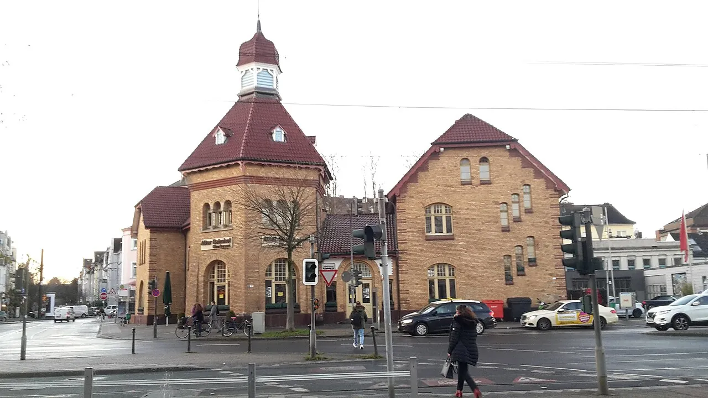

*Foto: Tischgenosse / Wikimedia Commons (CC BY-SA 3.0) – [Quelle](https://commons.wikimedia.org/wiki/File:Alter_Bahnhof_Oberkassel_2018.jpg)*

Der **Alte Bahnhof** am Belsenplatz in Düsseldorf-Oberkassel ist eine Hausbrauerei mit Restaurant im denkmalgeschützten früheren Bahnhofsgebäude. Der Bahnhof wurde im Januar 1853 an der Strecke von Mönchengladbach nach Düsseldorf eröffnet, das heutige Empfangsgebäude stammt von 1896. Wegen der Konkurrenz der Straßenbahn wurde der Personenverkehr 1902 eingestellt, der Güterverkehr endete 1972.

Schon 1902 wurden die Warteräume zu einem **Restaurant** umgebaut. Nach einer Sanierung in den 1990er-Jahren eröffnete dort das Brauhaus Belsenbräu, das später mehrfach umbenannt wurde. Seit 2008 braut das Haus wieder eigenes Bier. Zum Brauhaus gehören Schwemme, Restaurant, **Biergarten** und Festräume, die Küche ist rheinisch-gutbürgerlich.

Quellen je Satz

1. Der Alte Bahnhof am Belsenplatz in Düsseldorf-Oberkassel ist eine Hausbrauerei m… — https://www.brauhaus-alterbahnhof.de/
2. Der Bahnhof wurde im Januar 1853 an der Strecke von Mönchengladbach nach Düsseld… — https://de.wikipedia.org/wiki/Alter_Bahnhof_Oberkassel
3. Wegen der Konkurrenz der Straßenbahn wurde der Personenverkehr 1902 eingestellt,… — https://de.wikipedia.org/wiki/Alter_Bahnhof_Oberkassel
4. Schon 1902 wurden die Warteräume zu einem Restaurant umgebaut. — https://de.wikipedia.org/wiki/Alter_Bahnhof_Oberkassel
5. Nach einer Sanierung in den 1990er-Jahren eröffnete dort das Brauhaus Belsenbräu… — https://de.wikipedia.org/wiki/Alter_Bahnhof_Oberkassel
6. Seit 2008 braut das Haus wieder eigenes Bier. — https://de.wikipedia.org/wiki/Alter_Bahnhof_Oberkassel
7. Zum Brauhaus gehören Schwemme, Restaurant, Biergarten und Festräume, die Küche i… — https://www.brauhaus-alterbahnhof.de/

> Hinweis der Recherche: Laut Wikipedia gab es nach dem Zweiten Weltkrieg kurzzeitig wieder Personenverkehr – im Text daher nur „eingestellt“ ohne „endgültig“. Website nennt 1853 als Eröffnung des Bahnhofs, das Gebäude selbst ist laut Wikipedia von 1896. Haltestelle nicht ausdrücklich belegt (Belsenplatz naheliegend). Kapazitäten nicht angegeben.

---

### Another Cotton Lab Store

`/orte/another-cotton-lab-store` · 6 Sätze · Website: https://anothercotton.com

Der **Another Cotton Lab Store** in der **Carlstadt** ist der erste Flagship-Store der in Düsseldorf verwurzelten Modemarke Another Cotton Lab. Der Laden wurde im April 2025 eröffnet. Präsentiert wird die Ware auf dunklen Holzmöbeln über einem Fischgrätparkett.

Zu den bekanntesten Stücken der Marke gehören Shirts und Hoodies mit dem Aufdruck „Sunday Running Club“. Der gleichnamige **Sunday Running Club** ist ein Lauftreff der Marke, der sonntags morgens vor dem Laden startet. Nach dem Lauf gibt es Kaffee im Store, einmal im Monat finden zudem größere Sonderläufe statt.

Quellen je Satz

1. Der Another Cotton Lab Store in der Carlstadt ist der erste Flagship-Store der i… — https://www.visitduesseldorf.de/storys/2025/12/16/another-cotton-lab-carlstadt-duesseldorf/
2. Der Laden wurde im April 2025 eröffnet. — https://www.visitduesseldorf.de/storys/2025/12/16/another-cotton-lab-carlstadt-duesseldorf/
3. Präsentiert wird die Ware auf dunklen Holzmöbeln über einem Fischgrätparkett. — https://www.visitduesseldorf.de/storys/2025/12/16/another-cotton-lab-carlstadt-duesseldorf/
4. Zu den bekanntesten Stücken der Marke gehören Shirts und Hoodies mit dem Aufdruc… — https://www.visitduesseldorf.de/storys/2025/12/16/another-cotton-lab-carlstadt-duesseldorf/
5. Der gleichnamige Sunday Running Club ist ein Lauftreff der Marke, der sonntags m… — https://www.visitduesseldorf.de/storys/2025/12/16/another-cotton-lab-carlstadt-duesseldorf/
6. Nach dem Lauf gibt es Kaffee im Store, einmal im Monat finden zudem größere Sond… — https://www.visitduesseldorf.de/storys/2025/12/16/another-cotton-lab-carlstadt-duesseldorf/

> Hinweis der Recherche: textilwirtschaft.de (Artikel zum ersten Store: Bastionstraße 10, ca. 120 m², Gestaltung mit hellblauem Tresen und leuchtenden Säulen) sperrt ClaudeBot/anthropic-ai per robots.txt – daher nicht als Beleg verwendet, Angaben gestrichen. Kein sauberes Bild: Die Ladenfotos im visitduesseldorf-Artikel stammen von einem Fotografen (Eugen Shkolnikov), nicht vom Haus; Commons nicht ergiebig. Die robots.txt von anothercotton.com enthält an KI-Agenten gerichtete Werbetexte (Shop-App installieren) – ignoriert. Teilnehmerzahlen des Lauftreffs bewusst weggelassen (veralten).

---

### Aquazoo Löbbecke Museum

`/orte/aquazoo-loebbecke-museum` · 9 Sätze · Website: https://aquazoo-duesseldorf.de/

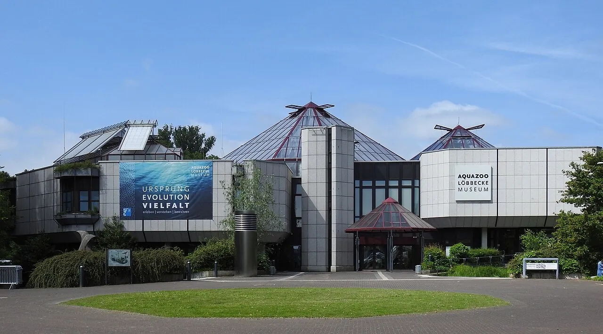

*Foto: Stefan3345 / Wikimedia Commons (CC BY-SA 4.0) – [Quelle](https://commons.wikimedia.org/wiki/File:Au%C3%9Fenansicht_PS_(82).jpg)*

Das **Aquazoo Löbbecke Museum** ist eine Einrichtung der Stadt Düsseldorf, die Zoo, Aquarium und Naturkundemuseum unter einem Dach verbindet. Seine Wurzeln liegen in der Sammlung des Apothekers **Theodor Löbbecke**, die nach seinem Tod 1901 an die Stadt fiel. Als Löbbecke-Museum wurde die Sammlung 1904 in der Altstadt eröffnet und 1930 in den damaligen Düsseldorfer Zoo eingegliedert.

Nach schweren Kriegsschäden im Jahr 1944 war die Einrichtung zunächst provisorisch in einem Hochbunker untergebracht. 1987 zog sie in einen Neubau im **Nordpark**, wo sie bis heute ihren Sitz hat. Nach einer umfassenden Sanierung ab 2013 wurde das Haus im September 2017 wiedereröffnet.

Der Rundgang führt durch Themenräume mit Aquarien, Terrarien und einer **Tropenhalle** und folgt der Entwicklung des Lebens vom Meer über das Süßwasser bis an Land. Ergänzt werden die lebenden Tiere durch Skelette, Präparate und Minerale. Die nächste Haltestelle ist **Nordpark/Aquazoo**, angefahren von den U-Bahn-Linien U78 und U79.

Quellen je Satz

1. Das Aquazoo Löbbecke Museum ist eine Einrichtung der Stadt Düsseldorf, die Zoo, … — https://www.duesseldorf.de/aquazoo
2. Seine Wurzeln liegen in der Sammlung des Apothekers Theodor Löbbecke, die nach s… — https://de.wikipedia.org/wiki/Aquazoo_–_Löbbecke_Museum
3. Als Löbbecke-Museum wurde die Sammlung 1904 in der Altstadt eröffnet und 1930 in… — https://de.wikipedia.org/wiki/Aquazoo_–_Löbbecke_Museum
4. Nach schweren Kriegsschäden im Jahr 1944 war die Einrichtung zunächst provisoris… — https://de.wikipedia.org/wiki/Aquazoo_–_Löbbecke_Museum
5. 1987 zog sie in einen Neubau im Nordpark, wo sie bis heute ihren Sitz hat. — https://de.wikipedia.org/wiki/Aquazoo_–_Löbbecke_Museum
6. Nach einer umfassenden Sanierung ab 2013 wurde das Haus im September 2017 wieder… — https://de.wikipedia.org/wiki/Aquazoo_–_Löbbecke_Museum
7. Der Rundgang führt durch Themenräume mit Aquarien, Terrarien und einer Tropenhal… — https://de.wikipedia.org/wiki/Aquazoo_–_Löbbecke_Museum
8. Ergänzt werden die lebenden Tiere durch Skelette, Präparate und Minerale. — https://aquazoo-duesseldorf.de/
9. Die nächste Haltestelle ist Nordpark/Aquazoo, angefahren von den U-Bahn-Linien U… — https://aquazoo-duesseldorf.de/

> Hinweis der Recherche: Tier- und Artenzahlen widersprüchlich (Wikipedia: ca. 5.000 Tiere/560 Arten, Website: über 6.000 Tiere/570 Arten), daher weggelassen.

---

### Areal Böhler

`/orte/areal-boehler` · 7 Sätze · Website: https://areal-boehler.de/

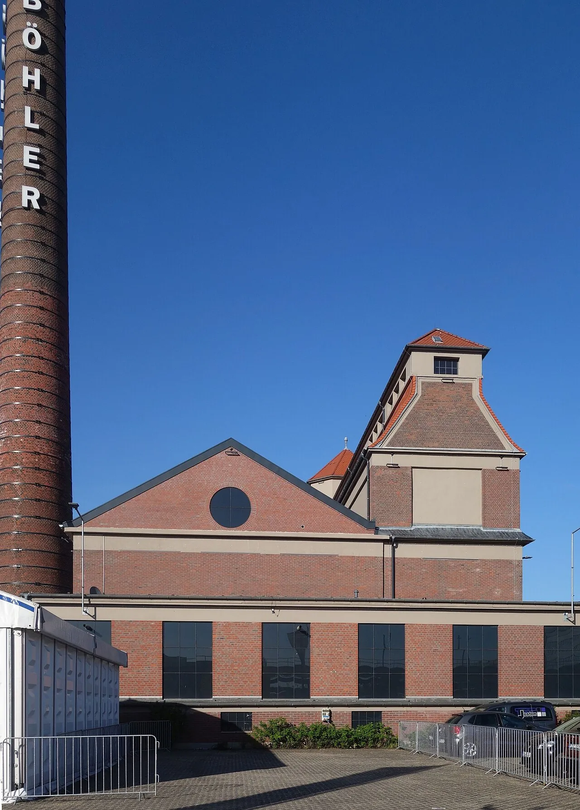

*Foto: Kürschner / Wikimedia Commons (CC0) – [Quelle](https://commons.wikimedia.org/wiki/File:Areal_B%C3%B6hler,_D%C3%BCsseldorf,_April_2025_(2).jpg)*

Das **Areal Böhler** ist ein früheres Stahlwerksgelände an der Grenze zwischen Düsseldorf und Meerbusch, dessen denkmalgeschützte **Industriearchitektur** heute für Messen, Events und Kongresse genutzt wird. Das österreichische Unternehmen Böhler kaufte das Grundstück in Büderich 1914 und nahm 1915 die Stahlproduktion auf. Das Pförtnerhaus entstand auf Düsseldorfer Gebiet, wodurch das Werk eine Düsseldorfer Adresse erhielt. Die Produktion in Schmiede und Stahlwerk endete 1993.

Das Gelände umfasst rund 230.000 Quadratmeter, davon dienen etwa 18.000 Quadratmeter in Hallen und 10.000 Quadratmeter im Freien als **Eventflächen**. Zu den Veranstaltungen gehört etwa die Kunstmesse **Art Düsseldorf**. Außerdem gibt es Gastronomie und Freizeitangebote wie Padel, Wellenreiten und Beachvolleyball.

Quellen je Satz

1. Das Areal Böhler ist ein früheres Stahlwerksgelände an der Grenze zwischen Düsse… — https://areal-boehler.de/
2. Das österreichische Unternehmen Böhler kaufte das Grundstück in Büderich 1914 un… — https://de.wikipedia.org/wiki/Datei:Areal_B%C3%B6hler,_November_2016.jpg
3. Das Pförtnerhaus entstand auf Düsseldorfer Gebiet, wodurch das Werk eine Düsseld… — https://de.wikipedia.org/wiki/Datei:Areal_B%C3%B6hler,_November_2016.jpg
4. Die Produktion in Schmiede und Stahlwerk endete 1993. — https://de.wikipedia.org/wiki/Datei:Areal_B%C3%B6hler,_November_2016.jpg
5. Das Gelände umfasst rund 230.000 Quadratmeter, davon dienen etwa 18.000 Quadratm… — https://areal-boehler.de/
6. Zu den Veranstaltungen gehört etwa die Kunstmesse Art Düsseldorf. — https://areal-boehler.de/
7. Außerdem gibt es Gastronomie und Freizeitangebote wie Padel, Wellenreiten und Be… — https://areal-boehler.de/

> Hinweis der Recherche: LAGE PRÜFEN: Das Areal liegt überwiegend in Meerbusch-Büderich (eigene Adresse der Website: Böhlerstraße 1, 40667 Meerbusch); nur das Pförtnerhaus/die Postadresse Hansaallee 321 liegt auf Düsseldorfer Gebiet. Text trotzdem geschrieben, da das Gelände die Stadtgrenze berührt. Geschichtsdaten stammen aus der Dateibeschreibung auf Wikipedia/Commons (kein eigener Wikipedia-Artikel abrufbar). Haltestelle nicht belegt.

---

### ASG-Bildungsforum Düsseldorf

`/orte/asg-bildungsforum-duesseldorf` · 4 Sätze · Website: https://www.asg-bildungsforum.de

Das **ASG-Bildungsforum** ist eine gemeinnützige Bildungseinrichtung, die seit 1954 besteht und sich auf ein christliches Menschenbild beruft. Träger ist die Arbeitsgemeinschaft Sozialpädagogik und Gesellschaftsbildung, ein gemeinnütziger Verein, der vom Land NRW als Weiterbildungsanbieter und Träger der freien Jugendhilfe anerkannt ist.

An der Gerresheimer Straße 90 in **Flingern** befinden sich die Zentrale und ein **Familientreff**. Das Programm reicht von Angeboten für Schwangere, Eltern und Familien über Sprach- und Deutschkurse bis zu Fitness, Kochkursen, Kunst, Politik und Glaubensthemen.

Quellen je Satz

1. Das ASG-Bildungsforum ist eine gemeinnützige Bildungseinrichtung, die seit 1954 … — https://www.asg-bildungsforum.de/
2. Träger ist die Arbeitsgemeinschaft Sozialpädagogik und Gesellschaftsbildung, ein… — https://www.ddorf-aktuell.de/?p=89405
3. An der Gerresheimer Straße 90 in Flingern befinden sich die Zentrale und ein Fam… — https://www.ddorf-aktuell.de/?p=89405
4. Das Programm reicht von Angeboten für Schwangere, Eltern und Familien über Sprac… — https://www.asg-bildungsforum.de/

> Hinweis der Recherche: Weitere Standorte laut Ddorf-Aktuell (2023): Sprachenzentrum Münsterstraße 304, Fitnesshalle Münsterstraße 121, Familientreffs Oberkassel und Rath. Kurs- und Stundenzahlen (über 3.000 Veranstaltungen) weggelassen, da veränderlich. Kein Gebäudefoto gefunden.

---

### Ashtanga Yoga Düsseldorf

`/orte/ashtanga-yoga-duesseldorf` · 3 Sätze · Website: https://astanga-yoga.net/

Die **Ashtanga Yoga Schule Düsseldorf** liegt in einem Hinterhof an der Grafenberger Allee, in der Nähe des Stauffenplatzes. Unterrichtet wird **Ashtanga Vinyasa Yoga**, unter anderem im Mysore Style, als Led Class und als Selfpractice. Der **Mysore Style** ist auch für Anfänger geeignet, daneben gibt es Anfängerkurse, Pranayama-Workshops und Einzelstunden.

Quellen je Satz

1. Die Ashtanga Yoga Schule Düsseldorf liegt in einem Hinterhof an der Grafenberger… — https://astanga-yoga.net/kurse/
2. Unterrichtet wird Ashtanga Vinyasa Yoga, unter anderem im Mysore Style, als Led … — https://astanga-yoga.net/kurse/
3. Der Mysore Style ist auch für Anfänger geeignet, daneben gibt es Anfängerkurse, … — https://astanga-yoga.net/kurse/

> Hinweis der Recherche: Die Schule nennt sich auf der eigenen Website „Ashtanga Yoga Schule Düsseldorf“. Kein Gründungsjahr und kein sauberes Gebäudefoto gefunden.

---

### ausARTen

`/orte/ausarten` · 3 Sätze · Website: https://ausarten-workshop.de/

**ausARTen** ist ein Anbieter von **Malworkshops** und Kreativ-Events in Düsseldorf. Das Programm reicht von offenen **Action-Painting**-Kursen bis zu privaten Formaten wie Brunch & Paint, Dance and Paint oder Familien-Workshops. Auch Teambuilding-Events und Junggesellenabschiede werden angeboten.

Quellen je Satz

1. ausARTen ist ein Anbieter von Malworkshops und Kreativ-Events in Düsseldorf.… — https://ausarten-workshop.de/
2. Das Programm reicht von offenen Action-Painting-Kursen bis zu privaten Formaten … — https://ausarten-workshop.de/
3. Auch Teambuilding-Events und Junggesellenabschiede werden angeboten. — https://ausarten-workshop.de/

> Hinweis der Recherche: Adresse Friedrichstraße 102 (Hinterhof, 2. OG) nur über Eventportal belegt, nicht auf der eigenen Website gefunden. Ein Eintrag nennt für dieselbe Adresse den Namen „Hofart“. Kein sauberes Raumfoto.

---

### b41

`/orte/b41` · 6 Sätze · Website: https://www.baustelle-schaustelle.de/

Das **b41** an der Brehmstraße ist der Düsseldorfer Ausstellungsraum von **Baustelle Schaustelle**, einem nicht-kommerziellen Projektraum für junge Kunst mit einem weiteren Standort in Essen. Der gemeinnützige Verein Baustelle Schaustelle wurde 2007 gegründet und fördert den künstlerischen Nachwuchs aus der Region.

Gezeigt werden vor allem **Einzel- und Gruppenausstellungen** junger Künstlerinnen und Künstler, für viele ist es die erste Ausstellung außerhalb der Hochschule. Der Verein vergibt zudem einen bundesweit ausgeschriebenen **Kunstpreis** für junge Künstlerinnen und Künstler, verbunden mit einer Ausstellung der prämierten Arbeiten. Seit September 2017 ergänzt die Reihe **ZU GAST** in Düsseldorf das Programm um Performances, Vorträge und Talks. Verkauft werden die ausgestellten Arbeiten vom Verein nicht.

Quellen je Satz

1. Das b41 an der Brehmstraße ist der Düsseldorfer Ausstellungsraum von Baustelle S… — https://www.baustelle-schaustelle.de/about/kontakt/
2. Der gemeinnützige Verein Baustelle Schaustelle wurde 2007 gegründet und fördert … — https://www.baustelle-schaustelle.de/about/ueber-uns/
3. Gezeigt werden vor allem Einzel- und Gruppenausstellungen junger Künstlerinnen u… — https://www.baustelle-schaustelle.de/about/ueber-uns/
4. Der Verein vergibt zudem einen bundesweit ausgeschriebenen Kunstpreis für junge … — https://www.baustelle-schaustelle.de/about/ueber-uns/
5. Seit September 2017 ergänzt die Reihe ZU GAST in Düsseldorf das Programm um Perf… — https://www.baustelle-schaustelle.de/about/ueber-uns/
6. Verkauft werden die ausgestellten Arbeiten vom Verein nicht. — https://www.baustelle-schaustelle.de/about/ueber-uns/

> Hinweis der Recherche: Die Bezeichnung „b41“ für den Düsseldorfer Raum steht in den Ausstellungstiteln auf der Startseite (z. B. „// b41 Düsseldorf“). Laut einer Event-Anzeige war der Kunstpreis 2026 „vorerst“ der letzte – daher ohne „jährlich“ formuliert. Kein Foto des Raums gefunden.

---

### Badminton-Center Mörsenbroich

`/orte/badminton-center-moersenbroich` · 4 Sätze · Website: https://www.badminton-center.com/

Das **Badminton-Center Mörsenbroich** ist eine Badmintonhalle am Vogelsanger Weg im Düsseldorfer Stadtteil **Mörsenbroich**. Die Halle bietet 18 Felder mit gelenkschonendem **Schwingboden** und LED-Beleuchtung. Zur Anlage gehört ein Badminton-Fachgeschäft mit Besaitungsservice. Direkt an der Halle stehen Parkplätze zur Verfügung.

Quellen je Satz

1. Das Badminton-Center Mörsenbroich ist eine Badmintonhalle am Vogelsanger Weg im … — https://www.badminton-center.com/
2. Die Halle bietet 18 Felder mit gelenkschonendem Schwingboden und LED-Beleuchtung… — https://www.badminton-center.com/
3. Zur Anlage gehört ein Badminton-Fachgeschäft mit Besaitungsservice. — https://www.badminton-center.com/
4. Direkt an der Halle stehen Parkplätze zur Verfügung. — https://www.badminton-center.com/

> Hinweis der Recherche: Kein Eröffnungsjahr und keine Haltestelle belegt; kein sauberes Hallenfoto gefunden.

---

### BALLABALLA

`/orte/ballaballa` · 6 Sätze · Website: https://www.ballaballa.fun/

**BallaBalla** ist eine Bar an der Derendorfer Straße, in der Gäste **Tischtennis** spielen können. Neben Platten für zwei bis sechs Personen gibt es eine Rundlauf-Suite für bis zu acht Personen. Zum Programm gehören Rundlauf-Partys, Community-Treffen und Disco-Abende.

Gegründet wurde BallaBalla von **Alain Bieber**, zuvor künstlerischer Leiter des NRW-Forums. Der Ort startete 2025 als Pop-up im **Düwell**, einer Galerie-Mall an der Grünstraße nahe der Kö. Die Tischtennisplatten stammen vom schwedischen Hersteller Stiga.

Quellen je Satz

1. BallaBalla ist eine Bar an der Derendorfer Straße, in der Gäste Tischtennis spie… — https://www.ballaballa.fun/
2. Neben Platten für zwei bis sechs Personen gibt es eine Rundlauf-Suite für bis zu… — https://www.ballaballa.fun/
3. Zum Programm gehören Rundlauf-Partys, Community-Treffen und Disco-Abende. — https://www.ballaballa.fun/
4. Gegründet wurde BallaBalla von Alain Bieber, zuvor künstlerischer Leiter des NRW… — https://www.visitduesseldorf.de/attraktionen/ballaballa-357617eba7
5. Der Ort startete 2025 als Pop-up im Düwell, einer Galerie-Mall an der Grünstraße… — https://www.visitduesseldorf.de/storys/2025/12/05/balla-balla-mit-alain-bieber/
6. Die Tischtennisplatten stammen vom schwedischen Hersteller Stiga. — https://www.visitduesseldorf.de/storys/2025/12/05/balla-balla-mit-alain-bieber/

> Hinweis der Recherche: Ursprünglich Pop-up im Düwell (Grünstraße); Zeitpunkt des Umzugs an die Derendorfer Str. 50 nicht belegt. Einige Verzeichnisse nennen noch Grünstraße 15 oder Am Heerdter Hof 38 (Sommer-Ableger). Kein sauberes Gebäudefoto (og:image unklar).

---

### Balletthaus

`/orte/balletthaus` · 8 Sätze · Website: https://www.operamrhein.de/en/your-visit/balletthaus/

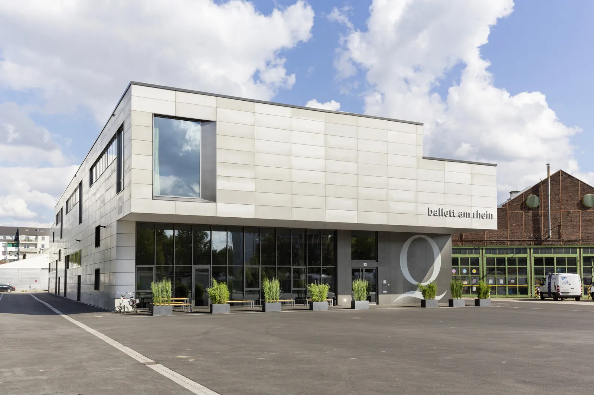

*Foto: Deutsche Oper am Rhein – [Quelle](https://www.operamrhein.de/en/your-visit/balletthaus/)*

Das Balletthaus in **Düsseldorf-Bilk** ist das Probenhaus des **Ballett am Rhein** und wurde eigens für die Compagnie gebaut. Seit Beginn der Spielzeit 2015/16 trainiert und probt das Ensemble dort. Entworfen hat den Bau das Architekturbüro von Gerkan, Marg und Partner. Errichtet wurde er als öffentlich-private Partnerschaft der Stadt Düsseldorf mit Hochtief in nur zehn Monaten.

Auf rund 3.000 Quadratmetern Fläche gibt es fünf **Ballettsäle**, dazu Garderoben, Büros, Aufenthaltsräume und einen Bereich für Reha und Therapie. Studio 1 bietet 112 Plätze und lässt sich mit Verdunklung und Theaterlicht in eine **Blackbox-Bühne** verwandeln. Das Haus liegt nahe dem historischen Rheinbahn-Depot „Am Steinberg“. Die nächsten Haltestellen sind „Merowingerstraße“ (Busse 835 und 836) und „Am Steinberg“ (Straßenbahnen 701 und 706).

Quellen je Satz

1. Das Balletthaus in Düsseldorf-Bilk ist das Probenhaus des Ballett am Rhein und w… — https://www.operamrhein.de/en/your-visit/balletthaus/
2. Seit Beginn der Spielzeit 2015/16 trainiert und probt das Ensemble dort. — https://www.operamrhein.de/en/your-visit/balletthaus/
3. Entworfen hat den Bau das Architekturbüro von Gerkan, Marg und Partner. — https://www.operamrhein.de/en/your-visit/balletthaus/
4. Errichtet wurde er als öffentlich-private Partnerschaft der Stadt Düsseldorf mit… — https://www.operamrhein.de/en/your-visit/balletthaus/
5. Auf rund 3.000 Quadratmetern Fläche gibt es fünf Ballettsäle, dazu Garderoben, B… — https://www.operamrhein.de/en/your-visit/balletthaus/
6. Studio 1 bietet 112 Plätze und lässt sich mit Verdunklung und Theaterlicht in ei… — https://www.operamrhein.de/en/your-visit/balletthaus/
7. Das Haus liegt nahe dem historischen Rheinbahn-Depot „Am Steinberg“. — https://www.operamrhein.de/en/your-visit/balletthaus/
8. Die nächsten Haltestellen sind „Merowingerstraße“ (Busse 835 und 836) und „Am St… — https://www.operamrhein.de/en/your-visit/balletthaus/

> Hinweis der Recherche: Bild: Außenansicht des Balletthauses von der offiziellen Seite; Fotograf auf der Seite nicht genannt, der Dateiname deutet auf Christoph Schroll hin (ggf. als Nachweis ergänzen). Kein passendes Commons-Bild gefunden. Die Seite nennt als Baubeginn den 03.07.2015, was nicht zum Bezug zur Spielzeit 2015/16 nach zehn Monaten Bauzeit passt; Datum daher weggelassen.

---

### Bambi Filmstudio

`/orte/bambi` · 8 Sätze · Website: https://filmkunstkinos.de/kinos/bambi/

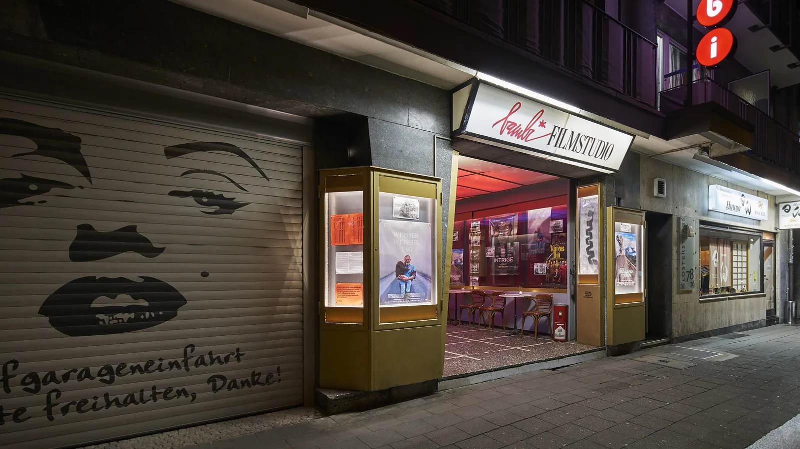

*Foto: Bambi Filmstudio / Düsseldorfer Filmkunstkinos – [Quelle](https://filmkunstkinos.de/kinos/bambi/)*

Das **Bambi Filmstudio** an der Klosterstraße ist ein Kino in der Düsseldorfer Innenstadt und gehört zusammen mit Atelier, Cinema und Metropol zu den Düsseldorfer Filmkunstkinos. Eröffnet wurde es im November 1963 von einem Filmverleiher. Nach einer Phase als Erstaufführungskino wird es seit 1965 als **Programmkino** betrieben und zählt damit zu den ältesten Häusern dieser Art in der Stadt.

Der **große Saal** mit 133 Plätzen ist seit der Eröffnung weitgehend unverändert, seine Decke mit rundem Sternenhimmel soll an ein Zirkuszelt erinnern. Ein zweiter, kleinerer Saal hat 66 Plätze, beide Säle sind mit digitaler Projektion und 5.1-Ton ausgestattet. Im Foyer gibt es ein **Kino-Café**, im Sommer wird auch das Außenfoyer genutzt.

Zum Programm gehören Filmkunst-Erstaufführungen, Kinderkino, Anime-Reihen und Sneak Previews. Die nächste Haltestelle ist **Klosterstraße** (Straßenbahn 707), etwa eine Gehminute entfernt.

Quellen je Satz

1. Das Bambi Filmstudio an der Klosterstraße ist ein Kino in der Düsseldorfer Innen… — https://filmkunstkinos.de/kinos/bambi/
2. Eröffnet wurde es im November 1963 von einem Filmverleiher. — https://www.visitduesseldorf.de/attraktionen/bambi-f9bd17d329
3. Nach einer Phase als Erstaufführungskino wird es seit 1965 als Programmkino betr… — https://filmkunstkinos.de/kinos/bambi/
4. Der große Saal mit 133 Plätzen ist seit der Eröffnung weitgehend unverändert, se… — https://filmkunstkinos.de/kinos/bambi/
5. Ein zweiter, kleinerer Saal hat 66 Plätze, beide Säle sind mit digitaler Projekt… — https://filmkunstkinos.de/kinos/bambi/
6. Im Foyer gibt es ein Kino-Café, im Sommer wird auch das Außenfoyer genutzt. — https://filmkunstkinos.de/kinos/bambi/
7. Zum Programm gehören Filmkunst-Erstaufführungen, Kinderkino, Anime-Reihen und Sn… — https://filmkunstkinos.de/kinos/bambi/
8. Die nächste Haltestelle ist Klosterstraße (Straßenbahn 707), etwa eine Gehminute… — https://filmkunstkinos.de/kinos/bambi/

> Hinweis der Recherche: Name des Gründers widersprüchlich geschrieben (visitduesseldorf: Erich J.A. Pietrek, filmkunstkinos.de: Pietreck), daher weggelassen. visitduesseldorf nennt das Bambi das älteste Programmkino Düsseldorfs, die eigene Website nur eines der ältesten, daher die vorsichtigere Formulierung.

---

### BASH ROOMS Düsseldorf

`/orte/bash-rooms-duesseldorf` · 6 Sätze · Website: https://www.bash-rooms.de/duesseldorf

**BASH ROOMS** an der Theodorstraße in Düsseldorf-Rath bietet eine live moderierte **Spielshow für Gruppen**, die etwa zweieinhalb Stunden dauert. Die Teilnehmenden treten in Teams in Spielen aus den Bereichen Wissen, Taktik, Geschick und Sport gegeneinander an, etwa beim Leitergolf, Speed-Stacking oder Domino. Der Standort hat drei Räume für jeweils bis zu 25 Personen, sodass bis zu 75 Gäste parallel spielen können.

Düsseldorf war der erste Standort des Anbieters und öffnete im Februar 2020, inzwischen gibt es Ableger in neun Städten. Gebucht wird die Show unter anderem für **Firmenevents**, Geburtstage und Junggesellenabschiede. Direkt vor dem Gebäude liegt die Haltestelle Wahlerstraße/JVA der Straßenbahnlinie 701, nebenan der **PSD Bank Dome**.

Quellen je Satz

1. BASH ROOMS an der Theodorstraße in Düsseldorf-Rath bietet eine live moderierte S… — https://www.bash-rooms.de/duesseldorf
2. Die Teilnehmenden treten in Teams in Spielen aus den Bereichen Wissen, Taktik, G… — https://www.bash-rooms.de/duesseldorf
3. Der Standort hat drei Räume für jeweils bis zu 25 Personen, sodass bis zu 75 Gäs… — https://www.bash-rooms.de/duesseldorf
4. Düsseldorf war der erste Standort des Anbieters und öffnete im Februar 2020, inz… — https://www.bash-rooms.de/duesseldorf
5. Gebucht wird die Show unter anderem für Firmenevents, Geburtstage und Junggesell… — https://www.bash-rooms.de/duesseldorf
6. Direkt vor dem Gebäude liegt die Haltestelle Wahlerstraße/JVA der Straßenbahnlin… — https://www.bash-rooms.de/duesseldorf

> Hinweis der Recherche: Website-Fotos zeigen vor allem Gästegruppen, keine eindeutig Düsseldorfer Raumaufnahme – daher kein Bild. Bewertungsangaben der Website nicht übernommen.

---

### BBK Kunstforum Düsseldorf

`/orte/bbk-kunstforum-duesseldorf` · 4 Sätze · Website: https://www.bbk-duesseldorf.de/

Das BBK Kunstforum ist der **Ausstellungs- und Veranstaltungsraum** des BBK Düsseldorf, der Berufsvertretung bildender Künstlerinnen und Künstler in der Stadt. Der Verband ist eine regionale Gliederung des Bundesverbands Bildender Künstlerinnen und Künstler und setzt sich für die **kulturpolitischen und sozialen Interessen** von Kunstschaffenden ein. Gezeigt werden Arbeiten von Mitgliedern, Gästen und befreundeten Kulturvereinen. Daneben finden Workshops, Vorträge sowie Musik- und Literaturprojekte statt.

Quellen je Satz

1. Das BBK Kunstforum ist der Ausstellungs- und Veranstaltungsraum des BBK Düsseldo… — https://www.bbk-duesseldorf.de/
2. Der Verband ist eine regionale Gliederung des Bundesverbands Bildender Künstleri… — https://www.bbk-duesseldorf.de/
3. Gezeigt werden Arbeiten von Mitgliedern, Gästen und befreundeten Kulturvereinen. — https://www.bbk-duesseldorf.de/
4. Daneben finden Workshops, Vorträge sowie Musik- und Literaturprojekte statt. — https://www.bbk-duesseldorf.de/

> Hinweis der Recherche: Gründungsjahr und Raumgröße nicht gefunden. Liegt laut Eventportalen im Hinterhof der Birkenstraße 47, auf demselben Gelände wie die Sammlung Philara (47a).

---

### Beerpongbar Düsseldorf

`/orte/beerpongbar-duesseldorf` · 4 Sätze · Website: https://beerpongbar-duesseldorf.de

Die **Beerpongbar Düsseldorf** an der Bolkerstraße liegt mitten in der **Altstadt**. Sie versteht sich als Erlebnisbar, in der neben **Beer Pong** auch Karaoke, Darts und weitere Spiele angeboten werden. Zum Haus gehören ein Private Room, ein Neon-Karaokeraum und mehrere Séparées, darunter eines im Stil „Old Düsseldorf“. Gebucht wird die Bar unter anderem für Firmenfeiern, Junggesellenabschiede, Geburtstage und Teamevents, außerdem finden dort Beerpong-Turniere statt.

Quellen je Satz

1. Die Beerpongbar Düsseldorf an der Bolkerstraße liegt mitten in der Altstadt.… — https://beerpongbar-duesseldorf.de/
2. Sie versteht sich als Erlebnisbar, in der neben Beer Pong auch Karaoke, Darts un… — https://beerpongbar-duesseldorf.de/
3. Zum Haus gehören ein Private Room, ein Neon-Karaokeraum und mehrere Séparées, da… — https://beerpongbar-duesseldorf.de/
4. Gebucht wird die Bar unter anderem für Firmenfeiern, Junggesellenabschiede, Gebu… — https://beerpongbar-duesseldorf.de/

> Hinweis der Recherche: Fotos auf der Website zeigen vor allem Personen (Gäste, Barpersonal), daher kein Bild. Angabe eines Eventportals, es sei Deutschlands erste Beerpongbar, nicht belegt und weggelassen; Eröffnungsjahr und Kapazität nicht auf der offiziellen Seite.

---

### Berger Kirche

`/orte/berger-kirche` · 8 Sätze · Website: –

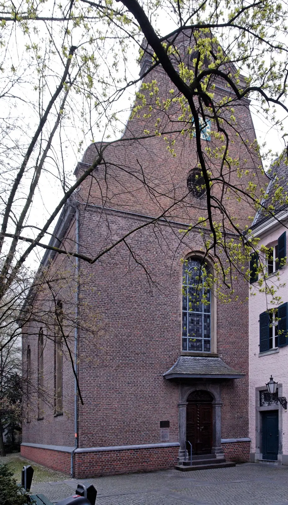

*Foto: Wiegels / Wikimedia Commons (CC BY 3.0) – [Quelle](https://commons.wikimedia.org/wiki/File:Berger_Kirche_in_Duesseldorf-Altstadt,_von_Westen.jpg)*

Die **Berger Kirche** ist eine evangelische Kirche aus dem 17. Jahrhundert in der Düsseldorfer Altstadt. Sie war die erste Kirche, die die lutherische Gemeinde in Düsseldorf errichtete, und wurde nach Baubeginn 1683 im August 1687 eingeweiht. Weil Lutheraner im katholisch geprägten Düsseldorf damals nur geduldet waren, entstand sie als **Hofkirche** in einem Hinterhof, seitlich grenzt sie an die Wallstraße.

Die schlichte **Saalkirche** aus rotem Backstein zeigt späte Formen der deutschen Renaissance, die Ausstattung wurde im Barock überformt. 1943 wurde sie im Krieg weitgehend zerstört und nach dem Wiederaufbau 1966 neu eingeweiht.

Seit 2003 steht die Kirche der **Diakonie Düsseldorf** zur Verfügung. Der Künstler Tobias Rehberger gestaltete den Innenraum neu, unter anderem mit einem Acrylglas-Altar, der elektronisch mit der Johanneskirche und St. Lambertus verbunden ist und bei Geräuschen in diesen Kirchen heller leuchtet. Auf dem Außengelände wurde 2011 ein **Trauerort** für Menschen eingerichtet, die die Gräber ihrer Angehörigen nicht besuchen können.

Quellen je Satz

1. Die Berger Kirche ist eine evangelische Kirche aus dem 17. Jahrhundert in der Dü… — https://de.wikipedia.org/wiki/Berger_Kirche_(D%C3%BCsseldorf)
2. Sie war die erste Kirche, die die lutherische Gemeinde in Düsseldorf errichtete,… — https://de.wikipedia.org/wiki/Berger_Kirche_(D%C3%BCsseldorf)
3. Weil Lutheraner im katholisch geprägten Düsseldorf damals nur geduldet waren, en… — https://de.wikipedia.org/wiki/Berger_Kirche_(D%C3%BCsseldorf)
4. Die schlichte Saalkirche aus rotem Backstein zeigt späte Formen der deutschen Re… — https://de.wikipedia.org/wiki/Berger_Kirche_(D%C3%BCsseldorf)
5. 1943 wurde sie im Krieg weitgehend zerstört und nach dem Wiederaufbau 1966 neu e… — https://de.wikipedia.org/wiki/Berger_Kirche_(D%C3%BCsseldorf)
6. Seit 2003 steht die Kirche der Diakonie Düsseldorf zur Verfügung. — https://de.wikipedia.org/wiki/Berger_Kirche_(D%C3%BCsseldorf)
7. Der Künstler Tobias Rehberger gestaltete den Innenraum neu, unter anderem mit ei… — https://de.wikipedia.org/wiki/Berger_Kirche_(D%C3%BCsseldorf)
8. Auf dem Außengelände wurde 2011 ein Trauerort für Menschen eingerichtet, die die… — https://de.wikipedia.org/wiki/Berger_Kirche_(D%C3%BCsseldorf)

> Hinweis der Recherche: Keine eigene Website gefunden; die in Wikipedia verlinkte Diakonie-Unterseite ist veraltet (Diakonie Düsseldorf: https://www.diakonie-duesseldorf.de/). Original-Bild ist nur 913 px breit, daher liefert die API die Originaldatei statt einer 1280-px-Vorschau.

---

### Bergischer Löwe Düsseldorf

`/orte/bergischer-loewe-duesseldorf` · 6 Sätze · Website: –

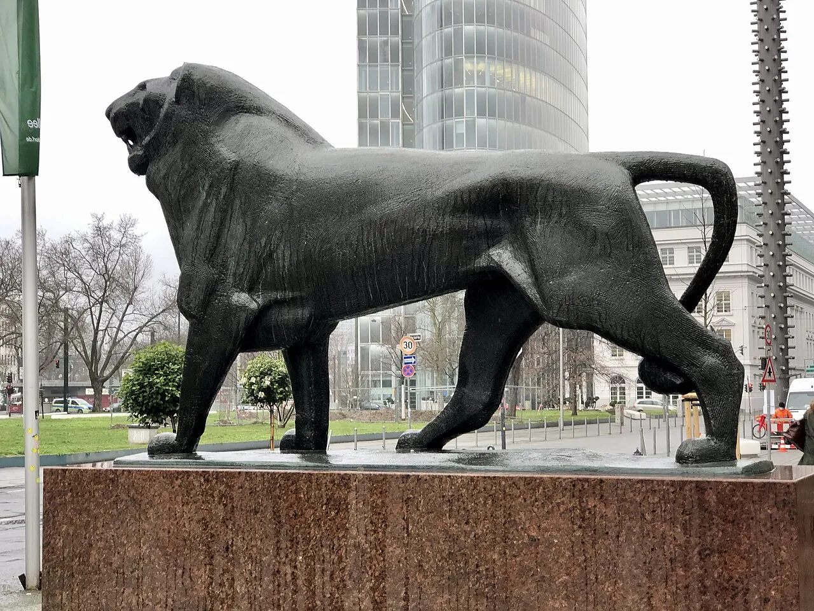

*Foto: Velopilger / Wikimedia Commons (CC BY-SA 4.0) – [Quelle](https://commons.wikimedia.org/wiki/File:2021-01-27-Bergischer_L%C3%B6we-1.jpg)*

Am Graf-Adolf-Platz, am südlichen Ende der **Königsallee** an der Kreuzung mit der Graf-Adolf-Straße, steht der **Bergische Löwe**, ein Denkmal aus Bronze. Aufgestellt wurde er 1963 zum 675-jährigen Jubiläum der Stadt. Die Plastik eines schreitenden Löwen schuf der Bildhauer Philipp Harth, gestiftet wurde sie vom Bankhaus Trinkaus.

Zwei frühere Fassungen aus **Holz** von Johannes Knubel hielten dem Wetter am Rhein und den Bombenangriffen von 1942 nicht stand. Der Löwe erscheint zusammen mit einem Anker auch im **Düsseldorfer Stadtwappen**. Er gilt als Kultfigur und gab dem Düsseldorfer Löwensenf seinen Namen.

Quellen je Satz

1. Am Graf-Adolf-Platz, am südlichen Ende der Königsallee an der Kreuzung mit der G… — https://www.visitduesseldorf.de/en/attractions/bergischer-loewe-lion-b6b55250df
2. Aufgestellt wurde er 1963 zum 675-jährigen Jubiläum der Stadt. — https://www.visitduesseldorf.de/en/attractions/bergischer-loewe-lion-b6b55250df
3. Die Plastik eines schreitenden Löwen schuf der Bildhauer Philipp Harth, gestifte… — https://de.wikipedia.org/wiki/Philipp_Harth
4. Zwei frühere Fassungen aus Holz von Johannes Knubel hielten dem Wetter am Rhein … — https://www.visitduesseldorf.de/en/attractions/bergischer-loewe-lion-b6b55250df
5. Der Löwe erscheint zusammen mit einem Anker auch im Düsseldorfer Stadtwappen.… — https://www.visitduesseldorf.de/en/attractions/bergischer-loewe-lion-b6b55250df
6. Er gilt als Kultfigur und gab dem Düsseldorfer Löwensenf seinen Namen. — https://www.visitduesseldorf.de/en/attractions/bergischer-loewe-lion-b6b55250df

> Hinweis der Recherche: Kein Lokal: Der Bergische Löwe ist ein Bronzedenkmal (vermutlich Treffpunkt, z. B. für Führungen); die Art „Club/Bar/Kneipe“ passt nicht. Schreibweise des Bildhauers widersprüchlich: visitduesseldorf.de schreibt „Philipp Hart“, Wikipedia „Philipp Harth“ – im Text Harth (Wikipedia-Artikel des Künstlers). Keine offizielle Website.

---

### Bilker Bunker

`/orte/bilker-bunker` · 7 Sätze · Website: https://bilkerbunker.de/

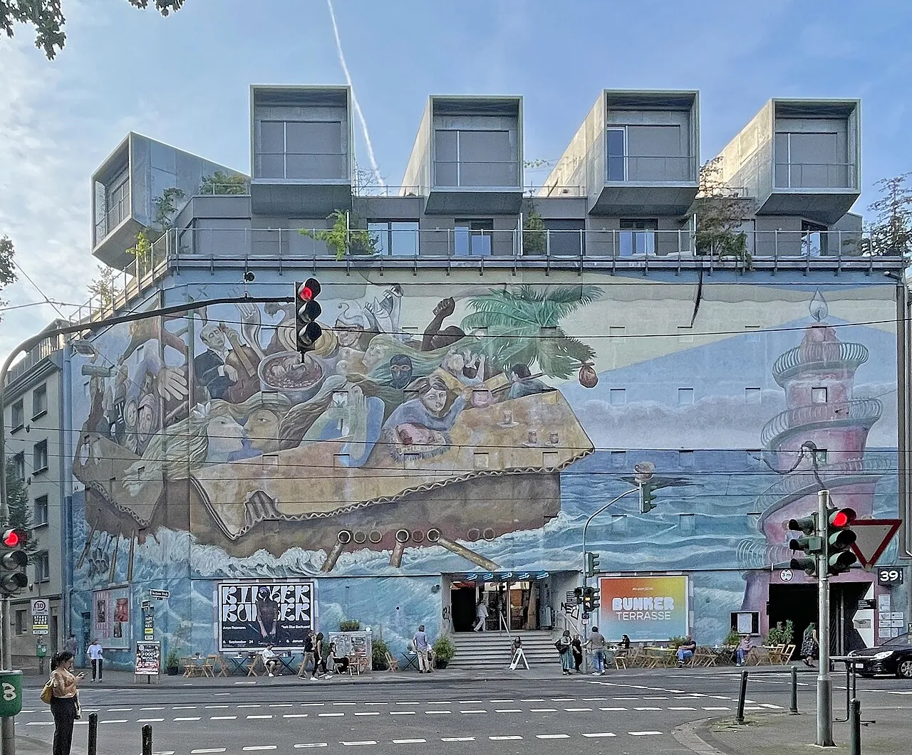

*Foto: Jula2812 / Wikimedia Commons (CC0) – [Quelle](https://commons.wikimedia.org/wiki/File:Bilker_Bunker,_Aachener_Stra%C3%9Fe_39,_D%C3%BCsseldorf-Bilk.jpg)*

Der **Bilker Bunker** an der Aachener Straße in Bilk ist ein früherer ziviler Schutzraum, der heute als gemeinnützige **Kulturinstitution** genutzt wird. Betrieben wird das Haus von der Bilker Bunker gGmbH. Auf den Bunker wurden fünf Kuben mit privaten Wohnungen aufgesetzt.

Erdgeschoss und erstes Obergeschoss dienen als **Ausstellungsräume** für wechselnde zeitgenössische Kunst. Im ersten Untergeschoss liegt die Musikbar **Schleuse Zwei** mit DJ-Abenden, Live-Auftritten und Konzerten. Weitere Etagen nehmen Showrooms, eine Fahrradgarage und Büros auf, im zweiten Untergeschoss gibt es mietbare Multiräume etwa für Bandproben oder Yoga. Vor dem Eingang liegt eine Terrasse mit Außengastronomie.

Quellen je Satz

1. Der Bilker Bunker an der Aachener Straße in Bilk ist ein früherer ziviler Schutz… — https://www.visitduesseldorf.de/attraktionen/bilker-bunker-5e636cae0b
2. Betrieben wird das Haus von der Bilker Bunker gGmbH. — https://bilkerbunker.de/
3. Auf den Bunker wurden fünf Kuben mit privaten Wohnungen aufgesetzt. — https://bilkerbunker.de/bilker-bunker
4. Erdgeschoss und erstes Obergeschoss dienen als Ausstellungsräume für wechselnde … — https://bilkerbunker.de/
5. Im ersten Untergeschoss liegt die Musikbar Schleuse Zwei mit DJ-Abenden, Live-Au… — https://bilkerbunker.de/
6. Weitere Etagen nehmen Showrooms, eine Fahrradgarage und Büros auf, im zweiten Un… — https://bilkerbunker.de/
7. Vor dem Eingang liegt eine Terrasse mit Außengastronomie. — https://bilkerbunker.de/

> Hinweis der Recherche: Baujahr widersprüchlich (1942 laut Düsseldorf-Festival-Seite, 1943 laut Architonic), daher weggelassen. Wandbild 1995 unter Klaus Klinger und Eröffnung als Kulturort im August 2023 nur über nicht abrufbare bzw. Portal-Quellen belegt, daher weggelassen.

---

### Bilker Häzz

`/orte/bilker-haezz` · 4 Sätze · Website: https://www.bilker-haezz.de/

Das **Bilker Häzz** ist eine Kneipe an der Bilker Allee in Düsseldorf, die 2016 eröffnet wurde. Im Mittelpunkt steht der **Fußball**, übertragen werden unter anderem die großen internationalen Turniere. Außerdem gibt es Veranstaltungen wie **Pub-Quiz** und Kneipenbingo. Die Bar kann auch für private Feiern wie Geburtstage, Firmenevents und Hochzeiten gemietet werden.

Quellen je Satz

1. Das Bilker Häzz ist eine Kneipe an der Bilker Allee in Düsseldorf, die 2016 eröf… — https://www.visitduesseldorf.de/en/poi/detail/bilker-haezz-977261cd41
2. Im Mittelpunkt steht der Fußball, übertragen werden unter anderem die großen int… — https://www.visitduesseldorf.de/en/poi/detail/bilker-haezz-977261cd41
3. Außerdem gibt es Veranstaltungen wie Pub-Quiz und Kneipenbingo. — https://www.bilker-haezz.de/
4. Die Bar kann auch für private Feiern wie Geburtstage, Firmenevents und Hochzeite… — https://www.bilker-haezz.de/

> Hinweis der Recherche: Kein eindeutiges Gebäude-/Raumfoto gefunden.

---

### Billardzentrum

`/orte/billardzentrum` · 2 Sätze · Website: –

Das Billardzentrum Düsseldorf ist ein Billard- und Snookercenter im Stadtteil **Heerdt**. Neben **Poolbillard** und Snooker gibt es dort auch Dart und Kicker.

Quellen je Satz

1. Das Billardzentrum Düsseldorf ist ein Billard- und Snookercenter im Stadtteil He… — https://freizeitinsider.de/lotse/billard/duesseldorf/
2. Neben Poolbillard und Snooker gibt es dort auch Dart und Kicker. — https://freizeitinsider.de/lotse/billard/duesseldorf/

> Hinweis der Recherche: Keine offizielle Website gefunden; einzige brauchbare Quelle ist das Freizeitverzeichnis freizeitinsider.de (kein Ticketportal). Dort genannte Tischzahl (14 Pool, 1 Snooker) bewusst weggelassen, da nicht aktuell überprüfbar. Schreibweise in Verzeichnissen teils „Billiardzentrum“.

---

### Blumengroßmarkt

`/orte/blumengrossmarkt` · 6 Sätze · Website: https://bgm-duesseldorf.de/

Der **Blumengroßmarkt Düsseldorf** an der Ulmenstraße ist ein Großmarkt für Schnittblumen und Zierpflanzen, betrieben von der Genossenschaft Blumengroßmarkt Düsseldorf eG. Im regulären Marktbetrieb verkauft er ausschließlich an gewerbliche Kunden wie Floristen, Einzelhandel und gärtnerischen Fachhandel, nicht an Privatpersonen. Die Anbieter stammen überwiegend aus der Region und sind größtenteils selbst Erzeuger der Ware.

Zum **Sortiment** gehören Schnittblumen, Beet-, Balkon- und Topfpflanzen, Baumschulware sowie Floristenbedarf. Seit 2024 nutzt der Markt eine neue Verkaufshalle auf dem Gelände an der Ulmenstraße.

Außerhalb des Großhandels finden auf dem Markt auch Veranstaltungen für Publikum statt, etwa **Flohmärkte** wie der Nachtflohmarkt Moonlight Market.

Quellen je Satz

1. Der Blumengroßmarkt Düsseldorf an der Ulmenstraße ist ein Großmarkt für Schnittb… — https://bgm-duesseldorf.de/
2. Im regulären Marktbetrieb verkauft er ausschließlich an gewerbliche Kunden wie F… — https://bgm-duesseldorf.de/
3. Die Anbieter stammen überwiegend aus der Region und sind größtenteils selbst Erz… — https://bgm-duesseldorf.de/UEBER_UNS.html
4. Zum Sortiment gehören Schnittblumen, Beet-, Balkon- und Topfpflanzen, Baumschulw… — https://bgm-duesseldorf.de/
5. Seit 2024 nutzt der Markt eine neue Verkaufshalle auf dem Gelände an der Ulmenst… — https://bgm-duesseldorf.de/
6. Außerhalb des Großhandels finden auf dem Markt auch Veranstaltungen für Publikum… — https://bgm-duesseldorf.de/

> Hinweis der Recherche: Anzahl der Anbieter widersprüchlich (Suchergebnis: über 40, Über-uns-Seite: knapp 70), daher weggelassen; auch die Flächenangabe (10.000 m²) stammt vermutlich aus der Zeit vor dem Hallenumzug und wurde weggelassen.

---

### Boston Club

`/orte/boston-club` · 6 Sätze · Website: https://www.boston-club.de/

Der **Boston-Club Düsseldorf** ist ein Tanzsportverein, der 1912 aus einem Tanzkreis im Breidenbacher Hof hervorging. Nach dem Zweiten Weltkrieg nahm er den Tanzbetrieb im Oktober 1948 wieder auf. Angeboten werden unter anderem **Standard** und Latein, Formationstanz, Jazz und Modern Dance, Hip-Hop, Breaking sowie Gesellschafts- und Kindertanz.

Die 2002 gegründete **Standardformation** tanzte zeitweise in der 1. Bundesliga. Der Verein hatte 2021 rund 540 Mitglieder und gehört dem Deutschen Tanzsportverband an. Sein Sitz ist an der Vennhauser Allee.

Quellen je Satz

1. Der Boston-Club Düsseldorf ist ein Tanzsportverein, der 1912 aus einem Tanzkreis… — https://de.wikipedia.org/wiki/Boston-Club_D%C3%BCsseldorf
2. Nach dem Zweiten Weltkrieg nahm er den Tanzbetrieb im Oktober 1948 wieder auf. — https://de.wikipedia.org/wiki/Boston-Club_D%C3%BCsseldorf
3. Angeboten werden unter anderem Standard und Latein, Formationstanz, Jazz und Mod… — https://de.wikipedia.org/wiki/Boston-Club_D%C3%BCsseldorf
4. Die 2002 gegründete Standardformation tanzte zeitweise in der 1. Bundesliga. — https://de.wikipedia.org/wiki/Boston-Club_D%C3%BCsseldorf
5. Der Verein hatte 2021 rund 540 Mitglieder und gehört dem Deutschen Tanzsportverb… — https://de.wikipedia.org/wiki/Boston-Club_D%C3%BCsseldorf
6. Sein Sitz ist an der Vennhauser Allee. — https://de.wikipedia.org/wiki/Boston-Club_D%C3%BCsseldorf

> Hinweis der Recherche: Ist ein Tanzsportverein, keine Bar/Kneipe – Kategorie „Club/Bar/Kneipe“ im Paket prüfen. Die Vereinsseite bezeichnet sich als „Deutschlands ältester Tanzsportverein“ (Eigenangabe, nicht übernommen). Commons-Bilder zeigen nur Tänzer, daher kein Bild.

---

### BrauArt

`/orte/brauart` · 6 Sätze · Website: https://brauart-duesseldorf.de/

**BrauArt** ist ein Fachgeschäft für Bier an der Emmastraße in Düsseldorf-**Oberbilk**, das zugleich als Treffpunkt und Veranstaltungsort dient. Das Sortiment umfasst nach eigenen Angaben mehr als 400 Biere, Cider und Spezialitäten aus Deutschland und dem Ausland. Dazu gehören etwa britische Ales, Porter und Stouts, belgische Trappistenbiere und amerikanische IPAs. Bereits seit 2006 importiert das Unternehmen handwerklich gebraute Biere aus Großbritannien.

Im Laden finden **Bierverkostungen** statt, auch für Firmen und Teams. Außerdem stehen Pub-Quiz-Abende, Livemusik, Comedy und Spieleabende auf dem Programm.

Quellen je Satz

1. BrauArt ist ein Fachgeschäft für Bier an der Emmastraße in Düsseldorf-Oberbilk, … — https://brauart-duesseldorf.de/ueber-brauart-duesseldorf
2. Das Sortiment umfasst nach eigenen Angaben mehr als 400 Biere, Cider und Spezial… — https://brauart-duesseldorf.de/
3. Dazu gehören etwa britische Ales, Porter und Stouts, belgische Trappistenbiere u… — https://brauart-duesseldorf.de/ueber-brauart-duesseldorf
4. Bereits seit 2006 importiert das Unternehmen handwerklich gebraute Biere aus Gro… — https://brauart-duesseldorf.de/ueber-brauart-duesseldorf
5. Im Laden finden Bierverkostungen statt, auch für Firmen und Teams. — https://brauart-duesseldorf.de/
6. Außerdem stehen Pub-Quiz-Abende, Livemusik, Comedy und Spieleabende auf dem Prog… — https://brauart-duesseldorf.de/ueber-brauart-duesseldorf

> Hinweis der Recherche: Kein sauberes Gebäude-/Raumfoto gefunden.

---

### Bürgerhaus Bilk

`/orte/buergerhaus-bilk` · 4 Sätze · Website: –

Das **Bürgerhaus Bilk** an der Bachstraße ist ein Treffpunkt für Kultur und Nachbarschaft im Stadtteilzentrum Bilk. Es bietet Veranstaltungen für alle Altersgruppen, **interkulturellen Austausch** für Menschen mit Migrationsgeschichte sowie Projekte, die verschiedene Generationen im Alltag unterstützen. Für größere Termine steht der **Bürgersaal** zur Verfügung, in dem etwa städtische Bürgerwerkstätten stattfinden. Unter derselben Adresse befindet sich auch die Stadtteilbibliothek Bilk.

Quellen je Satz

1. Das Bürgerhaus Bilk an der Bachstraße ist ein Treffpunkt für Kultur und Nachbars… — https://www.visitduesseldorf.de/en/attractions/community-centre-in-the-bilk-district-dd0b48b3da
2. Es bietet Veranstaltungen für alle Altersgruppen, interkulturellen Austausch für… — https://www.visitduesseldorf.de/en/attractions/community-centre-in-the-bilk-district-dd0b48b3da
3. Für größere Termine steht der Bürgersaal zur Verfügung, in dem etwa städtische B… — https://www.duesseldorf.de/medienportal/pressedienst-einzelansicht/pld/buergerwerkstatt-zur-zukuenftigen-nutzung-des-grundstuecks-ecke-elisabethstrassebachstrasse
4. Unter derselben Adresse befindet sich auch die Stadtteilbibliothek Bilk. — https://www.duesseldorf.de/medienportal/pressedienst-einzelansicht/pld/buergerwerkstatt-zur-zukuenftigen-nutzung-des-grundstuecks-ecke-elisabethstrassebachstrasse

> Hinweis der Recherche: Keine eigene Website des Bürgerhauses gefunden (Kontakt läuft über eine städtische Mailadresse). Lage in den Düsseldorf Arcaden (früheres Güterbahnhofsgelände) wahrscheinlich, aber nicht ausdrücklich für das Bürgerhaus belegt – daher weggelassen. Eröffnungsjahr, Saalgröße und Haltestelle nicht belegt. Kein freies Bild gefunden.

---

### Bürgerhaus Reisholz

`/orte/buergerhaus-reisholz` · 7 Sätze · Website: https://www.duesseldorf.de/buergerhaeuser/reisholz

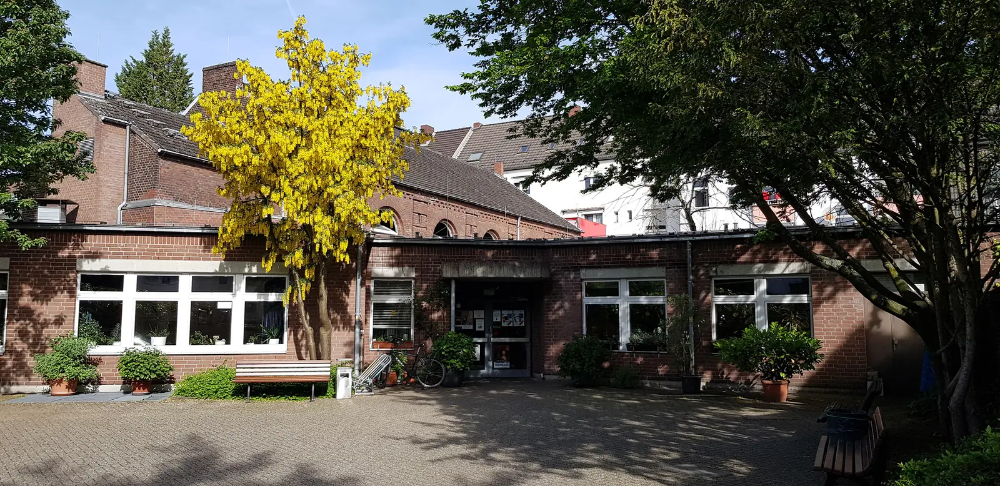

*Foto: Bürgerhaus Reisholz – [Quelle](https://www.duesseldorf.de/buergerhaeuser/reisholz)*

Das **Bürgerhaus Reisholz** ist ein Stadtteilzentrum an der Kappeler Straße im Düsseldorfer Industriestadtteil Reisholz. Seit 1982 ist es in einem ehemaligen **Kinosaal** aus der Zeit um die Jahrhundertwende untergebracht, der baulich erweitert wurde. Träger ist die Abteilung Jugendförderung im Amt für Jugend und Soziales der Stadt Düsseldorf.

Das Programm umfasst Kultur und Begegnung, Bildung und Soziales sowie Freizeitangebote, mit Schwerpunkten auf **Kinderkultur** und Abendveranstaltungen mit Musik und Tanz. Einmal im Monat gastiert ein **Kindertheater** mit Stücken für Kinder. Die Räume des Hauses können auch gemietet werden.

Die S-Bahn-Station **Reisholz** liegt etwa fünf Gehminuten entfernt.

Quellen je Satz

1. Das Bürgerhaus Reisholz ist ein Stadtteilzentrum an der Kappeler Straße im Düsse… — https://www.duesseldorf.de/buergerhaeuser/reisholz
2. Seit 1982 ist es in einem ehemaligen Kinosaal aus der Zeit um die Jahrhundertwen… — https://www.duesseldorf.de/buergerhaeuser/reisholz
3. Träger ist die Abteilung Jugendförderung im Amt für Jugend und Soziales der Stad… — https://www.fruehehilfen-online.nrw.de/fhiangebot/exportpdf/id/51815
4. Das Programm umfasst Kultur und Begegnung, Bildung und Soziales sowie Freizeitan… — https://www.duesseldorf.de/buergerhaeuser/reisholz
5. Einmal im Monat gastiert ein Kindertheater mit Stücken für Kinder. — https://www.fruehehilfen-online.nrw.de/fhiangebot/exportpdf/id/51815
6. Die Räume des Hauses können auch gemietet werden. — https://www.duesseldorf.de/buergerhaeuser/reisholz
7. Die S-Bahn-Station Reisholz liegt etwa fünf Gehminuten entfernt. — https://www.duesseldorf.de/buergerhaeuser/reisholz

> Hinweis der Recherche: Zukunft offen: Laut ddorf-aktuell.de (September 2024) ist das Gebäude von der Stadt gepachtet, der Pachtvertrag läuft 2029 aus und eine Verlängerung ist wegen Sanierungsbedarf unsicher (https://www.ddorf-aktuell.de/?p=124577). Bild von der städtischen Seite, Bildunterschrift „Eingang © Bürgerhaus Reisholz“.

---

### Bürgerhaus Salzmannbau

`/orte/buergerhaus-salzmannbau` · 7 Sätze · Website: https://www.duesseldorf.de/buergerhaeuser/salzmannbau

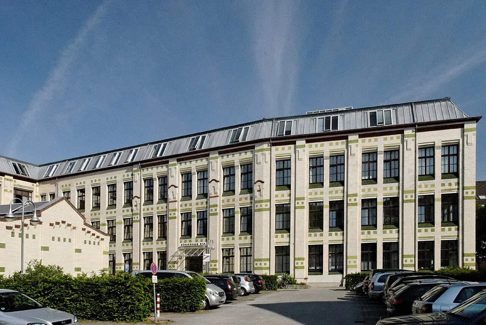

*Foto: Wiegels / Wikimedia Commons (CC BY 3.0) – [Quelle](https://commons.wikimedia.org/wiki/File:Salzmannbau_in_Duesseldorf-Bilk,_von_Sueden.jpg)*

Das **Bürgerhaus Salzmannbau** ist ein städtisches Bürgerhaus im Düsseldorfer Stadtteil **Bilk**. Es liegt im Salzmannbau, dem denkmalgeschützten früheren Hauptgebäude der Jagenberg-Fabrik, das der Architekt Heinrich Salzmann plante und das von 1904 bis 1906 entstand. 1984 wurde das Gebäude unter Denkmalschutz gestellt und von der Stadt erworben, nach einer Kernsanierung wurde es im September 1994 neu eröffnet.

Neben dem Bürgerhaus sind im Salzmannbau Vereine, Initiativen, **Künstlerateliers** und Wohnungen untergebracht. Das Bürgerhaus fördert vor allem Kinder und Familien sowie die interkulturelle Begegnung, besonders im Wohnquartier auf dem Jagenberggelände. Zum Programm gehören Veranstaltungen, Tanzevents sowie Kurse und Workshops, außerdem können Räume gemietet werden.

Die nächsten Haltestellen sind **Am Steinberg** und Moorenstraße, die von Straßenbahnen und Bussen angefahren werden.

Quellen je Satz

1. Das Bürgerhaus Salzmannbau ist ein städtisches Bürgerhaus im Düsseldorfer Stadtt… — https://www.duesseldorf.de/buergerhaeuser/salzmannbau
2. Es liegt im Salzmannbau, dem denkmalgeschützten früheren Hauptgebäude der Jagenb… — https://de.wikipedia.org/wiki/Salzmannbau
3. 1984 wurde das Gebäude unter Denkmalschutz gestellt und von der Stadt erworben, … — https://de.wikipedia.org/wiki/Salzmannbau
4. Neben dem Bürgerhaus sind im Salzmannbau Vereine, Initiativen, Künstlerateliers … — https://de.wikipedia.org/wiki/Salzmannbau
5. Das Bürgerhaus fördert vor allem Kinder und Familien sowie die interkulturelle B… — https://www.duesseldorf.de/buergerhaeuser/salzmannbau
6. Zum Programm gehören Veranstaltungen, Tanzevents sowie Kurse und Workshops, auße… — https://www.duesseldorf.de/buergerhaeuser/salzmannbau
7. Die nächsten Haltestellen sind Am Steinberg und Moorenstraße, die von Straßenbah… — https://www.duesseldorf.de/buergerhaeuser/salzmannbau

> Hinweis der Recherche: Auf dem (älteren) Commons-Foto steht über dem Eingang noch „Bürgerhaus Bilk“.

---

### Cageball Düsseldorf

`/orte/cageball-duesseldorf` · 6 Sätze · Website: https://www.cageball-duesseldorf.de/

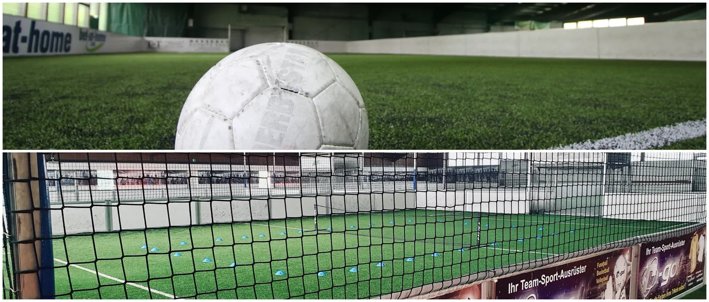

*Foto: Cageball Düsseldorf – [Quelle](https://www.cageball-duesseldorf.de/)*

**Cageball Düsseldorf** ist eine Sporthalle für Cageball an der Ulenbergstraße. Gespielt wird auf **Kunstrasenfeldern**, die von einer etwa einen Meter hohen Bande und einem rund vier Meter hohen Netz umschlossen sind. Die Halle hat **sieben Courts**: vier kleinere mit rund 350 Quadratmetern für acht bis zehn Spieler und drei größere mit 450 Quadratmetern für zehn bis zwölf Spieler.

Auf den kleineren Feldern lassen sich die Tore verkleinern, sodass auch ohne Torwart gespielt werden kann. Zur Anlage gehören eine **Sportsbar** mit etwa 50 Plätzen und ein Tischtennisangebot, außerdem gibt es Angebote für Kindergeburtstage, Bubble Ball und Fußballschulen. Einen zweiten Standort betreibt das Unternehmen in **Meerbusch-Lank**.

Quellen je Satz

1. Cageball Düsseldorf ist eine Sporthalle für Cageball an der Ulenbergstraße. — https://www.cageball-duesseldorf.de/
2. Gespielt wird auf Kunstrasenfeldern, die von einer etwa einen Meter hohen Bande … — https://www.cageball-duesseldorf.de/
3. Die Halle hat sieben Courts: vier kleinere mit rund 350 Quadratmetern für acht b… — https://www.cageball-duesseldorf.de/
4. Auf den kleineren Feldern lassen sich die Tore verkleinern, sodass auch ohne Tor… — https://www.cageball-duesseldorf.de/
5. Zur Anlage gehören eine Sportsbar mit etwa 50 Plätzen und ein Tischtennisangebot… — https://www.cageball-duesseldorf.de/
6. Einen zweiten Standort betreibt das Unternehmen in Meerbusch-Lank. — https://www.cageball-duesseldorf.de/

> Hinweis der Recherche: Bild ist eine Collage aus zwei Hallenansichten (Spielfeld mit Ball im Vordergrund). Ein Verzeichnis (newinthecity.de) erwähnt zusätzlich Bowlingbahnen, die offizielle Seite nicht – daher weggelassen. Eröffnungsjahr nicht belegt.

---

### CASTELLO Düsseldorf

`/orte/castello-duesseldorf` · 7 Sätze · Website: https://www.castello-duesseldorf.de/

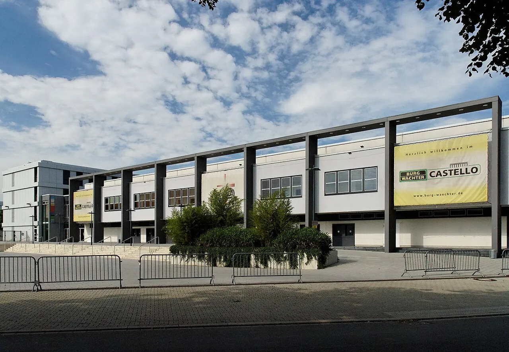

*Foto: Wiegels / Wikimedia Commons (CC BY 3.0) – [Quelle](https://commons.wikimedia.org/wiki/File:Burg-Waechter_Castello_in_Duesseldorf-Reisholz,_von_Suedwesten.jpg)*

Das CASTELLO ist eine **Mehrzweckhalle** an der Karl-Hohmann-Straße im Düsseldorfer Stadtteil **Reisholz**. Der Bau begann 2004 nach Plänen des Büros Guida & Mischok, ursprünglich war an dieser Stelle nur eine Turnhalle für ein benachbartes Gymnasium vorgesehen. Bis 2011 hieß die Halle Burg-Wächter Castello, seit August 2010 gehört sie der Stadt Düsseldorf.

Bei Konzerten fasst die Halle bis zu 4.850 Menschen, bei Basketballspielen 3.700. Der rund 1.600 Quadratmeter große **Innenraum** mit Vorhangsystem und Sportschwingboden wird für Sport-Events, TV-Produktionen und gesellschaftliche Veranstaltungen genutzt. Früher trugen hier unter anderem die Handballer der HSG Düsseldorf und die Basketballer der Giants ihre Heimspiele aus. Der **Bahnhof Düsseldorf-Reisholz** liegt in unmittelbarer Nähe.

Quellen je Satz

1. Das CASTELLO ist eine Mehrzweckhalle an der Karl-Hohmann-Straße im Düsseldorfer … — https://de.wikipedia.org/wiki/Castello_D%C3%BCsseldorf
2. Der Bau begann 2004 nach Plänen des Büros Guida & Mischok, ursprünglich war an d… — https://de.wikipedia.org/wiki/Castello_D%C3%BCsseldorf
3. Bis 2011 hieß die Halle Burg-Wächter Castello, seit August 2010 gehört sie der S… — https://de.wikipedia.org/wiki/Castello_D%C3%BCsseldorf
4. Bei Konzerten fasst die Halle bis zu 4.850 Menschen, bei Basketballspielen 3.700… — https://de.wikipedia.org/wiki/Castello_D%C3%BCsseldorf
5. Der rund 1.600 Quadratmeter große Innenraum mit Vorhangsystem und Sportschwingbo… — https://www.castello-duesseldorf.de/veranstalter/raumuebersicht
6. Früher trugen hier unter anderem die Handballer der HSG Düsseldorf und die Baske… — https://de.wikipedia.org/wiki/Castello_D%C3%BCsseldorf
7. Der Bahnhof Düsseldorf-Reisholz liegt in unmittelbarer Nähe. — https://de.wikipedia.org/wiki/Castello_D%C3%BCsseldorf

> Hinweis der Recherche: Eröffnungsdatum widersprüchlich (Wikipedia-Infobox: 24. Juni 2005, Fließtext: Richtfest Juni 2005, Betriebsbeginn Oktober 2005), daher weggelassen. Wikipedia schreibt, die Halle werde nach dem Ende der Profivereine vor allem für Schulsport genutzt; die Raumübersicht nennt 1.622 m² Innenraum. Bild (älter, Banner mit Hallennamen) zeigt die Halle von Südwesten.

---

### Cinema

`/orte/cinema` · 7 Sätze · Website: https://filmkunstkinos.de/kinos/cinema/

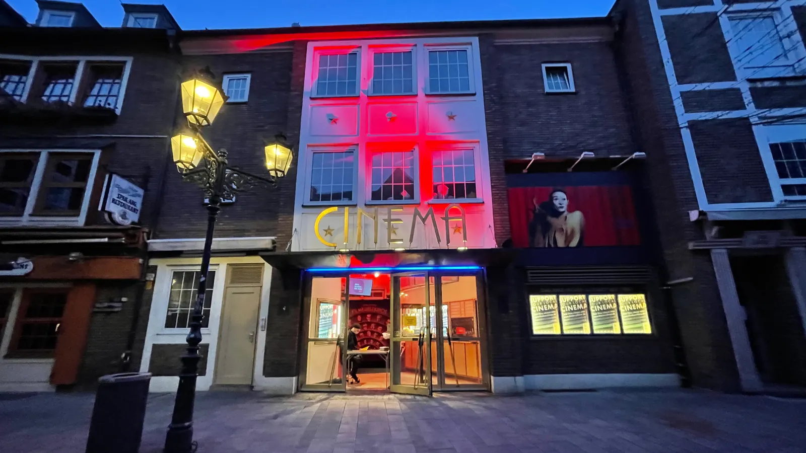

*Foto: Filmkunstkinos Düsseldorf – [Quelle](https://filmkunstkinos.de/kinos/cinema/)*

Das **Cinema** in der Schneider-Wibbel-Gasse in der Düsseldorfer Altstadt gehört zu den Düsseldorfer Filmkunstkinos. Eröffnet wurde das Haus 1957 als **Bali-Kino**, ein Non-Stop-Kino mit täglich wechselndem Programm. Nach der Schließung des früheren Cinemas an der Kasernenstraße übernahm Heinz Holzapfel das Bali und führte es als „Neues Cinema“ weiter.

Das Kino hat einen Saal mit 192 Plätzen und ein **Kinocafé** für rund 30 Personen. Das Foyer wurde im Sommer 2018 renoviert. Gezeigt werden vor allem **Erstaufführungen** aus dem Bereich Filmkunst, oft mit Premierenfeiern, dazu Aufzeichnungen aus Theater, Ballett und Kunstausstellungen sowie Filme in Originalfassung mit Untertiteln. Die nächste Haltestelle ist Heinrich-Heine-Allee, etwa fünf Gehminuten entfernt.

Quellen je Satz

1. Das Cinema in der Schneider-Wibbel-Gasse in der Düsseldorfer Altstadt gehört zu … — https://filmkunstkinos.de/kinos/cinema/
2. Eröffnet wurde das Haus 1957 als Bali-Kino, ein Non-Stop-Kino mit täglich wechse… — https://filmkunstkinos.de/kinos/cinema/
3. Nach der Schließung des früheren Cinemas an der Kasernenstraße übernahm Heinz Ho… — https://filmkunstkinos.de/kinos/cinema/
4. Das Kino hat einen Saal mit 192 Plätzen und ein Kinocafé für rund 30 Personen.… — https://filmkunstkinos.de/kinos/cinema/
5. Das Foyer wurde im Sommer 2018 renoviert. — https://filmkunstkinos.de/kinos/cinema/
6. Gezeigt werden vor allem Erstaufführungen aus dem Bereich Filmkunst, oft mit Pre… — https://filmkunstkinos.de/kinos/cinema/
7. Die nächste Haltestelle ist Heinrich-Heine-Allee, etwa fünf Gehminuten entfernt. — https://filmkunstkinos.de/kinos/cinema/

> Hinweis der Recherche: Kein Commons-Bild gefunden; Bild ist eine Architekturaufnahme der Fassade von der Kinoseite (in voller Größe, auf der Seite als 480px-Vorschau eingebunden), kein Fotograf angegeben. Jahr der Übernahme durch Heinz Holzapfel nicht genannt.

---

### Cinestar

`/orte/cinestar` · 5 Sätze · Website: https://www.cinestar.de/kino-duesseldorf

Das **CineStar Düsseldorf** ist ein Multiplex-Kino an der Hansaallee beim Forum Oberkassel. Es öffnete 1998 als Ufa-Palast Forum Oberkassel und wird seit April 2003 von der Kette CineStar betrieben.

Das Haus ist ein **Glasbau** mit neun Sälen. Auf dem Programm stehen **Blockbuster** ebenso wie Arthouse-Filme. Die nächste Haltestelle ist Löricker Straße, angefahren von den Stadtbahnlinien U74 und U76 sowie vom Bus 828.

Quellen je Satz

1. Das CineStar Düsseldorf ist ein Multiplex-Kino an der Hansaallee beim Forum Ober… — https://www.cinestar.de/kino-duesseldorf/info/anfahrt
2. Es öffnete 1998 als Ufa-Palast Forum Oberkassel und wird seit April 2003 von der… — https://cinematreasures.org/theaters/62080
3. Das Haus ist ein Glasbau mit neun Sälen. — https://www.visitduesseldorf.de/en/attractions/cinestar-duesseldorf-5b186ff662
4. Auf dem Programm stehen Blockbuster ebenso wie Arthouse-Filme. — https://www.visitduesseldorf.de/en/attractions/cinestar-duesseldorf-5b186ff662
5. Die nächste Haltestelle ist Löricker Straße, angefahren von den Stadtbahnlinien … — https://www.cinestar.de/kino-duesseldorf/info/anfahrt

> Hinweis der Recherche: Eröffnungsjahr 1998 und Übernahme 2003 nur bei cinematreasures.org (Nutzerbeiträge) gefunden, keine zweite Quelle. Stadtteil: kino.de nennt Heerdt (PLZ 40549), CineStar selbst verortet das Kino bei Oberkassel/Forum Oberkassel – im Text nur „beim Forum Oberkassel“. Kein passendes Commons-Gebäudefoto gefunden.

---

### Classic Remise Düsseldorf

`/orte/classic-remise-duesseldorf` · 6 Sätze · Website: https://remise.de/duesseldorf/

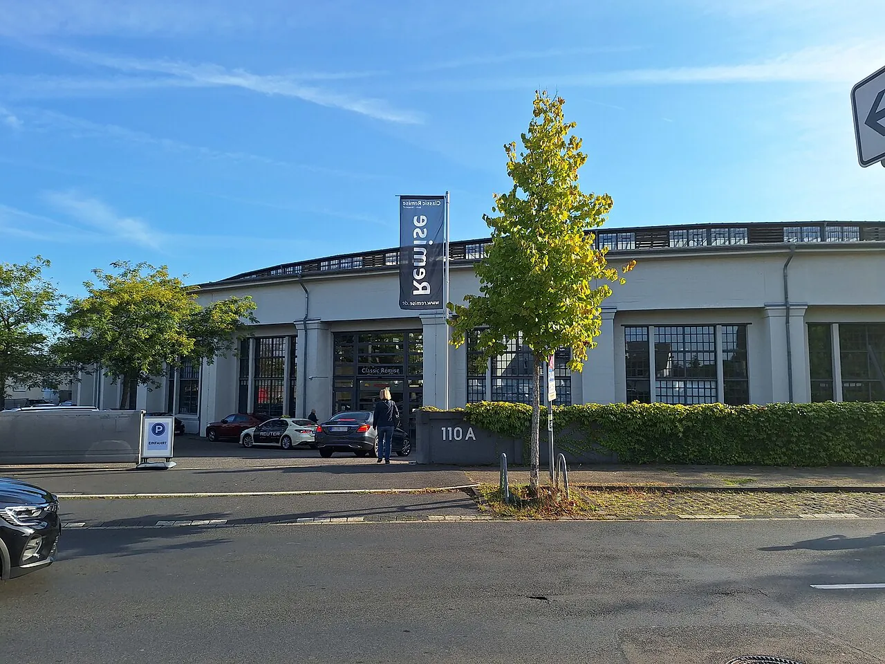

*Foto: Paintdog / Wikimedia Commons (CC BY-SA 4.0) – [Quelle](https://commons.wikimedia.org/wiki/File:2025-09-06_09-27-26_Eingang_zur_Classic_Remise_in_D%C3%BCsseldorf.jpg)*

Die Classic Remise Düsseldorf ist ein Zentrum für **Oldtimer** in einem denkmalgeschützten **Ringlokschuppen** an der Harffstraße. Der Lokschuppen wurde 1929 bis 1931 errichtet, sein halbkreisförmiger Grundriss misst fast 150 Meter im Durchmesser. Eröffnet wurde die Anlage im September 2006, zunächst unter dem Namen Meilenwerk.

Auf mehr als 19.000 Quadratmetern arbeiten Händler, Restauratoren und **Werkstätten** sowie Geschäfte für Zubehör, Automobilliteratur und Bekleidung. In gläsernen Einstellboxen sind zudem Oldtimer ausgestellt. Gastronomie und **Veranstaltungsflächen** ergänzen das Angebot, genutzt etwa für Präsentationen, Tagungen und Oldtimer-Treffen.

Quellen je Satz

1. Die Classic Remise Düsseldorf ist ein Zentrum für Oldtimer in einem denkmalgesch… — https://remise.de/duesseldorf/
2. Der Lokschuppen wurde 1929 bis 1931 errichtet, sein halbkreisförmiger Grundriss … — https://de.wikipedia.org/wiki/Classic_Remise
3. Eröffnet wurde die Anlage im September 2006, zunächst unter dem Namen Meilenwerk… — https://de.wikipedia.org/wiki/Classic_Remise
4. Auf mehr als 19.000 Quadratmetern arbeiten Händler, Restauratoren und Werkstätte… — https://de.wikipedia.org/wiki/Classic_Remise
5. In gläsernen Einstellboxen sind zudem Oldtimer ausgestellt. — https://remise.de/duesseldorf/
6. Gastronomie und Veranstaltungsflächen ergänzen das Angebot, genutzt etwa für Prä… — https://de.wikipedia.org/wiki/Classic_Remise

> Hinweis der Recherche: Stadtteil weggelassen: Wikipedia-Auswertung ergab Oberbilk, die Postleitzahl 40591 gehört aber zu Wersten. Bild zeigt den Eingang an der Harffstraße, nicht visuell geprüft.

---

### Coffee Brew Düsseldorf CAFÉ & BAR

`/orte/coffee-brew-duesseldorf-cafe-bar` · 4 Sätze · Website: https://www.thecodeagency.de/en/duesseldorf/

**Coffee Brew** ist ein Café mit Bar am Stresemannplatz in der Nähe des Düsseldorfer Hauptbahnhofs. Auf der Karte stehen ganztägiges **Frühstück**, Mittagsgerichte, Specialty Coffee, Tees und frische Säfte. Am Wochenende wird das Café abends zur Bar mit Cocktails und lokalen Bieren. Am selben Standort betreibt The Code Agency **Escape Rooms** und eine Axtwurf-Anlage, die Lounge des Cafés dient auch als Arbeitsplatz.

Quellen je Satz

1. Coffee Brew ist ein Café mit Bar am Stresemannplatz in der Nähe des Düsseldorfer… — https://lifeinduesseldorf.com/coffeebrew-dusseldorf-krefeld/
2. Auf der Karte stehen ganztägiges Frühstück, Mittagsgerichte, Specialty Coffee, T… — https://lifeinduesseldorf.com/coffeebrew-dusseldorf-krefeld/
3. Am Wochenende wird das Café abends zur Bar mit Cocktails und lokalen Bieren. — https://lifeinduesseldorf.com/coffeebrew-dusseldorf-krefeld/
4. Am selben Standort betreibt The Code Agency Escape Rooms und eine Axtwurf-Anlage… — https://www.thecodeagency.de/en/duesseldorf/

> Hinweis der Recherche: Adresse prüfen: Paket nennt Graf-Adolf-Straße 77, The Code Agency nennt für den Standort Stresemannplatz 4 (vermutlich dasselbe Eckgebäude, nicht belegt). coffeebrew.de zeigt inzwischen nur noch das Krefelder Café; als Webseite daher die Düsseldorf-Seite von The Code Agency, die das Café führt. Kein sauberes Gebäudefoto.

---

### Comedy Club Düsseldorf

`/orte/comedy-club-duesseldorf` · 3 Sätze · Website: https://comedyclubduesseldorf.de/

Der Comedy Club Düsseldorf an der Oststraße ist eine Bühne für **Live-Comedy** mit eigener Bar. An allen Abenden der Woche finden dort professionelle, überwiegend deutschsprachige Shows statt. Zum Programm gehören **Stand-up-Shows**, Open-Mic-Abende und Soloprogramme.

Quellen je Satz

1. Der Comedy Club Düsseldorf an der Oststraße ist eine Bühne für Live-Comedy mit e… — https://www.comedyinyoureye.com/comedy-in-your-eye-dusseldorf-english-speaking-stand-up-comedy-club
2. An allen Abenden der Woche finden dort professionelle, überwiegend deutschsprach… — https://www.comedyinyoureye.com/comedy-in-your-eye-dusseldorf-english-speaking-stand-up-comedy-club
3. Zum Programm gehören Stand-up-Shows, Open-Mic-Abende und Soloprogramme. — https://comedyclubduesseldorf.de/

> Hinweis der Recherche: Sehr wenige feste Angaben: Die eigene Website (comedyclubduesseldorf.de, nicht comedy-club-duesseldorf.de) nennt sich „Hotspot für Stand Up Comedy“ und bezeichnet den Club als neu, aber ohne Gründungsdatum, Platzzahl oder Adresse im Text. Adresse und tägliches Programm stammen von der Seite der englischsprachigen Reihe „Comedy in Your Eye“, die dort stattfindet. Kein sauberes Bild.

---

### Comedy für Freunde Club Düsseldorf

`/orte/comedy-fuer-freunde-club-duesseldorf` · 4 Sätze · Website: https://comedy-fuer-freunde.com/duesseldorf

Der **Comedy für Freunde Club Düsseldorf** ist die Düsseldorfer Spielstätte der Stand-up-Reihe Comedy für Freunde an der Ackerstraße 109. Die Shows finden in der **Lupin Gin Bar** statt. Bei der **Profi-Testbühne** probieren sechs bis acht Profi-Comedians und Newcomer in rund 90 Minuten neue Geschichten und Witze aus. Comedy für Freunde veranstaltet Shows auch in weiteren Städten, darunter München, Köln, Frankfurt und Innsbruck.

Quellen je Satz

1. Der Comedy für Freunde Club Düsseldorf ist die Düsseldorfer Spielstätte der Stan… — https://comedy-fuer-freunde.com/duesseldorf
2. Die Shows finden in der Lupin Gin Bar statt. — https://comedy-fuer-freunde.com/duesseldorf
3. Bei der Profi-Testbühne probieren sechs bis acht Profi-Comedians und Newcomer in… — https://comedy-fuer-freunde.com/duesseldorf
4. Comedy für Freunde veranstaltet Shows auch in weiteren Städten, darunter München… — https://comedy-fuer-freunde.com/duesseldorf

> Hinweis der Recherche: Die Spielstätte ist laut offizieller Seite die Lupin Gin Bar (Ackerstraße 109); einige Eventportale nennen den Ort deshalb „Lupin Gin Bar“. Fotos auf der Website stammen teils aus anderen Städten (z. B. Miesbach) und zeigen nicht eindeutig den Düsseldorfer Raum, daher kein Bild. Gründungsjahr nicht angegeben.

---

### Cuvée

`/orte/cuvee` · 7 Sätze · Website: https://cuvee-flingern.de/

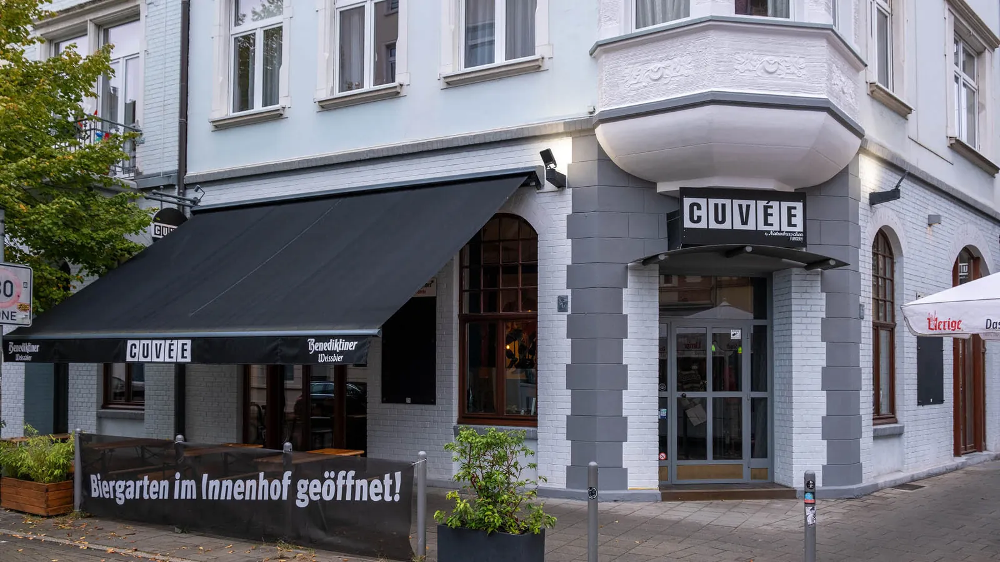

*Foto: Cuvée Flingern – [Quelle](https://cuvee-flingern.de/)*

Das **Cuvée** ist eine Weinbar mit Restaurant an der Hermannstraße in Düsseldorf-Flingern. Es hat im März 2023 eröffnet und tritt unter dem Zusatz „by **Naturburschen** Flingern“ auf. Die Weinkarte umfasst rund 100 Weine, überwiegend von kleinen Weingütern aus Deutschland und Europa. Im Lokal gibt es mehr als 60 Plätze.

Die Küche bringt **portugiesisch-brasilianische** Einflüsse auf den Teller. Gemeinsam mit den Naturburschen hat das Cuvée eigene Weine herausgebracht, darunter den „No Cuvée“. Zum Programm gehören regelmäßige **Bingo- und Quizabende**, und im Sommer finden im Innenhof kleine Konzerte statt.

Quellen je Satz

1. Das Cuvée ist eine Weinbar mit Restaurant an der Hermannstraße in Düsseldorf-Fli… — https://cuvee-flingern.de/kontakt/
2. Es hat im März 2023 eröffnet und tritt unter dem Zusatz „by Naturburschen Flinge… — https://cuvee-flingern.de/
3. Die Weinkarte umfasst rund 100 Weine, überwiegend von kleinen Weingütern aus Deu… — https://www.visitduesseldorf.de/storys/2025/11/19/6-spots-genuss-weinbar-in-duesseldorf/
4. Im Lokal gibt es mehr als 60 Plätze. — https://cuvee-flingern.de/
5. Die Küche bringt portugiesisch-brasilianische Einflüsse auf den Teller. — https://www.visitduesseldorf.de/storys/2025/11/19/6-spots-genuss-weinbar-in-duesseldorf/
6. Gemeinsam mit den Naturburschen hat das Cuvée eigene Weine herausgebracht, darun… — https://www.visitduesseldorf.de/storys/2025/11/19/6-spots-genuss-weinbar-in-duesseldorf/
7. Zum Programm gehören regelmäßige Bingo- und Quizabende, und im Sommer finden im … — https://www.visitduesseldorf.de/storys/2025/11/19/6-spots-genuss-weinbar-in-duesseldorf/

> Hinweis der Recherche: Bild ist das og:image der Startseite und zeigt die Eckfassade mit Eingang und Markise. Fotograf nicht angegeben.

---

### Das Rheinische Landestheater

`/orte/das-rheinische-landestheater` · 9 Sätze · Website: https://www.rheinisches-landestheater.de

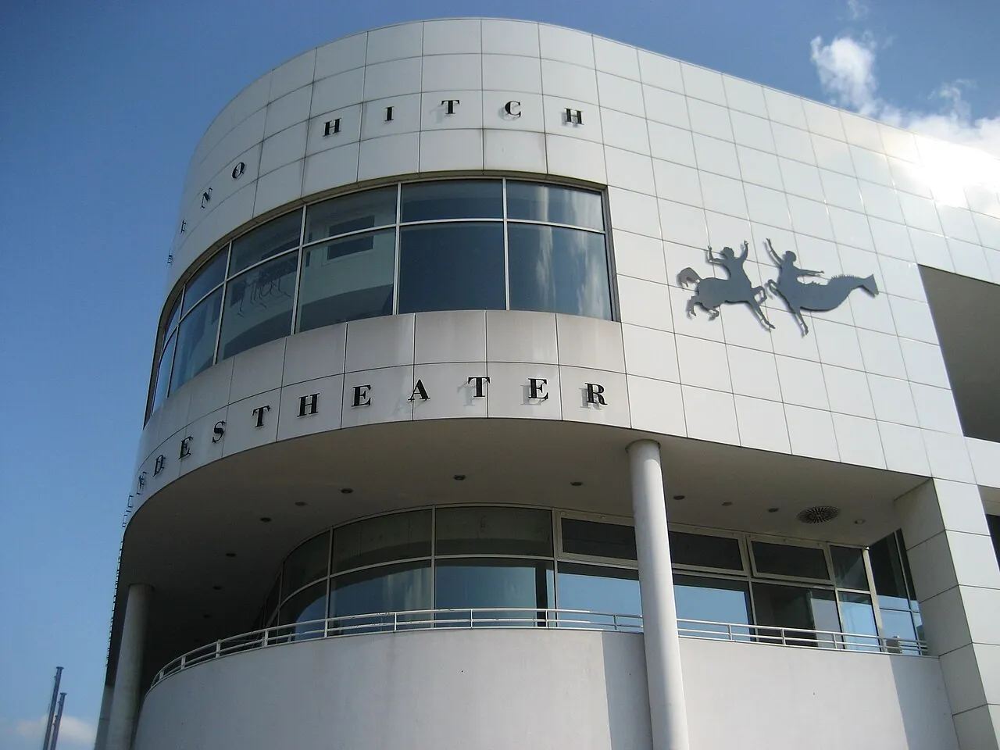

*Foto: Michael Reschke / Wikimedia Commons (CC BY-SA 3.0) – [Quelle](https://commons.wikimedia.org/wiki/File:Neuss,_Rheinisches_Landestheater_2008.JPG)*

Das **Rheinische Landestheater** ist ein Schauspielhaus in der Neusser Innenstadt an der Oberstraße. Als Landesbühne spielt es nicht nur in Neuss, sondern gastiert auch in Städten und Gemeinden ohne eigenes Ensemble, vor allem in Nordrhein-Westfalen. Einen Schwerpunkt bilden **Kinder- und Jugendtheater** sowie Theaterpädagogik.

Gegründet wurde das Theater im August 1925 in Neuss als **Rheinisches Städtebundtheater**, 1937 erhielt es seinen heutigen Namen. 1981 schloss es sich mit dem Theater am Niederrhein in Kleve zusammen.

Seit Dezember 2000 spielt das Ensemble im umgebauten früheren **Horten-Kaufhaus** an der Oberstraße, das der Architekt Oliver Ingenhoven gestaltet hat. Das Schauspielhaus im ersten Obergeschoss hat einen steil ansteigenden Zuschauerraum mit 443 Plätzen. Im Untergeschoss liegt eine **Studiobühne** für kleinere und zeitgenössische Stücke sowie für Kinder- und Jugendtheater. Vom Foyer aus reicht der Blick über die Stadt bis zur Kirche St. Quirin.

Quellen je Satz

1. Das Rheinische Landestheater ist ein Schauspielhaus in der Neusser Innenstadt an… — https://de.wikipedia.org/wiki/Rheinisches_Landestheater_Neuss
2. Als Landesbühne spielt es nicht nur in Neuss, sondern gastiert auch in Städten u… — https://de.wikipedia.org/wiki/Rheinisches_Landestheater_Neuss
3. Einen Schwerpunkt bilden Kinder- und Jugendtheater sowie Theaterpädagogik. — https://de.wikipedia.org/wiki/Rheinisches_Landestheater_Neuss
4. Gegründet wurde das Theater im August 1925 in Neuss als Rheinisches Städtebundth… — https://de.wikipedia.org/wiki/Rheinisches_Landestheater_Neuss
5. 1981 schloss es sich mit dem Theater am Niederrhein in Kleve zusammen. — https://de.wikipedia.org/wiki/Rheinisches_Landestheater_Neuss
6. Seit Dezember 2000 spielt das Ensemble im umgebauten früheren Horten-Kaufhaus an… — https://de.wikipedia.org/wiki/Rheinisches_Landestheater_Neuss
7. Das Schauspielhaus im ersten Obergeschoss hat einen steil ansteigenden Zuschauer… — https://de.wikipedia.org/wiki/Rheinisches_Landestheater_Neuss
8. Im Untergeschoss liegt eine Studiobühne für kleinere und zeitgenössische Stücke … — https://de.wikipedia.org/wiki/Rheinisches_Landestheater_Neuss
9. Vom Foyer aus reicht der Blick über die Stadt bis zur Kirche St. Quirin. — https://de.wikipedia.org/wiki/Rheinisches_Landestheater_Neuss

> Hinweis der Recherche: Alle Fakten aus Wikipedia; offizielle Website nicht inhaltlich ausgewertet. Liegt in Neuss.

---

### Dein Ursprunghaus - Dein Ort für Bewusstwerdung

`/orte/dein-ursprunghaus-dein-ort-fuer-bewusstwerdung` · 4 Sätze · Website: https://dein-ursprunghaus.de

Hinter **Dein Ursprunghaus** an der Oberkasseler Straße in Düsseldorf steht eine gemeinnützige GmbH. Angeboten werden ganzheitliche **Psychotherapie**, Paartherapie, Somatic Soul Experiencing, traumasensibles Yoga, Meditation und Elementelehre. Dazu kommen Massagen und Energiearbeit, auch Massagen für Pferde. Bei **Veranstaltungen** gibt es außerdem Gruppenangebote, darunter kostenlose wie eine Beratung für Angehörige von Menschen mit Demenz.

Quellen je Satz

1. Hinter Dein Ursprunghaus an der Oberkasseler Straße in Düsseldorf steht eine gem… — https://dein-ursprunghaus.de/impressum/
2. Angeboten werden ganzheitliche Psychotherapie, Paartherapie, Somatic Soul Experi… — https://dein-ursprunghaus.de/
3. Dazu kommen Massagen und Energiearbeit, auch Massagen für Pferde. — https://dein-ursprunghaus.de/
4. Bei Veranstaltungen gibt es außerdem Gruppenangebote, darunter kostenlose wie ei… — https://dein-ursprunghaus.de/

> Hinweis der Recherche: Kleiner Anbieter; Website zeigt nur Logo und Platzhalterbilder, kein Foto der Räume.

---

### Design Center Kronospan

`/orte/design-center-kronospan` · 4 Sätze · Website: https://kronospan.com/de_DE/

Das **Kronospan Design Center** an der Schadowstraße ist ein Showroom des Holzwerkstoffherstellers Kronospan im Düsseldorfer Stadtzentrum, einen Block von der Königsallee entfernt. Gezeigt werden **dekorative Oberflächen**, Holzwerkstoffplatten und Bodenbeläge in Originalgröße, sodass sich die Materialien direkt nebeneinander vergleichen lassen. Es ist das erste Design Center des Unternehmens in Deutschland und nimmt große Teile des Erdgeschosses im Geschäftshaus Schadowstraße 78 ein, das Kronospan dafür erworben hat. Zielgruppe sind vor allem **Innenarchitekten**, Designer und Projektentwickler, die dort gemeinsam mit ihren Kunden mit dem Sortiment arbeiten können.

Quellen je Satz

1. Das Kronospan Design Center an der Schadowstraße ist ein Showroom des Holzwerkst… — https://kronospan.com/de_DE/company/news/view/kronospan-in-dusseldorf-less-browsing-more-deciding-135/
2. Gezeigt werden dekorative Oberflächen, Holzwerkstoffplatten und Bodenbeläge in O… — https://kronospan.com/de_DE/company/news/view/kronospan-in-dusseldorf-less-browsing-more-deciding-135/
3. Es ist das erste Design Center des Unternehmens in Deutschland und nimmt große T… — https://assetphysics.com/duesseldorf-aengevelt-brokers-property-on-schadowstrasse-to-kronospan/
4. Zielgruppe sind vor allem Innenarchitekten, Designer und Projektentwickler, die … — https://assetphysics.com/duesseldorf-aengevelt-brokers-property-on-schadowstrasse-to-kronospan/

> Hinweis der Recherche: Ort ist ein Fach-Showroom, keine Gastronomie/Eventlocation im eigentlichen Sinn; Eventnutzung nicht belegt. Eröffnung laut Kronospan-Meldung vom August 2026, genaues Datum nicht genannt. Fotos auf der Kronospan-Seite zeigen vor allem Personen bei der Eröffnung oder Materialmuster – daher kein Bild.

---

### DJK TUSA 06 e.V

`/orte/djk-tusa-06-e-v` · 6 Sätze · Website: https://www.tusa06.de

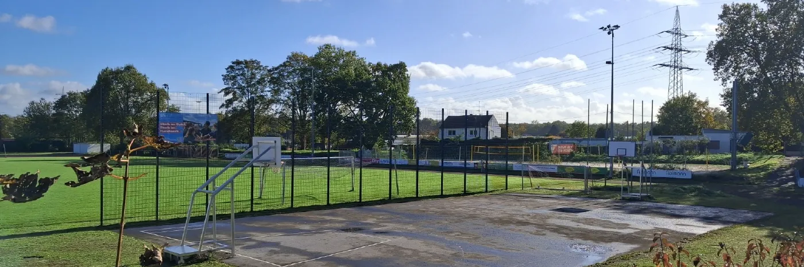

*Foto: DJK TuSA 06 Düsseldorf – [Quelle](https://www.tusa06.de/)*

Die **DJK TuSA 06 Düsseldorf** ist ein Sportverein im Stadtteil **Flehe**, der seit 1906 besteht. Der Verein zählt rund 2.300 Mitglieder, fast die Hälfte davon Kinder und Jugendliche.

Das Angebot reicht von **Fußball** sowie Frauen- und Mädchenfußball über Basketball, 3x3-Basketball, Leichtathletik, Tischtennis und Volleyball bis zu Fitness und Inklusionssport. Auf der **Sportanlage an der Fleher Straße** gibt es einen Naturrasenplatz mit Laufbahn, zwei Kunstrasenplätze sowie Flächen für Beachvolleyball, Basketball und Outdoor-Fitness. Zum Gelände gehört außerdem ein Vereinsheim mit Gastronomie. Seit 2018 unterhält der Verein ein Leistungszentrum für Frauen- und Mädchenfußball.

Quellen je Satz

1. Die DJK TuSA 06 Düsseldorf ist ein Sportverein im Stadtteil Flehe, der seit 1906… — https://www.tusa06.de/
2. Der Verein zählt rund 2.300 Mitglieder, fast die Hälfte davon Kinder und Jugendl… — https://www.tusa06.de/
3. Das Angebot reicht von Fußball sowie Frauen- und Mädchenfußball über Basketball,… — https://www.tusa06.de/
4. Auf der Sportanlage an der Fleher Straße gibt es einen Naturrasenplatz mit Laufb… — https://www.tusa06.de/
5. Zum Gelände gehört außerdem ein Vereinsheim mit Gastronomie. — https://www.tusa06.de/
6. Seit 2018 unterhält der Verein ein Leistungszentrum für Frauen- und Mädchenfußba… — https://www.tusa06.de/

> Hinweis der Recherche: Bild zeigt die Vereinsanlage (Basketballfeld, dahinter Kunstrasen) – keine Personen im Fokus. Mitgliederzahl kann veralten; die Website nennt „acht Abteilungen“, listet aber neun Angebote, daher keine Abteilungszahl im Text. Ein Newsletter des Fußballkreises nennt als Postadresse Fleher Str. 24 b – vermutlich Tippfehler, offizielle Seite: 224b.

---

### Drachental Games

`/orte/drachental-games` · 2 Sätze · Website: –

Drachental ist ein Laden für **Brett- und Tabletopspiele**, an den sich großzügige Spielräume anschließen. Die Spielfläche ist groß genug für Turniere und andere Spielveranstaltungen, außerdem ist der Laden seit jeher Treffpunkt des Vereins **Games 'n Dice Düsseldorf**.

Quellen je Satz

1. Drachental ist ein Laden für Brett- und Tabletopspiele, an den sich großzügige S… — https://chaosbunker.de/en/2024/07/24/a-visit-to-games-n-dice-dusseldorf-e-v
2. Die Spielfläche ist groß genug für Turniere und andere Spielveranstaltungen, auß… — https://chaosbunker.de/en/2024/07/24/a-visit-to-games-n-dice-dusseldorf-e-v

> Hinweis der Recherche: Keine offizielle Website gefunden (drachental.de ist eine fremde Fantasy-Fanseite). Einzige Quelle ist ein Hobby-Blog (chaosbunker.de), kein Stadt- oder Presseportal – bitte ggf. prüfen. Adresse Wagnerstraße 14 nur im Verzeichnis boardoro.com, dort fälschlich als „40212 Ratingen“.

---

### Düsseldorfer Marionetten-Theater

`/orte/duesseldorfer-marionetten-theater` · 8 Sätze · Website: https://www.marionettentheater-duesseldorf.de/

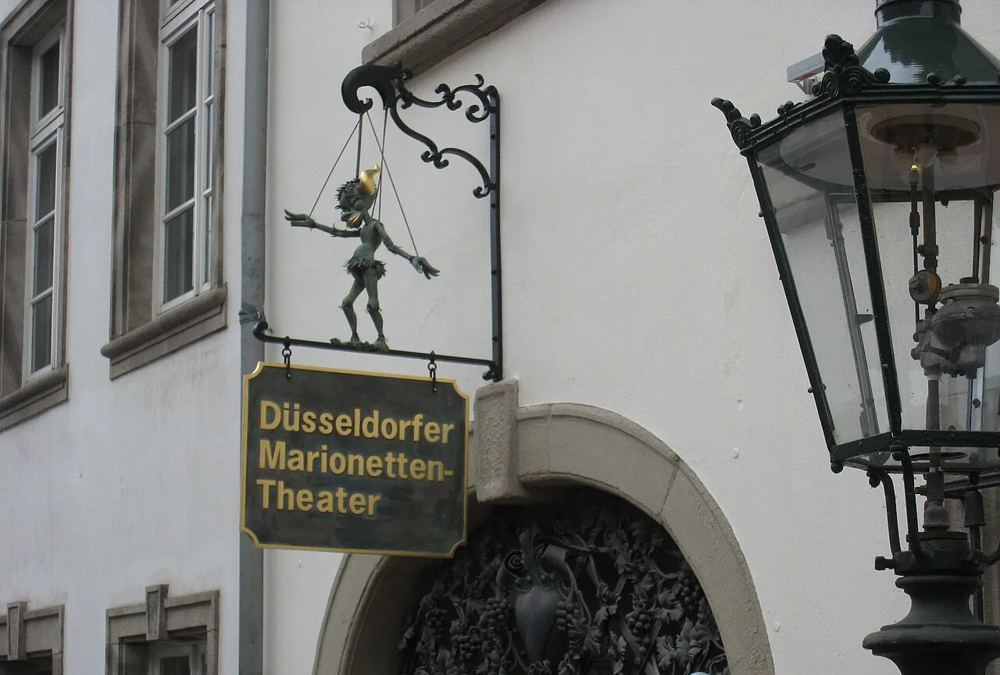

*Foto: Düsseldorfer Marionetten-Theater / Wikimedia Commons (CC BY-SA 3.0) – [Quelle](https://commons.wikimedia.org/wiki/File:Duesseldorfer_Marionetten-Theater_Toreingang_Palais_Wittgenstein_mit_Theaterschild_(Duesseldorfer_Marionetten-Theater).JPG)*

Das Düsseldorfer Marionetten-Theater ist eine **Marionettenbühne** im Palais Wittgenstein an der Bilker Straße. Seine Wurzeln reichen bis 1925 zurück, als die Brüder Emanuel und Franz Zangerle in Köln das „Theater Rheinischer Marionetten“ gründeten. Nach Stationen in einem Torturm der Kölner Hohenzollernbrücke und nach dem Zweiten Weltkrieg in Steinau kam die Bühne 1956 nach Düsseldorf, zunächst an die Wallstraße. Seit 1966 spielt sie im **Palais Wittgenstein**. Unter dem heutigen Namen wurde sie im Januar 1986 neu eröffnet.

Der Theatersaal hat 90 Plätze. Das Repertoire umfasst Märchen, Dramen, Fabeln sowie klassisches und modernes **Musiktheater** und richtet sich an Erwachsene und Kinder ab acht Jahren. Zu den Inszenierungen gehören Mozarts „Zauberflöte“ und „Die Entführung aus dem Serail“, Michael Endes „Wunschpunsch“ erlebte mehr als 1.000 Vorstellungen.

Quellen je Satz

1. Das Düsseldorfer Marionetten-Theater ist eine Marionettenbühne im Palais Wittgen… — https://de.wikipedia.org/wiki/D%C3%BCsseldorfer_Marionetten-Theater
2. Seine Wurzeln reichen bis 1925 zurück, als die Brüder Emanuel und Franz Zangerle… — https://de.wikipedia.org/wiki/D%C3%BCsseldorfer_Marionetten-Theater
3. Nach Stationen in einem Torturm der Kölner Hohenzollernbrücke und nach dem Zweit… — https://de.wikipedia.org/wiki/D%C3%BCsseldorfer_Marionetten-Theater
4. Seit 1966 spielt sie im Palais Wittgenstein. — https://de.wikipedia.org/wiki/D%C3%BCsseldorfer_Marionetten-Theater
5. Unter dem heutigen Namen wurde sie im Januar 1986 neu eröffnet. — https://de.wikipedia.org/wiki/D%C3%BCsseldorfer_Marionetten-Theater
6. Der Theatersaal hat 90 Plätze. — https://de.wikipedia.org/wiki/D%C3%BCsseldorfer_Marionetten-Theater
7. Das Repertoire umfasst Märchen, Dramen, Fabeln sowie klassisches und modernes Mu… — https://de.wikipedia.org/wiki/D%C3%BCsseldorfer_Marionetten-Theater
8. Zu den Inszenierungen gehören Mozarts „Zauberflöte“ und „Die Entführung aus dem … — https://de.wikipedia.org/wiki/D%C3%BCsseldorfer_Marionetten-Theater

> Hinweis der Recherche: Offizielle Website war wegen eines Zertifikatsfehlers nicht abrufbar, Text stützt sich nur auf Wikipedia.

---

### D’haus Central

`/orte/dhaus-central` · 6 Sätze · Website: https://www.dhaus.de/

Das **Central** an der Worringer Straße 140 ist eine Spielstätte des Düsseldorfer Schauspielhauses in der Nähe des Hauptbahnhofs. Das Schauspielhaus nutzt die Räume im Gebäude der früheren **Paketpost** seit Juni 2008. Außer Bühnen sind dort Werkstätten wie Schreinerei, Schlosserei und Malersaal sowie Kulissenlager und Kostümfundus untergebracht.

Im Central spielen das **Junge Schauspiel** und das **Stadt:Kollektiv**, außerdem liegt hier das Proben- und Produktionszentrum des Hauses. In den Spielzeiten 2016/17 bis 2018/19, während der Sanierung des Schauspielhauses am Gustaf-Gründgens-Platz, zeigte das Ensemble sein Repertoire im Central. Gespielt wird in den Räumen Central 1 und Central 2 sowie auf der **Central-Brücke**, wo sich auch die Theaterbar befindet.

Quellen je Satz

1. Das Central an der Worringer Straße 140 ist eine Spielstätte des Düsseldorfer Sc… — https://www.dhaus.de/das-dhaus/ueber-das-haus/
2. Das Schauspielhaus nutzt die Räume im Gebäude der früheren Paketpost seit Juni 2… — https://de.wikipedia.org/wiki/D%C3%BCsseldorfer_Schauspielhaus
3. Außer Bühnen sind dort Werkstätten wie Schreinerei, Schlosserei und Malersaal so… — https://de.wikipedia.org/wiki/D%C3%BCsseldorfer_Schauspielhaus
4. Im Central spielen das Junge Schauspiel und das Stadt:Kollektiv, außerdem liegt … — https://www.dhaus.de/das-dhaus/ueber-das-haus/
5. In den Spielzeiten 2016/17 bis 2018/19, während der Sanierung des Schauspielhaus… — https://www.dhaus.de/das-dhaus/ueber-das-haus/
6. Gespielt wird in den Räumen Central 1 und Central 2 sowie auf der Central-Brücke… — https://www.dhaus.de/

> Hinweis der Recherche: Kein sauberes Commons-Bild des Central-Gebäudes gefunden. Platzzahlen der Bühnen nicht belegt, daher weggelassen. Raumnamen (Central 1, Central 2, Central Brücke) stammen aus dem Spielplan auf dhaus.de.

---

### Eigenlob Keramik Malstudio

`/orte/eigenlob-keramik-malstudio` · 3 Sätze · Website: https://www.eigenlob-keramik.de/

Eigenlob ist ein **Keramik-Malstudio** in Düsseldorf, in dem Gäste Rohlinge aus Keramik selbst bemalen. Die bemalten Stücke werden anschließend im Studio **glasiert und gebrannt** und später abgeholt. Neben dem freien Malen gibt es feste Formate wie Mal-Abende, Junggesellinnenabschiede und **Kindergeburtstage**.

Quellen je Satz

1. Eigenlob ist ein Keramik-Malstudio in Düsseldorf, in dem Gäste Rohlinge aus Kera… — https://www.eigenlob-keramik.de/
2. Die bemalten Stücke werden anschließend im Studio glasiert und gebrannt und spät… — https://www.eigenlob-keramik.de/
3. Neben dem freien Malen gibt es feste Formate wie Mal-Abende, Junggesellinnenabsc… — https://www.eigenlob-keramik.de/

> Hinweis der Recherche: Adresse widersprüchlich: Die eigene Website nennt Hüttenstraße 48, Eventportale und ein Reiseverzeichnis nennen Hüttenstraße 61.

---

### Einstein Boulderhalle

`/orte/einstein-boulderhalle` · 6 Sätze · Website: https://einstein-boulder-duesseldorf.de

Die **Einstein Boulderhalle** ist eine Kletterhalle zum Bouldern an der Lierenfelder Straße im Stadtteil Lierenfeld. Betrieben wird sie von einer Gesellschaft der Einstein-Gruppe. Der Boulderbereich im offenen **Industrie-Loft-Stil** umfasst 1.725 Quadratmeter Kletterfläche und richtet sich an Einsteiger ebenso wie an sehr erfahrene Kletterer.

Zum Haus gehören außerdem ein rund 1.000 Quadratmeter großer **CrossFit**-Bereich, ein Cycling-Raum, ein Yogastudio und eine Sauna im Zwischengeschoss. Für **Kinder** ab drei Jahren gibt es ein eigenes Kursprogramm, dazu Kindergeburtstage, Ferienprogramme und Angebote für Schulklassen. Die nächsten Haltestellen sind Lierenfeld Betriebshof (Straßenbahn 709) und Ronsdorfer Straße (Bus 725).

Quellen je Satz

1. Die Einstein Boulderhalle ist eine Kletterhalle zum Bouldern an der Lierenfelder… — https://einstein-boulder-duesseldorf.de/infos/anfahrt
2. Betrieben wird sie von einer Gesellschaft der Einstein-Gruppe. — https://einstein-boulder-duesseldorf.de/
3. Der Boulderbereich im offenen Industrie-Loft-Stil umfasst 1.725 Quadratmeter Kle… — https://einstein-boulder-duesseldorf.de/infos/ubersicht-unseres-angebotes
4. Zum Haus gehören außerdem ein rund 1.000 Quadratmeter großer CrossFit-Bereich, e… — https://einstein-boulder-duesseldorf.de/infos/ubersicht-unseres-angebotes
5. Für Kinder ab drei Jahren gibt es ein eigenes Kursprogramm, dazu Kindergeburtsta… — https://einstein-boulder-duesseldorf.de/
6. Die nächsten Haltestellen sind Lierenfeld Betriebshof (Straßenbahn 709) und Rons… — https://einstein-boulder-duesseldorf.de/infos/anfahrt

> Hinweis der Recherche: Eröffnungsjahr nicht belegt. og:image der Website ist ein Google-Bild (nicht erlaubt), kein Commons-Foto gefunden. Urban Sports Club nennt abweichende Flächen (u. a. 1.200 m² Kinderbereich) – nicht übernommen.

---

### EKŌ-Haus der Japanischen Kultur

`/orte/eko-haus-der-japanischen-kultur` · 7 Sätze · Website: https://eko-haus.de/

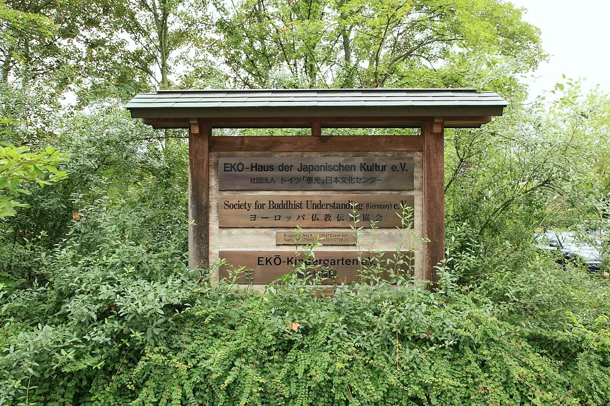

*Foto: Frank Vincentz / Wikimedia Commons (CC BY-SA 3.0) – [Quelle](https://commons.wikimedia.org/wiki/File:D%C3%BCsseldorf_-_Br%C3%BCggener_Weg_-_EKO-Haus_01_ies.jpg)*

Das EKŌ-Haus der Japanischen Kultur liegt am Brüggener Weg im Düsseldorfer Stadtteil **Niederkassel**. Ziel des Hauses ist es, die buddhistische Lehre und die darauf beruhende **japanische Kultur** zu vermitteln und den interreligiösen Dialog zu fördern. Es geht auf Numata Yehan zurück, den Gründer des japanischen Unternehmens Mitutoyo, und ist eine Auslandsniederlassung der in Tokio gegründeten Bukkyō Dendō Kyōkai. Der Grundstein wurde 1988 gelegt, der Tempel 1992 geweiht und das Haus 1993 eröffnet.

Zum Gelände gehören ein **buddhistischer Tempel**, ein traditionelles **Japanisches Haus**, Gartenanlagen und eine Bibliothek mit Schwerpunkt Buddhismusforschung. Der Tempelgarten ist als Trockengarten angelegt, in dem Wasserfall, Flusslauf und Teich durch Steine dargestellt sind. Das Angebot umfasst Kurse etwa in Kalligraphie, Koto-Musik und japanischer Sprache sowie Teezeremonien, Führungen, Ausstellungen und Vorträge.

Quellen je Satz

1. Das EKŌ-Haus der Japanischen Kultur liegt am Brüggener Weg im Düsseldorfer Stadt… — https://de.wikipedia.org/wiki/Ek%C5%8D-ji
2. Ziel des Hauses ist es, die buddhistische Lehre und die darauf beruhende japanis… — https://eko-haus.de/ueber-uns/ziel-geschichte/
3. Es geht auf Numata Yehan zurück, den Gründer des japanischen Unternehmens Mituto… — https://eko-haus.de/ueber-uns/ziel-geschichte/
4. Der Grundstein wurde 1988 gelegt, der Tempel 1992 geweiht und das Haus 1993 eröf… — https://eko-haus.de/ueber-uns/ziel-geschichte/
5. Zum Gelände gehören ein buddhistischer Tempel, ein traditionelles Japanisches Ha… — https://eko-haus.de/ueber-uns/gebaeude-gaerten/
6. Der Tempelgarten ist als Trockengarten angelegt, in dem Wasserfall, Flusslauf un… — https://eko-haus.de/ueber-uns/gebaeude-gaerten/
7. Das Angebot umfasst Kurse etwa in Kalligraphie, Koto-Musik und japanischer Sprac… — https://eko-haus.de/

> Hinweis der Recherche: Stadtteil: Wikipedia (Ekō-ji) nennt Niederkassel, eine Commons-Bildbeschreibung Oberkassel; im Text Niederkassel nach Wikipedia. Haltestelle auf der Website nicht direkt belegt. Bild nicht visuell geprüft (Beschreibung: Eko-Haus, Brüggener Weg).

---

### Em Pöötzke

`/orte/em-poeoetzke` · 2 Sätze · Website: –

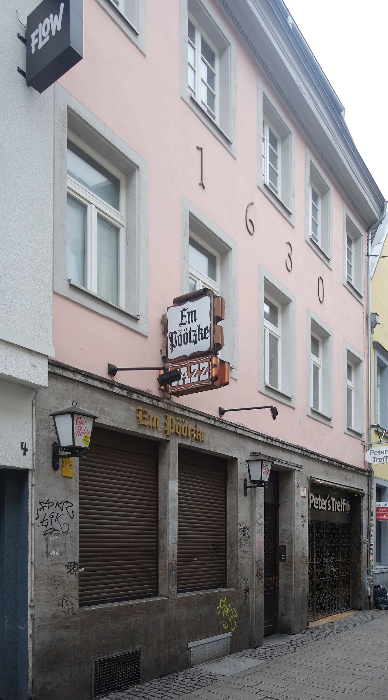

*Foto: Kürschner / Wikimedia Commons (CC0) – [Quelle](https://commons.wikimedia.org/wiki/File:Em_P%C3%B6%C3%B6tzke,_D%C3%BCsseldorf,_Januar_2026.jpg)*

**Em Pöötzke** in der Mertensgasse in der Düsseldorfer Altstadt ist eine Kneipe mit **Livemusik**, die als Jazzkneipe bekannt ist. Das Repertoire reicht von Dixieland und Blues über Soul, Funk und lateinamerikanische Musik bis zu **Modern Jazz**, traditionell sammeln die Musiker bei den Gästen eine Spende ein.

Quellen je Satz

1. Em Pöötzke in der Mertensgasse in der Düsseldorfer Altstadt ist eine Kneipe mit … — https://dusseldorf.amazingcapitals.com/em-pootzke
2. Das Repertoire reicht von Dixieland und Blues über Soul, Funk und lateinamerikan… — https://dusseldorf.amazingcapitals.com/em-pootzke

> Hinweis der Recherche: Keine offizielle Website (nur Facebook „empoetzkejazz“); Quellenlage dünn (Stadtführer amazingcapitals). Behauptung „älteste Jazzkneipe Deutschlands“ nur Eigenwerbung, weggelassen. Eurowings-Blog nennt Baujahr 1630 des Hauses, war aber nicht abrufbar (403) – weggelassen. Betriebsstatus unsicher: eine undatierte Nutzerbewertung meldet Schließung, Eventportale listen aber noch einen Jazz Slam im September 2026.

---

### Event-Theater Schwanenhöfe

`/orte/event-theater-schwanenhoefe` · 4 Sätze · Website: https://www.event-theater-schwanenhoefe.de/

Das **Event-Theater Schwanenhöfe** ist eine Eventlocation in Flingern für Veranstaltungen mit 50 bis 180 Gästen. Es liegt auf dem früheren **Henkel-Gelände**, wo ein Stadtquartier mit Industriearchitektur entsteht. Genutzt wird es für Firmenveranstaltungen, Tagungen, Hochzeiten und Feiern sowie für Film- und Fernsehproduktionen. Daneben finden auch öffentliche Veranstaltungen statt.

Quellen je Satz

1. Das Event-Theater Schwanenhöfe ist eine Eventlocation in Flingern für Veranstalt… — https://www.event-theater-schwanenhoefe.de/
2. Es liegt auf dem früheren Henkel-Gelände, wo ein Stadtquartier mit Industriearch… — https://www.event-theater-schwanenhoefe.de/
3. Genutzt wird es für Firmenveranstaltungen, Tagungen, Hochzeiten und Feiern sowie… — https://www.event-theater-schwanenhoefe.de/
4. Daneben finden auch öffentliche Veranstaltungen statt. — https://www.event-theater-schwanenhoefe.de/

> Hinweis der Recherche: Eröffnungsjahr (2015) nur auf einem Hochzeitsportal, daher weggelassen. Kein sauberes Saalfoto (nur kleines Slider-Bild).

---

### Everybodyoga

`/orte/everybodyoga` · 4 Sätze · Website: https://everybodyoga.de/

**everybodyoga** ist ein Yogastudio in einem ruhigen Hinterhof an der Merowingerstraße in Düsseldorf-**Bilk**. Auf dem Kursplan stehen unter anderem Vinyasa, Yin und **Kundalini Yoga**, dazu Kurse für Schwangere und nach der Geburt, Kinderyoga und Yoga für Eltern und Kind. Außerdem gibt es Einzelstunden und Angebote für Firmen. Der **S-Bahnhof Bilk** ist etwa zwei Gehminuten entfernt.

Quellen je Satz

1. everybodyoga ist ein Yogastudio in einem ruhigen Hinterhof an der Merowingerstra… — https://everybodyoga.de/kontakt-anfahrt/
2. Auf dem Kursplan stehen unter anderem Vinyasa, Yin und Kundalini Yoga, dazu Kurs… — https://everybodyoga.de/kontakt-anfahrt/
3. Außerdem gibt es Einzelstunden und Angebote für Firmen. — https://everybodyoga.de/kontakt-anfahrt/
4. Der S-Bahnhof Bilk ist etwa zwei Gehminuten entfernt. — https://everybodyoga.de/kontakt-anfahrt/

> Hinweis der Recherche: Kein Gründungsjahr und kein sauberes Raumfoto gefunden.

---

### Fatty's Irish Pub

`/orte/fatty-s-irish-pub` · 5 Sätze · Website: https://www.fattys.de/

**Fatty's Irish Pub** liegt an der Hunsrückenstraße mitten in der Düsseldorfer **Altstadt**. Die Kneipe wurde 1978 gegründet und war ursprünglich ein deutsches Lokal.

Bekannt ist der Pub für **Sportübertragungen** von Fußball, Eishockey, Rugby und American Football. Nach Angaben des Inhabers gehörte er zu den ersten Kneipen in Düsseldorf, die American Football zeigten. Zum Publikum zählen neben Fans von Fortuna Düsseldorf und der DEG viele britische Fußballfans.

Quellen je Satz

1. Fatty's Irish Pub liegt an der Hunsrückenstraße mitten in der Düsseldorfer Altst… — https://www.visitduesseldorf.de/storys/2024/06/11/fattys-irish-pub-duesseldorf/
2. Die Kneipe wurde 1978 gegründet und war ursprünglich ein deutsches Lokal. — https://www.visitduesseldorf.de/storys/2024/06/11/fattys-irish-pub-duesseldorf/
3. Bekannt ist der Pub für Sportübertragungen von Fußball, Eishockey, Rugby und Ame… — https://www.visitduesseldorf.de/storys/2024/06/11/fattys-irish-pub-duesseldorf/
4. Nach Angaben des Inhabers gehörte er zu den ersten Kneipen in Düsseldorf, die Am… — https://www.visitduesseldorf.de/storys/2024/06/11/fattys-irish-pub-duesseldorf/
5. Zum Publikum zählen neben Fans von Fortuna Düsseldorf und der DEG viele britisch… — https://www.visitduesseldorf.de/storys/2024/06/11/fattys-irish-pub-duesseldorf/

> Hinweis der Recherche: Fassade heißt „The Irish Pub bei Fatty“. Bildkandidat auf Commons (gemeinfrei, Kürschner): https://commons.wikimedia.org/wiki/File:D%C3%BCsseldorf,_Hunsr%C3%BCckenstra%C3%9Fe_13,_2016.jpg – zeigt die Fassade gut, im Vordergrund aber viele erkennbare Gäste; daher nicht übernommen, bitte selbst entscheiden.

---

### FFT Düsseldorf

`/orte/fft-duesseldorf` · 7 Sätze · Website: https://www.fft-duesseldorf.de/

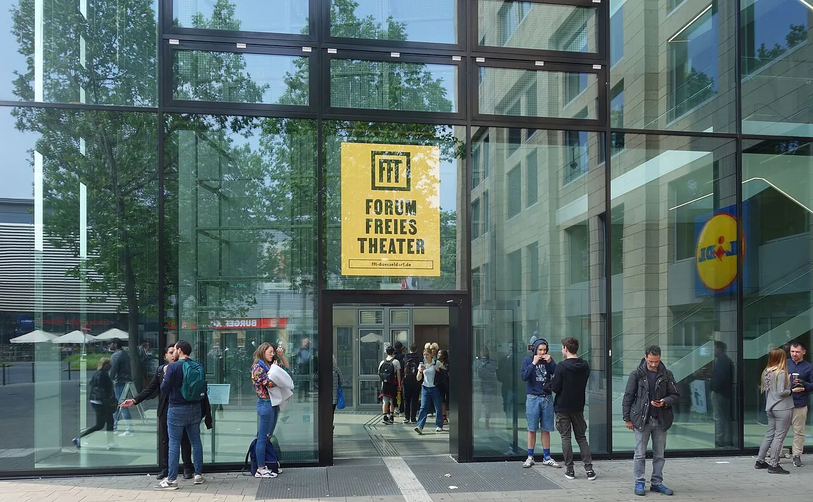

*Foto: Kürschner / Wikimedia Commons (Public Domain) – [Quelle](https://commons.wikimedia.org/wiki/File:Konrad-Adenauer-Platz_1,_D%C3%BCsseldorf_Mai_2023_(1).jpg)*

Das FFT (Forum Freies Theater) ist ein internationales **Produktionshaus für freie darstellende Künste** in Düsseldorf. Es wurde 1999 gegründet und ging aus den Kammerspielen Düsseldorf und dem Jungen Theater in der Altstadt hervor. Ohne festes Ensemble zeigt das Haus Arbeiten an der Schnittstelle von **Theater, Performance, Tanz**, bildender Kunst und Musik.

Seit 2021 hat das FFT seine Spielstätte im **KAP1** am Hauptbahnhof, zuvor nutzte es das FFT Juta in der Altstadt und die FFT Kammerspiele an der Jahnstraße. Im KAP1 stehen unter anderem zwei Bühnen, ein Foyer mit Blick auf den Bahnhofsvorplatz und eine Bar zur Verfügung. Programme für junges Publikum und die künstlerische Arbeit mit Jugendlichen gehören unter dem Namen **Junges FFT** seit Beginn zum Profil. 2015 wurde das FFT mit dem Theaterpreis des Bundes ausgezeichnet.

Quellen je Satz

1. Das FFT (Forum Freies Theater) ist ein internationales Produktionshaus für freie… — https://www.fft-duesseldorf.de/ueber-uns/
2. Es wurde 1999 gegründet und ging aus den Kammerspielen Düsseldorf und dem Jungen… — https://de.wikipedia.org/wiki/Forum_Freies_Theater
3. Ohne festes Ensemble zeigt das Haus Arbeiten an der Schnittstelle von Theater, P… — https://de.wikipedia.org/wiki/Forum_Freies_Theater
4. Seit 2021 hat das FFT seine Spielstätte im KAP1 am Hauptbahnhof, zuvor nutzte es… — https://de.wikipedia.org/wiki/Forum_Freies_Theater
5. Im KAP1 stehen unter anderem zwei Bühnen, ein Foyer mit Blick auf den Bahnhofsvo… — https://www.fft-duesseldorf.de/ueber-uns/
6. Programme für junges Publikum und die künstlerische Arbeit mit Jugendlichen gehö… — https://www.fft-duesseldorf.de/ueber-uns/
7. 2015 wurde das FFT mit dem Theaterpreis des Bundes ausgezeichnet. — https://de.wikipedia.org/wiki/Forum_Freies_Theater

> Hinweis der Recherche: Bild zeigt das Gebäude KAP1 (Konrad-Adenauer-Platz 1), in dem das FFT spielt; kein eigenes Commons-Foto der FFT-Räume. Bild wegen Drosselung durch Wikimedia nicht visuell geprüft.

---

### Filmwerkstatt Düsseldorf

`/orte/filmwerkstatt-duesseldorf` · 6 Sätze · Website: https://www.filmwerkstatt-duesseldorf.de/

Die Filmwerkstatt Düsseldorf ist ein gemeinnütziger, selbstverwalteter Verein von **Filmschaffenden**. Sie wurde 1976 gegründet und 1980 dem damals neu gegründeten Filminstitut der Stadt angegliedert. Seit 1992 ist sie ein eingetragener Verein, dessen Zweck laut Satzung die **Förderung des filmischen Nachwuchses** ist.

Zum Angebot gehören die Begleitung von Filmprojekten, der Verleih von Kamera-, Licht- und Tontechnik sowie die Vermietung von Schnittplätzen und Tonstudios. Mit der **Jungen Filmwerkstatt** gibt es einen außerschulischen Treffpunkt für junge Filmbegeisterte ab 16 Jahren. In ihren Räumen im Hof der Birkenstraße 47 zeigt die Filmwerkstatt außerdem Filme und veranstaltet Konzertabende.

Quellen je Satz

1. Die Filmwerkstatt Düsseldorf ist ein gemeinnütziger, selbstverwalteter Verein vo… — https://www.filmwerkstatt-duesseldorf.de/ueber-uns/
2. Sie wurde 1976 gegründet und 1980 dem damals neu gegründeten Filminstitut der St… — https://www.filmwerkstatt-duesseldorf.de/ueber-uns/
3. Seit 1992 ist sie ein eingetragener Verein, dessen Zweck laut Satzung die Förder… — https://www.filmwerkstatt-duesseldorf.de/ueber-uns/
4. Zum Angebot gehören die Begleitung von Filmprojekten, der Verleih von Kamera-, L… — https://de.wikipedia.org/wiki/Filmwerkstatt_D%C3%BCsseldorf
5. Mit der Jungen Filmwerkstatt gibt es einen außerschulischen Treffpunkt für junge… — https://de.wikipedia.org/wiki/Filmwerkstatt_D%C3%BCsseldorf
6. In ihren Räumen im Hof der Birkenstraße 47 zeigt die Filmwerkstatt außerdem Film… — https://www.filmwerkstatt-duesseldorf.de/

> Hinweis der Recherche: Wikipedia nennt als Standort noch die frühere Fliedner-Schule in Kaiserswerth (seit 1991); heutiger Sitz laut Website Birkenstraße 47 (Im Hof), seit wann ist nicht belegt. Herkunft widersprüchlich (Wikipedia: Filmgruppe Düsseldorf/„Film kritisch“ 1971, Website: Filmgruppe der Kunstakademie), daher weggelassen. Kein Bild gefunden.

---

### Franklinstraße Turnhalle

`/orte/franklinstrasse-turnhalle` · 3 Sätze · Website: –

An der Franklinstraße 5 in **Pempelfort** liegt die Kinder- und Jugendfreizeiteinrichtung **Franklin 5**, zu der eine **Sporthalle** gehört. Die Einrichtung richtet sich an Düsseldorferinnen und Düsseldorfer im Alter von 8 bis 27 Jahren. In der Sporthalle findet unter anderem regelmäßig Nachtfußball statt.

Quellen je Satz

1. An der Franklinstraße 5 in Pempelfort liegt die Kinder- und Jugendfreizeiteinric… — https://www.duesseldorf.de/kiju/freizeiteinrichtungen/pempelfort-franklinstrasse-5
2. Die Einrichtung richtet sich an Düsseldorferinnen und Düsseldorfer im Alter von … — https://www.duesseldorf.de/kiju/freizeiteinrichtungen/pempelfort-franklinstrasse-5
3. In der Sporthalle findet unter anderem regelmäßig Nachtfußball statt. — https://www.duesseldorf.de/kiju/freizeiteinrichtungen/pempelfort-franklinstrasse-5

> Hinweis der Recherche: Annahme: Die „Turnhalle“ ist die Sporthalle der Jugendeinrichtung Franklin 5 (gleiche Adresse); eine eigenständige Turnhalle unter dieser Adresse wurde nicht gefunden. Träger der Einrichtung nennt die Stadtseite nicht.

---

### Fünfzehnwochen Gerresheim

`/orte/fuenfzehnwochen-gerresheim` · 6 Sätze · Website: https://www.fuenfzehnwochen.de/

**Fünfzehnwochen** in Gerresheim ist ein Ausstellungs- und Projektraum des gleichnamigen gemeinnützigen Vereins, der Kunst in Düsseldorf fördert. Der Raum liegt am **Apostelplatz**, einem kleinen Park mit Spielplatz. Die nächste Haltestelle ist Von-Gahlen-Straße der U73, etwa 100 Meter entfernt.

Der Verein will Arbeiten von Meisterschülerinnen und Meisterschülern der **Kunstakademie Düsseldorf** sowie anderer Kunst- und Kulturschaffender im Alltag zugänglich machen. Bei den Ausstellungen sprechen die Künstlerinnen und Künstler vor Ort mit dem Publikum, dazu gibt es Vernissagen, **Kunstgespräche** und Finissagen, teils mit Musik oder Tanz. Einen zweiten Raum betreibt der Verein in Golzheim.

Quellen je Satz

1. Fünfzehnwochen in Gerresheim ist ein Ausstellungs- und Projektraum des gleichnam… — https://www.fuenfzehnwochen.de/%C3%BCber/
2. Der Raum liegt am Apostelplatz, einem kleinen Park mit Spielplatz. — https://www.fuenfzehnwochen.de/%C3%BCber/
3. Die nächste Haltestelle ist Von-Gahlen-Straße der U73, etwa 100 Meter entfernt. — https://www.fuenfzehnwochen.de/kontakt/
4. Der Verein will Arbeiten von Meisterschülerinnen und Meisterschülern der Kunstak… — https://www.fuenfzehnwochen.de/%C3%BCber/
5. Bei den Ausstellungen sprechen die Künstlerinnen und Künstler vor Ort mit dem Pu… — https://www.fuenfzehnwochen.de/%C3%BCber/
6. Einen zweiten Raum betreibt der Verein in Golzheim. — https://www.fuenfzehnwochen.de/kontakt/

> Hinweis der Recherche: Gründungsjahr und Raumgröße nicht belegt. Kein freies Bild des Raums gefunden.

---

### Fünfzehnwochen Golzheim - Projektraum / Offraum

`/orte/fuenfzehnwochen-golzheim-projektraum-offraum` · 5 Sätze · Website: https://www.fuenfzehnwochen.de/

**Fünfzehnwochen** in Golzheim ist ein Ausstellungs- und Projektraum des gleichnamigen gemeinnützigen Vereins, der Kunst in Düsseldorf fördert. Der Raum liegt an der Kaiserswerther Straße, die nächste Haltestelle ist **Theodor-Heuss-Brücke** mit den Linien U78 und U79.

Der Verein will Arbeiten von Meisterschülerinnen und Meisterschülern der **Kunstakademie Düsseldorf** sowie anderer Kunst- und Kulturschaffender im Alltag zugänglich machen. Bei den Ausstellungen sprechen die Künstlerinnen und Künstler vor Ort mit dem Publikum, dazu gibt es Vernissagen, **Kunstgespräche** und Finissagen, teils mit Musik oder Tanz. Einen zweiten Raum betreibt der Verein in Gerresheim.

Quellen je Satz

1. Fünfzehnwochen in Golzheim ist ein Ausstellungs- und Projektraum des gleichnamig… — https://www.fuenfzehnwochen.de/%C3%BCber/
2. Der Raum liegt an der Kaiserswerther Straße, die nächste Haltestelle ist Theodor… — https://www.fuenfzehnwochen.de/kontakt/
3. Der Verein will Arbeiten von Meisterschülerinnen und Meisterschülern der Kunstak… — https://www.fuenfzehnwochen.de/%C3%BCber/
4. Bei den Ausstellungen sprechen die Künstlerinnen und Künstler vor Ort mit dem Pu… — https://www.fuenfzehnwochen.de/%C3%BCber/
5. Einen zweiten Raum betreibt der Verein in Gerresheim. — https://www.fuenfzehnwochen.de/kontakt/

> Hinweis der Recherche: Gründungsjahr und Raumgröße nicht belegt. Text ähnelt dem Gerresheimer Eintrag, da die Quellen beide Räume gemeinsam beschreiben. Kein freies Bild gefunden.

---

### Galerie ARTROOM

`/orte/galerie-artroom` · 2 Sätze · Website: –

Die **Galerie Art Room** ist ein Ausstellungsraum im Düsseldorfer Stadtteil **Gerresheim**. Im Februar 2022 zeigte dort etwa die Neusser Künstlerin Jutta Jung Malerei mit Frauenmotiven.

Quellen je Satz

1. Die Galerie Art Room ist ein Ausstellungsraum im Düsseldorfer Stadtteil Gerreshe… — https://textination.de/en/node/24870
2. Im Februar 2022 zeigte dort etwa die Neusser Künstlerin Jutta Jung Malerei mit F… — https://textination.de/en/node/24870

> Hinweis der Recherche: Quellenlage dünn. Die Domain galerie-artroom.de zeigt veraltete Inhalte von 2014 und eingeschleuste Casino-Werbung (vermutlich übernommen/gekapert) – nicht als Webseite übernommen. Pressemitteilungen auf openPR (u. a. „Produzentengalerie“, getragen vom „Freundeskreis Art Room“) sind durch eine Bot-Schutzseite gesperrt und daher nicht genutzt. Rausgegangen-Eventeinträge nennen Am Poth, 40625 Düsseldorf; Galerie-Status aktuell unklar.

---

### Gare Du Neuss

`/orte/gare-du-neuss` · 6 Sätze · Website: https://www.gare-du-neuss.de

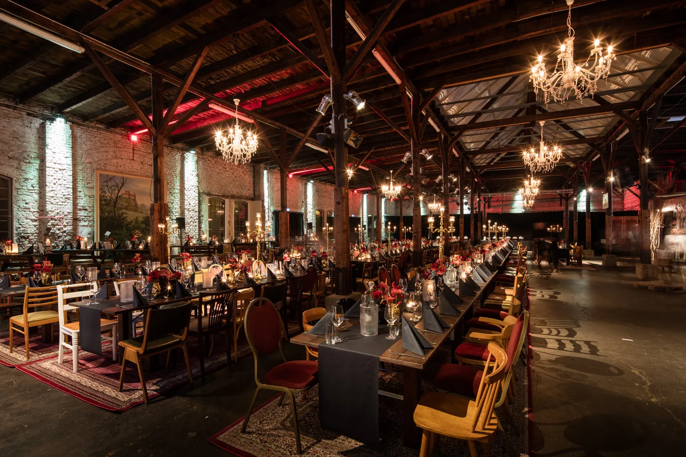

*Foto: Gare du Neuss – [Quelle](https://eventlocation.gareduneuss.de/location/)*

**Gare du Neuss** ist eine Eventlocation in einem früheren **Bahnhofsgebäude** an der Karl-Arnold-Straße in Neuss. Je nach Raumkonzept finden dort Feiern und Tagungen mit 80 bis 450 Gästen statt, Sommerfeste mit überdachtem Außenbereich sind für bis zu 750 Gäste möglich. Genutzt wird das Haus für **Firmenfeiern**, Hochzeiten, Geburtstage, Ausstellungen und Pop-up-Veranstaltungen.

Neben der großen Halle gehört das Café Stückgut zum Ort. Unter dem Namen Gare du Neuss finden dort außerdem **Flohmärkte** statt. Vom **Neusser Hauptbahnhof** sind es über den Ausgang Zufuhrstraße etwa sechs Minuten zu Fuß.

Quellen je Satz

1. Gare du Neuss ist eine Eventlocation in einem früheren Bahnhofsgebäude an der Ka… — https://eventlocation.gareduneuss.de/location/
2. Je nach Raumkonzept finden dort Feiern und Tagungen mit 80 bis 450 Gästen statt,… — https://eventlocation.gareduneuss.de/location/
3. Genutzt wird das Haus für Firmenfeiern, Hochzeiten, Geburtstage, Ausstellungen u… — https://eventlocation.gareduneuss.de/location/
4. Neben der großen Halle gehört das Café Stückgut zum Ort. — https://eventlocation.gareduneuss.de/location/
5. Unter dem Namen Gare du Neuss finden dort außerdem Flohmärkte statt. — https://flohmarkt.gareduneuss.de/
6. Vom Neusser Hauptbahnhof sind es über den Ausgang Zufuhrstraße etwa sechs Minute… — https://eventlocation.gareduneuss.de/anfahrt/

> Hinweis der Recherche: Liegt in Neuss. Website nennt kein Baujahr und keine frühere Nutzung im Detail („alter Bahnhof“); Commons beschreibt den Ort als ehemaligen Güterbahnhof – nicht im Text, da nicht offiziell belegt. Der regelmäßige Samstagsflohmarkt ist laut Website seit Juli 2019 eingestellt, Märkte laufen nur noch nach Eventkalender. Bild: Innenansicht der Halle (festlich eingedeckt) von der offiziellen Website, Fotograf nicht angegeben.

---

### Gerhart Hauptmann Haus

`/orte/gerhart-hauptmann-haus` · 8 Sätze · Website: https://www.g-h-h.de/

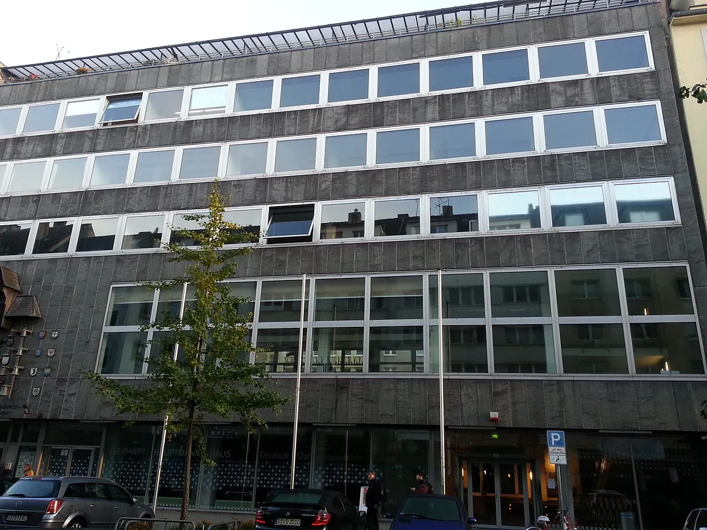

*Foto: Derbrauni / Wikimedia Commons (CC BY-SA 4.0) – [Quelle](https://commons.wikimedia.org/wiki/File:Gerhart-Hauptmann-Haus_D%C3%BCDo_total.jpg)*

Das **Gerhart-Hauptmann-Haus** an der Bismarckstraße ist ein deutsch-osteuropäisches Forum, getragen von der gleichnamigen Stiftung. Eröffnet wurde es im Juni 1963 als „Haus des Deutschen Ostens“ und Begegnungsstätte für Heimatvertriebene, den heutigen Namen trägt es seit 1992.

Der fünfgeschossige **Betonbau** mit verglasten unteren Geschossen entstand 1960 bis 1962 nach Plänen von Walter Kroner und Bruno Lambart. An der Fassade hängt ein 1985 eingeweihtes **Glockenspiel** mit 20 Glocken, umgeben von Wappen früherer deutscher Kulturregionen im Osten. Im Haus liegt der Eichendorff-Saal.

Inhaltlich befasst sich das Haus mit europäischer und deutscher **Zeitgeschichte**. Dazu gehört eine Spezialbibliothek zur Geschichte Ostmittel- und Osteuropas. Das Haus liegt nahe dem Hauptbahnhof.

Quellen je Satz

1. Das Gerhart-Hauptmann-Haus an der Bismarckstraße ist ein deutsch-osteuropäisches… — https://de.wikipedia.org/wiki/Gerhart-Hauptmann-Haus_(D%C3%BCsseldorf)
2. Eröffnet wurde es im Juni 1963 als „Haus des Deutschen Ostens“ und Begegnungsstä… — https://de.wikipedia.org/wiki/Gerhart-Hauptmann-Haus_(D%C3%BCsseldorf)
3. Der fünfgeschossige Betonbau mit verglasten unteren Geschossen entstand 1960 bis… — https://de.wikipedia.org/wiki/Gerhart-Hauptmann-Haus_(D%C3%BCsseldorf)
4. An der Fassade hängt ein 1985 eingeweihtes Glockenspiel mit 20 Glocken, umgeben … — https://de.wikipedia.org/wiki/Gerhart-Hauptmann-Haus_(D%C3%BCsseldorf)
5. Im Haus liegt der Eichendorff-Saal. — https://de.wikipedia.org/wiki/Gerhart-Hauptmann-Haus_(D%C3%BCsseldorf)
6. Inhaltlich befasst sich das Haus mit europäischer und deutscher Zeitgeschichte.… — https://de.wikipedia.org/wiki/Gerhart-Hauptmann-Haus_(D%C3%BCsseldorf)
7. Dazu gehört eine Spezialbibliothek zur Geschichte Ostmittel- und Osteuropas. — https://de.wikipedia.org/wiki/Gerhart-Hauptmann-Haus_(D%C3%BCsseldorf)
8. Das Haus liegt nahe dem Hauptbahnhof. — https://de.wikipedia.org/wiki/Gerhart-Hauptmann-Haus_(D%C3%BCsseldorf)

> Hinweis der Recherche: Haltestelle nicht belegt.

---

### Ghorban Delikatessen Manufaktur

`/orte/ghorban-delikatessen-manufaktur` · 5 Sätze · Website: https://www.ghorban.de/

Die **Ghorban Delikatessen Manufaktur** an der Heinrich-Heine-Allee ist ein Geschäft für **mediterrane Feinkost** mit angeschlossenem Bistro. Das inhabergeführte Unternehmen stellt seine Produkte nach eigenen Rezepten in einer eigenen Manufaktur und in wenigen traditionellen Handwerksbetrieben her. Weitere Läden gibt es unter anderem in Aachen.

Zum Sortiment gehören **Bio-Olivenöle** aus eigenen Hainen in Murcia, Kalabrien und auf Kreta. Im **Bistro** lassen sich viele Produkte aus eigener Herstellung und von meist ökologisch arbeitenden Erzeugern probieren.

Quellen je Satz

1. Die Ghorban Delikatessen Manufaktur an der Heinrich-Heine-Allee ist ein Geschäft… — https://www.visitduesseldorf.de/storys/2022/12/01/sechs-feinkostprodukte-die-gluecklich-machen/
2. Das inhabergeführte Unternehmen stellt seine Produkte nach eigenen Rezepten in e… — https://www.ghorban.de/
3. Weitere Läden gibt es unter anderem in Aachen. — https://www.ghorban.de/
4. Zum Sortiment gehören Bio-Olivenöle aus eigenen Hainen in Murcia, Kalabrien und … — https://www.visitduesseldorf.de/storys/2022/12/01/sechs-feinkostprodukte-die-gluecklich-machen/
5. Im Bistro lassen sich viele Produkte aus eigener Herstellung und von meist ökolo… — https://www.visitduesseldorf.de/storys/2022/12/01/sechs-feinkostprodukte-die-gluecklich-machen/

> Hinweis der Recherche: Gründungsjahr nicht genannt (Website: Marke seit 20 Jahren). Website nennt PLZ 40210, Paket 40213. Kein sauberes Ladenfoto.

---

### Ghorban Düsseldorf

`/orte/ghorban-duesseldorf` · 3 Sätze · Website: https://www.ghorban.de/

**Ghorban** an der Heinrich-Heine-Allee ist die Düsseldorfer Filiale einer Feinkostmarke für **mediterrane Spezialitäten**. Die Produkte entstehen nach eigenen Rezepten in einer eigenen **Manufaktur** und bei einigen traditionellen Handwerksbetrieben. Weitere Standorte gibt es in Aachen sowie in Märkten in Dortmund, Heiligenhaus und Wuppertal.

Quellen je Satz

1. Ghorban an der Heinrich-Heine-Allee ist die Düsseldorfer Filiale einer Feinkostm… — https://www.ghorban.de/
2. Die Produkte entstehen nach eigenen Rezepten in einer eigenen Manufaktur und bei… — https://www.ghorban.de/
3. Weitere Standorte gibt es in Aachen sowie in Märkten in Dortmund, Heiligenhaus u… — https://www.ghorban.de/

> Hinweis der Recherche: Ob es vor Ort Deli/Weinbar mit Speisen gibt, steht nur auf Liefer- und Rabattportalen (Wolt, NeoTaste) – daher weggelassen. Website nennt PLZ 40210 statt 40213. Bilder der Website zeigen nur Produkte, kein Ladenfoto.

---

### Globetrotter Düsseldorf

`/orte/globetrotter-duesseldorf` · 6 Sätze · Website: https://www.globetrotter.de/filialen/duesseldorf/

**Globetrotter** ist ein Fachgeschäft für Outdoor-Ausrüstung, das seine Düsseldorfer Filiale im November 2021 an der Flinger Straße in der **Altstadt** eröffnet hat. Zuvor befand sich das Geschäft an der Königsallee. Die Filiale an der Flinger Straße hat rund 1.500 Quadratmeter Verkaufsfläche.

In der **Clubhütte** finden Vorträge und Workshops statt. Eine hauseigene Werkstatt übernimmt kleinere Reparaturen, außerdem gibt es einen Bereich mit gebrauchter, aufbereiteter **Second-Hand-Ausrüstung**. Zum Haus gehört zudem eine reisemedizinische Praxis, in der Impfungen angeboten werden.

Quellen je Satz

1. Globetrotter ist ein Fachgeschäft für Outdoor-Ausrüstung, das seine Düsseldorfer… — https://lokalbuero.com/2021/10/18/globetrotter-duesseldorf-zieht-in-die-flinger-strasse/
2. Zuvor befand sich das Geschäft an der Königsallee. — https://lokalbuero.com/2021/10/18/globetrotter-duesseldorf-zieht-in-die-flinger-strasse/
3. Die Filiale an der Flinger Straße hat rund 1.500 Quadratmeter Verkaufsfläche. — https://lokalbuero.com/2021/10/18/globetrotter-duesseldorf-zieht-in-die-flinger-strasse/
4. In der Clubhütte finden Vorträge und Workshops statt. — https://www.globetrotter.de/filialen/duesseldorf/
5. Eine hauseigene Werkstatt übernimmt kleinere Reparaturen, außerdem gibt es einen… — https://www.globetrotter.de/filialen/duesseldorf/
6. Zum Haus gehört zudem eine reisemedizinische Praxis, in der Impfungen angeboten … — https://www.globetrotter.de/filialen/duesseldorf/

> Hinweis der Recherche: Kein sauberes Gebäudefoto gefunden.

---

### Glow & Patterns Art Studio

`/orte/glow-patterns-art-studio` · 3 Sätze · Website: https://sites.google.com/view/glow-patterns/home

**Glow & Patterns** ist ein Düsseldorfer Atelier für handgefertigte **Mosaik**- und Terrazzo-Kunst. Angeboten werden vor allem angeleitete **Mosaik-Workshops**, in denen Teilnehmende eigene Arbeiten gestalten, darunter Kurse für Erwachsene, Eltern-Kind- und Kinder-Workshops sowie ein Intensivkurs. Zusätzlich gibt es Mosaik-Bausätze für zu Hause.

Quellen je Satz

1. Glow & Patterns ist ein Düsseldorfer Atelier für handgefertigte Mosaik- und Terr… — https://sites.google.com/view/glow-patterns/home
2. Angeboten werden vor allem angeleitete Mosaik-Workshops, in denen Teilnehmende e… — https://sites.google.com/view/glow-patterns/home
3. Zusätzlich gibt es Mosaik-Bausätze für zu Hause. — https://sites.google.com/view/glow-patterns/home

> Hinweis der Recherche: ADRESSE PRÜFEN: Die offizielle Seite nennt als Adresse Atelier 303, Wiesenstraße 21A, 40549 Düsseldorf (Heerdt); auch Regioactive und Konfetti nennen Wiesenstraße 21a. Die Adresse Duisburger Straße 34 taucht nur in einem älteren Suchtreffer/Buchungseintrag auf – Umzug wahrscheinlich. Lage daher im Text weggelassen. Website ist eine Google-Sites-Seite.

---

### Goethe-Museum

`/orte/goethe-museum` · 9 Sätze · Website: https://www.goethe-museum.de/

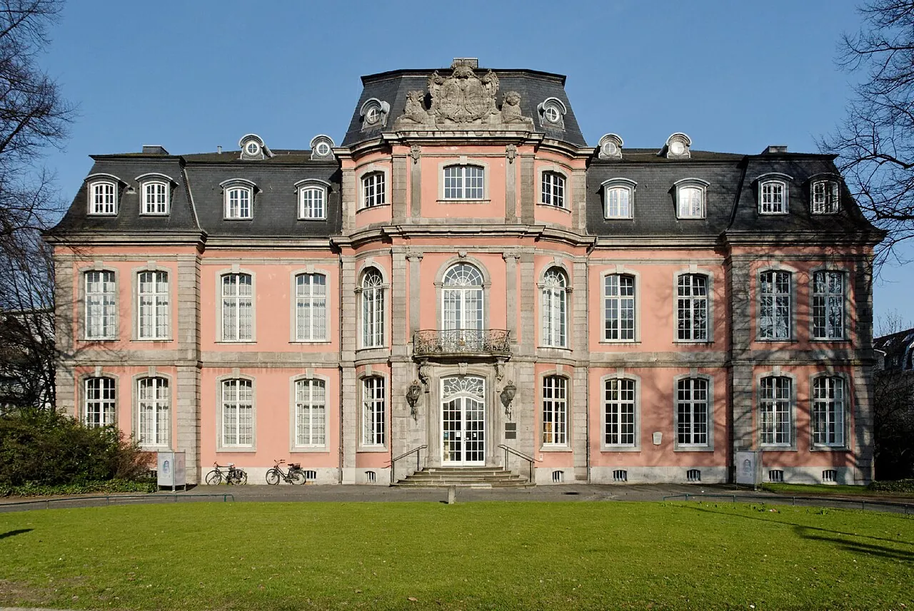

*Foto: Jörg Wiegels / Wikimedia Commons (CC BY-SA 3.0) – [Quelle](https://commons.wikimedia.org/wiki/File:Schloss_Jaegerhof_in_Duesseldorf-Pempelfort,_von_Westen.jpg)*

Das **Goethe-Museum** ist in **Schloss Jägerhof** an der Jacobistraße in Pempelfort untergebracht, am Ende der Jägerhofallee im Hofgarten. Getragen wird es von der Anton-und-Katharina-Kippenberg-Stiftung, die 1953 von zwei Erbinnen des früheren Insel-Verlegers Anton Kippenberg gegründet wurde. Das Museum öffnete im Juni 1956. Seit 1987 ist es im Schloss Jägerhof untergebracht.

Nach Angaben des Hauses umfasst die Sammlung rund 50.000 Objekte und ist die größte private **Goethe-Sammlung**. Dazu gehören Handschriften, Bücher, Gemälde, Zeichnungen, Büsten und Kunsthandwerk. Zum Haus gehören außerdem eine Forschungsbibliothek und ein Ort für Kulturveranstaltungen.

Das **Rokoko**-Schloss ließ Kurfürst Karl Theodor von 1752 bis 1763 als Lustschloss errichten, nach Plänen von Johann Joseph Couven, die Nicolas de Pigage nur teilweise ausführte. Nach schweren Schäden im Juni 1943 wurde es ab 1950 von Helmut Hentrich wiederaufgebaut.

Quellen je Satz

1. Das Goethe-Museum ist in Schloss Jägerhof an der Jacobistraße in Pempelfort unte… — https://de.wikipedia.org/wiki/Schloss_J%C3%A4gerhof
2. Getragen wird es von der Anton-und-Katharina-Kippenberg-Stiftung, die 1953 von z… — https://www.goethe-museum.de/en/about-us/the-goethe-museum-duesseldorf
3. Das Museum öffnete im Juni 1956. — https://www.goethe-museum.de/en/about-us/the-goethe-museum-duesseldorf
4. Seit 1987 ist es im Schloss Jägerhof untergebracht. — https://de.wikipedia.org/wiki/Schloss_J%C3%A4gerhof
5. Nach Angaben des Hauses umfasst die Sammlung rund 50.000 Objekte und ist die grö… — https://www.goethe-museum.de/en/about-us/the-goethe-museum-duesseldorf
6. Dazu gehören Handschriften, Bücher, Gemälde, Zeichnungen, Büsten und Kunsthandwe… — https://www.goethe-museum.de/en/about-us/the-goethe-museum-duesseldorf
7. Zum Haus gehören außerdem eine Forschungsbibliothek und ein Ort für Kulturverans… — https://www.goethe-museum.de/en/about-us/the-goethe-museum-duesseldorf
8. Das Rokoko-Schloss ließ Kurfürst Karl Theodor von 1752 bis 1763 als Lustschloss … — https://de.wikipedia.org/wiki/Schloss_J%C3%A4gerhof
9. Nach schweren Schäden im Juni 1943 wurde es ab 1950 von Helmut Hentrich wiederau… — https://de.wikipedia.org/wiki/Schloss_J%C3%A4gerhof

> Hinweis der Recherche: Wikipedia nennt eine museale Nutzung des Schlosses seit 1955, das Haus selbst die Eröffnung des Goethe-Museums 1956 (beides nicht unbedingt widersprüchlich, Ort vor 1987 nicht übernommen). Laut einer Stellenanzeige von 2025 befindet sich das Museum in einer umfassenden Transformation – Ausstellungsumfang ggf. eingeschränkt. Haltestelle nicht belegt.

---

### Hamtorkrug

`/orte/hamtorkrug` · 6 Sätze · Website: https://hamtorkrug.com/

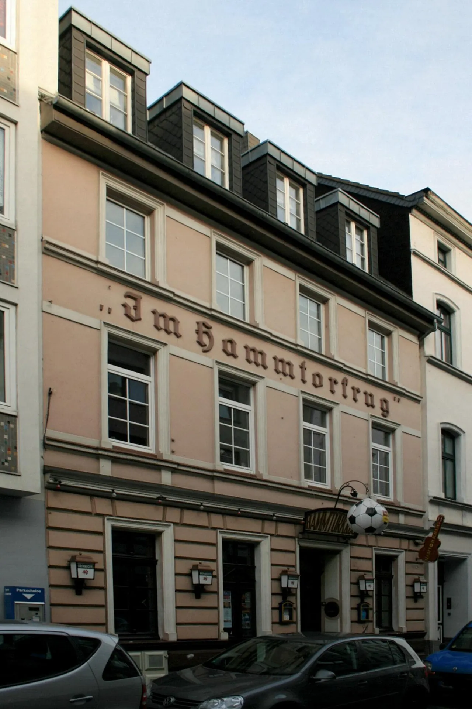

*Foto: Käthe u. Bernd Limburg / Wikimedia Commons (CC BY-SA 3.0 DE) – [Quelle](https://commons.wikimedia.org/wiki/File:(092)_1-197_Wohn-_u._Gesch%C3%A4ftshaus,_B%C3%BCttger_Stra%C3%9Fe_3_(Neuss).jpg)*

Der **Hamtorkrug** ist eine Gaststätte an der Büttger Straße in der Neusser Innenstadt, die seit Ende der 1960er-Jahre als Musikkneipe bekannt ist. In den 1970er-Jahren trug sie lange nach ihrem damaligen Wirt den Spitznamen „Ossi“.

Das Haus wurde um 1850 als erstes Gebäude unmittelbar vor dem **Hamtor** außerhalb der mittelalterlichen Stadtbefestigung errichtet. Der Kohlenhändler Johann Schmitz hatte den Neubau 1847 beantragt und betrieb dort neben Kohlenhandel und Landwirtschaft eine Gastwirtschaft. Seit 1993 steht das Gebäude auf der **Denkmalliste** der Stadt Neuss. Zum Angebot der Kneipe zählen auch Billard, Dart und Kicker.

Quellen je Satz

1. Der Hamtorkrug ist eine Gaststätte an der Büttger Straße in der Neusser Innensta… — https://e-pflicht.ulb.hhu.de/download/pdf/376441
2. In den 1970er-Jahren trug sie lange nach ihrem damaligen Wirt den Spitznamen „Os… — https://e-pflicht.ulb.hhu.de/download/pdf/376441
3. Das Haus wurde um 1850 als erstes Gebäude unmittelbar vor dem Hamtor außerhalb d… — https://e-pflicht.ulb.hhu.de/download/pdf/376441
4. Der Kohlenhändler Johann Schmitz hatte den Neubau 1847 beantragt und betrieb dor… — https://e-pflicht.ulb.hhu.de/download/pdf/376441
5. Seit 1993 steht das Gebäude auf der Denkmalliste der Stadt Neuss. — https://e-pflicht.ulb.hhu.de/download/pdf/376441
6. Zum Angebot der Kneipe zählen auch Billard, Dart und Kicker. — https://freizeitinsider.de/angebot/musikkneipe-hamtorkrug/

> Hinweis der Recherche: Die offizielle Website hamtorkrug.com sperrt per robots.txt ClaudeBot und anthropic-ai; sie wurde daher nicht als Quelle genutzt. Geschichte aus dem Artikel „Der Hamtorkrug: Eine Gaststätte mit langer Tradition“ in der Gilde Gazette der Schützengilde Neuss (Nr. 30, 2021, S. 50 ff., Pflichtexemplar ULB Düsseldorf). Widerspruch: Laut Denkmalbegründung ist das Haus seit 1887 Gaststätte, der Gazette-Artikel korrigiert, es sei schon seit der Erbauung eine Gastwirtschaft gewesen – Jahreszahl 1887 daher weggelassen. Billard/Dart/Kicker nur aus Verzeichnis (freizeitinsider.de) belegt.

---

### Hanaro Markt

`/orte/hanaro-markt` · 4 Sätze · Website: –

Der **Hanaro Markt** an der Immermannstraße ist ein **asiatischer Supermarkt** nur wenige Schritte vom Düsseldorfer **Hauptbahnhof** entfernt. Das Sortiment konzentriert sich auf japanische und koreanische Lebensmittel, darunter frische Zutaten, Gewürze und Süßigkeiten. Vor Ort wird zudem frisch zubereitetes Essen zum Mitnehmen angeboten. Das Geschäft wird in zweiter Generation als Familienunternehmen geführt.

Quellen je Satz

1. Der Hanaro Markt an der Immermannstraße ist ein asiatischer Supermarkt nur wenig… — https://www.visitduesseldorf.de/attraktionen/hanaro-markt-56ea5bd93a
2. Das Sortiment konzentriert sich auf japanische und koreanische Lebensmittel, dar… — https://www.visitduesseldorf.de/attraktionen/hanaro-markt-56ea5bd93a
3. Vor Ort wird zudem frisch zubereitetes Essen zum Mitnehmen angeboten. — https://www.visitduesseldorf.de/attraktionen/hanaro-markt-56ea5bd93a
4. Das Geschäft wird in zweiter Generation als Familienunternehmen geführt. — https://www.visitduesseldorf.de/attraktionen/hanaro-markt-56ea5bd93a

> Hinweis der Recherche: Keine offizielle Website gefunden (hanaro-markt.de nicht erreichbar). Größenangaben („einer der größten Asia-Supermärkte“) nur aus einem Blog – weggelassen.

---

### Haus der Universität

`/orte/haus-der-universitaet` · 8 Sätze · Website: https://www.hdu.hhu.de/

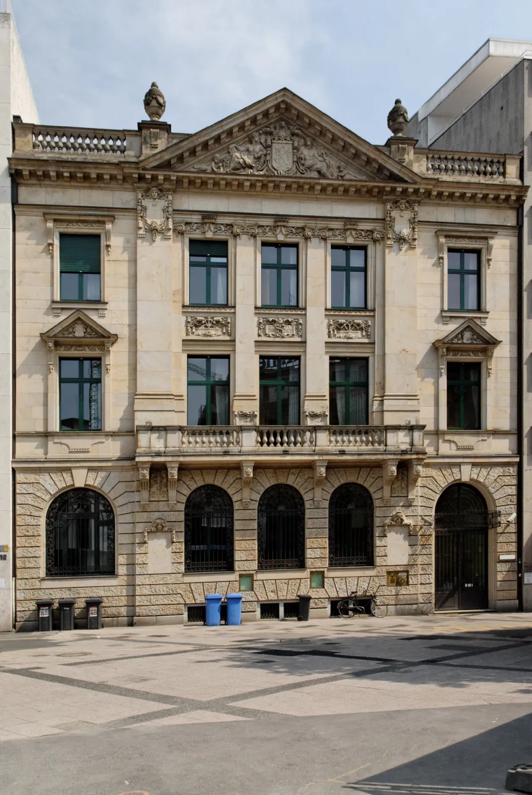

*Foto: Jörg Wiegels / Wikimedia Commons (CC BY-SA 3.0) – [Quelle](https://commons.wikimedia.org/wiki/File:Gebaeude_Schadowplatz_14_in_Duesseldorf-Stadtmitte,_von_Westen.jpg)*

Das Haus der Universität am **Schadowplatz** ist ein Veranstaltungs- und Tagungsort der **Heinrich-Heine-Universität** Düsseldorf in der Innenstadt. Seit 2013 dient es als Forum für den Dialog zwischen Wissenschaft und Stadtgesellschaft. Hier finden die öffentlichen Veranstaltungen der **Bürgeruniversität** sowie weitere Vorträge und Veranstaltungen aus Wissenschaft, Gesellschaft und Kultur statt. Zu den Räumen gehören ein Saal im Untergeschoss, ein Foyer im Erdgeschoss und Besprechungsräume in den oberen Etagen.

Das Gebäude entstand 1896/97 nach Plänen des Büros Kayser & von Großheim zusammen mit dem Düsseldorfer Architekten Max Wöhler als Sitz der **Niederrheinischen Bank**. Später nutzten es unter anderem das Bankhaus Schliep & Co. und ab 2001 die Garantibank International. Die **Sandsteinfassade** im Stil des Historismus mit Elementen der Renaissance steht seit 1982 unter Denkmalschutz. Im Jahr 2011 erwarb die van Meeteren-Stiftung das Haus und ließ es zum Informations- und Veranstaltungszentrum umbauen.

Quellen je Satz

1. Das Haus der Universität am Schadowplatz ist ein Veranstaltungs- und Tagungsort … — https://hdu.hhu.de/en/about-us
2. Seit 2013 dient es als Forum für den Dialog zwischen Wissenschaft und Stadtgesel… — https://hdu.hhu.de/en/about-us
3. Hier finden die öffentlichen Veranstaltungen der Bürgeruniversität sowie weitere… — https://hdu.hhu.de/en/about-us
4. Zu den Räumen gehören ein Saal im Untergeschoss, ein Foyer im Erdgeschoss und Be… — https://hdu.hhu.de/en/about-us
5. Das Gebäude entstand 1896/97 nach Plänen des Büros Kayser & von Großheim zusamme… — https://www.hdu.hhu.de/en/about-us/history-of-the-building
6. Später nutzten es unter anderem das Bankhaus Schliep & Co. und ab 2001 die Garan… — https://www.hdu.hhu.de/en/about-us/history-of-the-building
7. Die Sandsteinfassade im Stil des Historismus mit Elementen der Renaissance steht… — https://www.hdu.hhu.de/en/about-us/history-of-the-building
8. Im Jahr 2011 erwarb die van Meeteren-Stiftung das Haus und ließ es zum Informati… — https://www.hdu.hhu.de/en/about-us/history-of-the-building

> Hinweis der Recherche: Commons-Bild ist laut API unskaliert (Original 1280 x 1912, Hochformat). Commons-Dateinamen nennen als Eröffnung den 20. September 2013; im Text nur „seit 2013“ laut HHU-Seite.

---

### Haus Spilles

`/orte/haus-spilles` · 6 Sätze · Website: https://spilles.de/

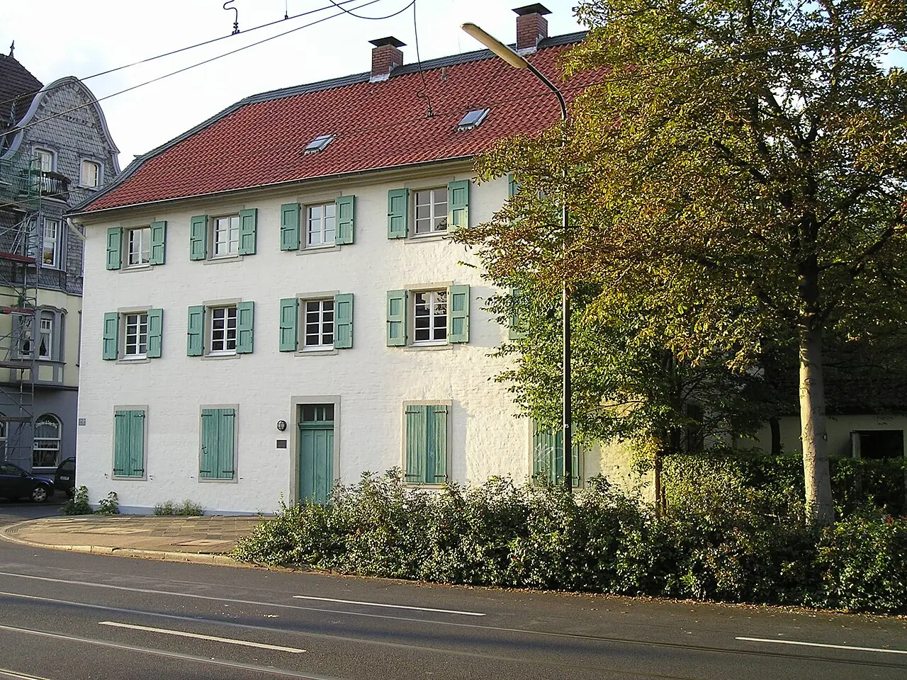

*Foto: noebse / Wikimedia Commons (CC BY 3.0) – [Quelle](https://commons.wikimedia.org/wiki/File:Haus_Spilles_D%C3%BCsseldorf_Benrath.JPG)*

Das **Haus Spilles** an der Benrather Schloßallee ist ein selbstverwaltetes Jugendzentrum in Düsseldorf-**Benrath**. Träger ist der Initiativkreis „Jugend in Benrath“ e.V., der in den 1970er-Jahren ein selbstverwaltetes Jugendzentrum für den Stadtteil gefordert hatte. Das Hauptgebäude ist die ehemalige **Posthalterei**, nach einem Umbau ab 1981 nahm das Jugendzentrum 1983 den Betrieb auf.

Zur Anlage gehört außerdem ein neu errichtetes Café-Gebäude mit drei Ebenen, das durch einen Durchgang mit dem Hauptgebäude verbunden ist. Nachmittags richtet sich der **Teens Club** an 10- bis 16-Jährige, im Abendbereich gibt es Cafés unter der Woche sowie Konzerte und Partys am Wochenende. Daneben bietet eine Radiowerkstatt die Möglichkeit, eigene Sendungen im Bürgerfunk zu gestalten.

Quellen je Satz

1. Das Haus Spilles an der Benrather Schloßallee ist ein selbstverwaltetes Jugendze… — https://spilles.de/hausspilles/haus-spilles/
2. Träger ist der Initiativkreis „Jugend in Benrath“ e.V., der in den 1970er-Jahren… — https://de.wikipedia.org/wiki/Haus_Spilles
3. Das Hauptgebäude ist die ehemalige Posthalterei, nach einem Umbau ab 1981 nahm d… — https://de.wikipedia.org/wiki/Haus_Spilles
4. Zur Anlage gehört außerdem ein neu errichtetes Café-Gebäude mit drei Ebenen, das… — https://de.wikipedia.org/wiki/Haus_Spilles
5. Nachmittags richtet sich der Teens Club an 10- bis 16-Jährige, im Abendbereich g… — https://spilles.de/hausspilles/haus-spilles/
6. Daneben bietet eine Radiowerkstatt die Möglichkeit, eigene Sendungen im Bürgerfu… — https://spilles.de/hausspilles/haus-spilles/

> Hinweis der Recherche: Ein Baujahr der ehemaligen Posthalterei wird in den Quellen nicht genannt.

---

### Heine Haus Literaturhaus Düsseldorf

`/orte/heine-haus-literaturhaus-duesseldorf` · 8 Sätze · Website: https://www.heinehaus.de/

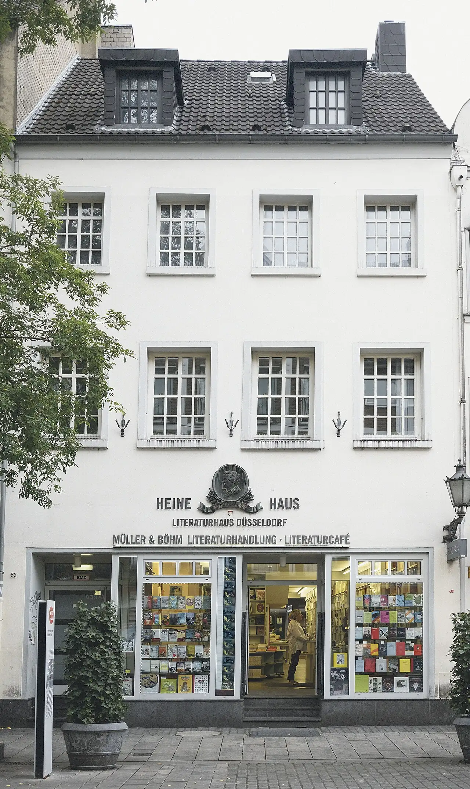

*Foto: Katja Stuke / Wikimedia Commons (CC BY-SA 4.0) – [Quelle](https://commons.wikimedia.org/wiki/File:Heine_Haus_D%C3%BCsseldorf_2020.jpg)*

Das **Heine Haus** ist ein Literaturhaus an der Bolkerstraße in der Düsseldorfer **Altstadt**. An dieser Stelle stand das Haus, in dessen Hinterhaus Heinrich Heine 1797 geboren wurde, es wurde im frühen 19. Jahrhundert durch einen Neubau ersetzt. Im Zweiten Weltkrieg wurde das Gebäude 1943 bis auf die Fassade zerstört und ab 1947 wieder aufgebaut.

Seit 2006 dient es als Zentrum für Literatur, seit 2017 unter dem Namen **Heine Haus Literaturhaus Düsseldorf**. Getragen wird es gemeinsam von der Stadt Düsseldorf, einem Förderverein und der Literaturhandlung Müller & Böhm, die den vorderen Teil des Hauses nutzt. Im hinteren Bereich liegen ein Veranstaltungsraum und ein Literaturcafé.

Auf dem Programm stehen vor allem **Autorenlesungen** mit Schwerpunkt auf neuer deutschsprachiger Literatur, dazu Reihen mit internationaler Literatur und Diskussionsabende. Seit 2011 widmet sich das Haus jährlich mit dem Festival „Poesie – Ein Fest im Heine Haus“ der Lyrik, in dessen Rahmen der **PoesieDebütPreis Düsseldorf** vergeben wird.

Quellen je Satz

1. Das Heine Haus ist ein Literaturhaus an der Bolkerstraße in der Düsseldorfer Alt… — https://de.wikipedia.org/wiki/Heine_Haus_(D%C3%BCsseldorf)
2. An dieser Stelle stand das Haus, in dessen Hinterhaus Heinrich Heine 1797 gebore… — https://de.wikipedia.org/wiki/Heine_Haus_(D%C3%BCsseldorf)
3. Im Zweiten Weltkrieg wurde das Gebäude 1943 bis auf die Fassade zerstört und ab … — https://de.wikipedia.org/wiki/Heine_Haus_(D%C3%BCsseldorf)
4. Seit 2006 dient es als Zentrum für Literatur, seit 2017 unter dem Namen Heine Ha… — https://de.wikipedia.org/wiki/Heine_Haus_(D%C3%BCsseldorf)
5. Getragen wird es gemeinsam von der Stadt Düsseldorf, einem Förderverein und der … — https://de.wikipedia.org/wiki/Heine_Haus_(D%C3%BCsseldorf)
6. Im hinteren Bereich liegen ein Veranstaltungsraum und ein Literaturcafé. — https://de.wikipedia.org/wiki/Heine_Haus_(D%C3%BCsseldorf)
7. Auf dem Programm stehen vor allem Autorenlesungen mit Schwerpunkt auf neuer deut… — https://de.wikipedia.org/wiki/Heine_Haus_(D%C3%BCsseldorf)
8. Seit 2011 widmet sich das Haus jährlich mit dem Festival „Poesie – Ein Fest im H… — https://de.wikipedia.org/wiki/Heine_Haus_(D%C3%BCsseldorf)

> Hinweis der Recherche: Abrissdatum des eigentlichen Geburtshauses in Wikipedia widersprüchlich (zwischen 1810 und 1820 bzw. um 1821) – daher nur „im frühen 19. Jahrhundert“. Website heinehaus.de enthält vor allem Archiv/PoesieFest-Seiten; Fakten aus Wikipedia. Auf dem Foto steht eine Person klein im Ladeneingang.

---

### Henkel-Saal

`/orte/henkel-saal` · 6 Sätze · Website: –

Der **Henkel-Saal** gehört zum **Schlösser Quartier** an der Ratinger Straße im Herzen der Düsseldorfer Altstadt. Der Saal bietet rund 550 Quadratmeter Fläche für Veranstaltungen. Eigentümerin der Immobilie ist die städtische Projektgesellschaft IDR AG.

Im Zuge eines neuen Konzepts wurde der Saal modernisiert und zu einer multifunktionalen Eventlocation umgebaut. Seit April 2025 ist er mit dem damals eröffneten **Schlager Café** verbunden. Weiterhin finden im Henkel-Saal auch **Brauchtumsveranstaltungen** statt, etwa der Düsseldorfer Jonges.

Quellen je Satz

1. Der Henkel-Saal gehört zum Schlösser Quartier an der Ratinger Straße im Herzen d… — https://www.visitduesseldorf.de/en/poi/detail/schloesser-quartier-e474325f79
2. Der Saal bietet rund 550 Quadratmeter Fläche für Veranstaltungen. — https://www.ddorf-aktuell.de/?p=119913
3. Eigentümerin der Immobilie ist die städtische Projektgesellschaft IDR AG. — https://www.ddorf-aktuell.de/?p=119913
4. Im Zuge eines neuen Konzepts wurde der Saal modernisiert und zu einer multifunkt… — https://www.tageskarte.io/gastronomie/detail/concept-family-oeffnet-schlager-cafe-in-duesseldorf.html
5. Seit April 2025 ist er mit dem damals eröffneten Schlager Café verbunden. — https://www.tageskarte.io/gastronomie/detail/concept-family-oeffnet-schlager-cafe-in-duesseldorf.html
6. Weiterhin finden im Henkel-Saal auch Brauchtumsveranstaltungen statt, etwa der D… — https://www.tageskarte.io/gastronomie/detail/concept-family-oeffnet-schlager-cafe-in-duesseldorf.html

> Hinweis der Recherche: Offizielle Seite schloesser-quartier.de sperrt per robots.txt alle Bots (Disallow: / für *) – nicht genutzt, daher auch keine Webseite eingetragen (Adresse wäre https://schloesser-quartier.de). Kapazität widersprüchlich (eventlocations: 700 sitzend/1.600 stehend; Hirespace: 200 sitzend/300 stehend; Tageskarte: bis 1.600 Gäste zusammen mit Café) – weggelassen. Renovierungsjahr 2024 vs. 2025 widersprüchlich – weggelassen. Henkel-Sponsoring seit 2009 nur aus Suchsnippet, nicht belegt. Kein Commons-Bild gefunden.

---

### Hetjens - Deutsches Keramikmuseum

`/orte/hetjens-deutsches-keramikmuseum` · 8 Sätze · Website: https://www.hetjensmuseum.de/

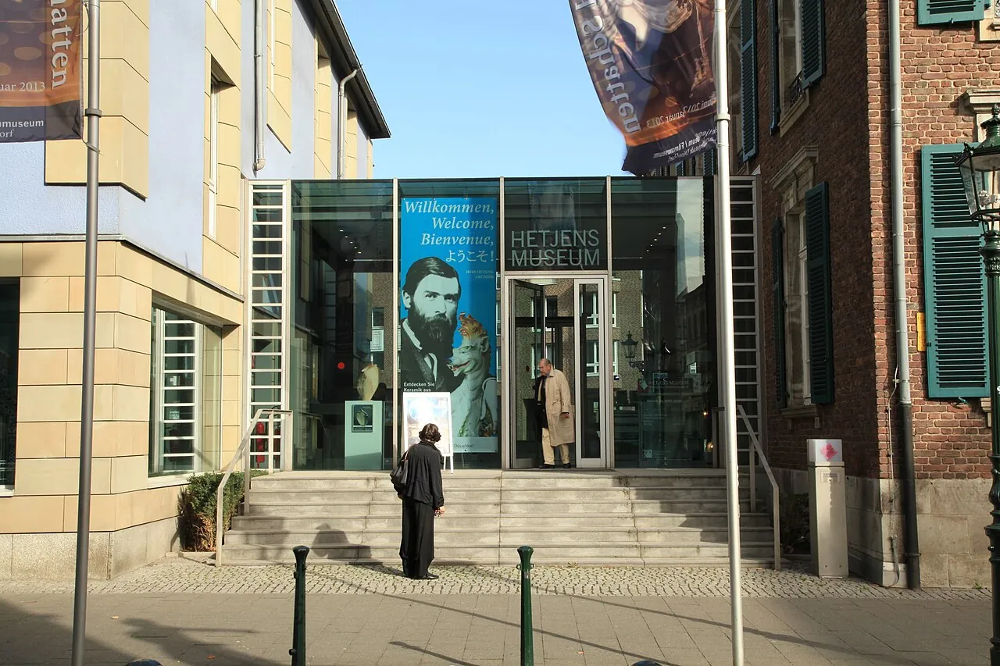

*Foto: Frank Vincentz / Wikimedia Commons (CC BY-SA 3.0) – [Quelle](https://commons.wikimedia.org/wiki/File:D%C3%BCsseldorf_-_Schulstra%C3%9Fe_-_Hetjens-Museum_01_ies.jpg)*

Das **Hetjens – Deutsches Keramikmuseum** ist ein Spezialmuseum für Keramik und zeigt Stücke aus rund 8000 Jahren und aus aller Welt. Es liegt im **Palais Nesselrode** an der Schulstraße, wenige Gehminuten von Rheinufer und Burgplatz entfernt.

Das Museum wurde im Mai 1909 eröffnet und geht auf den Nachlass des Sammlers **Laurenz Heinrich Hetjens** zurück, der der Stadt Geld für ein Museum unter seinem Namen vermachte. Das erste Gebäude stand am Hofgartenufer in Pempelfort, 1969 zog das Museum in das Palais Nesselrode um. 1994 kam ein Erweiterungsbau hinzu, in dem auch das Filmmuseum Düsseldorf untergebracht ist.

Grundstock der Sammlung war rheinisches Steinzeug, das im Lauf der Zeit um Keramik aus allen Kontinenten und Epochen ergänzt wurde. Zu den Schwerpunkten der **Dauerausstellung** gehören antike und präkolumbische Keramik, islamische Keramik, Fayence und Majolika, Porzellan sowie zeitgenössische Studiokeramik. Zu sehen ist außerdem eine rekonstruierte **islamische Keramikkuppel** aus Pakistan.

Quellen je Satz

1. Das Hetjens – Deutsches Keramikmuseum ist ein Spezialmuseum für Keramik und zeig… — https://www.duesseldorf.de/hetjens
2. Es liegt im Palais Nesselrode an der Schulstraße, wenige Gehminuten von Rheinufe… — https://www.duesseldorf.de/hetjens
3. Das Museum wurde im Mai 1909 eröffnet und geht auf den Nachlass des Sammlers Lau… — https://de.wikipedia.org/wiki/Hetjens-Museum
4. Das erste Gebäude stand am Hofgartenufer in Pempelfort, 1969 zog das Museum in d… — https://de.wikipedia.org/wiki/Hetjens-Museum
5. 1994 kam ein Erweiterungsbau hinzu, in dem auch das Filmmuseum Düsseldorf unterg… — https://de.wikipedia.org/wiki/Hetjens-Museum
6. Grundstock der Sammlung war rheinisches Steinzeug, das im Lauf der Zeit um Keram… — https://de.wikipedia.org/wiki/Hetjens-Museum
7. Zu den Schwerpunkten der Dauerausstellung gehören antike und präkolumbische Kera… — https://de.wikipedia.org/wiki/Hetjens-Museum
8. Zu sehen ist außerdem eine rekonstruierte islamische Keramikkuppel aus Pakistan.… — https://de.wikipedia.org/wiki/Hetjens-Museum

> Hinweis der Recherche: Stadtseite meldet Umbauarbeiten für ein Museumscafé („Wir bauen um“); ob das Museum geschlossen ist, war nicht erkennbar. hetjens.de ist eine fremde Gärtnerei – offizielle Website ist hetjensmuseum.de. Haltestelle nicht belegt.

---

### hi sunny

`/orte/hi-sunny` · 5 Sätze · Website: https://hi-sunny.de/

hi sunny ist ein Laden für **Home- und Living-Produkte** und Mode in Düsseldorf-Benrath, mit Waren bekannter Marken, kleiner Labels und regionaler Künstlerinnen und Künstler. Eröffnet wurde er im März 2026.

Ergänzt wird das Sortiment durch **kreative Workshops**, die zu festen Terminen stattfinden oder von Gruppen gebucht werden können. Angeboten werden etwa Kurse zu Trockenblumenkränzen, Kerzenherstellung und lufttrocknendem Ton. Der Laden liegt an der Görresstraße am Anfang der Fußgängerzone, nahe Schloss Benrath, in einem denkmalgeschützten **Eckgebäude**.

Quellen je Satz

1. hi sunny ist ein Laden für Home- und Living-Produkte und Mode in Düsseldorf-Benr… — https://hi-sunny.de/about
2. Eröffnet wurde er im März 2026. — https://hi-sunny.de/
3. Ergänzt wird das Sortiment durch kreative Workshops, die zu festen Terminen stat… — https://hi-sunny.de/about
4. Angeboten werden etwa Kurse zu Trockenblumenkränzen, Kerzenherstellung und luftt… — https://hi-sunny.de/
5. Der Laden liegt an der Görresstraße am Anfang der Fußgängerzone, nahe Schloss Be… — https://hi-sunny.de/about

> Hinweis der Recherche: robots.txt (Squarespace-Standard) nennt ClaudeBot/anthropic-ai, sperrt aber nur Unterpfade wie /config und /search; Start- und About-Seite sind erlaubt. Workshop-Preise weggelassen. Kein Bild (kleiner Laden, nur Website-Fotos).

---

### Holocafe

`/orte/holocafe` · 4 Sätze · Website: https://holocafe.de/de/duesseldorf

Das **Holocafé** an der Immermannstraße bietet **Virtual-Reality-Spiele** für Gruppen. Im Programm sind unter anderem Free-Roam-Spiele wie „Arizona Sunshine“ und „Escape the Lost Pyramid“. Außerdem gibt es **Brettspiele** und Trading Card Games wie Magic: The Gathering. Die Marke startete mit einem Pop-up in den Bilker Arkaden, im Dezember 2018 eröffnete der Düsseldorfer Hauptstandort, damals Am Wehrhahn.

Quellen je Satz

1. Das Holocafé an der Immermannstraße bietet Virtual-Reality-Spiele für Gruppen.… — https://holocafe.de/de/duesseldorf
2. Im Programm sind unter anderem Free-Roam-Spiele wie „Arizona Sunshine“ und „Esca… — https://holocafe.de/de/duesseldorf/vr-free-roam-games
3. Außerdem gibt es Brettspiele und Trading Card Games wie Magic: The Gathering.… — https://holocafe.de/de/duesseldorf/brettspiele-trading-card-games
4. Die Marke startete mit einem Pop-up in den Bilker Arkaden, im Dezember 2018 eröf… — https://www.ddorf-aktuell.de/?p=7921

> Hinweis der Recherche: Früherer Standort Am Wehrhahn 41 (Eröffnung Dezember 2018); die Website nennt heute Immermannstraße 7, Umzugsdatum nicht belegt. Weitere Holocafés in Köln und Winterberg. Kein sauberes Gebäudefoto.

---

### IHK Düsseldorf

`/orte/ihk-duesseldorf` · 4 Sätze · Website: https://www.ihk.de/duesseldorf

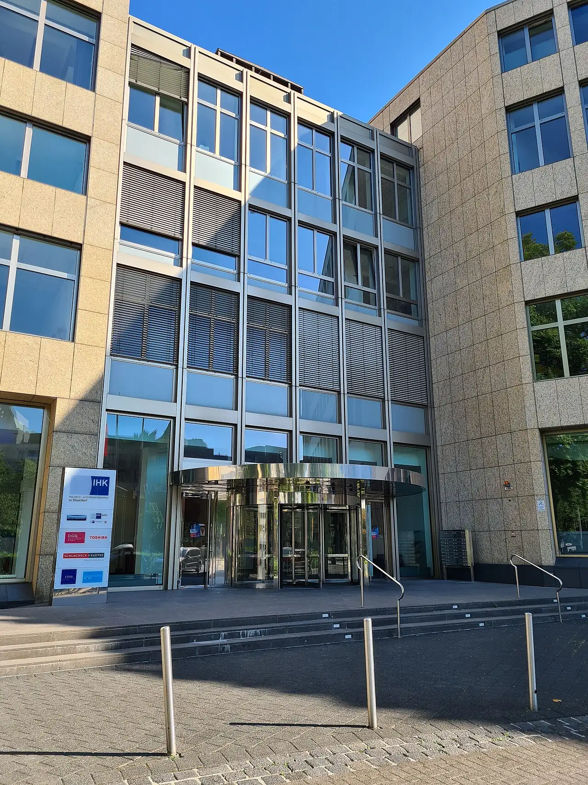

*Foto: Kalligraf / Wikimedia Commons (CC BY-SA 4.0) – [Quelle](https://commons.wikimedia.org/wiki/File:D%C3%BCsseldorf_Ernst-Schneider-Platz_1.jpg)*

Die Industrie- und Handelskammer zu Düsseldorf ist eine **Körperschaft des öffentlichen Rechts** für rund 100.000 Mitgliedsunternehmen aus Düsseldorf und dem Kreis Mettmann. Gegründet wurde sie im Mai 1831 als Königliche Handelskammer zu Düsseldorf. Ihren Sitz hat sie am **Ernst-Schneider-Platz** an der Berliner Allee in der Stadtmitte, wo sie 1957 ihr Gebäude bezog. Der Platz ist nach Ernst Schneider benannt, der die Kammer von 1949 bis 1968 als Präsident leitete, vor dem Gebäude steht eine Raumsäule des Bildhauers Erich Hauser.

Quellen je Satz

1. Die Industrie- und Handelskammer zu Düsseldorf ist eine Körperschaft des öffentl… — https://de.wikipedia.org/wiki/Industrie-_und_Handelskammer_zu_D%C3%BCsseldorf
2. Gegründet wurde sie im Mai 1831 als Königliche Handelskammer zu Düsseldorf. — https://de.wikipedia.org/wiki/Industrie-_und_Handelskammer_zu_D%C3%BCsseldorf
3. Ihren Sitz hat sie am Ernst-Schneider-Platz an der Berliner Allee in der Stadtmi… — https://de.wikipedia.org/wiki/Industrie-_und_Handelskammer_zu_D%C3%BCsseldorf
4. Der Platz ist nach Ernst Schneider benannt, der die Kammer von 1949 bis 1968 als… — https://de.wikipedia.org/wiki/Industrie-_und_Handelskammer_zu_D%C3%BCsseldorf

> Hinweis der Recherche: Säle und Veranstaltungsräume im Haus nicht belegt, daher weggelassen. Wikipedia nennt außerdem das IHK-Forum (Weiterbildung) nahe dem Hauptbahnhof; Veranstaltungen können auch dort stattfinden. Bild im Hochformat (Eingang mit IHK-Schild).

---

### IIK Düsseldorf Trainingszentrum, Raum F4

`/orte/iik-duesseldorf-trainingszentrum-raum-f4` · 4 Sätze · Website: https://iik-duesseldorf.de

Das **IIK Düsseldorf** bietet an der Eulerstraße **Deutschkurse** für Studium, Beruf und Alltag an, dazu Integrationskurse, Sommerkurse und Englischkurse. Außerdem werden dort **Sprachprüfungen** wie DSH, telc und TestDaF angeboten. Das Institut nutzt die gesamte erste Etage des Gebäudes mit zwölf Kursräumen für bis zu 25 Personen und einem Raum für Kleingruppen. Die Kursräume sind mit Smartboards ausgestattet.

Quellen je Satz

1. Das IIK Düsseldorf bietet an der Eulerstraße Deutschkurse für Studium, Beruf und… — https://iik-duesseldorf.de/en/german/around-the-courses/rooms-and-equipment
2. Außerdem werden dort Sprachprüfungen wie DSH, telc und TestDaF angeboten. — https://iik-duesseldorf.de/en/german/around-the-courses/rooms-and-equipment
3. Das Institut nutzt die gesamte erste Etage des Gebäudes mit zwölf Kursräumen für… — https://iik-duesseldorf.de/en/german/around-the-courses/rooms-and-equipment
4. Die Kursräume sind mit Smartboards ausgestattet. — https://iik-duesseldorf.de/en/german/around-the-courses/rooms-and-equipment

> Hinweis der Recherche: „Raum F4“ wird auf der offiziellen Seite nicht erwähnt; der Text beschreibt das Institut insgesamt. Ausgeschriebener Name (Institut für Internationale Kommunikation) und Trägerschaft nicht auf der gelesenen Seite belegt, daher weggelassen. Ältere Listings nennen noch Palmenstraße 25/Friedrichstraße 26 – offenbar veraltet. Kein sauberes Gebäudefoto gefunden.

---

### International English Library

`/orte/international-english-library` · 5 Sätze · Website: https://www.international-library.de/

Die International English Library (IEL) ist eine öffentliche **englischsprachige Bibliothek** in Düsseldorf und nach eigenen Angaben die einzige ihrer Art in Nordrhein-Westfalen. Gegründet wurde sie 1946 von der **britischen Besatzung**. Seit 1999 betreibt sie ein internationales Team von **Ehrenamtlichen**; im selben Jahr entstand der Förderverein Friends of International Library e.V., um die Bibliothek vor der Schließung zu bewahren.

Der Bestand umfasst mehr als 21.000 Publikationen, von **klassischer bis zeitgenössischer Literatur**. Regelmäßig gibt es Veranstaltungen, darunter einen Buchclub, Lyrik-Termine und Angebote für Kinder.

Quellen je Satz

1. Die International English Library (IEL) ist eine öffentliche englischsprachige B… — https://www.international-library.de/
2. Gegründet wurde sie 1946 von der britischen Besatzung. — https://www.international-library.de/about-us
3. Seit 1999 betreibt sie ein internationales Team von Ehrenamtlichen; im selben Ja… — https://www.international-library.de/
4. Der Bestand umfasst mehr als 21.000 Publikationen, von klassischer bis zeitgenös… — https://www.international-library.de/
5. Regelmäßig gibt es Veranstaltungen, darunter einen Buchclub, Lyrik-Termine und A… — https://www.international-library.de/

> Hinweis der Recherche: Gründungsjahr des Fördervereins aus „vor 25 Jahren“ (Stand 2024) abgeleitet. Adresse Mecumstraße 10 nur über eine Google-Sites-Kopie der Website und Portale bestätigt.

---

### ISLA DE CUBA | LATINO BAR EN DÜSSELDORF

`/orte/isla-de-cuba-latino-bar-en-duesseldorf` · 4 Sätze · Website: https://isladecuba.de/

Isla de Cuba ist eine **Latino-Bar** an der Bolkerstraße in der Düsseldorfer **Altstadt**. Serviert werden handgemixte kubanische Cocktails wie der Mojito. Musikalisch dominieren Salsa, Bachata und Reggaeton. Regelmäßig gibt es **Salsa-Abende**, Tanzkurse und Partys mit DJs.

Quellen je Satz

1. Isla de Cuba ist eine Latino-Bar an der Bolkerstraße in der Düsseldorfer Altstad… — https://www.visitduesseldorf.de/en/poi/detail/bar-isla-de-cuba-2d028e40d2
2. Serviert werden handgemixte kubanische Cocktails wie der Mojito. — https://www.visitduesseldorf.de/en/poi/detail/bar-isla-de-cuba-2d028e40d2
3. Musikalisch dominieren Salsa, Bachata und Reggaeton. — https://isladecuba.de/
4. Regelmäßig gibt es Salsa-Abende, Tanzkurse und Partys mit DJs. — https://www.visitduesseldorf.de/en/poi/detail/bar-isla-de-cuba-2d028e40d2

> Hinweis der Recherche: Kein sauberes Gebäude- oder Raumfoto gefunden.

---

### IT'S ART, BABY!

`/orte/it-s-art-baby` · 4 Sätze · Website: https://www.itsartbaby.de/

**IT'S ART, BABY!**, auch IAB Gallery genannt, ist eine Galerie für zeitgenössische Kunst in einem Innenhof an der Hohen Straße in der **Carlstadt**. Gezeigt werden Arbeiten aufstrebender Künstlerinnen und Künstler aus unterschiedlichen Medien. Die Räume dienen zugleich als Showroom für die **Kunstberatung** des Hauses, die unter anderem Büros, Kanzleien, Praxen und Architekturbüros mit Kunst ausstattet. Außerdem wird die Galerie als Eventlocation angeboten.

Quellen je Satz

1. IT'S ART, BABY!, auch IAB Gallery genannt, ist eine Galerie für zeitgenössische … — https://www.itsartbaby.de/
2. Gezeigt werden Arbeiten aufstrebender Künstlerinnen und Künstler aus unterschied… — https://www.itsartbaby.de/
3. Die Räume dienen zugleich als Showroom für die Kunstberatung des Hauses, die unt… — https://www.itsartbaby.de/
4. Außerdem wird die Galerie als Eventlocation angeboten. — https://www.itsartbaby.de/

> Hinweis der Recherche: Eventportale nennen teils eine ältere Adresse Nordstraße 25 (40477); die offizielle Website nennt Hohe Straße 35 (Innenhof). Gründungsjahr nicht belegt. Fotos der Website zeigen vor allem Vernissage-Publikum bzw. einzelne Kunstwerke – daher kein Bild. Achtung: itsartbaby.com ist ein fremdes Angebot.

---

### Jazz-Schmiede

`/orte/jazz-schmiede` · 7 Sätze · Website: https://www.jazz-schmiede.de/

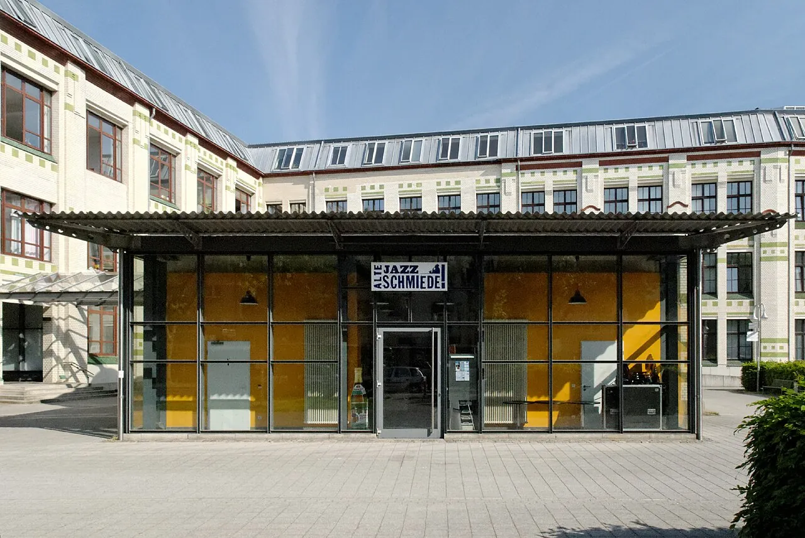

*Foto: Wiegels / Wikimedia Commons (CC BY 3.0) – [Quelle](https://commons.wikimedia.org/wiki/File:Jazz-Schmiede_in_Duesseldorf-Bilk,_von_Sueden.jpg)*

Die Jazz-Schmiede ist ein Konzertort für **Jazz und Weltmusik** im Düsseldorfer Stadtteil **Bilk**, unweit des Universitätsklinikums. Das Gebäude gehört zum denkmalgeschützten Ensemble **Salzmannbau**, einem ehemaligen Industriegelände aus der Gründerzeit, und diente früher als Schmiede. 1994 wurde es nach Plänen des Architekten Heiner Siefert zu einem kleinen Konzertsaal für bis zu 200 Gäste umgebaut, mit eigenem Flügel und einer Theke im Saal.

Den Konzertbetrieb verantwortet seit September 1995 der Verein **Jazz in Düsseldorf**, der 1994 eigens dafür gegründet wurde. Jedes Jahr finden mindestens 50 Konzerte statt, von kleinen Besetzungen bis zu Big Bands, dazu kommt außerhalb der Sommerpause eine wöchentliche **Jam-Session**. Seit 1996 werden hier regelmäßig Konzerte für WDR und Deutschlandfunk aufgezeichnet. Das Programm erhielt mehrfach den Spielstättenpreis des Landes NRW und viermal den Bundesspielstättenpreis „Applaus“.

Quellen je Satz

1. Die Jazz-Schmiede ist ein Konzertort für Jazz und Weltmusik im Düsseldorfer Stad… — https://de.wikipedia.org/wiki/Jazz-Schmiede
2. Das Gebäude gehört zum denkmalgeschützten Ensemble Salzmannbau, einem ehemaligen… — https://de.wikipedia.org/wiki/Jazz-Schmiede
3. 1994 wurde es nach Plänen des Architekten Heiner Siefert zu einem kleinen Konzer… — https://de.wikipedia.org/wiki/Jazz-Schmiede
4. Den Konzertbetrieb verantwortet seit September 1995 der Verein Jazz in Düsseldor… — https://de.wikipedia.org/wiki/Jazz-Schmiede
5. Jedes Jahr finden mindestens 50 Konzerte statt, von kleinen Besetzungen bis zu B… — https://de.wikipedia.org/wiki/Jazz-Schmiede
6. Seit 1996 werden hier regelmäßig Konzerte für WDR und Deutschlandfunk aufgezeich… — https://de.wikipedia.org/wiki/Jazz-Schmiede
7. Das Programm erhielt mehrfach den Spielstättenpreis des Landes NRW und viermal d… — https://de.wikipedia.org/wiki/Jazz-Schmiede

> Hinweis der Recherche: Alle Fakten aus Wikipedia; die eigene Website enthält kaum feste Hausangaben. Bild (Außenansicht, Original 1600 px) nicht visuell geprüft wegen Wikimedia-Drosselung.

---

### Jivamukti Yoga Düsseldorf

`/orte/jivamukti-yoga-duesseldorf` · 4 Sätze · Website: https://jivamuktiyogaduesseldorf.com/

**Jivamukti Yoga Düsseldorf** ist ein Yogastudio in der Düsseldorfer **Friedrichstadt**, dessen Eingang an der Oberbilker Allee liegt. Das Studio umfasst rund 220 Quadratmeter, davon etwa 120 für den **Yogaraum**, dazu einen Vorraum mit Gemeinschaftstisch, eine Garderobe und eine Küche. Unterrichtet wird **Jivamukti Yoga**. Daneben gibt es Ausbildungen für Lehrende, Workshops und Kurse für Firmen, außerdem können die Räume für Veranstaltungen gemietet werden.

Quellen je Satz

1. Jivamukti Yoga Düsseldorf ist ein Yogastudio in der Düsseldorfer Friedrichstadt,… — https://jivamuktiyogaduesseldorf.com/studio
2. Das Studio umfasst rund 220 Quadratmeter, davon etwa 120 für den Yogaraum, dazu … — https://jivamuktiyogaduesseldorf.com/studio
3. Unterrichtet wird Jivamukti Yoga. — https://jivamuktiyogaduesseldorf.com/studio
4. Daneben gibt es Ausbildungen für Lehrende, Workshops und Kurse für Firmen, außer… — https://jivamuktiyogaduesseldorf.com/studio

> Hinweis der Recherche: Postadresse laut Studio-Website Remscheider Straße 19, Eingang Oberbilker Allee 40. Raumfotos auf der Website vorhanden (webp), Inhalt nicht geprüft, daher kein Bild.

---

### Jugendkirche

`/orte/jugendkirche` · 4 Sätze · Website: https://www.evdus.de/leben-und-lernen/kinder-und-jugend/jugendkirche

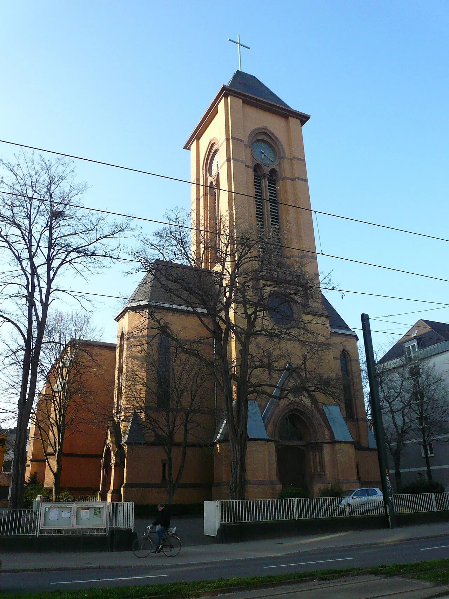

*Foto: Taurus65 / Wikimedia Commons (CC BY-SA 3.0) – [Quelle](https://commons.wikimedia.org/wiki/File:Christuskirche_D%C3%BCsseldorf-Oberbilk.JPG)*

Die **Evangelische Jugendkirche Düsseldorf** ist ein Angebot der Evangelischen Kirche in Düsseldorf, bei dem junge Menschen Kirche mitgestalten. Sie nutzt mit der **Christuskirche** am Campus Jugend in Düsseldorf-**Oberbilk** einen echten Kirchraum. Zu den Angeboten gehören eine Tischgemeinschaft mit gemeinsamem Einkaufen, Kochen und Essen sowie ehrenamtlich organisierte Spiele- und Rollenspielabende. Daneben gibt es Veranstaltungen wie Feriengottesdienste, die Jugendsynode und Rollerdisko.

Quellen je Satz

1. Die Evangelische Jugendkirche Düsseldorf ist ein Angebot der Evangelischen Kirch… — https://www.evdus.de/leben-und-lernen/kinder-und-jugend/jugendkirche
2. Sie nutzt mit der Christuskirche am Campus Jugend in Düsseldorf-Oberbilk einen e… — https://www.evdus.de/leben-und-lernen/kinder-und-jugend/jugendkirche
3. Zu den Angeboten gehören eine Tischgemeinschaft mit gemeinsamem Einkaufen, Koche… — https://www.evdus.de/leben-und-lernen/kinder-und-jugend/jugendkirche
4. Daneben gibt es Veranstaltungen wie Feriengottesdienste, die Jugendsynode und Ro… — https://www.evdus.de/leben-und-lernen/kinder-und-jugend/jugendkirche

> Hinweis der Recherche: Zur Christuskirche (Weihe 1899, Architekt Georg Weidenbach laut Commons-Dateinamen, Kriegsschäden) nur Reise-Aggregatoren und Dateibeschreibungen gefunden, keine belastbare Quelle, daher weggelassen. jugendkirche-duesseldorf.de leitet auf evdus.de um.

---

### Jugendkulturcafé Franzmann

`/orte/jugendkulturcafe-franzmann` · 5 Sätze · Website: –

Das **Jugendkulturcafé Franzmann** an der Ratinger Straße wird von der **Katholischen Jugendagentur Düsseldorf** getragen und besteht seit 2015. Es bietet jungen Düsseldorferinnen und Düsseldorfern einen geschützten Raum, um sich zu entfalten, sich sozial zu engagieren oder eigene Kunst auf die Bühne zu bringen. Das Café versteht sich als „No-Hate-Area“, in der Vielfalt gelebt wird.

Neben dem Café gibt es kostenlose Workshops, Veranstaltungen und weitere kulturelle Angebote. Beim **Franzmann Stickerfest** zeigte das Haus Sticker- und Paste-up-Arbeiten, die junge Besucherinnen und Besucher gemeinsam mit Streetart-Künstlern der Düsseldorfer Szene erarbeitet hatten.

Quellen je Satz

1. Das Jugendkulturcafé Franzmann an der Ratinger Straße wird von der Katholischen … — https://www.ddorf-aktuell.de/?p=123228
2. Es bietet jungen Düsseldorferinnen und Düsseldorfern einen geschützten Raum, um … — https://www.ddorf-aktuell.de/?p=123228
3. Das Café versteht sich als „No-Hate-Area“, in der Vielfalt gelebt wird. — https://www.ddorf-aktuell.de/?p=123228
4. Neben dem Café gibt es kostenlose Workshops, Veranstaltungen und weitere kulture… — https://www.ddorf-aktuell.de/?p=123228
5. Beim Franzmann Stickerfest zeigte das Haus Sticker- und Paste-up-Arbeiten, die j… — https://www.ddorf-aktuell.de/?p=123228

> Hinweis der Recherche: Einzige belastbare Quelle ist Ddorf-Aktuell (September 2024); keine eigene Website des Cafés gefunden (ggf. Unterseite der Katholischen Jugendagentur). Kein Bild.

---

### KaBARett FLiN

`/orte/kabarett-flin` · 6 Sätze · Website: https://www.kabarett-flin.de/

Das **KaBARett FLiN** ist eine kleine Kabarettbühne an der Ludenberger Straße in Grafenberg, nahe dem Staufenplatz. Gegründet wurde es 1999 als Zimmertheater „Theater FLINgern“ in einem Hinterhof an der Ackerstraße in Flingern. 2014 musste es dort einem Wohnungsbauprojekt weichen.

Im März 2015 eröffnete die Bühne neu im früheren **Haus Marx**, einem Gebäude von 1904. Sie hat rund 80 Plätze. Auf dem Programm stehen **Kabarett** und Comedy sowie eigene Theaterproduktionen, dazu kommt ein gastronomisches Angebot.

Quellen je Satz

1. Das KaBARett FLiN ist eine kleine Kabarettbühne an der Ludenberger Straße in Gra… — https://de.wikipedia.org/wiki/KaBARett_FLiN
2. Gegründet wurde es 1999 als Zimmertheater „Theater FLINgern“ in einem Hinterhof … — https://de.wikipedia.org/wiki/KaBARett_FLiN
3. 2014 musste es dort einem Wohnungsbauprojekt weichen. — https://de.wikipedia.org/wiki/KaBARett_FLiN
4. Im März 2015 eröffnete die Bühne neu im früheren Haus Marx, einem Gebäude von 19… — https://de.wikipedia.org/wiki/KaBARett_FLiN
5. Sie hat rund 80 Plätze. — https://de.wikipedia.org/wiki/KaBARett_FLiN
6. Auf dem Programm stehen Kabarett und Comedy sowie eigene Theaterproduktionen, da… — https://de.wikipedia.org/wiki/KaBARett_FLiN

> Hinweis der Recherche: Kein eindeutiges Gebäudefoto auf Commons oder der Website.

---

### KIT

`/orte/kit` · 7 Sätze · Website: https://www.kunst-im-tunnel.de/

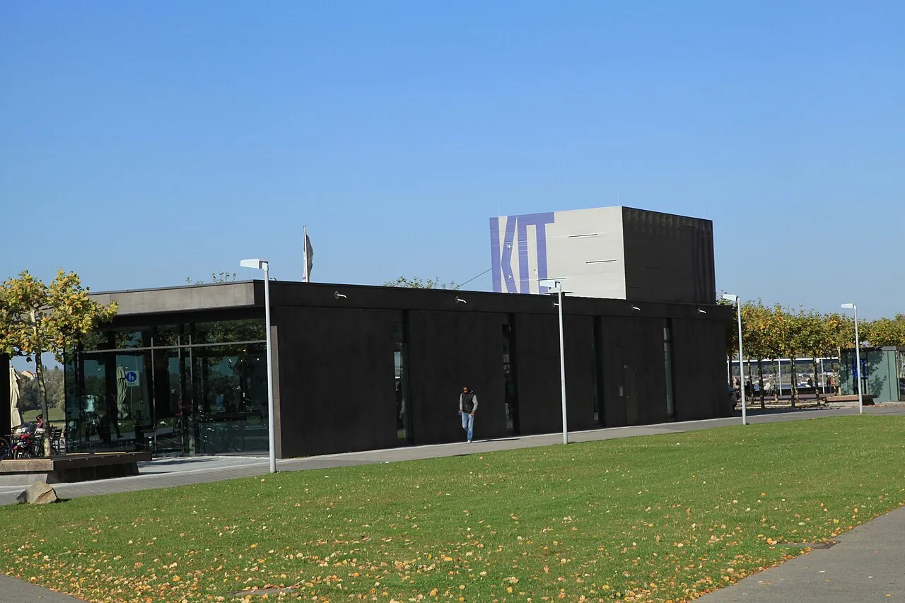

*Foto: Frank Vincentz / Wikimedia Commons (CC BY-SA 3.0) – [Quelle](https://commons.wikimedia.org/wiki/File:D%C3%BCsseldorf_-_Mannesmannufer_-_KIT_01_ies.jpg)*

Das **KIT – Kunst im Tunnel** ist ein unterirdisches Ausstellungshaus für zeitgenössische Kunst in Düsseldorf. Es liegt in einem Restraum, der beim Bau des **Rheinufertunnels** entstand, rund zwei Meter unter der Rheinuferpromenade nahe Landtag und Rheinkniebrücke. Eröffnet wurde es im Februar 2007, betrieben wird es von der **Kunsthalle Düsseldorf**.

Der **Eingangspavillon** auf der Promenade wurde vom Düsseldorfer Büro Fritschi Architekten entworfen, ist zum Rhein hin verglast und beherbergt ein kleines Bistro. Von dort führen Treppe und Aufzug in den rund 888 Quadratmeter großen Ausstellungsbereich zwischen den beiden Tunnelröhren. Der leicht geschwungene Raum ist 140 Meter lang und verjüngt sich von acht Metern auf einen Meter Breite.

Gezeigt werden vor allem Arbeiten junger Künstlerinnen und Künstler, darunter Absolventinnen und Absolventen der **Kunstakademie Düsseldorf**.

Quellen je Satz

1. Das KIT – Kunst im Tunnel ist ein unterirdisches Ausstellungshaus für zeitgenöss… — https://de.wikipedia.org/wiki/Kunst_im_Tunnel
2. Es liegt in einem Restraum, der beim Bau des Rheinufertunnels entstand, rund zwe… — https://de.wikipedia.org/wiki/Kunst_im_Tunnel
3. Eröffnet wurde es im Februar 2007, betrieben wird es von der Kunsthalle Düsseldo… — https://de.wikipedia.org/wiki/Kunst_im_Tunnel
4. Der Eingangspavillon auf der Promenade wurde vom Düsseldorfer Büro Fritschi Arch… — https://de.wikipedia.org/wiki/Kunst_im_Tunnel
5. Von dort führen Treppe und Aufzug in den rund 888 Quadratmeter großen Ausstellun… — https://de.wikipedia.org/wiki/Kunst_im_Tunnel
6. Der leicht geschwungene Raum ist 140 Meter lang und verjüngt sich von acht Meter… — https://de.wikipedia.org/wiki/Kunst_im_Tunnel
7. Gezeigt werden vor allem Arbeiten junger Künstlerinnen und Künstler, darunter Ab… — https://de.wikipedia.org/wiki/Kunst_im_Tunnel

> Hinweis der Recherche: Alle Angaben aus Wikipedia; offizielle Website nicht inhaltlich ausgewertet. Bild zeigt den Eingangspavillon mit KIT-Schriftzug, eine Person klein im Bild.

---

### Klanghaus

`/orte/klanghaus` · 3 Sätze · Website: https://www.klanghaus-duesseldorf.de/

Das **Klanghaus** ist ein Kulturzentrum in Düsseldorf-Oberbilk unter dem Leitgedanken „Musik, Raum, Bewegung“. Angeboten werden **Instrumental- und Gesangsunterricht**, Tanz, Theater, Kampfkunst, Chöre und Stimmbildung sowie musikalische Früherziehung. Die Räume lassen sich außerdem für Kurse wie Yoga und Pilates, für Workshops, Schulungen, Chorproben und Veranstaltungen **mieten**.

Quellen je Satz

1. Das Klanghaus ist ein Kulturzentrum in Düsseldorf-Oberbilk unter dem Leitgedanke… — https://www.klanghaus-duesseldorf.de/
2. Angeboten werden Instrumental- und Gesangsunterricht, Tanz, Theater, Kampfkunst,… — https://www.klanghaus-duesseldorf.de/
3. Die Räume lassen sich außerdem für Kurse wie Yoga und Pilates, für Workshops, Sc… — https://www.klanghaus-duesseldorf.de/vermietung

> Hinweis der Recherche: Adresse Kirchstraße 20, die Lage im Hinterhof und der Bezug zu TASK Düsseldorf stehen nur auf rausgegangen.de, nicht auf der Website – daher weggelassen. Gründungsjahr und Raumgrößen nicht belegt. Raumfotos der Website nur über ablaufende signierte CDN-Links – daher kein Bild.

---

### KLONKK – StadtStrand Indoor-Location

`/orte/klonkk-stadtstrand-indoor-location` · 5 Sätze · Website: https://www.klonkk.de/

KLONKK ist eine **Indoor-Eventlocation** in einer früheren Fabrikhalle auf dem **Factory Campus** an der Erkrather Straße. Der StadtStrand Düsseldorf führt sie als neuen eigenen Standort. Auf rund 900 Quadratmetern finden bis zu 200 Personen Platz.

Es gibt eine **Bühne für Live-Acts**, eine Bar, Chill-out-Bereiche sowie Billard und Kicker. Genutzt wird die Halle für Partys, Konzerte, Firmen- und Privatfeiern, aber auch für Workshops und Nachtflohmärkte.

Quellen je Satz

1. KLONKK ist eine Indoor-Eventlocation in einer früheren Fabrikhalle auf dem Facto… — https://www.klonkk.de/
2. Der StadtStrand Düsseldorf führt sie als neuen eigenen Standort. — https://www.stadtstrand-duesseldorf.de/
3. Auf rund 900 Quadratmetern finden bis zu 200 Personen Platz. — https://www.klonkk.de/
4. Es gibt eine Bühne für Live-Acts, eine Bar, Chill-out-Bereiche sowie Billard und… — https://www.klonkk.de/
5. Genutzt wird die Halle für Partys, Konzerte, Firmen- und Privatfeiern, aber auch… — https://www.klonkk.de/

> Hinweis der Recherche: Eröffnungsdatum nicht angegeben (laut StadtStrand-Seite „Jetzt neu“). Kein sauberes Bild gefunden.

---

### Kloster Flingern

`/orte/kloster-flingern` · 8 Sätze · Website: https://www.kloster-flingern.de/

**Kloster Flingern** ist das frühere **Kloster Christi Hilf** an der Flurstraße in Flingern-Nord. Errichtet wurde es 1890 nach Plänen des Architekten Heinrich Florak, ab 1894 zogen die Töchter vom Heiligen Kreuz ein. Die Klosterkirche mit Apsis wurde im Zweiten Weltkrieg weitgehend zerstört und danach wieder aufgebaut. Seit 1988 steht das Gebäude unter **Denkmalschutz**. Im Jahr 2003 verließ der Orden das Kloster.

Heute vereint das Haus Wohnungen, Büros, Ausstellungs- und **Veranstaltungsräume**. Die frühere Kirche wird als Raum für Events vermietet, etwa für Dinner, Vorträge oder Lesungen. Außerdem gibt es ein Yoga-Studio, Ateliers und eine Schmuckwerkstatt.

Quellen je Satz

1. Kloster Flingern ist das frühere Kloster Christi Hilf an der Flurstraße in Fling… — https://www.kuladig.de/Objektansicht/KLD-344101
2. Errichtet wurde es 1890 nach Plänen des Architekten Heinrich Florak, ab 1894 zog… — https://www.kuladig.de/Objektansicht/KLD-344101
3. Die Klosterkirche mit Apsis wurde im Zweiten Weltkrieg weitgehend zerstört und d… — https://www.kuladig.de/Objektansicht/KLD-344101
4. Seit 1988 steht das Gebäude unter Denkmalschutz. — https://www.kuladig.de/Objektansicht/KLD-344101
5. Im Jahr 2003 verließ der Orden das Kloster. — https://www.kuladig.de/Objektansicht/KLD-344101
6. Heute vereint das Haus Wohnungen, Büros, Ausstellungs- und Veranstaltungsräume.… — https://www.kuladig.de/Objektansicht/KLD-344101
7. Die frühere Kirche wird als Raum für Events vermietet, etwa für Dinner, Vorträge… — https://www.kloster-flingern.de/
8. Außerdem gibt es ein Yoga-Studio, Ateliers und eine Schmuckwerkstatt. — https://www.kloster-flingern.de/

> Hinweis der Recherche: Kein Foto auf Commons gefunden, Website-Bilder ohne Fotografenangabe.

---

### Kraeutelle - Naturkosmetik Workshops

`/orte/kraeutelle-naturkosmetik-workshops` · 5 Sätze · Website: https://kraeutelle.de

**Kräutelle** bietet in Düsseldorf Workshops an, in denen **Naturkosmetik** selbst hergestellt wird, die Kurse finden in den Räumen von Alternavita an der Kühlwetterstraße statt. In kleinen Gruppen rühren die Teilnehmenden Pflegeprodukte wie Hyalurongel, Gesichtswasser, Serum, Creme, Deo und Salbe an und nehmen sie mit nach Hause. Vermittelt wird dabei auch Wissen über **Heilpflanzen**, Öle und Wirkstoffe, Vorkenntnisse sind nicht nötig.

Der Name verbindet die Wörter Kräuter und **Immortelle**, eine Pflanze, die auch getrocknet Form, Farbe und Duft behält. Neben den Kursen gibt es auch Angebote für Gruppen-Events.

Quellen je Satz

1. Kräutelle bietet in Düsseldorf Workshops an, in denen Naturkosmetik selbst herge… — https://kraeutelle.de/
2. In kleinen Gruppen rühren die Teilnehmenden Pflegeprodukte wie Hyalurongel, Gesi… — https://kraeutelle.de/
3. Vermittelt wird dabei auch Wissen über Heilpflanzen, Öle und Wirkstoffe, Vorkenn… — https://kraeutelle.de/
4. Der Name verbindet die Wörter Kräuter und Immortelle, eine Pflanze, die auch get… — https://kraeutelle.de/
5. Neben den Kursen gibt es auch Angebote für Gruppen-Events. — https://kraeutelle.de/

> Hinweis der Recherche: Kleiner Anbieter, Kurse bei Alternavita (Kühlwetterstraße 53). Kein Foto der Räume gefunden.

---

### Kulturhaus Süd / Freizeitstätte Garath

`/orte/kulturhaus-sued-freizeitstaette-garath` · 8 Sätze · Website: https://www.duesseldorf.de/jugendamt/familie/buergerhaeuser/fg

*Foto: Wiegels / Wikimedia Commons (CC BY 3.0) – [Quelle](https://commons.wikimedia.org/wiki/File:Gebaeude_Fritz-Erler-Strasse_21_in_Duesseldorf-Garath,_von_Sueden.jpg)*

Das **Kulturhaus Süd** an der Fritz-Erler-Straße in Düsseldorf-**Garath** ist ein Kultur- und Bürgerzentrum, das bis zu seiner Modernisierung Freizeitstätte Garath hieß. Die Stadt bezeichnet es als größtes Bürgerhaus Düsseldorfs. Erbaut wurde es von 1972 bis 1974 nach Plänen des Architekten Olaf Jacobsen, eröffnet im April 1975.

Das Gebäude besteht aus elf **Betonkuben**, die um halbe Geschosse versetzt schneckenförmig um einen Innenhof angeordnet sind. Bei der Modernisierung blieb die Bausubstanz erhalten, die Technik wurde erneuert.

Im großen **Saal** finden Vorstellungen des Kino Süd, Kleinkunst und andere Veranstaltungen statt. Im Haus befinden sich außerdem die Stadtteilbücherei, das Zentrum plus der Diakonie, Kurs- und Seminarräume sowie ein Café. Mit der S-Bahn ist das Haus über die Linien S6 und S68 erreichbar.

Quellen je Satz

1. Das Kulturhaus Süd an der Fritz-Erler-Straße in Düsseldorf-Garath ist ein Kultur… — https://de.wikipedia.org/wiki/Freizeitst%C3%A4tte_Garath
2. Die Stadt bezeichnet es als größtes Bürgerhaus Düsseldorfs. — https://www.duesseldorf.de/jugendamt/familie/buergerhaeuser/fg
3. Erbaut wurde es von 1972 bis 1974 nach Plänen des Architekten Olaf Jacobsen, erö… — https://de.wikipedia.org/wiki/Freizeitst%C3%A4tte_Garath
4. Das Gebäude besteht aus elf Betonkuben, die um halbe Geschosse versetzt schnecke… — https://de.wikipedia.org/wiki/Freizeitst%C3%A4tte_Garath
5. Bei der Modernisierung blieb die Bausubstanz erhalten, die Technik wurde erneuer… — https://de.wikipedia.org/wiki/Freizeitst%C3%A4tte_Garath
6. Im großen Saal finden Vorstellungen des Kino Süd, Kleinkunst und andere Veransta… — https://de.wikipedia.org/wiki/Freizeitst%C3%A4tte_Garath
7. Im Haus befinden sich außerdem die Stadtteilbücherei, das Zentrum plus der Diako… — https://www.duesseldorf.de/jugendamt/familie/buergerhaeuser/fg
8. Mit der S-Bahn ist das Haus über die Linien S6 und S68 erreichbar. — https://www.duesseldorf.de/jugendamt/familie/buergerhaeuser/fg

> Hinweis der Recherche: Platzzahl des Saals widersprüchlich (Wikipedia 350, Stadt 320), Umbauzeitraum und -kosten widersprüchlich (Wikipedia 2021–2023 / 5,6 Mio. €, Architekturbüro 2020–2022 / 5,3 Mio. €), daher weggelassen.

---

### Kunsthalle Düsseldorf

`/orte/kunsthalle-duesseldorf` · 8 Sätze · Website: https://www.kunsthalle-duesseldorf.de/

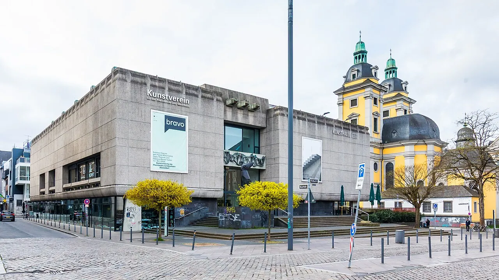

*Foto: Raimond Spekking / Wikimedia Commons (CC BY-SA 4.0) – [Quelle](https://commons.wikimedia.org/wiki/File:Au%C3%9Fenansicht_Kunsthalle_D%C3%BCsseldorf_2026-0726.jpg)*

Die Kunsthalle Düsseldorf ist ein Ausstellungshaus für **zeitgenössische Kunst** ohne eigene Sammlung. Sie liegt am **Grabbeplatz** gegenüber der Kunstsammlung Nordrhein-Westfalen. Ihre Geschichte reicht auf eine erste Kunsthalle zurück, die im Juli 1881 eröffnet, im Zweiten Weltkrieg stark beschädigt und 1967 abgerissen wurde.

Der heutige Bau von 1967 mit seiner Fassade aus Sichtbeton gilt als Beispiel des **Brutalismus**. Innen bietet er auf drei Etagen drei große Säle und zwei Foyers mit zusammen rund 1.000 Quadratmetern Ausstellungsfläche. Nachdem Ende der 1990er-Jahre ein Abriss verhindert worden war, öffnete das Haus nach einem Umbau im Juli 2002 wieder.

Im selben Gebäude haben auch der **Kunstverein für die Rheinlande und Westfalen**, das Kabarett Kom(m)ödchen, eine Buchhandlung und der Salon des Amateurs ihren Sitz. Einen weiteren Ausstellungsraum betreibt die Kunsthalle mit **KIT – Kunst im Tunnel** unter der Rheinuferpromenade.

Quellen je Satz

1. Die Kunsthalle Düsseldorf ist ein Ausstellungshaus für zeitgenössische Kunst ohn… — https://www.kunsthalle-duesseldorf.de/ueber-uns/
2. Sie liegt am Grabbeplatz gegenüber der Kunstsammlung Nordrhein-Westfalen. — https://de.wikipedia.org/wiki/Kunsthalle_D%C3%BCsseldorf
3. Ihre Geschichte reicht auf eine erste Kunsthalle zurück, die im Juli 1881 eröffn… — https://de.wikipedia.org/wiki/Kunsthalle_D%C3%BCsseldorf
4. Der heutige Bau von 1967 mit seiner Fassade aus Sichtbeton gilt als Beispiel des… — https://de.wikipedia.org/wiki/Kunsthalle_D%C3%BCsseldorf
5. Innen bietet er auf drei Etagen drei große Säle und zwei Foyers mit zusammen run… — https://www.kunsthalle-duesseldorf.de/ueber-uns/
6. Nachdem Ende der 1990er-Jahre ein Abriss verhindert worden war, öffnete das Haus… — https://www.kunsthalle-duesseldorf.de/ueber-uns/
7. Im selben Gebäude haben auch der Kunstverein für die Rheinlande und Westfalen, d… — https://www.kunsthalle-duesseldorf.de/ueber-uns/
8. Einen weiteren Ausstellungsraum betreibt die Kunsthalle mit KIT – Kunst im Tunne… — https://de.wikipedia.org/wiki/Kunsthalle_D%C3%BCsseldorf

> Hinweis der Recherche: Bild zeigt die Fassade mit Kunstverein-Schriftzug und ein Ausstellungsplakat am Gebäude (Gebäude klar im Vordergrund). Die Kunsthalle selbst nennt ihren Bau eines der ersten Zeugnisse des Brutalismus in Deutschland; im Text nur die vorsichtigere Wikipedia-Formulierung.

---

### Kunstsammlung NRW

`/orte/kunstsammlung-nrw` · 7 Sätze · Website: https://www.kunstsammlung.de/

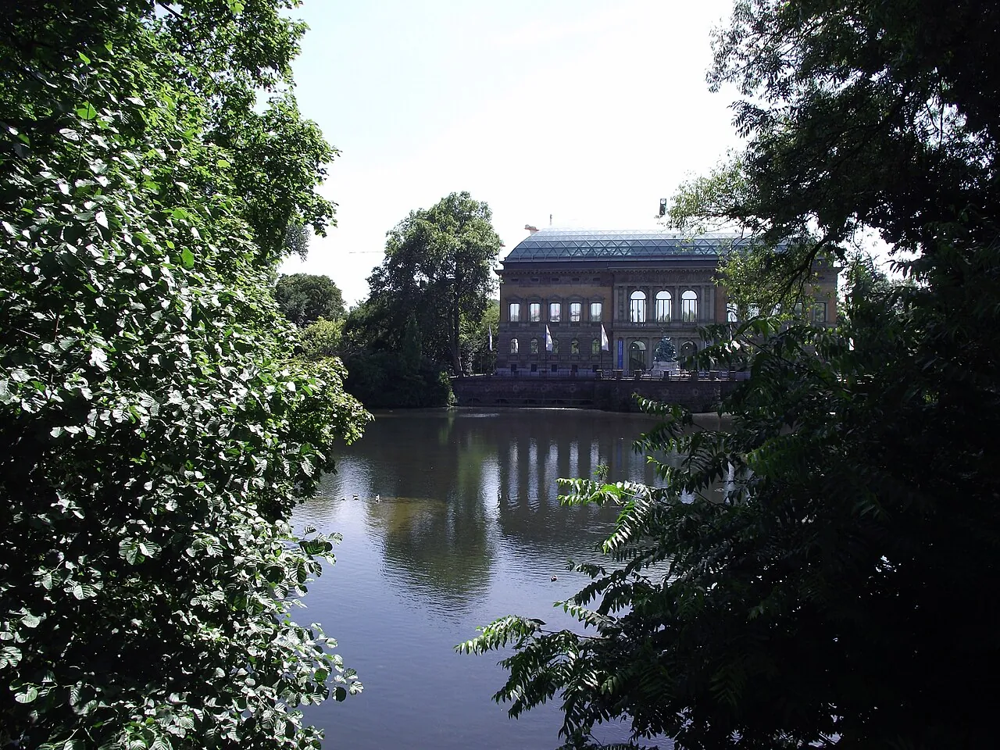

*Foto: Fred Romero / Wikimedia Commons (CC BY 2.0) – [Quelle](https://commons.wikimedia.org/wiki/File:D%C3%BCsseldorf_-_K21_St%C3%A4ndehaus,_Kunstsammlung_Nordrhein-Westfalen.jpg)*

Die Kunstsammlung Nordrhein-Westfalen ist das Kunstmuseum des Landes und zeigt Kunst des 20. und 21. Jahrhunderts an zwei Standorten in Düsseldorf: im **K20** am Grabbeplatz und im **K21** im Ständehaus. Gegründet wurde sie 1961 von der Landesregierung als Stiftung. Zur Sammlung gehören Werke der Klassischen Moderne, etwa von Pablo Picasso, Henri Matisse und Piet Mondrian, sowie rund 130 Zeichnungen und Gemälde von **Paul Klee**.

Das K21 liegt im **Ständehaus** am Kaiserteich, das 1876 bis 1880 nach Plänen von Julius Raschdorff für den Provinziallandtag der preußischen Rheinprovinz gebaut wurde. Von 1949 bis 1988 tagte dort der Landtag von Nordrhein-Westfalen. Nach einem Umbau, bei dem eine Kuppel aus Glas und Stahl das Dach der Nachkriegszeit ersetzte, öffnete das Haus im April 2002 als Museum. Im K21 steht **Gegenwartskunst** ab etwa 1980 im Mittelpunkt.

Quellen je Satz

1. Die Kunstsammlung Nordrhein-Westfalen ist das Kunstmuseum des Landes und zeigt K… — https://de.wikipedia.org/wiki/Kunstsammlung_Nordrhein-Westfalen
2. Gegründet wurde sie 1961 von der Landesregierung als Stiftung. — https://de.wikipedia.org/wiki/Kunstsammlung_Nordrhein-Westfalen
3. Zur Sammlung gehören Werke der Klassischen Moderne, etwa von Pablo Picasso, Henr… — https://de.wikipedia.org/wiki/Kunstsammlung_Nordrhein-Westfalen
4. Das K21 liegt im Ständehaus am Kaiserteich, das 1876 bis 1880 nach Plänen von Ju… — https://de.wikipedia.org/wiki/St%C3%A4ndehaus_(D%C3%BCsseldorf)
5. Von 1949 bis 1988 tagte dort der Landtag von Nordrhein-Westfalen. — https://de.wikipedia.org/wiki/St%C3%A4ndehaus_(D%C3%BCsseldorf)
6. Nach einem Umbau, bei dem eine Kuppel aus Glas und Stahl das Dach der Nachkriegs… — https://de.wikipedia.org/wiki/St%C3%A4ndehaus_(D%C3%BCsseldorf)
7. Im K21 steht Gegenwartskunst ab etwa 1980 im Mittelpunkt. — https://de.wikipedia.org/wiki/St%C3%A4ndehaus_(D%C3%BCsseldorf)

> Hinweis der Recherche: Die Paket-Adresse Ständehausstraße 1 ist das K21; der Text behandelt die Kunstsammlung mit Schwerpunkt auf diesem Standort. Bild zeigt das Ständehaus (K21), nicht visuell geprüft. Die Installation „in orbit“ wurde weggelassen (Abbau ab 2024 vorgesehen).

---

### KöX

`/orte/koex` · 6 Sätze · Website: https://koex-ateliers.de/

Das **Atelierhaus KöX** an der Kölner Straße ist ein selbstorganisierter Ort für Kunst, Soziokultur und Begegnung im Zentrum Düsseldorfs. Getragen wird es von einem **gemeinnützigen Verein**, der das Gebäude selbst verwaltet und dessen Mieterinnen und Mieter zugleich Mitglieder sind. Das Haus ist ein Nachkriegsbau mit fünf Etagen, von denen die oberen vier vorrangig als **Ateliers** für Künstlerinnen und Künstler vorgesehen sind.

Im Erdgeschoss liegen auf rund 100 Quadratmetern die gemeinsam genutzten **Ausstellungs- und Veranstaltungsräume** samt Vereins-Café. Dort finden wechselnde Ausstellungen, Konzerte, Lesungen, Filmabende und **Workshops** statt. Der Ausstellungsraum soll etablierten wie weniger bekannten künstlerischen Positionen Platz bieten, und das kuratorische Team wird jährlich neu besetzt.

Quellen je Satz

1. Das Atelierhaus KöX an der Kölner Straße ist ein selbstorganisierter Ort für Kun… — https://koex-ateliers.de/
2. Getragen wird es von einem gemeinnützigen Verein, der das Gebäude selbst verwalt… — https://koex-ateliers.de/verein-2/
3. Das Haus ist ein Nachkriegsbau mit fünf Etagen, von denen die oberen vier vorran… — https://koex-ateliers.de/verein/
4. Im Erdgeschoss liegen auf rund 100 Quadratmetern die gemeinsam genutzten Ausstel… — https://koex-ateliers.de/verein/
5. Dort finden wechselnde Ausstellungen, Konzerte, Lesungen, Filmabende und Worksho… — https://koex-ateliers.de/verein/
6. Der Ausstellungsraum soll etablierten wie weniger bekannten künstlerischen Posit… — https://koex-ateliers.de/verein-2/

> Hinweis der Recherche: Auf der Website liegt die Seite „Räume“ unter /verein/ und die Seite „Verein“ unter /verein-2/ (Slugs vertauscht wirkend). Kein sauberes Gebäudefoto gefunden (og:image ist eine Zeichnung), auf Commons nichts.

---

### Landtag NRW

`/orte/landtag-nrw` · 7 Sätze · Website: https://www.landtag.nrw.de

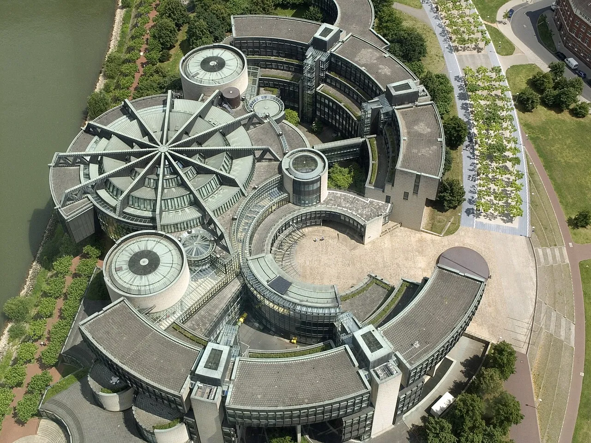

*Foto: Островский Александр, Киев / Wikimedia Commons (CC BY-SA 3.0) – [Quelle](https://commons.wikimedia.org/wiki/File:NRW,_D%C3%BCsseldorf,_Rheinturm_-_view_to_Landtag.jpg)*

Der **Landtag Nordrhein-Westfalen** ist das Parlament des Landes, zu seinen zentralen Aufgaben gehören Gesetzgebung, die Wahl des Ministerpräsidenten und die Kontrolle der Regierung. Sein Gebäude steht im Regierungsviertel direkt am **Rhein**, in der Nähe des Medienhafens.

Der Neubau wurde 1988 fertiggestellt und stammt vom Architekturbüro Eller, Moser, Walter + Partner. Sechs halbkreisförmige Bauteile gruppieren sich um den runden **Plenarsaal** in der Mitte. Zuvor tagte das Parlament von 1949 bis 1988 im **Ständehaus**, das für nur rund 70 Abgeordnete ausgelegt war.

Für Einzelpersonen und Gruppen gibt es einen eigenen **Besuchereingang** und einen Besucherdienst. Die nächste Haltestelle ist Landtag/Kniebrücke an den Straßenbahnlinien 706, 708 und 709.

Quellen je Satz

1. Der Landtag Nordrhein-Westfalen ist das Parlament des Landes, zu seinen zentrale… — https://de.wikipedia.org/wiki/Landtag_Nordrhein-Westfalen
2. Sein Gebäude steht im Regierungsviertel direkt am Rhein, in der Nähe des Medienh… — https://de.wikipedia.org/wiki/Landtag_Nordrhein-Westfalen
3. Der Neubau wurde 1988 fertiggestellt und stammt vom Architekturbüro Eller, Moser… — https://de.wikipedia.org/wiki/Landtag_Nordrhein-Westfalen
4. Sechs halbkreisförmige Bauteile gruppieren sich um den runden Plenarsaal in der … — https://de.wikipedia.org/wiki/Landtag_Nordrhein-Westfalen
5. Zuvor tagte das Parlament von 1949 bis 1988 im Ständehaus, das für nur rund 70 A… — https://de.wikipedia.org/wiki/Landtag_Nordrhein-Westfalen
6. Für Einzelpersonen und Gruppen gibt es einen eigenen Besuchereingang und einen B… — https://www.landtag.nrw.de/home/ubersichtsseite/ihr-besuch-im-landtag.html
7. Die nächste Haltestelle ist Landtag/Kniebrücke an den Straßenbahnlinien 706, 708… — https://www.landtag.nrw.de/home/service/anfahrt.html

> Hinweis der Recherche: Haltestelle: Die Anfahrtsseite nennt „Landtag/Kniebrücke“ (Linien 706, 708, 709), die Besuchsseite nennt als Ausstieg für Besuchergruppen „Moselstraße“ (offenbar für Busanreise) – im Text nur Landtag/Kniebrücke. Bild: Luftaufnahme vom Rheinturm (2008).

---

### LaserTag Evolution Düsseldorf

`/orte/lasertag-evolution-duesseldorf` · 5 Sätze · Website: https://www.lasertag-evolution.com

**LaserTag Evolution** ist eine Lasertag-Halle im Stadtteil **Bilk**. Gespielt wird mit Sensorwesten und Phasern in einem Labyrinth im **Science-Fiction-Stil** mit Portalen, Podesten, Basen und mehr als 60 interaktiven Zielen. Bis zu 33 Spielerinnen und Spieler in bis zu acht Teams können gleichzeitig antreten.

Zum Haus gehören eine **Lounge**, ein Eventraum, eine Bar am Eingang und eine rund 250 Quadratmeter große Außenterrasse. Gefeiert werden dort unter anderem **Kindergeburtstage**, Junggesellenabschiede und Firmenfeiern mit bis zu 200 Gästen.

Quellen je Satz

1. LaserTag Evolution ist eine Lasertag-Halle im Stadtteil Bilk. — https://www.lasertag-evolution.com/
2. Gespielt wird mit Sensorwesten und Phasern in einem Labyrinth im Science-Fiction… — https://www.lasertag-evolution.com/
3. Bis zu 33 Spielerinnen und Spieler in bis zu acht Teams können gleichzeitig antr… — https://www.lasertag-evolution.com/
4. Zum Haus gehören eine Lounge, ein Eventraum, eine Bar am Eingang und eine rund 2… — https://www.lasertag-evolution.com/
5. Gefeiert werden dort unter anderem Kindergeburtstage, Junggesellenabschiede und … — https://www.lasertag-evolution.com/

> Hinweis der Recherche: Größe der Arena und Eröffnungsjahr nicht belegt (Website wirbt mit „größtes Lasertag Eventcenter“, ohne Beleg – nicht übernommen). Kein sauberes Gebäudefoto.

---

### Leica Galerie Düsseldorf

`/orte/leica-galerie-duesseldorf` · 2 Sätze · Website: https://leica-camera.com/de-AT/leica-galerien/leica-galerie-duesseldorf

Die Leica Galerie Düsseldorf zeigt wechselnde **Fotografie-Ausstellungen** national und international bekannter Fotografinnen und Fotografen. Sie gehört zum Netz der **Leica Galerien**, das vor rund 50 Jahren mit einer ersten Galerie in Wetzlar begann und inzwischen 27 Häuser weltweit umfasst.

Quellen je Satz

1. Die Leica Galerie Düsseldorf zeigt wechselnde Fotografie-Ausstellungen national … — https://www.leica-oskar-barnack-award.com/en/information/leica-galleries/dusseldorf.html
2. Sie gehört zum Netz der Leica Galerien, das vor rund 50 Jahren mit einer ersten … — https://www.duesseldorf.de/fotografie

> Hinweis der Recherche: Standort widersprüchlich: Eröffnet wurde die Galerie mit dem Leica Store im November 2019 in der Kö-Galerie (Königsallee 60, laut Leica-Pressemitteilung/Suchergebnis); aktuelle Leica-Seiten nennen laut Suche Königsallee 2 (Kö-Bogen, Libeskind-Bau), duesseldorf.de spricht von der „neuen Leica Galerie Düsseldorf“ – vermutlich Umzug, aber nicht direkt belegt, daher Lage nicht im Text. Leica-Seiten werden per JavaScript gerendert, Inhalt war nicht lesbar.

---

### Light Space Movement

`/orte/light-space-movement` · 4 Sätze · Website: https://lightspacemovement.de/

**Light Space Movement** ist ein Studio für Bewegung und Yoga in einem Hinterhof an der Gerresheimer Straße in Düsseldorf. Das Angebot umfasst **Privatstunden** nach einer Methode, die Elemente aus Yoga, Tai Chi, Qigong, funktionellem Training und Achtsamkeit verbindet. Außerdem gibt es **Workshops**, etwa zu Handstand, Armbalancen und Mobilität, sowie Bewegungscoachings für Unternehmen. Das Studio veranstaltet zudem Retreats und kann gemietet werden.

Quellen je Satz

1. Light Space Movement ist ein Studio für Bewegung und Yoga in einem Hinterhof an … — https://lightspacemovement.de/
2. Das Angebot umfasst Privatstunden nach einer Methode, die Elemente aus Yoga, Tai… — https://lightspacemovement.de/
3. Außerdem gibt es Workshops, etwa zu Handstand, Armbalancen und Mobilität, sowie … — https://lightspacemovement.de/
4. Das Studio veranstaltet zudem Retreats und kann gemietet werden. — https://lightspacemovement.de/

> Hinweis der Recherche: Kein Gründungsjahr und kein sauberes Raumfoto gefunden.

---

### Limas RestoBar

`/orte/limas-restobar` · 4 Sätze · Website: https://www.limasrestobar.de/

**Lima's RestoBar** an der Münsterstraße in Düsseldorf ist ein Restaurant mit Schwerpunkt auf **peruanischer Küche**. Nach eigenen Angaben besteht es seit 2017 und war das erste Restaurant in Düsseldorf, das sich auf gehobene peruanische Küche konzentriert. Der Name ist eine Anspielung auf die peruanische Hauptstadt **Lima**, deren Küche Einflüsse aus vier Kontinenten vereint. Neben dem Restaurantbetrieb gehört auch ein Catering zum Angebot.

Quellen je Satz

1. Lima's RestoBar an der Münsterstraße in Düsseldorf ist ein Restaurant mit Schwer… — https://www.limasrestobar.de/kontakt/
2. Nach eigenen Angaben besteht es seit 2017 und war das erste Restaurant in Düssel… — https://www.limasrestobar.de/uber-uns/
3. Der Name ist eine Anspielung auf die peruanische Hauptstadt Lima, deren Küche Ei… — https://www.limasrestobar.de/uber-uns/
4. Neben dem Restaurantbetrieb gehört auch ein Catering zum Angebot. — https://www.limasrestobar.de/uber-uns/

> Hinweis der Recherche: Startseite zeigt derzeit eine Wartungsseite (Relaunch), Unterseiten sind erreichbar. „Erstes Restaurant mit gehobener peruanischer Küche in Düsseldorf“ ist Eigenangabe des Hauses. Kein sauberes Gebäudefoto gefunden.

---

### Machen & Lachen Yoga Studio

`/orte/machen-lachen-yoga-studio` · 4 Sätze · Website: https://www.machenundlachen.com

**Machen & Lachen** ist ein Yogastudio in Düsseldorf, das Yoga, Meditation und persönliche Begleitung anbietet, vor Ort und online. Das Studio liegt in einem ruhigen **Hinterhof** an der Schirmerstraße in Pempelfort. Auf dem Kursplan stehen Vinyasa, Yin, Hatha und Kundalini Yoga sowie Rückenyoga, dazu Fitnesskurse, Meditation und Atemarbeit. Außerdem bietet das Studio eine **Yogalehrer-Ausbildung**, Einzelbegleitung und ein Online-Studio an.

Quellen je Satz

1. Machen & Lachen ist ein Yogastudio in Düsseldorf, das Yoga, Meditation und persö… — https://www.machenundlachen.com/
2. Das Studio liegt in einem ruhigen Hinterhof an der Schirmerstraße in Pempelfort.… — https://urbansportsclub.com/de/venues/machenlachen-yogastudio
3. Auf dem Kursplan stehen Vinyasa, Yin, Hatha und Kundalini Yoga sowie Rückenyoga,… — https://urbansportsclub.com/de/venues/machenlachen-yogastudio
4. Außerdem bietet das Studio eine Yogalehrer-Ausbildung, Einzelbegleitung und ein … — https://www.machenundlachen.com/

> Hinweis der Recherche: Offizielle Website (Wix) nennt im auslesbaren Text weder Adresse noch Kursstile; Lage und Stile daher von Urban Sports Club (Buchungsplattform, ergänzend zur offiziellen Seite). Kein Foto.

---

### Maison Zen - Studio für mentale Gesundheit

`/orte/maison-zen-studio-fuer-mentale-gesundheit` · 5 Sätze · Website: https://www.maisonzen.de

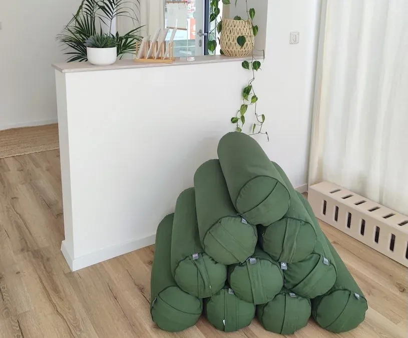

*Foto: Maison Zen – [Quelle](https://www.maisonzen.de/)*

**Maison Zen** ist ein Studio für **mentale Gesundheit** an der Hammer Dorfstraße in Düsseldorf. Es bietet Kurse, Workshops und Einzeltrainings rund um **Achtsamkeit** und Stressbewältigung an.

Zum regelmäßigen Programm gehören unter anderem Anti-Stress-Yoga, Kurse mit **Atem und Meditation**, Yoga Nidra sowie Klang- und Entspannungsyoga. Daneben gibt es Workshops, etwa zur Einführung in die Meditation oder zum Thema Selbstmitgefühl, sowie ein achtwöchiges Präventionsprogramm zur Achtsamkeit. Die Kursräume können auch gemietet werden.

Quellen je Satz

1. Maison Zen ist ein Studio für mentale Gesundheit an der Hammer Dorfstraße in Düs… — https://www.maisonzen.de/
2. Es bietet Kurse, Workshops und Einzeltrainings rund um Achtsamkeit und Stressbew… — https://www.maisonzen.de/
3. Zum regelmäßigen Programm gehören unter anderem Anti-Stress-Yoga, Kurse mit Atem… — https://www.maisonzen.de/
4. Daneben gibt es Workshops, etwa zur Einführung in die Meditation oder zum Thema … — https://www.maisonzen.de/
5. Die Kursräume können auch gemietet werden. — https://www.maisonzen.de/

> Hinweis der Recherche: Ältere Eventportal-Einträge (rausgegangen) nennen als Adresse Pionierstraße 57, 40215 Düsseldorf (Friedrichstadt); die offizielle Seite nennt nur Hammer Dorfstr. 127 – vermutlich Umzug. Bild zeigt einen Kursraum (Bolster, Holzboden) aus dem Bereich Raummiete. robots.txt erlaubt Zugriff (KI-Bots stehen in der gemeinsamen Gruppe mit *, kein Komplettverbot).

---

### Maschinendorf Düsseldorf

`/orte/maschinendorf-duesseldorf` · 7 Sätze · Website: https://www.maschinendorf.de/

Das **Maschinendorf** im Hinterhof der Birkenstraße in Düsseldorf-Flingern ist ein Coworking-Space für Handwerk, Kunst und Kreative. Untergebracht ist es in den weitläufigen Räumen der ehemaligen **Schreinerei Otto Kunze**. Auf rund 2500 Quadratmetern und drei Etagen gibt es unter anderem Werkstätten für Metall, Holz, Siebdruck und Textil.

Entstanden ist das Projekt, als der Coworking-Space Super7000 und der Verein **GarageLab** nach der Schließung der Schreinerei neue Räume suchten. Betrieben wird das Maschinendorf von einer gemeinnützigen GmbH. Neben der offenen Werkstatt gibt es **Workshops**, etwa zum Aufarbeiten von Möbeln oder zum Polstern, sowie Veranstaltungen wie Konzerte, einen Tag der offenen Tür und ein Sommerfest. Erhalten geblieben ist außerdem eine Kantine aus den 1970er-Jahren.

Quellen je Satz

1. Das Maschinendorf im Hinterhof der Birkenstraße in Düsseldorf-Flingern ist ein C… — https://www.visitduesseldorf.de/storys/2026/01/13/coworkingspace-maschinendorf-flingern/
2. Untergebracht ist es in den weitläufigen Räumen der ehemaligen Schreinerei Otto … — https://www.visitduesseldorf.de/storys/2026/01/13/coworkingspace-maschinendorf-flingern/
3. Auf rund 2500 Quadratmetern und drei Etagen gibt es unter anderem Werkstätten fü… — https://www.maschinendorf.de/
4. Entstanden ist das Projekt, als der Coworking-Space Super7000 und der Verein Gar… — https://www.visitduesseldorf.de/storys/2026/01/13/coworkingspace-maschinendorf-flingern/
5. Betrieben wird das Maschinendorf von einer gemeinnützigen GmbH. — https://www.maschinendorf.de/
6. Neben der offenen Werkstatt gibt es Workshops, etwa zum Aufarbeiten von Möbeln o… — https://www.maschinendorf.de/
7. Erhalten geblieben ist außerdem eine Kantine aus den 1970er-Jahren. — https://www.maschinendorf.de/

> Hinweis der Recherche: Superlativ der Website („schönster und größter Makerspace in NRW“) nicht übernommen. Eröffnungsjahr nicht klar belegt. Website-Bilder ohne Beschreibung (Google-Sites-CDN), Fotos im visitduesseldorf-Artikel stammen nicht vom Haus – daher kein Bild.

---

### Maxhaus

`/orte/maxhaus` · 9 Sätze · Website: https://www.maxhaus.de/

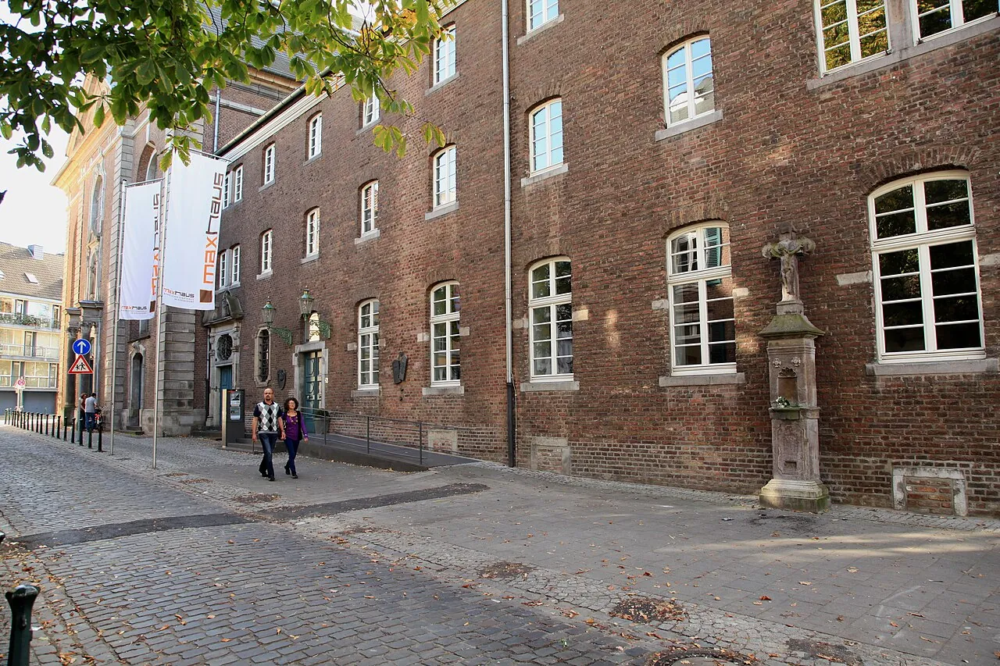

*Foto: Frank Vincentz / Wikimedia Commons (CC BY-SA 3.0) – [Quelle](https://commons.wikimedia.org/wiki/File:D%C3%BCsseldorf_-_Schulstra%C3%9Fe_-_Maxhaus_01_ies.jpg)*

Das **Maxhaus** an der Schulstraße in der Carlstadt ist das katholische Stadthaus in Düsseldorf und bildet mit der benachbarten Maxkirche einen Gebäudekomplex. Der barocke Backsteinbau wurde 1661 als **Franziskanerkloster** fertiggestellt. Nach der Säkularisation 1803 zog ein Lyzeum ein, das auch Heinrich Heine besuchte.

Nach rund sechs Jahren Umbau wurde das Haus im September 2006 wiedereröffnet, dabei erhielt der Innenhof innerhalb des Kreuzgangs ein Dach aus **Glas und Stahl**. Der Umbau wurde 2010 unter anderem als „Vorbildlicher Bau“ des Landes NRW ausgezeichnet. Zu den Räumen gehören der Klosterhof, der Antoniussaal, mehrere Seminarräume und ein Raum der Stille. Im Keller zeigt die Dauerausstellung „Das verborgene Kloster“ die Baugeschichte.

Das Programm umfasst Kunst, Musik, Wort, Glaube und Führungen, im Klosterhof gibt es ein **Bistro**. Zu den festen Reihen gehören die Düsseldorfer Mittwochgespräche, die es seit 1961 gibt.

Quellen je Satz

1. Das Maxhaus an der Schulstraße in der Carlstadt ist das katholische Stadthaus in… — https://de.wikipedia.org/wiki/Maxhaus
2. Der barocke Backsteinbau wurde 1661 als Franziskanerkloster fertiggestellt. — https://de.wikipedia.org/wiki/Maxhaus
3. Nach der Säkularisation 1803 zog ein Lyzeum ein, das auch Heinrich Heine besucht… — https://de.wikipedia.org/wiki/Maxhaus
4. Nach rund sechs Jahren Umbau wurde das Haus im September 2006 wiedereröffnet, da… — https://de.wikipedia.org/wiki/Maxhaus
5. Der Umbau wurde 2010 unter anderem als „Vorbildlicher Bau“ des Landes NRW ausgez… — https://de.wikipedia.org/wiki/Maxhaus
6. Zu den Räumen gehören der Klosterhof, der Antoniussaal, mehrere Seminarräume und… — https://www.maxhaus.de/
7. Im Keller zeigt die Dauerausstellung „Das verborgene Kloster“ die Baugeschichte. — https://de.wikipedia.org/wiki/Maxhaus
8. Das Programm umfasst Kunst, Musik, Wort, Glaube und Führungen, im Klosterhof gib… — https://www.maxhaus.de/
9. Zu den festen Reihen gehören die Düsseldorfer Mittwochgespräche, die es seit 196… — https://de.wikipedia.org/wiki/Maxhaus

> Hinweis der Recherche: Träger wird weder auf Wikipedia noch auf maxhaus.de genannt (Links verweisen auf katholisches-duesseldorf.de). Haltestelle nicht belegt.

---

### Merkur Spiel-Arena

`/orte/merkur-spiel-arena` · 7 Sätze · Website: https://www.merkur-spiel-arena.de/

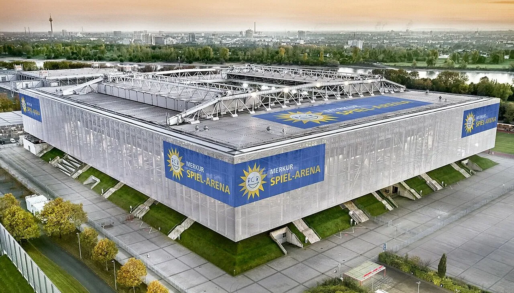

*Foto: Peter Weihs / Wikimedia Commons (CC BY-SA 4.0) – [Quelle](https://commons.wikimedia.org/wiki/File:Merkur-Spiel-Arena_(D%C3%BCsseldorf,_GER)_2021.jpg)*

Die Merkur Spiel-Arena ist ein **Fußballstadion** mit schließbarem Dach im Düsseldorfer Stadtteil **Stockum**, neben dem Messegelände. Sie wurde von 2002 bis 2004 als Ersatz für das Rheinstadion gebaut und im Januar 2005 offiziell eingeweiht. Bis 2009 hieß sie LTU Arena, danach bis 2018 Esprit Arena, seit August 2018 trägt sie ihren heutigen Namen.

Seit 2004 trägt **Fortuna Düsseldorf** hier ihre Heimspiele aus. Das Stadion bietet 54.600 Plätze, bei Konzerten bis zu 66.000. Zu den großen Veranstaltungen gehörten der **Eurovision Song Contest 2011** und Spiele der Fußball-Europameisterschaft 2024. Direkt am Stadion liegt der U-Bahnhof „Merkur Spiel-Arena/Messe Nord“ mit Verbindung in die Innenstadt.

Quellen je Satz

1. Die Merkur Spiel-Arena ist ein Fußballstadion mit schließbarem Dach im Düsseldor… — https://de.wikipedia.org/wiki/Merkur_Spiel-Arena
2. Sie wurde von 2002 bis 2004 als Ersatz für das Rheinstadion gebaut und im Januar… — https://de.wikipedia.org/wiki/Merkur_Spiel-Arena
3. Bis 2009 hieß sie LTU Arena, danach bis 2018 Esprit Arena, seit August 2018 träg… — https://de.wikipedia.org/wiki/Merkur_Spiel-Arena
4. Seit 2004 trägt Fortuna Düsseldorf hier ihre Heimspiele aus. — https://de.wikipedia.org/wiki/Merkur_Spiel-Arena
5. Das Stadion bietet 54.600 Plätze, bei Konzerten bis zu 66.000. — https://de.wikipedia.org/wiki/Merkur_Spiel-Arena
6. Zu den großen Veranstaltungen gehörten der Eurovision Song Contest 2011 und Spie… — https://de.wikipedia.org/wiki/Merkur_Spiel-Arena
7. Direkt am Stadion liegt der U-Bahnhof „Merkur Spiel-Arena/Messe Nord“ mit Verbin… — https://de.wikipedia.org/wiki/Merkur_Spiel-Arena

> Hinweis der Recherche: Luftbild von 2021 (Original 1627 px). Die 1280-px-Vorschau-URL wurde nach dem Commons-Schema gebildet und per Abruf geprüft (HTTP 200), weil die API-Antwort hier unvollständig wiedergegeben wurde. Kapazität laut Wikipedia: 54.600 national, 51.500 international.

---

### Messe Düsseldorf

`/orte/messe-duesseldorf` · 8 Sätze · Website: https://www.messe-duesseldorf.de/

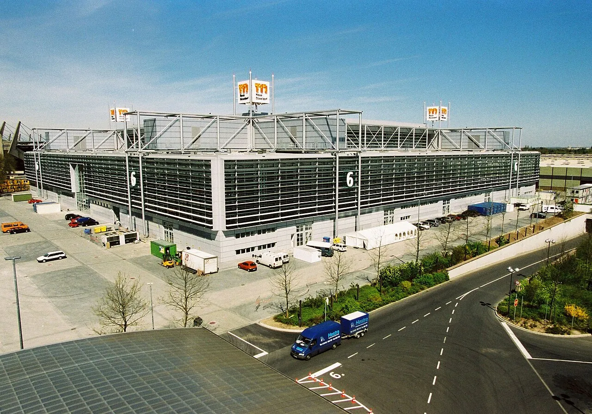

*Foto: Messe Düsseldorf GmbH / Wikimedia Commons (CC BY-SA 3.0) – [Quelle](https://commons.wikimedia.org/wiki/File:Messe_D%C3%BCsseldorf_Halle_6.jpg)*

Die **Messe Düsseldorf** betreibt ihr Messegelände in Stockum am Rhein, wenige Kilometer vom Flughafen entfernt. Das Gelände umfasst 18 Hallen mit rund 262.700 Quadratmetern Hallenfläche sowie etwa 43.000 Quadratmeter Freigelände. An Halle 6 schließt die Merkur Spiel-Arena an.

Die Messegesellschaft wurde 1947 als NOWEA gegründet, 1971 zog die Messe nach Stockum. Die Düsseldorfer Messetradition reicht bis zur Bergischen Gewerbeausstellung von 1811 zurück, die Ausstellung **GeSoLei** zog 1926 rund 7,5 Millionen Besucher an. Zu den bekannten Messen gehören **boot**, drupa, Medica, interpack und die Kunststoffmesse „K“. Gesellschafter sind unter anderem die Stadt Düsseldorf und das Land Nordrhein-Westfalen.

Erreichbar ist das Gelände mit den **Stadtbahnlinien** U78 und U79, Haltestellen sind Messe Ost/Stockumer Kirchstraße und Messe Nord/Merkur Spiel-Arena.

Quellen je Satz

1. Die Messe Düsseldorf betreibt ihr Messegelände in Stockum am Rhein, wenige Kilom… — https://de.wikipedia.org/wiki/Messe_D%C3%BCsseldorf
2. Das Gelände umfasst 18 Hallen mit rund 262.700 Quadratmetern Hallenfläche sowie … — https://de.wikipedia.org/wiki/Messe_D%C3%BCsseldorf
3. An Halle 6 schließt die Merkur Spiel-Arena an. — https://de.wikipedia.org/wiki/Messe_D%C3%BCsseldorf
4. Die Messegesellschaft wurde 1947 als NOWEA gegründet, 1971 zog die Messe nach St… — https://de.wikipedia.org/wiki/Messe_D%C3%BCsseldorf
5. Die Düsseldorfer Messetradition reicht bis zur Bergischen Gewerbeausstellung von… — https://de.wikipedia.org/wiki/Messe_D%C3%BCsseldorf
6. Zu den bekannten Messen gehören boot, drupa, Medica, interpack und die Kunststof… — https://de.wikipedia.org/wiki/Messe_D%C3%BCsseldorf
7. Gesellschafter sind unter anderem die Stadt Düsseldorf und das Land Nordrhein-We… — https://de.wikipedia.org/wiki/Messe_D%C3%BCsseldorf
8. Erreichbar ist das Gelände mit den Stadtbahnlinien U78 und U79, Haltestellen sin… — https://de.wikipedia.org/wiki/Messe_D%C3%BCsseldorf

> Hinweis der Recherche: U79 hält laut Wikipedia nur an Messe Ost; Messe Nord wird von der U78 bedient – im Text zusammengefasst, ggf. präzisieren.

---

### Metropol Kino

`/orte/metropol-kino` · 8 Sätze · Website: https://filmkunstkinos.de/kinos/metropol/

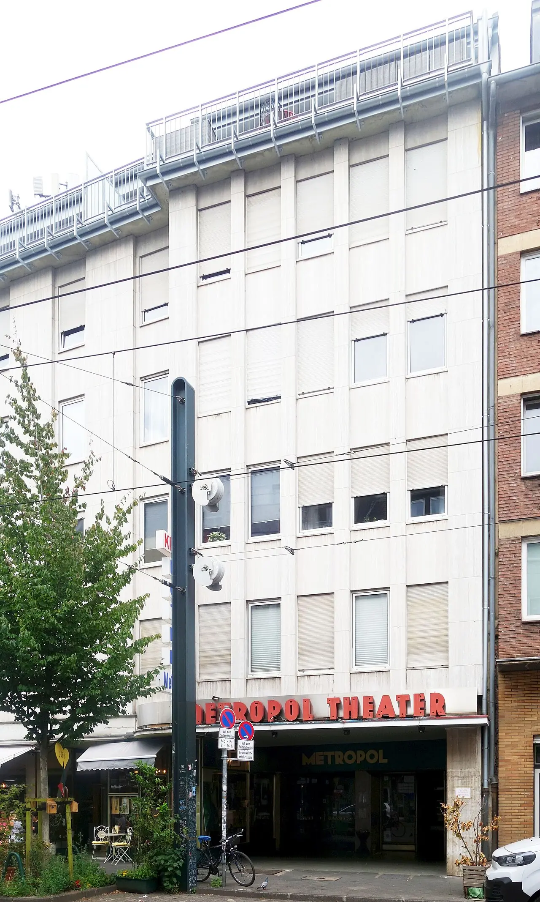

*Foto: Kürschner / Wikimedia Commons (CC0) – [Quelle](https://commons.wikimedia.org/wiki/File:Metropol_Theater,_Brunnenstra%C3%9Fe,_D%C3%BCsseldorf,_August_2026_(01).jpg)*

Das **Metropol** an der Brunnenstraße in Düsseldorf-Bilk gehört zu den Düsseldorfer Filmkunstkinos. Eröffnet wurde es im Juni 1940; der ursprüngliche Saal mit über 800 Plätzen wurde im Krieg zerstört und 1949 wieder aufgebaut. 1965 wurde das Haus abgerissen und neu errichtet, 1972 öffnete es als **Repertoirekino** wieder.

Seit 1979 wird das Metropol als **Programmkino** geführt, 1992 kamen der zweite Saal Phantom und das Kinocafé Playtime hinzu. Im Mai 2013 wurde die Technik vollständig auf digitale Projektion umgestellt, nach einem siebenmonatigen Umbau öffnete das Kino im November 2023 wieder. Heute verteilen sich rund 158 Plätze auf die drei Säle **Cinerama**, Phantom und Souterrain.

Gezeigt werden vor allem **Erstaufführungen** aus dem Bereich Filmkunst, oft in Originalfassung mit Untertiteln, dazu Filmreihen, Kinderkino und Lesungen. Für sein Programm wird das Haus regelmäßig vom Kulturstaatsminister und der **Filmstiftung NRW** ausgezeichnet.

Quellen je Satz

1. Das Metropol an der Brunnenstraße in Düsseldorf-Bilk gehört zu den Düsseldorfer … — https://filmkunstkinos.de/kinos/metropol/
2. Eröffnet wurde es im Juni 1940; der ursprüngliche Saal mit über 800 Plätzen wurd… — https://filmkunstkinos.de/kinos/metropol/
3. 1965 wurde das Haus abgerissen und neu errichtet, 1972 öffnete es als Repertoire… — https://filmkunstkinos.de/kinos/metropol/
4. Seit 1979 wird das Metropol als Programmkino geführt, 1992 kamen der zweite Saal… — https://filmkunstkinos.de/kinos/metropol/
5. Im Mai 2013 wurde die Technik vollständig auf digitale Projektion umgestellt, na… — https://filmkunstkinos.de/kinos/metropol/
6. Heute verteilen sich rund 158 Plätze auf die drei Säle Cinerama, Phantom und Sou… — https://filmkunstkinos.de/kinos/metropol/
7. Gezeigt werden vor allem Erstaufführungen aus dem Bereich Filmkunst, oft in Orig… — https://filmkunstkinos.de/kinos/metropol/
8. Für sein Programm wird das Haus regelmäßig vom Kulturstaatsminister und der Film… — https://www.visitduesseldorf.de/attraktionen/metropol-63d7acd8bb

> Hinweis der Recherche: Altersangaben widersprechen sich (visitduesseldorf: „über 75 Jahre“ und „ältestes Kino Düsseldorfs“; eine andere visitduesseldorf-Seite nennt 85 Jahre im Juni 2025). Daher nur das Eröffnungsjahr 1940 laut Betreiber übernommen, „ältestes Kino“ weggelassen. Keine Haltestelle belegt.

---

### Monkeyspot Düsseldorf

`/orte/monkeyspot-duesseldorf` · 6 Sätze · Website: https://monkeyspot.de/startseite-duesseldorf/

Der **Monkeyspot** an der Schiessstraße ist eine Boulderhalle im Gewerbegebiet von Düsseldorf-**Heerdt**. Sie wurde im Mai 2013 als erster Standort der Kette eröffnet, später kamen Hallen in Duisburg und Mönchengladbach hinzu. In der Halle gibt es rund 250 Boulder, die wöchentlich neu geschraubt werden.

Neben dem Hauptbereich gibt es einen separaten **Trainingsbereich** und einen Kinderbereich. Für Einsteiger werden Anfängerkurse zu Sicherheit und Grundtechniken angeboten. Ein **Bistro** mit Außenbereich und ein Shop für Kletterschuhe und Zubehör ergänzen das Angebot.

Quellen je Satz

1. Der Monkeyspot an der Schiessstraße ist eine Boulderhalle im Gewerbegebiet von D… — https://monkeyspot.de/startseite-duesseldorf/
2. Sie wurde im Mai 2013 als erster Standort der Kette eröffnet, später kamen Halle… — https://monkeyspot.de/startseite-duesseldorf/
3. In der Halle gibt es rund 250 Boulder, die wöchentlich neu geschraubt werden. — https://monkeyspot.de/startseite-duesseldorf/
4. Neben dem Hauptbereich gibt es einen separaten Trainingsbereich und einen Kinder… — https://monkeyspot.de/startseite-duesseldorf/
5. Für Einsteiger werden Anfängerkurse zu Sicherheit und Grundtechniken angeboten. — https://monkeyspot.de/startseite-duesseldorf/
6. Ein Bistro mit Außenbereich und ein Shop für Kletterschuhe und Zubehör ergänzen … — https://monkeyspot.de/startseite-duesseldorf/

> Hinweis der Recherche: Boulderfläche widersprüchlich (Website: ca. 1.300 m², andere Verzeichnisse 1.400 m² bzw. ca. 1.000 m²), daher weggelassen. Kein sauberes Hallenfoto gefunden.

---

### MS RheinFantasie

`/orte/ms-rheinfantasie` · 5 Sätze · Website: https://www.k-d.com/flotte/ms-rheinfantasie/

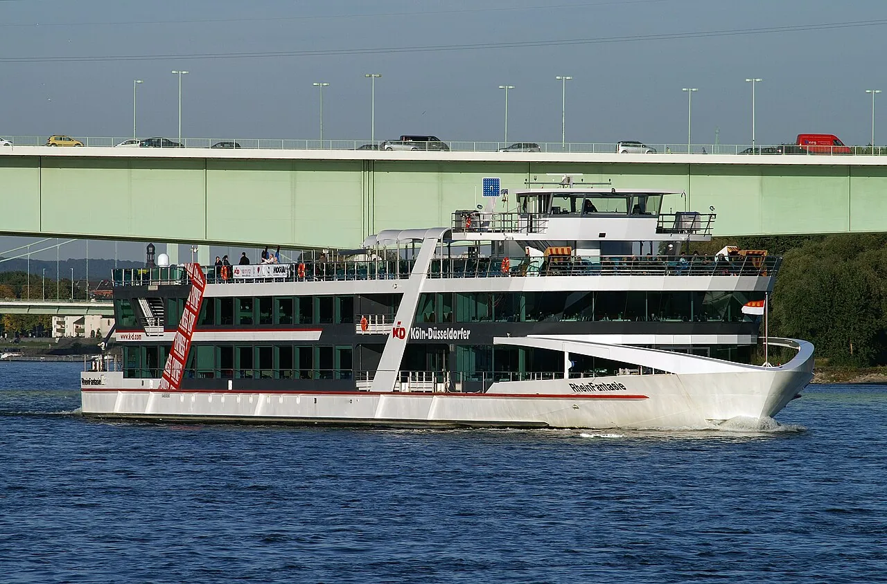

*Foto: Rolf Heinrich, Köln / Wikimedia Commons (CC BY 3.0) – [Quelle](https://commons.wikimedia.org/wiki/File:RheinFantasie_(ship,_2011)_102.jpg)*

Die **MS RheinFantasie** ist ein Eventschiff der Reederei Köln-Düsseldorfer (KD), das für Partyfahrten, Firmenveranstaltungen und private Feiern genutzt wird. Das 2011 vom Stapel gelaufene Schiff ist gut 85 Meter lang und 14 Meter breit und bietet Platz für bis zu 1.000 Gäste. Eingesetzt wird es nach Angaben der Reederei vor allem ab Köln und Bonn.

An Bord gibt es einen **Galeriesalon** mit rund 35 Quadratmeter großer Bühne, zwei Aussichtssalons im Bug und ein etwa 900 Quadratmeter großes **Freideck**. Im Juni 2021 erhielt die MS RheinFantasie den **Green Award** als besonders nachhaltiges Schiff.

Quellen je Satz

1. Die MS RheinFantasie ist ein Eventschiff der Reederei Köln-Düsseldorfer (KD), da… — https://www.k-d.com/flotte/ms-rheinfantasie/
2. Das 2011 vom Stapel gelaufene Schiff ist gut 85 Meter lang und 14 Meter breit un… — https://www.k-d.com/flotte/ms-rheinfantasie/
3. Eingesetzt wird es nach Angaben der Reederei vor allem ab Köln und Bonn. — https://www.k-d.com/flotte/ms-rheinfantasie/
4. An Bord gibt es einen Galeriesalon mit rund 35 Quadratmeter großer Bühne, zwei A… — https://www.k-d.com/flotte/ms-rheinfantasie/
5. Im Juni 2021 erhielt die MS RheinFantasie den Green Award als besonders nachhalt… — https://www.k-d.com/flotte/ms-rheinfantasie/

> Hinweis der Recherche: Schiff, kein fester Ort: Laut KD fährt die RheinFantasie vornehmlich ab Köln und Bonn; der Anleger Robert-Lehr-Ufer in Düsseldorf wird nur für einzelne Fahrten genutzt. Ortsseite ggf. prüfen. Foto zeigt das Schiff auf dem Rhein in Köln (Zoobrücke im Hintergrund).

---

### NEBN Gallery

`/orte/nebn-gallery` · 6 Sätze · Website: https://www.nebn.info/

Die **NEBN Gallery & Rooms** an der Eisenstraße in Düsseldorf-**Oberbilk** ist eine Galerie mit angeschlossenem Mehrzweckraum. Sie befindet sich in einer ehemaligen **Metzgerei** von rund 140 Quadratmetern, die jahrzehntelang leer stand und vor der Nutzung rund acht Monate lang saniert wurde. Die Eröffnung fand im April 2023 statt.

Im vorderen Teil liegen Galerie und Showroom für **zeitgenössische Kunst**. Der hintere Raum dient als Ort für Co-Working, Präsentationen und Treffen. Neben Vernissagen finden dort auch Veranstaltungen wie Strick-Treffen statt.

Quellen je Satz

1. Die NEBN Gallery & Rooms an der Eisenstraße in Düsseldorf-Oberbilk ist eine Gale… — https://www.nebn.info/about
2. Sie befindet sich in einer ehemaligen Metzgerei von rund 140 Quadratmetern, die … — https://www.nebn.info/about
3. Die Eröffnung fand im April 2023 statt. — https://www.theycallitkleinparis.de/2023/04/25/martin-heck-und-johanna-jacob-im-interview-wir-haben-viel-vor/
4. Im vorderen Teil liegen Galerie und Showroom für zeitgenössische Kunst. — https://www.nebn.info/about
5. Der hintere Raum dient als Ort für Co-Working, Präsentationen und Treffen. — https://www.nebn.info/about
6. Neben Vernissagen finden dort auch Veranstaltungen wie Strick-Treffen statt. — https://www.nebn.info/about

> Hinweis der Recherche: Das Eröffnungsdatum (29. April 2023) stammt aus einer Vorankündigung im Interview vom 25.04.2023; spätere Ausstellungen (2025) belegen den Betrieb. Kein eindeutiges Raumfoto gefunden.

---

### Niemandsland e.V.

`/orte/niemandsland-e-v` · 6 Sätze · Website: https://niemandsland.org

**Niemandsland e.V.** ist ein sozial-ökologischer Nachbarschaftsverein an der Heerstraße in Düsseldorf. Der Verein setzt sich für Ökologie, Kultur und **soziale Gerechtigkeit** ein. Ideen zu Umwelt- und Sozialthemen werden dort gemeinsam umgesetzt, das Angebot ist offen für alle.

Zu den Projekten gehört ein **Umsonstladen**, in dem Kleidung und nicht mehr benötigte Dinge kostenlos getauscht, mitgenommen und abgegeben werden können. Außerdem gibt es eine Holz-, eine Fahrrad- und eine Töpferwerkstatt. Auf dem Gelände liegt ein gemeinschaftlich bewirtschafteter **Garten**, dazu kommen ein gemeinsamer Mittagstisch, Veranstaltungen und Feste.

Quellen je Satz

1. Niemandsland e.V. ist ein sozial-ökologischer Nachbarschaftsverein an der Heerst… — https://www.visitduesseldorf.de/attraktionen/niemandsland-e.v.-9b5ed1493d
2. Der Verein setzt sich für Ökologie, Kultur und soziale Gerechtigkeit ein. — https://niemandsland.org/gegenwart-und-zukunft/
3. Ideen zu Umwelt- und Sozialthemen werden dort gemeinsam umgesetzt, das Angebot i… — https://www.visitduesseldorf.de/attraktionen/niemandsland-e.v.-9b5ed1493d
4. Zu den Projekten gehört ein Umsonstladen, in dem Kleidung und nicht mehr benötig… — https://www.visitduesseldorf.de/attraktionen/niemandsland-e.v.-9b5ed1493d
5. Außerdem gibt es eine Holz-, eine Fahrrad- und eine Töpferwerkstatt. — https://niemandsland.org/
6. Auf dem Gelände liegt ein gemeinschaftlich bewirtschafteter Garten, dazu kommen … — https://www.visitduesseldorf.de/attraktionen/niemandsland-e.v.-9b5ed1493d

> Hinweis der Recherche: Gründungsjahr und Geschichte des Geländes nicht belegt. Kein freies Foto gefunden.

---

### NRW Akademie der Wissenschaften und der Künste

`/orte/nrw-akademie-der-wissenschaften-und-der-kuenste` · 8 Sätze · Website: https://www.awk.nrw

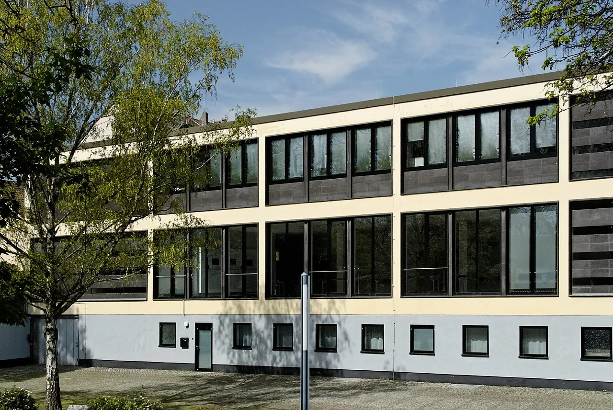

*Foto: Wiegels / Wikimedia Commons (CC BY 3.0) – [Quelle](https://commons.wikimedia.org/wiki/File:Karl-Arnold-Haus_in_Duesseldorf-Unterbilk,_von_Sueden.jpg)*

Die **Nordrhein-Westfälische Akademie der Wissenschaften und der Künste** ist eine Wissenschaftsakademie mit Sitz in Düsseldorf. Ihr Ursprung ist die Arbeitsgemeinschaft für Forschung, die Ministerpräsident Karl Arnold 1950 gründete, 1970 wurde daraus eine Akademie. Seit 2008 gehört eine Klasse der Künste dazu, damit nahm sie als erste deutsche Akademie die Künste als eigenständige Klasse auf. Daneben gibt es Klassen für Naturwissenschaften und Medizin, für Geisteswissenschaften sowie für Ingenieur- und Wirtschaftswissenschaften.

Die Akademie hat ihren Sitz im **Karl-Arnold-Haus** an der Palmenstraße in Unterbilk, direkt am Florapark. Der Bau entstand von 1958 bis 1960 nach Plänen von Hans Schwippert und Friedrich Kohlmann. Er hat zwei Säle für 400 und 80 Personen, einen rechteckigen Kongresssaal und einen runden **Diskussionssaal**. Zum Programm der Akademie gehören Vorträge, wissenschaftliche Sitzungen und öffentliche Veranstaltungen.

Quellen je Satz

1. Die Nordrhein-Westfälische Akademie der Wissenschaften und der Künste ist eine W… — https://de.wikipedia.org/wiki/Nordrhein-Westf%C3%A4lische_Akademie_der_Wissenschaften_und_der_K%C3%BCnste
2. Ihr Ursprung ist die Arbeitsgemeinschaft für Forschung, die Ministerpräsident Ka… — https://de.wikipedia.org/wiki/Nordrhein-Westf%C3%A4lische_Akademie_der_Wissenschaften_und_der_K%C3%BCnste
3. Seit 2008 gehört eine Klasse der Künste dazu, damit nahm sie als erste deutsche … — https://de.wikipedia.org/wiki/Nordrhein-Westf%C3%A4lische_Akademie_der_Wissenschaften_und_der_K%C3%BCnste
4. Daneben gibt es Klassen für Naturwissenschaften und Medizin, für Geisteswissensc… — https://de.wikipedia.org/wiki/Nordrhein-Westf%C3%A4lische_Akademie_der_Wissenschaften_und_der_K%C3%BCnste
5. Die Akademie hat ihren Sitz im Karl-Arnold-Haus an der Palmenstraße in Unterbilk… — https://de.wikipedia.org/wiki/Karl-Arnold-Haus
6. Der Bau entstand von 1958 bis 1960 nach Plänen von Hans Schwippert und Friedrich… — https://de.wikipedia.org/wiki/Karl-Arnold-Haus
7. Er hat zwei Säle für 400 und 80 Personen, einen rechteckigen Kongresssaal und ei… — https://de.wikipedia.org/wiki/Karl-Arnold-Haus
8. Zum Programm der Akademie gehören Vorträge, wissenschaftliche Sitzungen und öffe… — https://de.wikipedia.org/wiki/Nordrhein-Westf%C3%A4lische_Akademie_der_Wissenschaften_und_der_K%C3%BCnste

> Hinweis der Recherche: Bauzeit widersprüchlich: Wikipedia (Karl-Arnold-Haus) nennt 1958–1960, ein TUM-Architekturarchiv-Eintrag 1956–1970 (vermutlich inkl. Erweiterung) – im Text 1958–1960 nach Wikipedia. Offizielle Website nicht inhaltlich ausgewertet.

---

### NRW-Forum

`/orte/nrw-forum` · 6 Sätze · Website: https://www.nrw-forum.de/

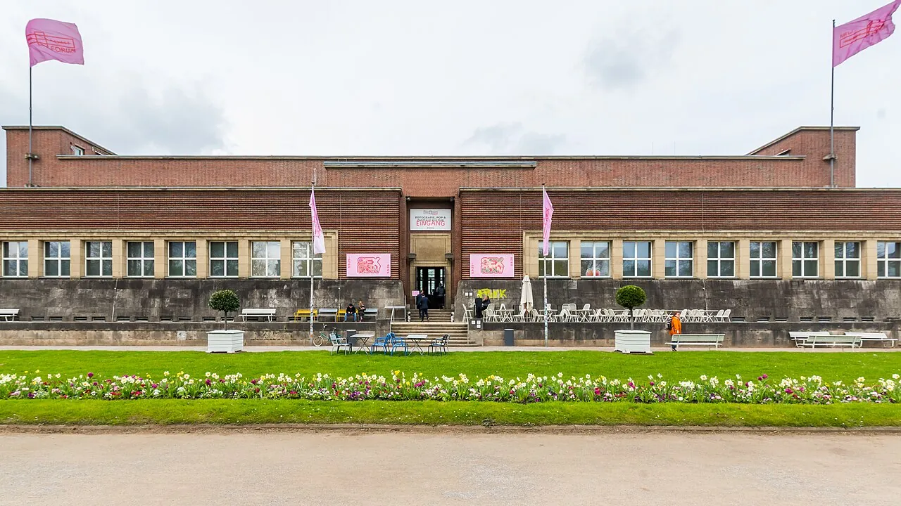

*Foto: Raimond Spekking / Wikimedia Commons (CC BY-SA 4.0) – [Quelle](https://commons.wikimedia.org/wiki/File:NRW-Forum,_Ehrenhof,_D%C3%BCsseldorf-0790.jpg)*

Das NRW-Forum ist ein **Ausstellungshaus** im **Ehrenhof** nördlich der Altstadt, zwischen Rhein und Hofgarten. Schwerpunkte des Programms sind **Fotografie, Pop und digitale Kultur**, gezeigt in Ausstellungen, Festivals und Workshops. Das Gebäude entstand 1925 bis 1926 nach Plänen von Wilhelm Kreis für die Ausstellung GeSoLei und beherbergte zunächst das Reichsmuseum für Gesellschafts- und Wirtschaftskunde.

Das Ensemble des Ehrenhofs steht unter **Denkmalschutz**. Nach einer umfassenden Sanierung wurde das Haus im Oktober 1998 als „NRW Forum Kultur und Wirtschaft“ wiedereröffnet. Seit 2016 wird es von der Stadt Düsseldorf getragen und gehört seit 2020 zur Stiftung Museum Kunstpalast.

Quellen je Satz

1. Das NRW-Forum ist ein Ausstellungshaus im Ehrenhof nördlich der Altstadt, zwisch… — https://de.wikipedia.org/wiki/NRW-Forum
2. Schwerpunkte des Programms sind Fotografie, Pop und digitale Kultur, gezeigt in … — https://de.wikipedia.org/wiki/NRW-Forum
3. Das Gebäude entstand 1925 bis 1926 nach Plänen von Wilhelm Kreis für die Ausstel… — https://de.wikipedia.org/wiki/NRW-Forum
4. Das Ensemble des Ehrenhofs steht unter Denkmalschutz. — https://de.wikipedia.org/wiki/NRW-Forum
5. Nach einer umfassenden Sanierung wurde das Haus im Oktober 1998 als „NRW Forum K… — https://de.wikipedia.org/wiki/NRW-Forum
6. Seit 2016 wird es von der Stadt Düsseldorf getragen und gehört seit 2020 zur Sti… — https://de.wikipedia.org/wiki/NRW-Forum

> Hinweis der Recherche: Alle Fakten aus Wikipedia; offizielle Website nicht gesondert abgerufen. Bild zeigt die Fassade mit Fahnen/Bannern einer Ausstellung (Gebäude klar im Vordergrund).

---

### OBD ART Studio & Community Space

`/orte/obd-art-studio-community-space` · 2 Sätze · Website: –

**OBD ART** ist ein Kunstatelier und Kulturraum in Düsseldorf, in dem Workshops in Malerei, Töpfern und kunsttherapeutisch angelehnten Techniken sowie Gemeinschaftsveranstaltungen stattfinden. Ein Schwerpunkt liegt auf **englischsprachigen Angeboten** für Frauen und queere Menschen, offen ist das Atelier aber auch für die übrige kreative Community.

Quellen je Satz

1. OBD ART ist ein Kunstatelier und Kulturraum in Düsseldorf, in dem Workshops in M… — https://dasauge.de/-obd-art
2. Ein Schwerpunkt liegt auf englischsprachigen Angeboten für Frauen und queere Men… — https://dasauge.de/-obd-art

> Hinweis der Recherche: Keine offizielle Website gefunden, nur ein Instagram-Profil (obd_art) und Eventportal-Einträge (rausgegangen.de). Die Adresse Flurstraße 36 steht nur auf rausgegangen.de, daher nicht im Text. Gründungsjahr nicht belegt.

---

### Oberschlesisches Landesmuseum

`/orte/oberschlesisches-landesmuseum` · 7 Sätze · Website: https://oberschlesisches-landesmuseum.de/

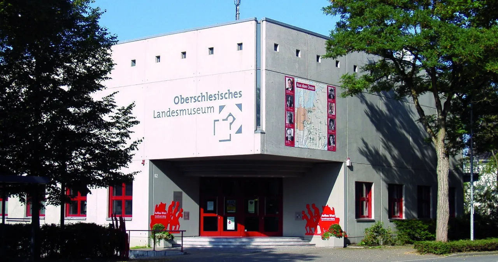

*Foto: Lena Ciochon / Wikimedia Commons (CC BY-SA 4.0) – [Quelle](https://commons.wikimedia.org/wiki/File:Oberschlesisches_Landesmuseum_Front.jpg)*

Das **Oberschlesische Landesmuseum** in Ratingen-**Hösel** widmet sich der Geschichte und Kultur Oberschlesiens. Es sammelt, bewahrt und zeigt das kulturelle Erbe der Region und versteht sich auch als außerschulischer Lernort. Eröffnet wurde das Museum 1983, getragen wird es von der Stiftung Haus Oberschlesien.

Das heutige **Museumsgebäude** aus drei aneinandergefügten Kuben wurde 1998 eröffnet und stammt vom Kölner Büro Walter von Lom & Partner. Es bietet rund 2.000 Quadratmeter Fläche auf drei Etagen.

Die **Dauerausstellung** behandelt Oberschlesien vor der Industrialisierung, die Zeit von Industrie und Bergbau sowie die Politik des 20. Jahrhunderts. Gefördert wird das Museum vom Land Nordrhein-Westfalen.

Quellen je Satz

1. Das Oberschlesische Landesmuseum in Ratingen-Hösel widmet sich der Geschichte un… — https://de.wikipedia.org/wiki/Oberschlesisches_Landesmuseum
2. Es sammelt, bewahrt und zeigt das kulturelle Erbe der Region und versteht sich a… — https://oberschlesisches-landesmuseum.de/
3. Eröffnet wurde das Museum 1983, getragen wird es von der Stiftung Haus Oberschle… — https://de.wikipedia.org/wiki/Oberschlesisches_Landesmuseum
4. Das heutige Museumsgebäude aus drei aneinandergefügten Kuben wurde 1998 eröffnet… — https://de.wikipedia.org/wiki/Oberschlesisches_Landesmuseum
5. Es bietet rund 2.000 Quadratmeter Fläche auf drei Etagen. — https://de.wikipedia.org/wiki/Oberschlesisches_Landesmuseum
6. Die Dauerausstellung behandelt Oberschlesien vor der Industrialisierung, die Zei… — https://oberschlesisches-landesmuseum.de/
7. Gefördert wird das Museum vom Land Nordrhein-Westfalen. — https://de.wikipedia.org/wiki/Oberschlesisches_Landesmuseum

> Hinweis der Recherche: Laut Wikipedia wurde 2025 ein Umzug nach Essen angekündigt, im September 2025 aber vom Stiftungsrat abgelehnt; das Museum bleibt in Hösel. Haltestelle auf der Website nicht im Text belegt.

---

### Ohrensessel Café & Galerie

`/orte/ohrensessel-cafe-galerie` · 5 Sätze · Website: https://www.ohrensessel-cafe.de/

Das **Ohrensessel** an der Tonhallenstraße ist ein Café mit angeschlossener **Galerie**, eingerichtet mit bunten Ohrensesseln aus aller Welt. Eröffnet wurde es im April 2022.

An den Wänden hängen moderne Kunstwerke, die auch gekauft werden können. Neben dem Café mit Frühstück, Snacks und hausgemachten Kuchen gibt es einen kleinen **Workspace** für etwa zehn Personen. Für Veranstaltungen lässt sich das Café mit bis zu 30 Gästen buchen.

Quellen je Satz

1. Das Ohrensessel an der Tonhallenstraße ist ein Café mit angeschlossener Galerie,… — https://www.ohrensessel-cafe.de/
2. Eröffnet wurde es im April 2022. — https://www.ohrensessel-cafe.de/
3. An den Wänden hängen moderne Kunstwerke, die auch gekauft werden können. — https://www.ohrensessel-cafe.de/
4. Neben dem Café mit Frühstück, Snacks und hausgemachten Kuchen gibt es einen klei… — https://www.ohrensessel-cafe.de/
5. Für Veranstaltungen lässt sich das Café mit bis zu 30 Gästen buchen. — https://www.ohrensessel-cafe.de/

> Hinweis der Recherche: Galeriebilder der Website zeigen nicht eindeutig den Raum, daher kein Bild.

---

### Palais Wittgenstein

`/orte/palais-wittgenstein` · 7 Sätze · Website: –

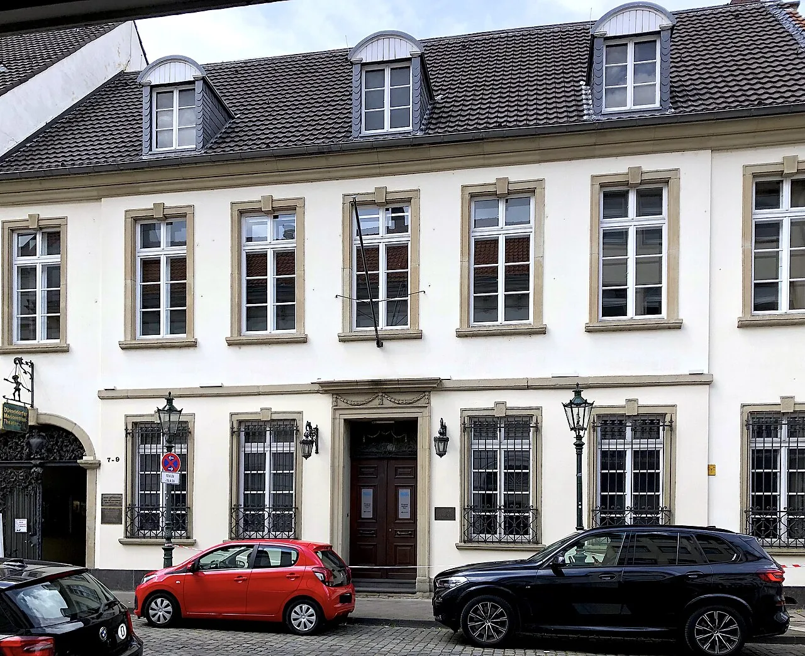

*Foto: Velopilger / Wikimedia Commons (CC0) – [Quelle](https://commons.wikimedia.org/wiki/File:Palais_Wittgenstein_(D%C3%BCsseldorf)_foto-2.jpg)*

Das Palais Wittgenstein an der Bilker Straße in der **Carlstadt** ist ein städtisches **Kulturzentrum**. Das Gebäude entstand nach 1790 für den Weinhändler Heinrich Huyssen, zu den späteren Eigentümern gehörte von 1874 bis 1876 Prinz Alexander zu Sayn-Wittgenstein. 1953 kaufte die Stadt Düsseldorf den Komplex. Nach schweren Schäden im Zweiten Weltkrieg wurde er 1974 bis 1976 außen historisch rekonstruiert und innen modernisiert, 1976 eröffnete das Kulturzentrum.

Zum Haus gehören ein **Kammermusiksaal** mit 234 Plätzen für Konzerte und Lesungen sowie das **Düsseldorfer Marionetten-Theater** im Innenhof. Seit 1977 ist außerdem das Institut français Düsseldorf im Palais untergebracht. Das Gebäude ist in der Denkmalliste der Stadt als Baudenkmal eingetragen.

Quellen je Satz

1. Das Palais Wittgenstein an der Bilker Straße in der Carlstadt ist ein städtische… — https://de.wikipedia.org/wiki/Palais_Wittgenstein_(D%C3%BCsseldorf)
2. Das Gebäude entstand nach 1790 für den Weinhändler Heinrich Huyssen, zu den spät… — https://de.wikipedia.org/wiki/Palais_Wittgenstein_(D%C3%BCsseldorf)
3. 1953 kaufte die Stadt Düsseldorf den Komplex. — https://de.wikipedia.org/wiki/Palais_Wittgenstein_(D%C3%BCsseldorf)
4. Nach schweren Schäden im Zweiten Weltkrieg wurde er 1974 bis 1976 außen historis… — https://de.wikipedia.org/wiki/Palais_Wittgenstein_(D%C3%BCsseldorf)
5. Zum Haus gehören ein Kammermusiksaal mit 234 Plätzen für Konzerte und Lesungen s… — https://de.wikipedia.org/wiki/Palais_Wittgenstein_(D%C3%BCsseldorf)
6. Seit 1977 ist außerdem das Institut français Düsseldorf im Palais untergebracht. — https://de.wikipedia.org/wiki/Palais_Wittgenstein_(D%C3%BCsseldorf)
7. Das Gebäude ist in der Denkmalliste der Stadt als Baudenkmal eingetragen. — https://de.wikipedia.org/wiki/Palais_Wittgenstein_(D%C3%BCsseldorf)

> Hinweis der Recherche: Keine eigene offizielle Website des Palais gefunden (Veranstaltungen über Stadt/Tonhalle). Alle Fakten aus Wikipedia; visitduesseldorf nennt laut Suchergebnis 1976 als Entstehungsjahr des Kulturzentrums, was zur Wiedereröffnung passt, nicht zum Baujahr. Bild nicht visuell geprüft.

---

### Pialana Manufaktur

`/orte/pialana-manufaktur` · 5 Sätze · Website: https://pialana.de/

Die **pialana Manufaktur** ist eine kleine Düsseldorfer Werkstatt für handgestrickte Einzelstücke und Kleinserien. Daneben entstehen dort Sonderanfertigungen für Film und Bühne.

Angeboten werden außerdem **Workshops** zum Stricken, Häkeln und Upcycling, darunter Anfängerkurse, eine wöchentliche Strick-Werkstatt und Kurse für Kinder. Beim Upcycling geht es auch um Reparaturtechniken wie die japanische Flicktechnik **Sashiko**. Die Kurse finden in kleinen Runden von drei bis fünf Personen in Düsseldorf-**Golzheim** statt.

Quellen je Satz

1. Die pialana Manufaktur ist eine kleine Düsseldorfer Werkstatt für handgestrickte… — https://pialana.de/
2. Daneben entstehen dort Sonderanfertigungen für Film und Bühne. — https://pialana.de/
3. Angeboten werden außerdem Workshops zum Stricken, Häkeln und Upcycling, darunter… — https://pialana.de/
4. Beim Upcycling geht es auch um Reparaturtechniken wie die japanische Flicktechni… — https://pialana.de/
5. Die Kurse finden in kleinen Runden von drei bis fünf Personen in Düsseldorf-Golz… — https://pialana.de/faq/

> Hinweis der Recherche: Die Website nennt nur „Düsseldorf-Golzheim“ als Kursort, die Adresse Cecilienallee 25 wurde nicht bestätigt. og:image zeigt Strickjacken (Produkt), daher kein Bild.

---

### Plange Mühle FUENF

`/orte/plange-muehle-fuenf` · 4 Sätze · Website: https://www.pm5-duesseldorf.de/

**Plange Mühle FUENF**, kurz PM5, ist ein Bistro mit Catering- und Eventbetrieb an der Straße Plange Mühle in Düsseldorf. Werktags gibt es Frühstück, hausgemachten Mittagstisch mit **mediterranen Einflüssen** sowie Kaffee und selbst gebackene Kuchen. Außerhalb der Öffnungszeiten wird das Haus zur **Eventlocation**, etwa für Firmenfeiern, Grillabende, Hochzeiten und private Feste. Namensgeber der Straße ist die 1906 errichtete Plange Mühle im Hafen, deren denkmalgeschützte Gebäude nach dem Ende des Mahlbetriebs 1998 für Büros, Ausstellungen, Freizeit und Gastronomie umgebaut wurden.

Quellen je Satz

1. Plange Mühle FUENF, kurz PM5, ist ein Bistro mit Catering- und Eventbetrieb an d… — https://www.pm5-duesseldorf.de/
2. Werktags gibt es Frühstück, hausgemachten Mittagstisch mit mediterranen Einflüss… — https://www.pm5-duesseldorf.de/
3. Außerhalb der Öffnungszeiten wird das Haus zur Eventlocation, etwa für Firmenfei… — https://www.pm5-duesseldorf.de/
4. Namensgeber der Straße ist die 1906 errichtete Plange Mühle im Hafen, deren denk… — https://de.wikipedia.org/wiki/Georg_Plange_Weizenm%C3%BChlen

> Hinweis der Recherche: Ob PM5 in einem der historischen Mühlengebäude liegt, ist nicht belegt; Satz 4 beschreibt nur das Mühlen-Ensemble – ggf. streichen, falls der Bezug zu weit geht. Kapazitätsangaben nur auf Eventportalen und widersprüchlich (150 sitzend/250 stehend vs. bis 300) – weggelassen. og:image der Website ist vermutlich das Logo, Raumfotos ohne Beschreibung – daher kein Bild.

---

### PSD Bank Dome

`/orte/psd-bank-dome` · 7 Sätze · Website: https://www.psd-bank-dome.de/

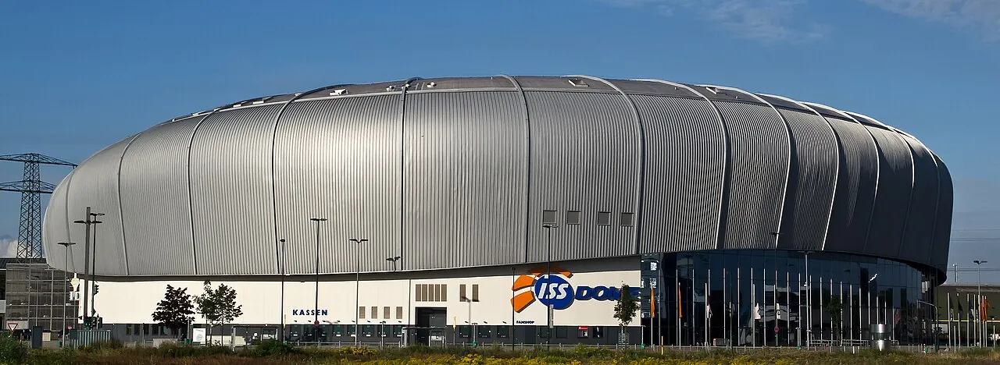

*Foto: M 93 / Wikimedia Commons (CC BY-SA 3.0 DE) – [Quelle](https://commons.wikimedia.org/wiki/File:ISS_DOME_%E2%80%93_Nordansicht,_21._Juli_2012,_D%C3%BCsseldorf.jpg)*

Der PSD Bank Dome ist eine **Multifunktionshalle** im Düsseldorfer Stadtteil **Rath**. Die Halle wurde nach Entwürfen des Büros RKW Architektur + Städtebau gebaut und im September 2006 eröffnet. Bis Juni 2021 hieß sie ISS Dome, seit Juli 2021 trägt sie den Namen der PSD Bank.

Seit der Saison 2006/07 trägt die **Düsseldorfer EG** hier ihre Eishockey-Heimspiele aus. Bei Konzerten und anderen Veranstaltungen fasst die Halle bis zu 15.151 Menschen. Innerhalb von etwa acht Stunden lässt sie sich von einer Eishalle in eine **Konzerthalle** umbauen. Nach der Merkur Spiel-Arena ist sie die zweitgrößte Veranstaltungsstätte der Stadt.

Quellen je Satz

1. Der PSD Bank Dome ist eine Multifunktionshalle im Düsseldorfer Stadtteil Rath.… — https://de.wikipedia.org/wiki/PSD_Bank_Dome
2. Die Halle wurde nach Entwürfen des Büros RKW Architektur + Städtebau gebaut und … — https://de.wikipedia.org/wiki/PSD_Bank_Dome
3. Bis Juni 2021 hieß sie ISS Dome, seit Juli 2021 trägt sie den Namen der PSD Bank… — https://de.wikipedia.org/wiki/PSD_Bank_Dome
4. Seit der Saison 2006/07 trägt die Düsseldorfer EG hier ihre Eishockey-Heimspiele… — https://de.wikipedia.org/wiki/PSD_Bank_Dome
5. Bei Konzerten und anderen Veranstaltungen fasst die Halle bis zu 15.151 Menschen… — https://de.wikipedia.org/wiki/PSD_Bank_Dome
6. Innerhalb von etwa acht Stunden lässt sie sich von einer Eishalle in eine Konzer… — https://www.visitduesseldorf.de/en/attractions/psd-bank-dome-c7539ebb18
7. Nach der Merkur Spiel-Arena ist sie die zweitgrößte Veranstaltungsstätte der Sta… — https://de.wikipedia.org/wiki/PSD_Bank_Dome

> Hinweis der Recherche: Bild von 2012 (damals ISS Dome, Panorama-Format 3368x1231), Beschriftung am Gebäude kann noch den alten Namen zeigen. Adresse laut visitduesseldorf DEG-Platz 1, 40472 Düsseldorf (Paket nennt Theodorstraße 281). Nächste Haltestelle: Quellen widersprüchlich bzw. nur Ticketportal, daher weggelassen.

---

### Raketenstation Hombroich

`/orte/raketenstation-hombroich` · 7 Sätze · Website: https://www.inselhombroich.de/

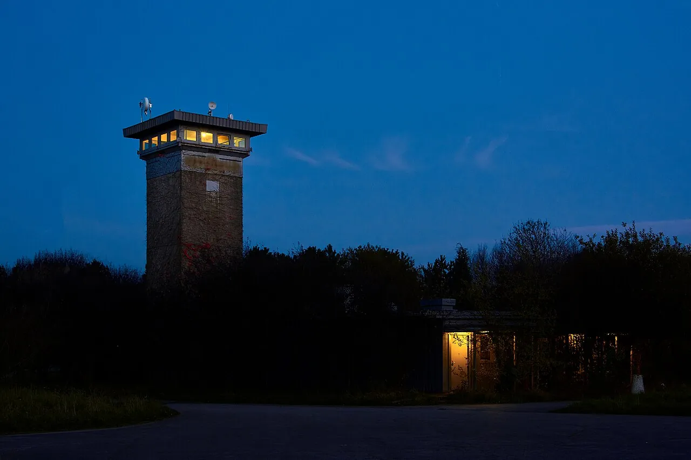

*Foto: Anil Öztas / Wikimedia Commons (CC BY-SA 4.0) – [Quelle](https://commons.wikimedia.org/wiki/File:Neuss_(DE),_Raketenstation_Hombroich,_Turmgeb%C3%A4ude_--_2014_--_7387.jpg)*

Die **Raketenstation Hombroich** ist ein Kunst- und Kulturgelände bei Holzheim im Neusser Stadtgebiet, das der **Stiftung Insel Hombroich** gehört. Bis 1990 befand sich hier eine NATO-Raketenstellung, die ab 1967 von belgischen Luftstreitkräften betrieben wurde und an der auch US-Soldaten stationiert waren. Die Raketen wurden 1988 im Zuge des INF-Vertrags abgebaut und abtransportiert.

1994 erwarb **Karl-Heinrich Müller** das Areal und ließ die vorhandenen Gebäude umbauen, an der Gestaltung wirkten unter anderem Erwin Heerich, Katsuhito Nishikawa und Oliver Kruse mit. Heute leben und arbeiten auf dem Gelände Künstler, Komponisten, Schriftsteller und Wissenschaftler.

Zu den Bauten zählen **begehbare Skulpturen** von Erwin Heerich, umgenutzte ehemalige NATO-Gebäude mit Ateliers, das Haus für Musiker von Raimund Abraham, ein Pavillon von Álvaro Siza und das Teehaus „Ein Stein“ von Terunobu Fujimori. 2004 wurde auf dem Areal das von **Tadao Ando** entworfene Ausstellungshaus der Langen Foundation fertiggestellt.

Quellen je Satz

1. Die Raketenstation Hombroich ist ein Kunst- und Kulturgelände bei Holzheim im Ne… — https://de.wikipedia.org/wiki/Raketenstation_Hombroich
2. Bis 1990 befand sich hier eine NATO-Raketenstellung, die ab 1967 von belgischen … — https://de.wikipedia.org/wiki/Raketenstation_Hombroich
3. Die Raketen wurden 1988 im Zuge des INF-Vertrags abgebaut und abtransportiert. — https://de.wikipedia.org/wiki/Raketenstation_Hombroich
4. 1994 erwarb Karl-Heinrich Müller das Areal und ließ die vorhandenen Gebäude umba… — https://de.wikipedia.org/wiki/Raketenstation_Hombroich
5. Heute leben und arbeiten auf dem Gelände Künstler, Komponisten, Schriftsteller u… — https://de.wikipedia.org/wiki/Raketenstation_Hombroich
6. Zu den Bauten zählen begehbare Skulpturen von Erwin Heerich, umgenutzte ehemalig… — https://www.inselhombroich.de/de/bauten/raketenstation/
7. 2004 wurde auf dem Areal das von Tadao Ando entworfene Ausstellungshaus der Lang… — https://de.wikipedia.org/wiki/Raketenstation_Hombroich

> Hinweis der Recherche: Fertigstellung des Hauses für Musiker widersprüchlich (Wikipedia 2014, Stiftungsseite 2017) – Jahr weggelassen. Das Teehaus war laut Wikipedia 2020 zu sehen; ob es dauerhaft steht, ist offen (Stiftungsseite führt es unter den Bauten). Bild zeigt das ehemalige NATO-Turmgebäude in der Dämmerung.

---

### Rathaus Düsseldorf

`/orte/rathaus-duesseldorf` · 9 Sätze · Website: https://www.duesseldorf.de

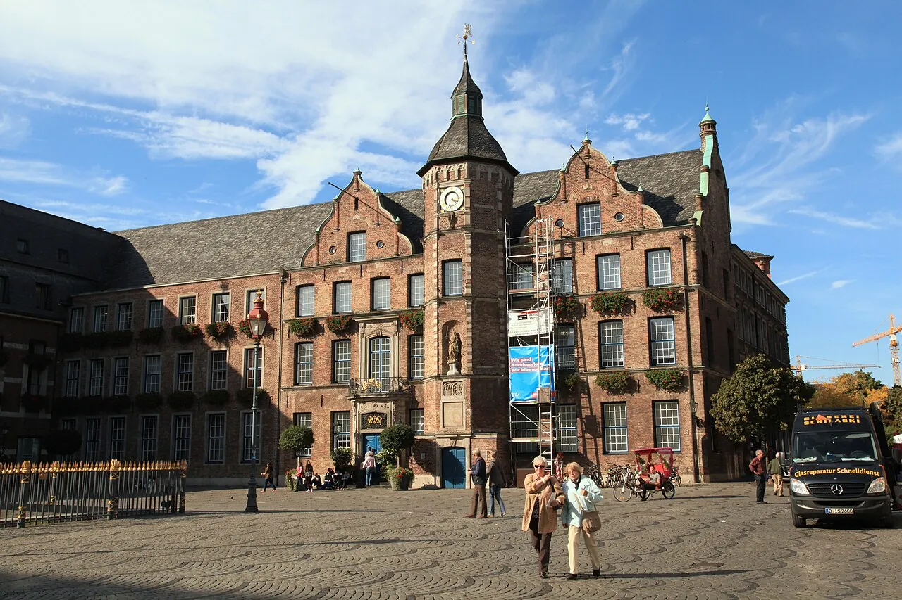

*Foto: Frank Vincentz / Wikimedia Commons (CC BY-SA 3.0) – [Quelle](https://commons.wikimedia.org/wiki/File:D%C3%BCsseldorf_-_Marktplatz_-_Rathaus_01_ies.jpg)*

Das **Düsseldorfer Rathaus** steht am Marktplatz in der Altstadt nahe dem Rhein, in der Mitte des Platzes erhebt sich das Reiterstandbild des Kurfürsten Jan Wellem. Seit den 1570er-Jahren ist es ohne Unterbrechung Sitz von Stadtrat und Stadtverwaltung. Der Plenarsaal des Rates liegt im Gebäudeteil Marktplatz 2.

Das **Alte Rathaus** errichtete der Baumeister Heinrich Tussmann. Seine ältesten Teile stammen aus den Jahren 1570 bis 1573, bis 1806 tagten dort auch die Landstände von Jülich-Berg. Das benachbarte **Grupello-Haus** wurde von Matteo Alberti erbaut. 1888 kam das Neue Rathaus nach Plänen von Eberhard Westhofen hinzu, nach Schäden im Zweiten Weltkrieg wurde es in den 1960er-Jahren umgestaltet.

Das Rathaus steht unter **Denkmalschutz**. In der Adventszeit bildet der Platz rund um das Jan-Wellem-Denkmal die Kulisse für den Düsseldorfer Weihnachtsmarkt.

Quellen je Satz

1. Das Düsseldorfer Rathaus steht am Marktplatz in der Altstadt nahe dem Rhein, in … — https://de.wikipedia.org/wiki/Rathaus_D%C3%BCsseldorf
2. Seit den 1570er-Jahren ist es ohne Unterbrechung Sitz von Stadtrat und Stadtverw… — https://de.wikipedia.org/wiki/Rathaus_D%C3%BCsseldorf
3. Der Plenarsaal des Rates liegt im Gebäudeteil Marktplatz 2. — https://de.wikipedia.org/wiki/Rathaus_D%C3%BCsseldorf
4. Das Alte Rathaus errichtete der Baumeister Heinrich Tussmann. — https://www.visitduesseldorf.de/en/attractions/rathaus-town-hall-dc663bd47c
5. Seine ältesten Teile stammen aus den Jahren 1570 bis 1573, bis 1806 tagten dort … — https://de.wikipedia.org/wiki/Rathaus_D%C3%BCsseldorf
6. Das benachbarte Grupello-Haus wurde von Matteo Alberti erbaut. — https://de.wikipedia.org/wiki/Rathaus_D%C3%BCsseldorf
7. 1888 kam das Neue Rathaus nach Plänen von Eberhard Westhofen hinzu, nach Schäden… — https://de.wikipedia.org/wiki/Rathaus_D%C3%BCsseldorf
8. Das Rathaus steht unter Denkmalschutz. — https://de.wikipedia.org/wiki/Rathaus_D%C3%BCsseldorf
9. In der Adventszeit bildet der Platz rund um das Jan-Wellem-Denkmal die Kulisse f… — https://www.visitduesseldorf.de/en/attractions/rathaus-town-hall-dc663bd47c

> Hinweis der Recherche: Baujahr des Grupello-Hauses widersprüchlich (Wikipedia 1706, visitduesseldorf.de 1705) – im Text weggelassen. Tussmann als Baumeister nur bei visitduesseldorf.de belegt (Wikipedia nennt keinen Architekten). Jan-Wellem-Saal (Nachkriegsbau 1958–61 nach Tamms) nur in einer Suchzusammenfassung gesehen, nicht direkt belegt – weggelassen. Webseite: Stadtportal (keine eigene Rathaus-Seite).

---

### reinraum e.V.

`/orte/reinraum-e-v` · 5 Sätze · Website: https://reinraum-ev.de/

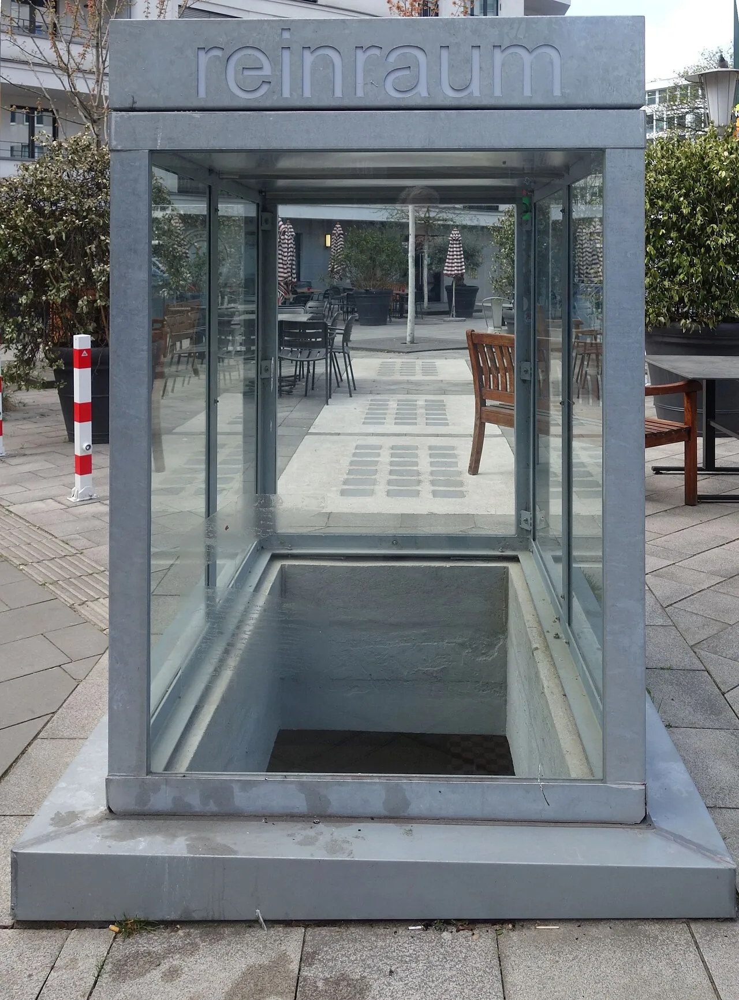

*Foto: Kürschner / Wikimedia Commons (CC0) – [Quelle](https://commons.wikimedia.org/wiki/File:Reinraum_e._V.,_D%C3%BCsseldorf,_April_2025_(3).jpg)*

Der **reinraum** ist ein Kunst- und Kulturraum in einer ehemaligen **unterirdischen Toilettenanlage** unterhalb des Jahnplatzes in der Düsseldorfer Innenstadt. Betrieben wird er vom Verein reinraum e.V., der von der Initiative seiner Mitglieder lebt. Der Name ist den Reinräumen der Mikroelektronik entlehnt, in denen unter besonders sauberen Bedingungen gearbeitet wird.

Der Raum ist rund 60 Quadratmeter groß. Gezeigt werden **Ausstellungen**, etwa zu Streetart und Urban Art, daneben gibt es Konzerte und **Partys**.

Quellen je Satz

1. Der reinraum ist ein Kunst- und Kulturraum in einer ehemaligen unterirdischen To… — https://reinraum-ev.de/verein/
2. Betrieben wird er vom Verein reinraum e.V., der von der Initiative seiner Mitgli… — https://reinraum-ev.de/verein/
3. Der Name ist den Reinräumen der Mikroelektronik entlehnt, in denen unter besonde… — https://reinraum-ev.de/verein/
4. Der Raum ist rund 60 Quadratmeter groß. — https://reinraum-ev.de/verein/
5. Gezeigt werden Ausstellungen, etwa zu Streetart und Urban Art, daneben gibt es K… — https://reinraum-ev.de/

> Hinweis der Recherche: Kategorie „Club/Bar/Kneipe“ passt nur teilweise – es ist ein Off-Space für Kunst mit Konzerten/Partys. Gründungsjahr nur über Event-Anzeige („25 Jahre Offspace“, 2026) – nicht verwendet. Bild zeigt den gläsernen Oberlicht-Aufbau mit Schriftzug „reinraum“.

---

### RheinRiff

`/orte/rheinriff` · 6 Sätze · Website: https://www.rheinriff.com/

Das **RheinRiff** an der Hansaallee in Düsseldorf ist eine Freizeit- und Eventlocation rund um eine **Indoor-Surfwelle**. Auf rund 9.000 Quadratmetern gibt es dort außerdem einen **Beachclub**, Sportangebote und ein modulares Conference Center. Die stehende Welle vom Typ Citywave ist neun Meter breit und lässt sich unabhängig von Wetter und Jahreszeit surfen.

Das Surfangebot reicht von Kursen für Einsteiger ohne Vorerfahrung bis zu Sessions für erfahrene Surferinnen und Surfer. Daneben finden Partys, Afterwork-Abende und **Firmenevents** statt. Die nächste Haltestelle ist **D-Lörick**, von dort sind es wenige Gehminuten bis zum Eingang.

Quellen je Satz

1. Das RheinRiff an der Hansaallee in Düsseldorf ist eine Freizeit- und Eventlocati… — https://www.rheinriff.com/
2. Auf rund 9.000 Quadratmetern gibt es dort außerdem einen Beachclub, Sportangebot… — https://www.rheinriff.com/
3. Die stehende Welle vom Typ Citywave ist neun Meter breit und lässt sich unabhäng… — https://www.rheinriff.com/de/surf
4. Das Surfangebot reicht von Kursen für Einsteiger ohne Vorerfahrung bis zu Sessio… — https://www.rheinriff.com/de/surf
5. Daneben finden Partys, Afterwork-Abende und Firmenevents statt. — https://www.rheinriff.com/
6. Die nächste Haltestelle ist D-Lörick, von dort sind es wenige Gehminuten bis zum… — https://www.rheinriff.com/de/anfahrt

> Hinweis der Recherche: Superlativ der Website („größte Indoor-Surfhalle der Welt“, „erste Indoor-Surf-Welle der Stadt“) bewusst nicht übernommen. Lage laut Handelsregister-Auszug auf dem Areal Böhler (Halle 8) – nicht in den Text übernommen, da nur aus einem Registerportal. og:image zeigt die Surfwelle während eines gesponserten Wettbewerbs mit großem Publikum – daher kein Bild.

---

### Rheinturm Düsseldorf

`/orte/rheinturm-duesseldorf` · 8 Sätze · Website: –

*Foto: Taxiarchos228 / Wikimedia Commons (FAL (Free Art License)) – [Quelle](https://commons.wikimedia.org/wiki/File:Rheinturm_-_Gesamtansicht_vom_Medienhafen.jpg)*

Der Rheinturm ist ein 240,5 Meter hoher **Fernmeldeturm** und das höchste Bauwerk Düsseldorfs. Er steht am östlichen Ende des **Medienhafens**, neben dem Landtag und der Rheinkniebrücke. Entworfen hat ihn Harald Deilmann im Auftrag der Deutschen Bundespost. Der öffentliche Aussichtsbereich wurde im März 1982 eröffnet.

Antennen auf dem Turm dienen dem Richtfunk sowie der Ausstrahlung von DVB-T-Fernsehen und UKW-Hörfunk. In 170 Metern Höhe liegt eine verglaste **Aussichtsebene** mit Panoramafenstern, in 174,5 Metern ein Restaurant, dessen Sitzbereich sich in etwa einer Stunde einmal um die eigene Achse dreht.

Am Schaft ist seit November 1981 der **Lichtzeitpegel** des Künstlers Horst H. Baumann angebracht, eine Lichtskulptur, die die Uhrzeit anzeigt. Das Guinness-Buch führt sie als größte dezimale Zeitskala der Welt.

Quellen je Satz

1. Der Rheinturm ist ein 240,5 Meter hoher Fernmeldeturm und das höchste Bauwerk Dü… — https://de.wikipedia.org/wiki/Rheinturm
2. Er steht am östlichen Ende des Medienhafens, neben dem Landtag und der Rheinknie… — https://de.wikipedia.org/wiki/Rheinturm
3. Entworfen hat ihn Harald Deilmann im Auftrag der Deutschen Bundespost. — https://de.wikipedia.org/wiki/Rheinturm
4. Der öffentliche Aussichtsbereich wurde im März 1982 eröffnet. — https://de.wikipedia.org/wiki/Rheinturm
5. Antennen auf dem Turm dienen dem Richtfunk sowie der Ausstrahlung von DVB-T-Fern… — https://de.wikipedia.org/wiki/Rheinturm
6. In 170 Metern Höhe liegt eine verglaste Aussichtsebene mit Panoramafenstern, in … — https://de.wikipedia.org/wiki/Rheinturm
7. Am Schaft ist seit November 1981 der Lichtzeitpegel des Künstlers Horst H. Bauma… — https://de.wikipedia.org/wiki/Rheinturm
8. Das Guinness-Buch führt sie als größte dezimale Zeitskala der Welt. — https://de.wikipedia.org/wiki/Rheinturm

> Hinweis der Recherche: Bildlizenz ist die Free Art License (frei, Namensnennung nötig), keine CC-Lizenz. Baubeginn weggelassen: Wikipedia nennt im Einleitungstext 1978–1982, in Infobox/Text Baubeginn Januar 1979. Höhe der Aussichtsplattform je nach Abschnitt 166,25 / 168 / 170 m; im Text nur die verglaste Ebene in 170 m genannt. Offizielle Website des Turms nicht ermittelt.

---

### Rigpa Zentrum Düsseldorf

`/orte/rigpa-zentrum-duesseldorf` · 4 Sätze · Website: https://www.rigpa.de/zentren/duesseldorf/

Das **Rigpa Zentrum Düsseldorf** an der Kronprinzenstraße ist ein Zentrum der buddhistischen Gemeinschaft Rigpa. Sie steht in der Tradition des **tibetischen Buddhismus** und bietet einen strukturierten Weg zum Studium und zur Praxis der traditionellen Lehren. Die Gruppe in Düsseldorf besteht seit den 1980er-Jahren. Angeboten werden offene **Meditationsabende** sowie Kurse, die mehr Ruhe und Gelassenheit im Alltag fördern sollen.

Quellen je Satz

1. Das Rigpa Zentrum Düsseldorf an der Kronprinzenstraße ist ein Zentrum der buddhi… — https://www.rigpa.de/zentren/duesseldorf/
2. Sie steht in der Tradition des tibetischen Buddhismus und bietet einen strukturi… — https://www.rigpa.de/zentren/duesseldorf/
3. Die Gruppe in Düsseldorf besteht seit den 1980er-Jahren. — https://www.rigpa.de/zentren/duesseldorf/
4. Angeboten werden offene Meditationsabende sowie Kurse, die mehr Ruhe und Gelasse… — https://www.rigpa.de/zentren/duesseldorf/

> Hinweis der Recherche: Laut Deutscher Buddhistischer Union war die Einweihung neuer Räume an der Kronprinzenstraße für Januar 2020 angekündigt; ob sie so stattfand, ist nicht belegt, daher weggelassen. Kein sauberes Raumfoto gefunden.

---

### Robert Schumann Hochschule Düsseldorf

`/orte/robert-schumann-hochschule-duesseldorf` · 7 Sätze · Website: https://www.rsh-duesseldorf.de

*Foto: Wiegels / Wikimedia Commons (CC BY 3.0) – [Quelle](https://commons.wikimedia.org/wiki/File:Robert-Schumann-Hochschule_in_Duesseldorf-Golzheim,_von_Osten.jpg)*

Die **Robert Schumann Hochschule** ist eine Musikhochschule mit Sitz an der Fischerstraße im Stadtteil Golzheim. Ihre Wurzeln reichen bis zum 1902 gegründeten Buths-Neitzel-Konservatorium zurück. Seit 1987 ist sie eine eigenständige Kunsthochschule, seit 1989 hat sie das Promotionsrecht.

Das Gebäude an der Fischerstraße wurde 1975 eingeweiht. Zentraler Veranstaltungsort ist der 1993 eröffnete **Partika-Saal** mit rund 200 Plätzen. Zur Hochschule gehören Institute für Musikwissenschaft, für Komposition und Musiktheorie, für Musik und Medien sowie für **Kirchenmusik**. Die Opernschule tritt mindestens einmal im Jahr gemeinsam mit der Deutschen Oper am Rhein auf, Konzerte finden auch in der Tonhalle statt.

Quellen je Satz

1. Die Robert Schumann Hochschule ist eine Musikhochschule mit Sitz an der Fischers… — https://de.wikipedia.org/wiki/Robert_Schumann_Hochschule_D%C3%BCsseldorf
2. Ihre Wurzeln reichen bis zum 1902 gegründeten Buths-Neitzel-Konservatorium zurüc… — https://de.wikipedia.org/wiki/Robert_Schumann_Hochschule_D%C3%BCsseldorf
3. Seit 1987 ist sie eine eigenständige Kunsthochschule, seit 1989 hat sie das Prom… — https://de.wikipedia.org/wiki/Robert_Schumann_Hochschule_D%C3%BCsseldorf
4. Das Gebäude an der Fischerstraße wurde 1975 eingeweiht. — https://de.wikipedia.org/wiki/Robert_Schumann_Hochschule_D%C3%BCsseldorf
5. Zentraler Veranstaltungsort ist der 1993 eröffnete Partika-Saal mit rund 200 Plä… — https://de.wikipedia.org/wiki/Robert_Schumann_Hochschule_D%C3%BCsseldorf
6. Zur Hochschule gehören Institute für Musikwissenschaft, für Komposition und Musi… — https://de.wikipedia.org/wiki/Robert_Schumann_Hochschule_D%C3%BCsseldorf
7. Die Opernschule tritt mindestens einmal im Jahr gemeinsam mit der Deutschen Oper… — https://de.wikipedia.org/wiki/Robert_Schumann_Hochschule_D%C3%BCsseldorf

> Hinweis der Recherche: Alle Fakten aus Wikipedia; Architekt des Hauptgebäudes dort nicht genannt. Offizielle Website nicht inhaltlich ausgewertet.

---

### Robert-Schumann-Saal

`/orte/robert-schumann-saal` · 7 Sätze · Website: https://www.kunstpalast.de/

*Foto: Andreas Grieger – [Quelle](https://www.kunstpalast.de/en/corporate-events/)*

Der Robert-Schumann-Saal ist der **Konzertsaal** im Museum Kunstpalast am **Ehrenhof**. Er wurde 2001 eröffnet und ist nach dem Komponisten Robert Schumann (1810–1856) benannt. Im selben Jahr wurde auch das Museum nach einem umfassenden Umbau durch den Architekten **Oswald Mathias Ungers** wiedereröffnet. Die 1998 gegründete Stiftung Museum Kunstpalast führte Kunstmuseum, Kunstpalast und Robert-Schumann-Saal unter einem Dach zusammen.

Der Saal hat eine Fläche von rund 600 Quadratmetern und bietet bis zu 796 Personen Platz. Zusammen mit dem angrenzenden **Foyer** wird er auch für Empfänge, Galas und Präsentationen vermietet. Das Gebäude geht auf einen ersten **Kunstpalast** von 1902 zurück, den Wilhelm Kreis 1926 zusammen mit Tonhalle, Rheinterrassen und dem heutigen NRW-Forum neu gestaltete.

Quellen je Satz

1. Der Robert-Schumann-Saal ist der Konzertsaal im Museum Kunstpalast am Ehrenhof.… — https://www.kunstpalast.de/en/corporate-events/
2. Er wurde 2001 eröffnet und ist nach dem Komponisten Robert Schumann (1810–1856) … — https://sammlung.kunstpalast.de/objects/details/1068498
3. Im selben Jahr wurde auch das Museum nach einem umfassenden Umbau durch den Arch… — https://www.kunstpalast.de/en/kunstpalast/
4. Die 1998 gegründete Stiftung Museum Kunstpalast führte Kunstmuseum, Kunstpalast … — https://www.kunstpalast.de/en/kunstpalast/
5. Der Saal hat eine Fläche von rund 600 Quadratmetern und bietet bis zu 796 Person… — https://www.kunstpalast.de/en/corporate-events/
6. Zusammen mit dem angrenzenden Foyer wird er auch für Empfänge, Galas und Präsent… — https://www.kunstpalast.de/en/corporate-events/
7. Das Gebäude geht auf einen ersten Kunstpalast von 1902 zurück, den Wilhelm Kreis… — https://www.kunstpalast.de/en/kunstpalast/

> Hinweis der Recherche: Bild: Innenansicht des Saals (mit Bankettbestuhlung), nur ca. 605 px breit. Auf Commons gibt es nur eine Aufnahme des Hintereingangs (Kürschner, gemeinfrei, 2011), daher das Hausfoto gewählt. de.wikipedia hat keinen eigenen Artikel (404). Im Text nicht ausdrücklich belegt, dass der Saal Teil des Ungers-Umbaus war.

---

### Roncalli's Apollo Varieté

`/orte/roncalli-s-apollo-variete` · 8 Sätze · Website: https://www.apollo-variete.com/

**Roncalli's Apollo Varieté** ist ein Varieté-Theater am Düsseldorfer Rheinufer, gegründet von Roncalli-Chef Bernhard Paul. Seit 1997 werden dort Abende mit Artistik, Akrobatik, Musik, Gesang, Tanz und Comedy gezeigt. Das Haus steht in einem **Glaskubus** unter der Rheinkniebrücke, entworfen von den Architekten Niklaus Fritschi, Benedikt Stahl und Günter Baum, die auch die angrenzende Rheinuferpromenade gestalteten.

Der **Saal** ist halbrund angelegt, die Tischreihen folgen dieser Form, sodass die Bühne von allen Plätzen frei zu sehen ist. Das Programm wechselt viermal im Jahr, dazu kommen Gastspiele und Sonderveranstaltungen. Zum Angebot gehört **Show & Dine**, bei dem ein Drei-Gänge-Menü über den Abend verteilt serviert wird.

Das Varieté liegt an der Rheinuferpromenade in der Nähe von Altstadt und Medienhafen. Die nächste Haltestelle ist **Landtag/Kniebrücke**, angefahren von Straßenbahn- und Buslinien der Rheinbahn.

Quellen je Satz

1. Roncalli's Apollo Varieté ist ein Varieté-Theater am Düsseldorfer Rheinufer, geg… — https://www.visitduesseldorf.de/en/attractions/roncallis-apollo-variete-cb57ae8685
2. Seit 1997 werden dort Abende mit Artistik, Akrobatik, Musik, Gesang, Tanz und Co… — https://www.visitduesseldorf.de/attraktionen/roncallis-apollo-variete-6b1db42646
3. Das Haus steht in einem Glaskubus unter der Rheinkniebrücke, entworfen von den A… — https://www.visitduesseldorf.de/attraktionen/roncallis-apollo-variete-6b1db42646
4. Der Saal ist halbrund angelegt, die Tischreihen folgen dieser Form, sodass die B… — https://www.apollo-variete.com/uber-uns/
5. Das Programm wechselt viermal im Jahr, dazu kommen Gastspiele und Sonderveransta… — https://www.apollo-variete.com/uber-uns/
6. Zum Angebot gehört Show & Dine, bei dem ein Drei-Gänge-Menü über den Abend verte… — https://www.apollo-variete.com/uber-uns/
7. Das Varieté liegt an der Rheinuferpromenade in der Nähe von Altstadt und Medienh… — https://www.apollo-variete.com/uber-uns/
8. Die nächste Haltestelle ist Landtag/Kniebrücke, angefahren von Straßenbahn- und … — https://www.apollo-variete.com/anfahrt-und-theaterkasse/

> Hinweis der Recherche: Zum historischen Apollo-Theater an der Kö widersprechen sich Quellen beim Schließungsjahr (1959 bzw. 1966), daher weggelassen. Die Angabe, es sei das erste reine Varieté-Neubau Deutschlands, war nur in einer Suchzusammenfassung, nicht auf einer geöffneten Seite belegt, daher weggelassen.

---

### Ruby Leni Hotel & Bar

`/orte/ruby-leni-hotel-bar` · 7 Sätze · Website: https://www.ruby-hotels.com

*Foto: Kürschner / Wikimedia Commons (CC0) – [Quelle](https://commons.wikimedia.org/wiki/File:Ruby,_Jahnstra%C3%9Fe_3,_D%C3%BCsseldorf,_Oktober_2025.jpg)*

Das **Ruby Leni** ist ein Hotel mit Bar an der Jahnstraße, rund 200 Meter von der Königsallee entfernt. Es eröffnete im Mai 2019 mit 166 Zimmern, einem Café und einer Dachterrasse.

Das Gebäude entstand 1904 als Hotel, wurde 1910 zum **Düsseldorfer Operettenhaus** und diente von 1951 bis 1970 dem Düsseldorfer Schauspielhaus. Der Name erinnert an die Helena aus Gustaf Gründgens’ **Faust**-Inszenierung, die in den 1950er-Jahren in diesem Haus zu sehen war. Antike Requisiten, Kostüme und Vintage-Stücke in der Einrichtung greifen die Theatergeschichte auf.

In der **Lenis Bar** gibt es Cocktails und Live-Musik, Gäste können sich dort auch eine E-Gitarre leihen. Im Erdgeschoss liegt außerdem eine Terrasse.

Quellen je Satz

1. Das Ruby Leni ist ein Hotel mit Bar an der Jahnstraße, rund 200 Meter von der Kö… — https://www.tageskarte.io/hotellerie/detail/ruby-leni-hotel-eroeffnet-im-mai-in-duesseldorf.html
2. Es eröffnete im Mai 2019 mit 166 Zimmern, einem Café und einer Dachterrasse. — https://www.tageskarte.io/hotellerie/detail/ruby-leni-hotel-eroeffnet-im-mai-in-duesseldorf.html
3. Das Gebäude entstand 1904 als Hotel, wurde 1910 zum Düsseldorfer Operettenhaus u… — https://www.tageskarte.io/hotellerie/detail/ruby-leni-hotel-eroeffnet-im-mai-in-duesseldorf.html
4. Der Name erinnert an die Helena aus Gustaf Gründgens’ Faust-Inszenierung, die in… — https://www.visitduesseldorf.de/en/poi/detail/ruby-leni-hotel-duesseldorf-dfb739b9a5
5. Antike Requisiten, Kostüme und Vintage-Stücke in der Einrichtung greifen die The… — https://www.visitduesseldorf.de/en/poi/detail/ruby-leni-hotel-duesseldorf-dfb739b9a5
6. In der Lenis Bar gibt es Cocktails und Live-Musik, Gäste können sich dort auch e… — https://www.visitduesseldorf.de/en/poi/detail/ruby-leni-hotel-duesseldorf-dfb739b9a5
7. Im Erdgeschoss liegt außerdem eine Terrasse. — https://www.visitduesseldorf.de/en/poi/detail/ruby-leni-hotel-duesseldorf-dfb739b9a5

> Hinweis der Recherche: Eröffnung „Mai 2019“ laut Fachartikel vom Februar 2019 (Ankündigung). Das dort erwähnte Forum Freies Theater im Untergeschoss weggelassen (vermutlich inzwischen umgezogen, nicht geprüft). Hotel-Detailseite auf ruby-hotels.com nicht auffindbar (Marke offenbar zu IHG gewechselt, ihg.com blockt automatisierte Abrufe) – Webseite daher nur Markenstartseite. Schreibweise „Gustaf Gründgens“ korrigiert (Quelle: „Gustav Gründgen“).

---

### Rundum Yoga

`/orte/rundum-yoga` · 5 Sätze · Website: https://rundumyoga.com/

Rundum Yoga ist ein **Yogastudio** in Düsseldorf mit Standorten in Unterbilk und Pempelfort. Das Studio in **Unterbilk** an der Kronenstraße eröffneten Susanne und Marc Wenke 2005 in einer ehemaligen Druckerei, zunächst unter dem Namen „Power Yoga & mehr“. Mit dem zweiten Studio in Pempelfort kam 2009 der heutige Name Rundum Yoga.

Das Kursangebot reicht von **Hatha**, Vinyasa und Yin Yoga bis zu Formaten wie Yoga Nidra, Rückenyoga sowie Kursen für Einsteiger und Schwangere. Außerdem bildet das Studio als bei der Yoga Alliance registrierte Schule **Yogalehrerinnen und Yogalehrer** aus, unter anderem in einer 200-Stunden-Multistyle-Ausbildung.

Quellen je Satz

1. Rundum Yoga ist ein Yogastudio in Düsseldorf mit Standorten in Unterbilk und Pem… — https://rundumyoga.com/
2. Das Studio in Unterbilk an der Kronenstraße eröffneten Susanne und Marc Wenke 20… — https://rundumyoga.com/the-story-behind/
3. Mit dem zweiten Studio in Pempelfort kam 2009 der heutige Name Rundum Yoga. — https://rundumyoga.com/the-story-behind/
4. Das Kursangebot reicht von Hatha, Vinyasa und Yin Yoga bis zu Formaten wie Yoga … — https://rundumyoga.com/
5. Außerdem bildet das Studio als bei der Yoga Alliance registrierte Schule Yogaleh… — https://rundumyoga.com/

> Hinweis der Recherche: Hausnummer Kronenstraße 4 nur über Portale (Wellhub, rausgegangen.de) belegt, die Studio-Website nennt auf den gelesenen Seiten keine Hausnummer.

---

### Saffran's

`/orte/saffran-s` · 4 Sätze · Website: –

Das **Saffrans** an der Collenbachstraße in Düsseldorf ist ein Kneipenrestaurant mit lokalen und internationalen Gerichten. Zum Angebot gehören außerdem **Brunch** sowie Feiern und Catering. Ausgeschenkt wird eine Auswahl an Weinen aus aller Welt. Für Feiern steht ein **Gesellschaftsraum** für bis zu 50 Personen zur Verfügung, der nach Angaben des Hauses aus dem Jahr 1900 stammt.

Quellen je Satz

1. Das Saffrans an der Collenbachstraße in Düsseldorf ist ein Kneipenrestaurant mit… — http://www.saffrans.de/
2. Zum Angebot gehören außerdem Brunch sowie Feiern und Catering. — http://www.saffrans.de/
3. Ausgeschenkt wird eine Auswahl an Weinen aus aller Welt. — http://www.saffrans.de/
4. Für Feiern steht ein Gesellschaftsraum für bis zu 50 Personen zur Verfügung, der… — http://www.saffrans.de/

> Hinweis der Recherche: Die Website des Hauses ist nur per http erreichbar (http://www.saffrans.de/, https schlägt fehl), daher Feld webseite leer. Schreibweise im Paket „Saffran's“, auf der Website „Saffrans“.

---

### Sammlung Philara

`/orte/sammlung-philara` · 7 Sätze · Website: https://philara.de/

*Foto: Stefan Müller / Wikimedia Commons (CC BY-SA 4.0) – [Quelle](https://commons.wikimedia.org/wiki/File:Sammlung_Philara_D%C3%BCsseldorf.jpg)*

Die Sammlung Philara ist ein öffentliches Ausstellungshaus für internationale **Gegenwartskunst** im Düsseldorfer Stadtteil **Flingern**. Gezeigt werden Werke aus der Sammlung des Düsseldorfer Kunstsammlers **Gil Bronner**, ergänzt durch Einzel- und Gruppenausstellungen. Seine ersten Ausstellungen organisierte Bronner ab 2008 in der ehemaligen Leitz-Fabrik in Düsseldorf-Reisholz.

Seit 2016 ist die Sammlung in der ehemaligen **Glaserei Lennarz** untergebracht. Den Umbau übernahm das Büro Sieber Architekten. Die Ausstellungsfläche umfasst rund 1.700 Quadratmeter, die Decken sind bis zu neun Meter hoch. Auf dem Dach liegt ein 550 Quadratmeter großer **Skulpturengarten** mit Café.

Quellen je Satz

1. Die Sammlung Philara ist ein öffentliches Ausstellungshaus für internationale Ge… — https://philara.de/de/ueber-uns
2. Gezeigt werden Werke aus der Sammlung des Düsseldorfer Kunstsammlers Gil Bronner… — https://philara.de/de/ueber-uns
3. Seine ersten Ausstellungen organisierte Bronner ab 2008 in der ehemaligen Leitz-… — https://philara.de/de/ueber-uns
4. Seit 2016 ist die Sammlung in der ehemaligen Glaserei Lennarz untergebracht. — https://philara.de/de/ueber-uns
5. Den Umbau übernahm das Büro Sieber Architekten. — https://philara.de/de/ueber-uns
6. Die Ausstellungsfläche umfasst rund 1.700 Quadratmeter, die Decken sind bis zu n… — https://www.visitduesseldorf.de/attraktionen/sammlung-philara-8c07eaa082
7. Auf dem Dach liegt ein 550 Quadratmeter großer Skulpturengarten mit Café. — https://philara.de/de/ueber-uns

> Hinweis der Recherche: Werkzahl weggelassen: philara.de nennt über 1.800 Werke, visitduesseldorf.de rund 1.300 Ankäufe. Hausnummer auf philara.de uneinheitlich (47 bzw. 47a). Commons-Bild ist laut API unskaliert (Original kleiner als 1280 px), Ansicht von der Bahnseite.

---

### Savoy Theater

`/orte/savoy-theater` · 7 Sätze · Website: https://savoy-theater.de/

*Foto: Marek Gehrmann / Wikimedia Commons (CC BY 3.0) – [Quelle](https://commons.wikimedia.org/wiki/File:Duesseldorf_Savoy_Theater.JPG)*

Das **Savoy Theater** liegt im Haus der Handelskammer an der Graf-Adolf-Straße. Es eröffnete im April 1958 als **Kino** „Savoy“ mit großer Breitwand und 70-Millimeter-Projektion. Im Untergeschoss kam im Mai 1958 das kleinere Atelier hinzu, das als Programmkino gedacht war. Später entstanden im Haus weitere kleine Säle wie Apollo 69, Die Lupe und Linse 2.

Nachdem in der Stadt mehrere Multiplex-Kinos eröffnet hatten, schloss der Kinokomplex im April 2000. Seit September 2000 wird das Savoy als **Kleinkunstbühne** genutzt. Im Untergeschoss läuft seit 2006 wieder das **Atelier** als Programmkino der Düsseldorfer Filmkunstkinos.

Quellen je Satz

1. Das Savoy Theater liegt im Haus der Handelskammer an der Graf-Adolf-Straße. — https://de.wikipedia.org/wiki/Savoy_Theater_(D%C3%BCsseldorf)
2. Es eröffnete im April 1958 als Kino „Savoy“ mit großer Breitwand und 70-Millimet… — https://de.wikipedia.org/wiki/Savoy_Theater_(D%C3%BCsseldorf)
3. Im Untergeschoss kam im Mai 1958 das kleinere Atelier hinzu, das als Programmkin… — https://de.wikipedia.org/wiki/Savoy_Theater_(D%C3%BCsseldorf)
4. Später entstanden im Haus weitere kleine Säle wie Apollo 69, Die Lupe und Linse … — https://de.wikipedia.org/wiki/Savoy_Theater_(D%C3%BCsseldorf)
5. Nachdem in der Stadt mehrere Multiplex-Kinos eröffnet hatten, schloss der Kinoko… — https://de.wikipedia.org/wiki/Savoy_Theater_(D%C3%BCsseldorf)
6. Seit September 2000 wird das Savoy als Kleinkunstbühne genutzt. — https://de.wikipedia.org/wiki/Savoy_Theater_(D%C3%BCsseldorf)
7. Im Untergeschoss läuft seit 2006 wieder das Atelier als Programmkino der Düsseld… — https://de.wikipedia.org/wiki/Savoy_Theater_(D%C3%BCsseldorf)

> Hinweis der Recherche: Architektenname im Wikipedia-Abruf unklar ("Hans Nehaus"), daher weggelassen. Platzzahl der heutigen Bühne nicht belegt.

---

### Schloss Benrath

`/orte/schloss-benrath` · 9 Sätze · Website: https://www.schloss-benrath.de/

*Foto: A.Savin / Wikimedia Commons (CC BY-SA 3.0) – [Quelle](https://commons.wikimedia.org/wiki/File:Schloss_Benrath_Jan2012.jpg)*

**Schloss Benrath** im Düsseldorfer Süden ist eine barocke Schlossanlage, die Kurfürst Karl Theodor von der Pfalz von 1755 bis 1771 errichten ließ. Die Pläne stammen von **Nicolas de Pigage**, die Innenräume zeigen den Übergang vom späten französischen Rokoko zum Klassizismus. Die dreiflügelige Anlage besteht aus dem zentralen Corps de Logis, zwei Kavaliershäusern und zwei Torhäusern.

Unter dem Dach der Stiftung Schloss und Park Benrath gibt es **drei Museen**: das Museum Corps de Logis, das Museum für Gartenkunst und das Naturkundemuseum. Das Museum für Europäische Gartenkunst im Ostflügel eröffnete 2002, das Naturkundemuseum ist seit 1929 im Westflügel untergebracht. Die Stiftung wurde im März 2000 gegründet und verwaltet Schloss und Park im Auftrag der Stadt Düsseldorf.

Der **Schlosspark** umfasst rund 61 Hektar, der westliche Jagdpark ist Naturschutzgebiet. Vor dem Schloss liegt der ovale Schlossweiher, die Hauptachse des Parks bildet der rund 470 Meter lange Spiegelweiher. Schloss und Park stehen seit 1984 unter Denkmalschutz.

Quellen je Satz

1. Schloss Benrath im Düsseldorfer Süden ist eine barocke Schlossanlage, die Kurfür… — https://de.wikipedia.org/wiki/Schloss_Benrath
2. Die Pläne stammen von Nicolas de Pigage, die Innenräume zeigen den Übergang vom … — https://de.wikipedia.org/wiki/Schloss_Benrath
3. Die dreiflügelige Anlage besteht aus dem zentralen Corps de Logis, zwei Kavalier… — https://de.wikipedia.org/wiki/Schloss_Benrath
4. Unter dem Dach der Stiftung Schloss und Park Benrath gibt es drei Museen: das Mu… — https://www.schloss-benrath.de/
5. Das Museum für Europäische Gartenkunst im Ostflügel eröffnete 2002, das Naturkun… — https://de.wikipedia.org/wiki/Schloss_Benrath
6. Die Stiftung wurde im März 2000 gegründet und verwaltet Schloss und Park im Auft… — https://de.wikipedia.org/wiki/Schloss_Benrath
7. Der Schlosspark umfasst rund 61 Hektar, der westliche Jagdpark ist Naturschutzge… — https://de.wikipedia.org/wiki/Schloss_Benrath
8. Vor dem Schloss liegt der ovale Schlossweiher, die Hauptachse des Parks bildet d… — https://de.wikipedia.org/wiki/Schloss_Benrath
9. Schloss und Park stehen seit 1984 unter Denkmalschutz. — https://de.wikipedia.org/wiki/Schloss_Benrath

> Hinweis der Recherche: Laufende Generalsanierung angekündigt (weggelassen, da aktuell). Haltestelle nicht belegt.

---

### SCHVARZ KAFFEE HQ

`/orte/schvarz-kaffee-hq` · 3 Sätze · Website: https://schvarz.com/

**SCHVARZ** ist eine Düsseldorfer **Kaffeerösterei**, die Specialty Coffee in kleinen Chargen röstet. Ihr Hauptsitz mit Rösterei, Werksverkauf und **Café** liegt im Gewerbegebiet Segro Park am Höherweg. Daneben bietet SCHVARZ Barista- und Filterkaffee-Kurse sowie Tastings an.

Quellen je Satz

1. SCHVARZ ist eine Düsseldorfer Kaffeerösterei, die Specialty Coffee in kleinen Ch… — https://schvarz.com/pages/roastery
2. Ihr Hauptsitz mit Rösterei, Werksverkauf und Café liegt im Gewerbegebiet Segro P… — https://schvarz.com/pages/roastery
3. Daneben bietet SCHVARZ Barista- und Filterkaffee-Kurse sowie Tastings an. — https://schvarz.com/pages/roastery

> Hinweis der Recherche: Laut neueroeffnung.info Umzug vom früheren Standort Ronsdorfer Straße an den Höherweg mit Wiedereröffnung am 18.10.2026; die eigene Website listet die Ronsdorfer Straße (Alte Farbwerke) aber weiterhin als zweiten Standort, daher weggelassen. Ob die Kurse am Höherweg stattfinden, ist nicht eindeutig. Foto auf der Website ist KI-bearbeitet (Firefly), daher nicht verwendet.

---

### Shidokan Dojo

`/orte/shidokan-dojo` · 5 Sätze · Website: https://www.shorinryu.de

Das **Shidokan Dojo** liegt im Hof der Rethelstraße 28 und ist ein Trainingsort für traditionelles **Karate aus Okinawa**. Es wurde 2007 als **Europäisches Zentrum für Okinawa Shorinryu Shidokan Karatedo** eröffnet.

Der Stil Shorinryu wird als geschmeidig, aber explosiv beschrieben und setzt auf schnelle, kraftvolle Techniken, Körperspannung und Beweglichkeit. Neben Karate wird im Dojo auch **Kobudo** unterrichtet, die Waffenkunst mit Bo, Sai und Tonfa. Für Einsteiger gibt es Anfängerkurse.

Quellen je Satz

1. Das Shidokan Dojo liegt im Hof der Rethelstraße 28 und ist ein Trainingsort für … — https://www.shorinryu.de/
2. Es wurde 2007 als Europäisches Zentrum für Okinawa Shorinryu Shidokan Karatedo e… — https://www.shorinryu.de/
3. Der Stil Shorinryu wird als geschmeidig, aber explosiv beschrieben und setzt auf… — https://www.shorinryu.de/eng/dojo-duesseldorf-eng.html
4. Neben Karate wird im Dojo auch Kobudo unterrichtet, die Waffenkunst mit Bo, Sai … — https://www.shorinryu.de/eng/dojo-duesseldorf-eng.html
5. Für Einsteiger gibt es Anfängerkurse. — https://www.shorinryu.de/eng/dojo-duesseldorf-eng.html

> Hinweis der Recherche: Kinderkurse widersprüchlich: englische Dojo-Seite nennt Kinder ab 6 Jahren, die deutsche Startseite sagt, bis auf Weiteres finden keine Kinderkurse statt – weggelassen. Postleitzahl uneinheitlich (40237 vs. 40267 auf der englischen Seite). Fotos auf der Website zeigen Training/Personen, daher kein Bild. Am Ort finden laut Eventportal auch andere Formate statt (z. B. Tanz).

---

### smoney-hub

`/orte/smoney-hub` · 5 Sätze · Website: –

Der **Smoney Hub** ist ein Treffpunkt der **Stadtsparkasse Düsseldorf** für junge Kundinnen und Kunden in der Sparkassen-Zentrale an der Berliner Allee. Eröffnet wurde er im Oktober 2022 auf rund 500 Quadratmetern, die zuvor ein Café belegte. Die Idee stammt aus einem Innovationswettbewerb der Sparkasse aus dem Jahr 2020, an dem Studierende, Auszubildende und Schüler teilnahmen.

Statt Schaltern und Geldautomaten gibt es Lounge-Sitzbereiche, schallgeschützte Besprechungskabinen und eine **Eventbühne**. In Gesprächen und Veranstaltungen geht es vor allem um Themen wie Karriere, Gründung und **Geldanlage**.

Quellen je Satz

1. Der Smoney Hub ist ein Treffpunkt der Stadtsparkasse Düsseldorf für junge Kundin… — https://www.it-finanzmagazin.de/smoney-hub-augenhoehe-junge-leute-stadtsparkasse-duesseldorf-146085/
2. Eröffnet wurde er im Oktober 2022 auf rund 500 Quadratmetern, die zuvor ein Café… — https://www.it-finanzmagazin.de/smoney-hub-augenhoehe-junge-leute-stadtsparkasse-duesseldorf-146085/
3. Die Idee stammt aus einem Innovationswettbewerb der Sparkasse aus dem Jahr 2020,… — https://www.it-finanzmagazin.de/smoney-hub-augenhoehe-junge-leute-stadtsparkasse-duesseldorf-146085/
4. Statt Schaltern und Geldautomaten gibt es Lounge-Sitzbereiche, schallgeschützte … — https://www.it-finanzmagazin.de/smoney-hub-augenhoehe-junge-leute-stadtsparkasse-duesseldorf-146085/
5. In Gesprächen und Veranstaltungen geht es vor allem um Themen wie Karriere, Grün… — https://www.it-finanzmagazin.de/smoney-hub-augenhoehe-junge-leute-stadtsparkasse-duesseldorf-146085/

> Hinweis der Recherche: Hauptquelle ist ein Fachartikel zur Eröffnung von 2022; sparkasse.de führt den „Digitalen Treffpunkt smoney“ an der Berliner Allee 33 weiterhin. Keine eigene Website des Hubs gefunden. Kein freies Bild.

---

### Sponk Keramik Workshop

`/orte/sponk-keramik-workshop` · 4 Sätze · Website: https://www.sponkkeramik.de

*Foto: Sponk Keramik – [Quelle](https://www.sponkkeramik.de/)*

**Sponk Keramik** ist ein Keramikstudio an der Bilker Allee, in dem Keramik bemalt und getöpfert wird. Angeboten werden Malabende ebenso wie **Töpferkurse** an der Drehscheibe, außerdem ein Brennservice für Keramik. Für Gruppen bis 40 Personen gibt es Teamevents, Junggesellinnenabschiede und **Kindergeburtstage**. Zum Angebot gehört auch die Arbeit mit Ton für Menschen mit körperlichen Einschränkungen, mit psychologischer Begleitung.

Quellen je Satz

1. Sponk Keramik ist ein Keramikstudio an der Bilker Allee, in dem Keramik bemalt u… — https://www.sponkkeramik.de/
2. Angeboten werden Malabende ebenso wie Töpferkurse an der Drehscheibe, außerdem e… — https://www.sponkkeramik.de/
3. Für Gruppen bis 40 Personen gibt es Teamevents, Junggesellinnenabschiede und Kin… — https://www.sponkkeramik.de/
4. Zum Angebot gehört auch die Arbeit mit Ton für Menschen mit körperlichen Einschr… — https://www.sponkkeramik.de/

> Hinweis der Recherche: Ältere Kursportal-Einträge (Konfetti) nennen noch Fürstenplatz 15 – vermutlich früherer Standort; die offizielle Website nennt Bilker Allee 224. Bild: og:image der Website, Innenansicht des Ateliers mit Arbeitstisch (an der Wand Deko-Blechschilder mit Personenmotiven, nur am Rand).

---

### SPONTAN THEATER Studio

`/orte/spontan-theater-studio` · 6 Sätze · Website: https://spontantheater.de/

Das **SPONTAN THEATER Studio** in Düsseldorf-Unterbilk ist der Düsseldorfer Standort einer Impro- und Theaterschule, die ein zweites Studio in der Kölner Neustadt-Süd betreibt. Im Studio an der Volmerswerther Straße gibt es eine eigene Bühnenfläche, auf der Kurse, Proben und Shows stattfinden. Die Schule ist aus der deutschsprachigen Sparte von **Expat Improv** hervorgegangen, unter dessen Namen in denselben Studios ein vergleichbares Kursprogramm auf Englisch läuft.

Das Angebot richtet sich an Erwachsene und reicht von **Schnupper- und Anfängerkursen** im Improvisationstheater über Fortgeschrittenenkurse bis zu thematischen Workshops. Daneben gibt es Kurse speziell für Menschen ab 60 sowie Workshops für Teams und Unternehmen. Das Studio liegt rund drei Gehminuten von der Haltestelle **Völklinger Straße** entfernt, die von S-Bahn und Straßenbahn angefahren wird.

Quellen je Satz

1. Das SPONTAN THEATER Studio in Düsseldorf-Unterbilk ist der Düsseldorfer Standort… — https://spontantheater.de/improschule/
2. Im Studio an der Volmerswerther Straße gibt es eine eigene Bühnenfläche, auf der… — https://spontantheater.de/kontakt/
3. Die Schule ist aus der deutschsprachigen Sparte von Expat Improv hervorgegangen,… — https://spontantheater.de/improschule/
4. Das Angebot richtet sich an Erwachsene und reicht von Schnupper- und Anfängerkur… — https://spontantheater.de/improschule/
5. Daneben gibt es Kurse speziell für Menschen ab 60 sowie Workshops für Teams und … — https://spontantheater.de/
6. Das Studio liegt rund drei Gehminuten von der Haltestelle Völklinger Straße entf… — https://spontantheater.de/improschule/

> Hinweis der Recherche: visitduesseldorf.de führt unter derselben Adresse auch „Impromix“; Expat Improv nutzt dieselben Räume. Das og:image der Website zeigt eine Personengruppe, daher kein Bild.

---

### Stadtbücherei Benrath

`/orte/stadtbuecherei-benrath` · 5 Sätze · Website: https://www.duesseldorf.de/stadtbuechereien/standorte/benrath

*Foto: Hermann Luyken / Wikimedia Commons (CC0) – [Quelle](https://commons.wikimedia.org/wiki/File:2015.09.28.083352_Orangerie_Schlo%C3%9F_Benrath_D%C3%BCsseldorf.jpg)*

Die Stadtbücherei Benrath befindet sich in der **Orangerie** an der Urdenbacher Allee, ihr Lesecafé bietet einen Blick in den Schlosspark. Die Orangerie gilt zusammen mit dem Torgebäude an der Urdenbacher Allee als letzter Rest des älteren **Jagdschlosses Benrath**.

Auf 525 Quadratmetern Publikumsfläche bietet die Bücherei Medien für Kinder und Erwachsene, einen Kinder- und Jugendbereich und eine „Bibliothek der Dinge“. Neben Lesungen und Kindertheater finden Kunstausstellungen, Kabarett und Konzerte statt, in Zusammenarbeit mit dem Benrather Kulturkreis außerdem die Reihe **Montagsprosa**. In der Adventszeit veranstaltet die Bücherei einen großen Büchertrödel.

Quellen je Satz

1. Die Stadtbücherei Benrath befindet sich in der Orangerie an der Urdenbacher Alle… — https://www.duesseldorf.de/stadtbuechereien/standorte/benrath
2. Die Orangerie gilt zusammen mit dem Torgebäude an der Urdenbacher Allee als letz… — https://de.wikipedia.org/wiki/Schloss_Benrath
3. Auf 525 Quadratmetern Publikumsfläche bietet die Bücherei Medien für Kinder und … — https://www.duesseldorf.de/stadtbuechereien/standorte/benrath
4. Neben Lesungen und Kindertheater finden Kunstausstellungen, Kabarett und Konzert… — https://www.duesseldorf.de/stadtbuechereien/standorte/benrath
5. In der Adventszeit veranstaltet die Bücherei einen großen Büchertrödel. — https://www.duesseldorf.de/stadtbuechereien/standorte/benrath

> Hinweis der Recherche: Bild zeigt die Orangerie mit Parterregarten von außen (gesamtes Gebäude, nicht speziell den Büchereiteil). Baujahr der Orangerie nicht belegt, daher weggelassen.

---

### Stadtbücherei Derendorf

`/orte/stadtbuecherei-derendorf` · 3 Sätze · Website: https://www.duesseldorf.de/stadtbuechereien/standorte/derendorf

Die Stadtbücherei Derendorf an der Blücherstraße wurde 1911 gegründet. Sie bietet 476 Quadratmeter Publikumsfläche auf zwei Ebenen, darunter eine Kinder- und eine **Familienbibliothek**, eine Saatgutbibliothek und ein Lesecafé. Neben Angeboten für Kinder wie Kindertheater und Bilderbuchkino gibt es **Ausstellungen**, einen Bücherflohmarkt sowie literarisch-musikalische Veranstaltungen und Konzerte für Erwachsene.

Quellen je Satz

1. Die Stadtbücherei Derendorf an der Blücherstraße wurde 1911 gegründet. — https://de.wikipedia.org/wiki/Stadtb%C3%BCchereien_D%C3%BCsseldorf
2. Sie bietet 476 Quadratmeter Publikumsfläche auf zwei Ebenen, darunter eine Kinde… — https://www.duesseldorf.de/stadtbuechereien/standorte/derendorf
3. Neben Angeboten für Kinder wie Kindertheater und Bilderbuchkino gibt es Ausstell… — https://www.duesseldorf.de/stadtbuechereien/standorte/derendorf

> Hinweis der Recherche: Kein Commons-Bild gefunden; das Foto der Stadtseite zeigt nur eine Spielecke (Schiff/Leuchtturm), nicht übernommen. Wiederöffnung nach dem Krieg in Wikipedia unklar formuliert („1967 bis 1976“), daher weggelassen.

---

### Stadtbücherei Eller

`/orte/stadtbuecherei-eller` · 4 Sätze · Website: https://www.duesseldorf.de/stadtbuechereien/standorte/eller

Die Stadtbücherei Eller am **Gertrudisplatz** wurde 1923 eröffnet. Sie hat 350 Quadratmeter Publikumsfläche auf zwei Ebenen und ein **Lesecafé** mit großer Außenterrasse. Zum Bestand gehören Romane, Sachbücher, Hörbücher, DVDs und Spiele, zur Ausstattung eine Kinderbibliothek und ein Schülercenter. Auf dem Programm stehen unter anderem Bilderbuchkino, Lesungen, Konzerte, Kindertheater und Spieletage.

Quellen je Satz

1. Die Stadtbücherei Eller am Gertrudisplatz wurde 1923 eröffnet. — https://de.wikipedia.org/wiki/Stadtb%C3%BCchereien_D%C3%BCsseldorf
2. Sie hat 350 Quadratmeter Publikumsfläche auf zwei Ebenen und ein Lesecafé mit gr… — https://www.duesseldorf.de/stadtbuechereien/standorte/eller
3. Zum Bestand gehören Romane, Sachbücher, Hörbücher, DVDs und Spiele, zur Ausstatt… — https://www.duesseldorf.de/stadtbuechereien/standorte/eller
4. Auf dem Programm stehen unter anderem Bilderbuchkino, Lesungen, Konzerte, Kinder… — https://www.duesseldorf.de/stadtbuechereien/standorte/eller

> Hinweis der Recherche: Kein Commons-Bild gefunden; Stadtseite zeigt nur ein kleines Foto einer Kinderecke (420 px), nicht übernommen. Adresse laut Stadt und Wikipedia Gertrudisplatz 16–18.

---

### Stadtbücherei Flingern

`/orte/stadtbuecherei-flingern` · 4 Sätze · Website: https://www.duesseldorf.de/stadtbuechereien/standorte/flingern

Die Stadtbücherei Flingern an der Hoffeldstraße gehört zu den **Stadtbüchereien Düsseldorf** und wurde 1907 gegründet. Auf rund 500 Quadratmetern Publikumsfläche in zwei Ebenen bietet sie Medien für Kinder und Erwachsene, darunter Bücher, Hörbücher, DVDs, Spiele, Mangas und Comics. Zur Ausstattung gehören ein **Kinder- und Jugendbereich**, ein Schülercenter, ein Lesecafé und eine „Bibliothek der Dinge“. Das Veranstaltungsprogramm reicht von Bilderbuchkino und Kindertheater über Lesungen und Vorträge bis zu Kunstausstellungen.

Quellen je Satz

1. Die Stadtbücherei Flingern an der Hoffeldstraße gehört zu den Stadtbüchereien Dü… — https://de.wikipedia.org/wiki/Stadtb%C3%BCchereien_D%C3%BCsseldorf
2. Auf rund 500 Quadratmetern Publikumsfläche in zwei Ebenen bietet sie Medien für … — https://www.duesseldorf.de/stadtbuechereien/standorte/flingern
3. Zur Ausstattung gehören ein Kinder- und Jugendbereich, ein Schülercenter, ein Le… — https://www.duesseldorf.de/stadtbuechereien/standorte/flingern
4. Das Veranstaltungsprogramm reicht von Bilderbuchkino und Kindertheater über Lesu… — https://www.duesseldorf.de/stadtbuechereien/standorte/flingern

> Hinweis der Recherche: Kein Commons-Bild des Gebäudes gefunden; das einzige Foto der Stadtseite zeigt unscharf eine Kinderecke (420 px), daher nicht übernommen.

---

### Stadtbücherei Garath

`/orte/stadtbuecherei-garath` · 6 Sätze · Website: https://www.duesseldorf.de/stadtbuechereien/standorte/garath

*Foto: Wiegels / Wikimedia Commons (CC BY 3.0) – [Quelle](https://commons.wikimedia.org/wiki/File:Gebaeude_Fritz-Erler-Strasse_21_in_Duesseldorf-Garath,_von_Sueden.jpg)*

Die **Stadtteilbücherei Garath** liegt im **Kulturhaus Süd** an der Fritz-Erler-Straße. Sie umfasst 340 Quadratmeter auf vier Ebenen mit Lesecafé, Kinderbereich und eigener Jugendbücherei. Neben Büchern, Zeitschriften, Hörbüchern, Spielen, DVDs und Tonies gibt es eine Bibliothek der Dinge mit ausleihbaren Gegenständen für handwerklich-kreative Projekte.

Zum Programm gehören digitale Angebote wie Programmieren mit Lego Education, Bee-Bots und **3D-Druck**. Außerdem gibt es einen Gamingtreff, Workshops, Theater, Konzerte, Lesungen und ein Sprachcafé. Die Bücherei beteiligt sich zudem am Garather **Sonnenradfest**.

Quellen je Satz

1. Die Stadtteilbücherei Garath liegt im Kulturhaus Süd an der Fritz-Erler-Straße.… — https://www.duesseldorf.de/stadtbuechereien/standorte/garath
2. Sie umfasst 340 Quadratmeter auf vier Ebenen mit Lesecafé, Kinderbereich und eig… — https://www.duesseldorf.de/stadtbuechereien/standorte/garath
3. Neben Büchern, Zeitschriften, Hörbüchern, Spielen, DVDs und Tonies gibt es eine … — https://www.duesseldorf.de/stadtbuechereien/standorte/garath
4. Zum Programm gehören digitale Angebote wie Programmieren mit Lego Education, Bee… — https://www.duesseldorf.de/stadtbuechereien/standorte/garath
5. Außerdem gibt es einen Gamingtreff, Workshops, Theater, Konzerte, Lesungen und e… — https://www.duesseldorf.de/stadtbuechereien/standorte/garath
6. Die Bücherei beteiligt sich zudem am Garather Sonnenradfest. — https://www.duesseldorf.de/stadtbuechereien/standorte/garath

> Hinweis der Recherche: Foto von 2011 zeigt das Gebäude noch mit Schriftzug „Freizeitstätte Garath / Stadtbücherei“ (heute Kulturhaus Süd). Geschichte und Haltestelle nicht belegt.

---

### Stadtbücherei Gerresheim

`/orte/stadtbuecherei-gerresheim` · 4 Sätze · Website: https://www.duesseldorf.de/stadtbuechereien/standorte/gerresheim

*Foto: Stadtbüchereien Düsseldorf – [Quelle](https://www.duesseldorf.de/stadtbuechereien/standorte/gerresheim)*

Die Stadtbücherei Gerresheim an der Heyestraße wurde 1913 eröffnet. Sie versteht sich als **Literatur- und Kulturort** mitten in Gerresheim und erstreckt sich über zwei Etagen. Neben einer Kinder- und einer **Jugendbibliothek** gibt es ein Schülercenter und ein Lesecafé mit Tageszeitungen. Das Programm umfasst Kindertheater, Autorenlesungen und Bilderbuchkino sowie abendliche Lesungen, Vorträge und Vernissagen für Erwachsene.

Quellen je Satz

1. Die Stadtbücherei Gerresheim an der Heyestraße wurde 1913 eröffnet. — https://de.wikipedia.org/wiki/Stadtb%C3%BCchereien_D%C3%BCsseldorf
2. Sie versteht sich als Literatur- und Kulturort mitten in Gerresheim und erstreck… — https://www.duesseldorf.de/stadtbuechereien/standorte/gerresheim
3. Neben einer Kinder- und einer Jugendbibliothek gibt es ein Schülercenter und ein… — https://www.duesseldorf.de/stadtbuechereien/standorte/gerresheim
4. Das Programm umfasst Kindertheater, Autorenlesungen und Bilderbuchkino sowie abe… — https://www.duesseldorf.de/stadtbuechereien/standorte/gerresheim

> Hinweis der Recherche: Bild von der Stadtseite: Innenraum der Kinder- und Jugendbücherei (nur ca. 420 px breit), kein Fotograf angegeben; kein Commons-Bild gefunden.

---

### Stadtbücherei Kaiserswerth

`/orte/stadtbuecherei-kaiserswerth` · 4 Sätze · Website: https://www.duesseldorf.de/stadtbuechereien/standorte/kaiserswerth

*Foto: Kürschner / Wikimedia Commons (Public Domain) – [Quelle](https://commons.wikimedia.org/wiki/File:Kaiserswerther_Markt_22-24,_D%C3%BCsseldorf_2019_(1).jpg)*

Die Stadtbücherei Kaiserswerth liegt am **Kaiserswerther Markt** und versteht sich als kultureller Treffpunkt in historischer Umgebung. Sie gehört seit der Eingemeindung Kaiserswerths im Jahr 1929 zu den Düsseldorfer Stadtbüchereien. Auf 268 Quadratmetern bietet sie Medien für alle Altersgruppen, außerdem einen kleinen Bestand an historischen Titeln und **Stadtteilinformationen** wie Jahrbücher und Stadtteilzeitungen. Zum Programm gehören neben Lesungen, Bilderbuchkino und Kindertheater auch Vorträge zu Kaiserswerth.

Quellen je Satz

1. Die Stadtbücherei Kaiserswerth liegt am Kaiserswerther Markt und versteht sich a… — https://www.duesseldorf.de/stadtbuechereien/standorte/kaiserswerth
2. Sie gehört seit der Eingemeindung Kaiserswerths im Jahr 1929 zu den Düsseldorfer… — https://de.wikipedia.org/wiki/Stadtb%C3%BCchereien_D%C3%BCsseldorf
3. Auf 268 Quadratmetern bietet sie Medien für alle Altersgruppen, außerdem einen k… — https://www.duesseldorf.de/stadtbuechereien/standorte/kaiserswerth
4. Zum Programm gehören neben Lesungen, Bilderbuchkino und Kindertheater auch Vortr… — https://www.duesseldorf.de/stadtbuechereien/standorte/kaiserswerth

> Hinweis der Recherche: Bild zeigt den Eingang Kaiserswerther Markt 22/24 mit Bücherauslage im Schaufenster (Foto von 2019); dass es der Büchereieingang ist, ergibt sich aus Hausnummer und Auslage, nicht aus der Bildbeschreibung.

---

### Stadtbücherei Oberkassel

`/orte/stadtbuecherei-oberkassel` · 3 Sätze · Website: https://www.duesseldorf.de/stadtbuechereien/standorte/oberkassel

*Foto: Stadtbüchereien Düsseldorf – [Quelle](https://www.duesseldorf.de/stadtbuechereien/standorte/oberkassel)*

Die Stadtbücherei Oberkassel an der **Luegallee** gehört seit der Eingemeindung Oberkassels 1920 zu den Düsseldorfer Stadtbüchereien und öffnete nach dem Zweiten Weltkrieg bereits 1947 wieder. Sie hat 400 Quadratmeter Publikumsfläche auf zwei Ebenen, mit Kinderbibliothek, Lesecafé und einer großen Krimi- und Thrillerabteilung. Für Kitas und Grundschulen bietet sie Leseförderung und **digitale Medienbildung** an, außerdem gibt es Kindertheater, Spielenachmittage, Lesungen und Vorträge.

Quellen je Satz

1. Die Stadtbücherei Oberkassel an der Luegallee gehört seit der Eingemeindung Ober… — https://de.wikipedia.org/wiki/Stadtb%C3%BCchereien_D%C3%BCsseldorf
2. Sie hat 400 Quadratmeter Publikumsfläche auf zwei Ebenen, mit Kinderbibliothek, … — https://www.duesseldorf.de/stadtbuechereien/standorte/oberkassel
3. Für Kitas und Grundschulen bietet sie Leseförderung und digitale Medienbildung a… — https://www.duesseldorf.de/stadtbuechereien/standorte/oberkassel

> Hinweis der Recherche: Bild von der Stadtseite: Innenraum mit Theke und Kinderbereich (nur ca. 420 px breit), kein Fotograf angegeben. Auf Commons gibt es nur ein Portal-Detail von Luegallee 65, nicht übernommen.

---

### Stadtbücherei Rath

`/orte/stadtbuecherei-rath` · 3 Sätze · Website: https://www.duesseldorf.de/stadtbuechereien/standorte/rath

*Foto: Stadtbüchereien Düsseldorf – [Quelle](https://www.duesseldorf.de/stadtbuechereien/standorte/rath)*

Die Stadtbücherei Rath besteht seit 1924 und befindet sich heute im **Westfalen-Center** an der Westfalenstraße. Auf 656 Quadratmetern Publikumsfläche auf einer Ebene bietet sie Medien für Kinder und Erwachsene, eine **Kinderbibliothek**, ein Lesecafé und eine „Bibliothek der Dinge“. Zum Programm gehören Lesungen, Vorträge, Workshops, Konzerte, Theater und Ausstellungen.

Quellen je Satz

1. Die Stadtbücherei Rath besteht seit 1924 und befindet sich heute im Westfalen-Ce… — https://de.wikipedia.org/wiki/Stadtb%C3%BCchereien_D%C3%BCsseldorf
2. Auf 656 Quadratmetern Publikumsfläche auf einer Ebene bietet sie Medien für Kind… — https://www.duesseldorf.de/stadtbuechereien/standorte/rath
3. Zum Programm gehören Lesungen, Vorträge, Workshops, Konzerte, Theater und Ausste… — https://www.duesseldorf.de/stadtbuechereien/standorte/rath

> Hinweis der Recherche: Bild von der Stadtseite: Innenraum mit Kinderbereich und Wandbild „Aaper Wald“ (nur 420 px breit), kein Fotograf angegeben; kein Commons-Bild gefunden.

---

### Stadtbücherei Unterbach

`/orte/stadtbuecherei-unterbach` · 5 Sätze · Website: https://www.duesseldorf.de/stadtbuechereien/standorte/unterbach

*Foto: Stadtbüchereien Düsseldorf – [Quelle](https://www.duesseldorf.de/stadtbuechereien/standorte/unterbach)*

Die **Stadtteilbücherei Unterbach** am Breidenplatz ist eine Zweigstelle der Stadtbüchereien Düsseldorf. Sie bietet rund 300 Quadratmeter Publikumsfläche auf zwei Ebenen, mit **Kinder- und Jugendbibliothek**, Lesecafé und einer Bibliothek der Dinge. Ausgeliehen werden Bücher, Hörbücher, DVDs, Spiele und weitere Medien.

Zum Programm gehören Lese- und Kreativangebote für Kinder ab vier Jahren, Kindertheater und **Bilderbuchkino**. Für Erwachsene gibt es unter anderem Lesungen, Ausstellungen und einen Bücherflohmarkt.

Quellen je Satz

1. Die Stadtteilbücherei Unterbach am Breidenplatz ist eine Zweigstelle der Stadtbü… — https://www.duesseldorf.de/stadtbuechereien/standorte/unterbach
2. Sie bietet rund 300 Quadratmeter Publikumsfläche auf zwei Ebenen, mit Kinder- un… — https://www.duesseldorf.de/stadtbuechereien/standorte/unterbach
3. Ausgeliehen werden Bücher, Hörbücher, DVDs, Spiele und weitere Medien. — https://www.duesseldorf.de/stadtbuechereien/standorte/unterbach
4. Zum Programm gehören Lese- und Kreativangebote für Kinder ab vier Jahren, Kinder… — https://www.duesseldorf.de/stadtbuechereien/standorte/unterbach
5. Für Erwachsene gibt es unter anderem Lesungen, Ausstellungen und einen Bücherflo… — https://www.duesseldorf.de/stadtbuechereien/standorte/unterbach

> Hinweis der Recherche: Kein Gründungsjahr und keine Haltestelle belegt.

---

### Stadtbücherei Unterrath

`/orte/stadtbuecherei-unterrath` · 6 Sätze · Website: https://www.duesseldorf.de/stadtbuechereien/standorte/unterrath

Die **Stadtteilbücherei Unterrath** an der Eckenerstraße ist eine Zweigstelle der Stadtbüchereien Düsseldorf im Norden der Stadt. Sie erstreckt sich über **zwei Ebenen** mit mehr als 560 Quadratmetern Publikumsfläche und hat ein Lesecafé. Im Erdgeschoss liegt ein Bereich für Kinder und Familien mit Spielbereich.

Der Bestand reicht von Romanen, Sachbüchern, Zeitungen und Zeitschriften über Gesellschaftsspiele bis zu Tonies und Tiptoi-Stiften für Kinder. Dazu kommen eine **Bibliothek der Dinge** und ein kleiner Sonderbestand mit historischen Titeln und Stadtteilinformationen. Regelmäßig gibt es Angebote wie einen **Buchclub**, Vorlesestunden für Kinder und Gaming-Nachmittage.

Quellen je Satz

1. Die Stadtteilbücherei Unterrath an der Eckenerstraße ist eine Zweigstelle der St… — https://www.duesseldorf.de/stadtbuechereien/standorte/unterrath
2. Sie erstreckt sich über zwei Ebenen mit mehr als 560 Quadratmetern Publikumsfläc… — https://www.duesseldorf.de/stadtbuechereien/standorte/unterrath
3. Im Erdgeschoss liegt ein Bereich für Kinder und Familien mit Spielbereich. — https://www.duesseldorf.de/stadtbuechereien/standorte/unterrath
4. Der Bestand reicht von Romanen, Sachbüchern, Zeitungen und Zeitschriften über Ge… — https://www.duesseldorf.de/stadtbuechereien/standorte/unterrath
5. Dazu kommen eine Bibliothek der Dinge und ein kleiner Sonderbestand mit historis… — https://www.duesseldorf.de/stadtbuechereien/standorte/unterrath
6. Regelmäßig gibt es Angebote wie einen Buchclub, Vorlesestunden für Kinder und Ga… — https://www.duesseldorf.de/stadtbuechereien/standorte/unterrath

> Hinweis der Recherche: Keine Angaben zu Gründung/Geschichte oder Haltestelle gefunden. Kein sauberes Gebäudefoto auf Commons; das Bild der Stadtseite zeigt nur eine bemalte Innenwand.

---

### Stadtbücherei Wersten

`/orte/stadtbuecherei-wersten` · 3 Sätze · Website: https://www.duesseldorf.de/stadtbuechereien/standorte/wersten

*Foto: Stadtbüchereien Düsseldorf – [Quelle](https://www.duesseldorf.de/stadtbuechereien/standorte/wersten)*

Die Stadtbücherei Wersten an der Liebfrauenstraße wurde 1936 eröffnet. Auf 570 Quadratmetern in zwei Ebenen gibt es eine **Kinder- und eine Jugendbibliothek**, ein Schülercenter, ein Lesecafé und eine Veranstaltungsfläche. Ein Schwerpunkt liegt auf der **Leseförderung**, hinzu kommen Ausstellungen, Lesungen, Kabarett, Musik und Theater.

Quellen je Satz

1. Die Stadtbücherei Wersten an der Liebfrauenstraße wurde 1936 eröffnet. — https://de.wikipedia.org/wiki/Stadtb%C3%BCchereien_D%C3%BCsseldorf
2. Auf 570 Quadratmetern in zwei Ebenen gibt es eine Kinder- und eine Jugendbibliot… — https://www.duesseldorf.de/stadtbuechereien/standorte/wersten
3. Ein Schwerpunkt liegt auf der Leseförderung, hinzu kommen Ausstellungen, Lesunge… — https://www.duesseldorf.de/stadtbuechereien/standorte/wersten

> Hinweis der Recherche: Bild von der Stadtseite: Obergeschoss der Bücherei mit Regalen (nur ca. 420 px breit, Rose im Vordergrund), kein Fotograf angegeben; kein Commons-Bild gefunden.

---

### Storage Museum

`/orte/storage-museum` · 2 Sätze · Website: https://storagemuseum.org

Das **Storage Museum** ist ein Kunstraum mit eigener Sammlung an der Himmelgeister Straße in Düsseldorf. Im Frühjahr 2026 entwickelte es gemeinsam mit der **Stiftung IMAI** und dem benachbarten Stadtverband der Gehörlosen eine Ausstellung aus den Sammlungen beider Kunstinstitutionen.

Quellen je Satz

1. Das Storage Museum ist ein Kunstraum mit eigener Sammlung an der Himmelgeister S… — https://stiftung-imai.de/en/events/exhibitions/ich-sage-die-zeige-mit-den-zeichen-im-zeigen-der-sage
2. Im Frühjahr 2026 entwickelte es gemeinsam mit der Stiftung IMAI und dem benachba… — https://stiftung-imai.de/en/events/exhibitions/ich-sage-die-zeige-mit-den-zeichen-im-zeigen-der-sage

> Hinweis der Recherche: Offizielle Website liefert kaum auslesbaren Text. Konzept (Kunstdepot und Museum zugleich, Künstler lagern dort Werke, daraus entstehen Ausstellungen; im historischen Salzmannbau in Bilk; erste Ausstellung ab 31. August 2024 mit 30 ausgewählten Künstlern) nur auf Rausgegangen-Eventseiten gefunden – nicht als Beleg genutzt. Ein Verzeichnis führt unter derselben Adresse „Kunstraum Düsseldorf“.

---

### Studio Brick Düsseldorf

`/orte/studio-brick-duesseldorf` · 3 Sätze · Website: https://studio-brick.de/

*Foto: StudioBrick – [Quelle](https://studio-brick.de/)*

**StudioBrick** an der Worringer Straße ist ein Kreativstudio in **Loft-Atmosphäre**, das Workshops, Kurse und Gruppenevents anbietet. Im Mittelpunkt steht das **Keramikbemalen**, dazu kommen unter anderem Gießkeramik, Schmuckgestaltung, Häkeln, Sticken und Punch Needle, Linoldruck und Aquarell. Das Studio richtet außerdem Teamevents und Junggesellenabschiede aus und lässt sich auch mieten.

Quellen je Satz

1. StudioBrick an der Worringer Straße ist ein Kreativstudio in Loft-Atmosphäre, da… — https://studio-brick.de/
2. Im Mittelpunkt steht das Keramikbemalen, dazu kommen unter anderem Gießkeramik, … — https://studio-brick.de/
3. Das Studio richtet außerdem Teamevents und Junggesellenabschiede aus und lässt s… — https://studio-brick.de/

> Hinweis der Recherche: Betreiber laut Eventportal Kollektiv K GmbH, auf der Website nicht genannt – weggelassen. Gründungsjahr, Kapazität und Haltestelle nicht belegt. Bild ist das og:image der Startseite und zeigt den Studioraum.

---

### Studio Calma by Artibloom - Kreativ Studio Düsseldorf

`/orte/studio-calma-by-artibloom-kreativ-studio-duesseldorf` · 4 Sätze · Website: https://artibloom.de/pages/studio-calma

**Studio Calma** ist ein Kreativ-Studio an der Münsterstraße in Düsseldorf, das zum Keramik- und Kunst-Onlineshop **Artibloom** gehört. Im **Open Studio** kann getöpfert und gemalt werden, die gebrannte Keramik wird einige Wochen später abgeholt. Hinzu kommen Kreativ-Workshops, etwa zu Punch Needling, Tufting, Häkeln oder dem Töpfern von Matcha-Schalen. Das Studio lässt sich außerdem für private Feiern wie Junggesellenabschiede, Teamevents, Geburtstage oder Weihnachtsfeiern buchen.

Quellen je Satz

1. Studio Calma ist ein Kreativ-Studio an der Münsterstraße in Düsseldorf, das zum … — https://artibloom.de/pages/studio-calma
2. Im Open Studio kann getöpfert und gemalt werden, die gebrannte Keramik wird eini… — https://artibloom.de/pages/studio-calma
3. Hinzu kommen Kreativ-Workshops, etwa zu Punch Needling, Tufting, Häkeln oder dem… — https://artibloom.de/pages/studio-calma
4. Das Studio lässt sich außerdem für private Feiern wie Junggesellenabschiede, Tea… — https://artibloom.de/pages/studio-calma

> Hinweis der Recherche: Kein Foto, das eindeutig den Studioraum zeigt (nur Illustrations-Banner und Stimmungsbilder). Eröffnungsdatum nicht angegeben.

---

### Superblock Boulderhalle

`/orte/superblock-boulderhalle` · 4 Sätze · Website: https://www.superblock.nrw/

Die **Superblock Boulderhalle** an der Fichtenstraße bietet rund 1.000 Quadratmeter Fläche zum Bouldern. Etwa 200 **Boulder** in sechs Schwierigkeitsgraden werden wöchentlich neu gesetzt und richten sich an Einsteiger wie an Profis. Neben den Boulderwänden gibt es einen **Trainingsbereich**, ein Bistro und in den warmen Monaten einen Außenbereich mit Slackline. Angeboten werden außerdem Technikkurse, Kindergeburtstage, Angebote für Schulen und Firmen sowie Trainingsgruppen.

Quellen je Satz

1. Die Superblock Boulderhalle an der Fichtenstraße bietet rund 1.000 Quadratmeter … — https://www.superblock.nrw/
2. Etwa 200 Boulder in sechs Schwierigkeitsgraden werden wöchentlich neu gesetzt un… — https://www.superblock.nrw/
3. Neben den Boulderwänden gibt es einen Trainingsbereich, ein Bistro und in den wa… — https://www.superblock.nrw/
4. Angeboten werden außerdem Technikkurse, Kindergeburtstage, Angebote für Schulen … — https://www.superblock.nrw/

> Hinweis der Recherche: Eröffnungsjahr und Haltestelle nicht auf der offiziellen Seite belegt (Verzeichnisse nennen U-Bahn Handelszentrum/Moskauer Straße und Straßenbahnhaltestelle Fichtenstraße, nicht übernommen). Keine Hallenfotos auf der Website, nichts auf Commons.

---

### Superfly Düsseldorf

`/orte/superfly-duesseldorf` · 5 Sätze · Website: https://www.superfly.de/duesseldorf

**Superfly Düsseldorf** ist ein **Trampolinpark** an der Kappeler Straße im Stadtteil **Reisholz**. Die Halle entstand auf einem ehemaligen Fabrikgelände und wurde im Oktober 2018 als achter und größter deutscher Standort von Superfly Air Sports eröffnet. Auf rund 5.000 Quadratmetern gibt es neben einer großen Trampolinfläche Hindernis- und Trampolin-Parcours.

Die Parcours erinnern an die Fernsehshow **Ninja Warrior**. Zum Angebot gehören außerdem Kindergeburtstage und Kurse, in denen Tricks auf dem Trampolin geübt werden.

Quellen je Satz

1. Superfly Düsseldorf ist ein Trampolinpark an der Kappeler Straße im Stadtteil Re… — https://www.ddorf-aktuell.de/?p=910
2. Die Halle entstand auf einem ehemaligen Fabrikgelände und wurde im Oktober 2018 … — https://www.ddorf-aktuell.de/?p=910
3. Auf rund 5.000 Quadratmetern gibt es neben einer großen Trampolinfläche Hinderni… — https://www.ddorf-aktuell.de/?p=910
4. Die Parcours erinnern an die Fernsehshow Ninja Warrior. — https://www.ddorf-aktuell.de/?p=910
5. Zum Angebot gehören außerdem Kindergeburtstage und Kurse, in denen Tricks auf de… — https://www.superfly.de/duesseldorf

> Hinweis der Recherche: Auf superfly.de kein eindeutig der Düsseldorfer Halle zugeordnetes Foto gefunden (nur Logo/Bilder anderer Standorte); auf Commons kein Bild der Halle gefunden. Preise und Stationszahlen aus dem Eröffnungsartikel 2018 bewusst weggelassen.

---

### SV Polizei

`/orte/sv-polizei` · 6 Sätze · Website: https://polizei-sv-duesseldorf.de/

Die Sportanlage an der Ernst-Poensgen-Allee in **Grafenberg** ist die vereinseigene Anlage des **Polizei-Sport-Vereins Düsseldorf**. Der Verein ist in elf Abteilungen von Boxen über Judo bis Volleyball organisiert und steht nicht nur Polizistinnen und Polizisten offen.

Auf der Anlage gibt es einen großen **Kunstrasenplatz**, einen Halbfeldplatz ebenfalls mit Kunstrasen und einen Hundesportplatz. Hier sind vor allem die Fußballmannschaften und die Abteilung Hundesport zu Hause. Sportplatz und Seminarraum können auch für Feiern gemietet werden. Der Verein richtet außerdem jährlich den **Düsseldorfer Brückenlauf** aus.

Quellen je Satz

1. Die Sportanlage an der Ernst-Poensgen-Allee in Grafenberg ist die vereinseigene … — https://polizei-sv-duesseldorf.de/verein/
2. Der Verein ist in elf Abteilungen von Boxen über Judo bis Volleyball organisiert… — https://polizei-sv-duesseldorf.de/
3. Auf der Anlage gibt es einen großen Kunstrasenplatz, einen Halbfeldplatz ebenfal… — https://polizei-sv-duesseldorf.de/verein/
4. Hier sind vor allem die Fußballmannschaften und die Abteilung Hundesport zu Haus… — https://polizei-sv-duesseldorf.de/verein/
5. Sportplatz und Seminarraum können auch für Feiern gemietet werden. — https://polizei-sv-duesseldorf.de/verein/
6. Der Verein richtet außerdem jährlich den Düsseldorfer Brückenlauf aus. — https://polizei-sv-duesseldorf.de/

> Hinweis der Recherche: Die Website nennt für dieselbe Adresse sowohl PLZ 40629 (Kontakt) als auch 40625 (Fußball-Seite). Mitgliederzahl (ca. 860) bewusst weggelassen, da veränderlich. Kein Foto der Anlage gefunden.

---

### TanzStudio HopSpot

`/orte/tanzstudio-hopspot` · 2 Sätze · Website: –

Das **TanzStudio HopSpot** ist ein Tanzstudio an der Adersstraße in Düsseldorf. Hier finden unter anderem die Düsseldorfer Kurse der **Kizomba**-Tanzschule KizMe statt.

Quellen je Satz

1. Das TanzStudio HopSpot ist ein Tanzstudio an der Adersstraße in Düsseldorf. — https://kizme.de/kursangebot
2. Hier finden unter anderem die Düsseldorfer Kurse der Kizomba-Tanzschule KizMe st… — https://kizme.de/kursangebot

> Hinweis der Recherche: hopspot.de leitet auf kpopdance.de („Hop Spot K-Pop Dance Studio“, mehrere Standorte) weiter; deren robots.txt sperrt ClaudeBot und anthropic-ai – daher nicht genutzt und nicht als Webseite eingetragen (Zuordnung zum Studio Adersstraße 78 auch nicht bestätigt). Text nur aus der Kursseite des Mieters KizMe, deshalb sehr kurz.

---

### The Clay Company

`/orte/the-clay-company` · 2 Sätze · Website: –

The Clay Company ist eine **Keramikwerkstatt** in Düsseldorf, die 2022 von Tanja Branisavljevic und Lea Starke gegründet wurde. Sie ist als **gemeinsamer Arbeitsraum** angelegt, in dem Mitglieder eigene Keramikprojekte umsetzen.

Quellen je Satz

1. The Clay Company ist eine Keramikwerkstatt in Düsseldorf, die 2022 von Tanja Bra… — https://www.cube-magazin.de/en/artikel/gradlinig-und-elegant/
2. Sie ist als gemeinsamer Arbeitsraum angelegt, in dem Mitglieder eigene Keramikpr… — https://www.cube-magazin.de/en/artikel/gradlinig-und-elegant/

> Hinweis der Recherche: Keine offizielle Website erreichbar (theclaycompany.de existiert nicht). Laut Eventportalen gibt es zwei Standorte: „Community Club“ Wielandstraße 52 und „Manufaktur“ Schinkelstraße 65 (dort u. a. Gießkurse); das ist nur über rausgegangen.de belegt und daher nicht im Text.

---

### The Craft Studio DÜSSELDORF

`/orte/the-craft-studio-duesseldorf` · 3 Sätze · Website: https://www.the-craftstudio.de/

**The Craft Studio** ist ein Studio für **Kreativ-Workshops** in Düsseldorf. Zum Angebot gehören Kurse etwa zu Acrylmalerei, Kerzengießen, Linoldruck und Terrazzo-Gießkeramik. Der Eingang liegt am Stresemannplatz 4 über ein Café, die Anschrift lautet Mintropstraße 8.

Quellen je Satz

1. The Craft Studio ist ein Studio für Kreativ-Workshops in Düsseldorf. — https://www.the-craftstudio.de/
2. Zum Angebot gehören Kurse etwa zu Acrylmalerei, Kerzengießen, Linoldruck und Ter… — https://www.the-craftstudio.de/
3. Der Eingang liegt am Stresemannplatz 4 über ein Café, die Anschrift lautet Mintr… — https://www.the-craftstudio.de/

> Hinweis der Recherche: Website ist eine Wix-Seite mit wenig auslesbarem Text; Gründung und Räume nicht belegt. Kein sauberes Raumfoto.

---

### The Old Irish Pub

`/orte/the-old-irish-pub` · 5 Sätze · Website: https://oldirishpub.de/

*Foto: Kürschner / Wikimedia Commons (CC0) – [Quelle](https://commons.wikimedia.org/wiki/File:The_Old_Irish_Pub,_D%C3%BCsseldorf-Altstadt,_Dezember_2024.jpg)*

**The Old Irish Pub** ist ein Pub im irischen Stil an der Bolkerstraße in der Düsseldorfer **Altstadt**. Er gehört zur Pub-Kette The Old Irish Pub. Auf dem Programm stehen **Livemusik** an mehreren Abenden der Woche und Karaoke, außerdem werden internationale Sportübertragungen auf großen Bildschirmen gezeigt.

Ausgeschenkt werden unter anderem Bier, Cider und Whiskey, darunter **Guinness** vom Fass. Neben dem regulären Betrieb finden dort auch Konzerte und private Feiern wie Firmenfeiern und Geburtstage statt.

Quellen je Satz

1. The Old Irish Pub ist ein Pub im irischen Stil an der Bolkerstraße in der Düssel… — https://www.visitduesseldorf.de/en/poi/detail/the-old-irish-pub-11b30a9f23
2. Er gehört zur Pub-Kette The Old Irish Pub. — https://oldirishpub.de/de/page/titelseite
3. Auf dem Programm stehen Livemusik an mehreren Abenden der Woche und Karaoke, auß… — https://www.visitduesseldorf.de/en/poi/detail/the-old-irish-pub-11b30a9f23
4. Ausgeschenkt werden unter anderem Bier, Cider und Whiskey, darunter Guinness vom… — https://www.visitduesseldorf.de/en/poi/detail/the-old-irish-pub-11b30a9f23
5. Neben dem regulären Betrieb finden dort auch Konzerte und private Feiern wie Fir… — https://oldirishpub.de/de/page/titelseite

---

### The Paris Club Bar

`/orte/the-paris-club-bar` · 4 Sätze · Website: https://www.25hours-hotels.com/en/restaurants-bars/duesseldorf/the-paris-club

*Foto: 25hours Hotel Das Tour – [Quelle](https://www.25hours-hotels.com/en/restaurants-bars/duesseldorf/the-paris-club)*

Die **The Paris Club Bar** liegt im 25hours Hotel Das Tour am Louis-Pasteur-Platz, direkt über dem gleichnamigen Restaurant im 16. Stock. Von dort bietet sich ein **Panoramablick** über die Düsseldorfer Skyline. Ausgeschenkt werden ausschließlich **französische Spirituosen**, auch Klassiker wie Manhattan oder Negroni werden französisch interpretiert. Das Restaurant darunter serviert französische Küche, etwa Austern und am Tisch zubereitetes Tatar.

Quellen je Satz

1. Die The Paris Club Bar liegt im 25hours Hotel Das Tour am Louis-Pasteur-Platz, d… — https://www.25hours-hotels.com/en/restaurants-bars/duesseldorf/the-paris-club
2. Von dort bietet sich ein Panoramablick über die Düsseldorfer Skyline. — https://www.25hours-hotels.com/en/restaurants-bars/duesseldorf/the-paris-club
3. Ausgeschenkt werden ausschließlich französische Spirituosen, auch Klassiker wie … — https://www.25hours-hotels.com/en/restaurants-bars/duesseldorf/the-paris-club
4. Das Restaurant darunter serviert französische Küche, etwa Austern und am Tisch z… — https://www.25hours-hotels.com/en/restaurants-bars/duesseldorf/the-paris-club

> Hinweis der Recherche: Ältere Quellen nennen den 15./16. Stock, die Hotelseite Restaurant im 16. Stock und Bar direkt darüber. Bild zeigt den Restaurantraum mit Fensterfront, nicht die Bar selbst. theparisclub.com ist eine geparkte Domain.

---

### The Vinyl Room

`/orte/the-vinyl-room` · 5 Sätze · Website: https://www.the-vinyl-room.com/

**The Vinyl Room** an der Ludenberger Straße in Düsseldorf-Gerresheim ist ein Plattenladen, der vor allem **Erstpressungen** verkauft. Hervorgegangen ist der Laden aus dem gleichnamigen deutschsprachigen YouTube-Kanal.

Schwerpunkte sind US-Erstpressungen aus Funk, Soul, Rock, Progressive Rock und Disco sowie deutsche und europäische Pressungen, Musik der 1980er-Jahre, **Krautrock** und Psychedelic Rock. Neben den Plattenkisten gibt es im Laden eine Sitzecke mit Bauhaus-Stühlen. Außerdem kauft der Laden Sammlungen und einzelne Platten an und betreibt einen **Onlineshop**.

Quellen je Satz

1. The Vinyl Room an der Ludenberger Straße in Düsseldorf-Gerresheim ist ein Platte… — https://www.the-vinyl-room.com/
2. Hervorgegangen ist der Laden aus dem gleichnamigen deutschsprachigen YouTube-Kan… — https://www.the-vinyl-room.com/
3. Schwerpunkte sind US-Erstpressungen aus Funk, Soul, Rock, Progressive Rock und D… — https://www.the-vinyl-room.com/
4. Neben den Plattenkisten gibt es im Laden eine Sitzecke mit Bauhaus-Stühlen. — https://www.the-vinyl-room.com/
5. Außerdem kauft der Laden Sammlungen und einzelne Platten an und betreibt einen O… — https://www.the-vinyl-room.com/

> Hinweis der Recherche: Kategorie „Club/Bar/Kneipe“ passt nicht – es ist ein Plattenladen (Events nur als YouTube-Livestream). Gründungsjahr nicht belegt. og:image zeigt nur Plattencover (Produkte) – daher kein Bild.

---

### Theater an der Kö

`/orte/theater-an-der-koe` · 7 Sätze · Website: https://www.theateranderkoe.de/

*Foto: Kürschner / Wikimedia Commons (CC0) – [Quelle](https://commons.wikimedia.org/wiki/File:Theater_an_der_K%C3%B6,_D%C3%BCsseldorf,_Juni_2025.JPG)*

Das **Theater an der Kö** ist ein Boulevardtheater in der Düsseldorfer Stadtmitte. Es befindet sich in den **Schadow-Arkaden** an der Schadowstraße, einem 1994 fertiggestellten Einkaufszentrum. Der Name verweist auf die nahe gelegene Königsallee, die in Düsseldorf kurz Kö genannt wird.

Eröffnet wurde das Haus im September 1994 mit der Komödie „Ausgerechnet Hamlet“ von Paul Rudnick. Der Saal bietet rund **400 Sitzplätze**. Ursprünglich war der Name „Theater in den Schadow Arkaden“ vorgesehen, der heutige Name soll auf eine Anregung des Schauspielers Peter Ustinov zurückgehen.

Das Programm besteht vor allem aus **Komödien**, die jeweils über mehrere Wochen laufen, sowie aus **Gastspielen** aus Kabarett und Comedy.

Quellen je Satz

1. Das Theater an der Kö ist ein Boulevardtheater in der Düsseldorfer Stadtmitte.… — https://de.wikipedia.org/wiki/Theater_an_der_K%C3%B6
2. Es befindet sich in den Schadow-Arkaden an der Schadowstraße, einem 1994 fertigg… — https://de.wikipedia.org/wiki/Theater_an_der_K%C3%B6
3. Der Name verweist auf die nahe gelegene Königsallee, die in Düsseldorf kurz Kö g… — https://de.wikipedia.org/wiki/Theater_an_der_K%C3%B6
4. Eröffnet wurde das Haus im September 1994 mit der Komödie „Ausgerechnet Hamlet“ … — https://de.wikipedia.org/wiki/Theater_an_der_K%C3%B6
5. Der Saal bietet rund 400 Sitzplätze. — https://de.wikipedia.org/wiki/Theater_an_der_K%C3%B6
6. Ursprünglich war der Name „Theater in den Schadow Arkaden“ vorgesehen, der heuti… — https://de.wikipedia.org/wiki/Theater_an_der_K%C3%B6
7. Das Programm besteht vor allem aus Komödien, die jeweils über mehrere Wochen lau… — https://www.theateranderkoe.de/

> Hinweis der Recherche: Unterseiten der offiziellen Website (Geschichte, Anfahrt) lieferten beim Abruf nur die Startseiteninhalte; Geschichte daher aus Wikipedia. Ustinov-Anekdote ist bei Wikipedia als „soll“ formuliert und hier entsprechend vorsichtig übernommen. Bild zeigt den Eingang in der Passage; im Schaufenster sind Plakate zu sehen.

---

### Theater an der Luegallee

`/orte/theater-an-der-luegallee` · 4 Sätze · Website: –

*Foto: Christiane Reichert / Wikimedia Commons (CC BY-SA 4.0) – [Quelle](https://commons.wikimedia.org/wiki/File:2020_Theater_aussen.jpg)*

Das **Theater an der Luegallee** ist ein Privattheater im Stadtteil Oberkassel. Gegründet wurde es 1980 von Isolde Rasem in einem früheren **Möbellager**. Anfangs hatte es knapp 100 Plätze, seit 1999 sind es 75. Auf dem Spielplan stehen vor allem **Krimis**, Thriller, Komödien und Lesungen.

Quellen je Satz

1. Das Theater an der Luegallee ist ein Privattheater im Stadtteil Oberkassel. — https://de.wikipedia.org/wiki/Theater_an_der_Luegallee
2. Gegründet wurde es 1980 von Isolde Rasem in einem früheren Möbellager. — https://de.wikipedia.org/wiki/Theater_an_der_Luegallee
3. Anfangs hatte es knapp 100 Plätze, seit 1999 sind es 75. — https://de.wikipedia.org/wiki/Theater_an_der_Luegallee
4. Auf dem Spielplan stehen vor allem Krimis, Thriller, Komödien und Lesungen. — https://de.wikipedia.org/wiki/Theater_an_der_Luegallee

> Hinweis der Recherche: Adresse laut Wikipedia/Verzeichnissen Luegallee 4, Eingang Burggrafenstraße (Paket: Burggrafenstraße 4). Offizielle Website nicht gefunden (theater-luegallee.de und theater-an-der-luegallee.de nicht erreichbar).

---

### Theater der Klänge Probenbühne

`/orte/theater-der-klaenge-probenbuehne` · 5 Sätze · Website: https://www.theater-der-klaenge.de/

Die Probenbühne an der Winkelsfelder Straße ist das Proben- und Produktionsstudio des **Theater der Klänge**. Das Theater der Klänge wurde 1987 in Düsseldorf gegründet und arbeitet als **freies Künstlerkollektiv**, das Text, Schauspiel, Tanz, Video und Livemusik verbindet. Betriebsbüro, Werkstätten und Probenstudio des Ensembles befinden sich seit 1991 in **Pempelfort**.

Der Hauptraum ist rund 135 Quadratmeter groß, hat **Tageslicht** durch eine Lichtkuppel und Fenster und ist mit einem Schwingboden ausgestattet. Über das Kulturamt der Stadt können auch geförderte Düsseldorfer **Tanz- und Theatergruppen** sowie Solokünstler den Raum für Proben anmieten.

Quellen je Satz

1. Die Probenbühne an der Winkelsfelder Straße ist das Proben- und Produktionsstudi… — https://www.duesseldorf.de/kulturamt/foerderung/tanz-theater/winkelsfelderstrasse
2. Das Theater der Klänge wurde 1987 in Düsseldorf gegründet und arbeitet als freie… — https://www.visitduesseldorf.de/attraktionen/theater-der-klaenge-58dea1f4e0
3. Betriebsbüro, Werkstätten und Probenstudio des Ensembles befinden sich seit 1991… — https://www.visitduesseldorf.de/attraktionen/theater-der-klaenge-58dea1f4e0
4. Der Hauptraum ist rund 135 Quadratmeter groß, hat Tageslicht durch eine Lichtkup… — https://www.duesseldorf.de/kulturamt/foerderung/tanz-theater/winkelsfelderstrasse
5. Über das Kulturamt der Stadt können auch geförderte Düsseldorfer Tanz- und Theat… — https://www.duesseldorf.de/kulturamt/foerderung/tanz-theater/winkelsfelderstrasse

> Hinweis der Recherche: Website-Inhalt nicht auswertbar (nur Titel „Theater der Klänge“ lesbar, Links verweisen auch auf theaterderklaenge.de).

---

### Theaterfabrik

`/orte/theaterfabrik` · 6 Sätze · Website: https://www.theaterfabrik.org/

Die **Theaterfabrik** ist eine Spielstätte an der Luisenstraße in der Düsseldorfer **Friedrichstadt**, getragen vom Verein Theaterfabrik Düsseldorf. Das Publikum sitzt dort in Sesseln, und nach den Vorstellungen gibt es Gelegenheit zum Austausch mit den Künstlerinnen und Künstlern.

Gespielt werden zeitgenössische **Eigenproduktionen**, moderne und klassische Stücke, Musikabende, Performances und **Improvisationstheater**. Hinzu kommen Gastspiele anderer Ensembles und freier Theatergruppen. Außerdem bietet die Theaterfabrik Theaterkurse und Workshops an, etwa im Improvisationstheater.

Die nächste Straßenbahnhaltestelle ist **Mintropplatz**, vom Hauptbahnhof aus ist das Theater auch zu Fuß in wenigen Minuten erreichbar.

Quellen je Satz

1. Die Theaterfabrik ist eine Spielstätte an der Luisenstraße in der Düsseldorfer F… — https://www.theaterfabrik.org/anfahrt/
2. Das Publikum sitzt dort in Sesseln, und nach den Vorstellungen gibt es Gelegenhe… — https://www.theaterfabrik.org/herzlich-willkommen-in-der-theaterfabrik/
3. Gespielt werden zeitgenössische Eigenproduktionen, moderne und klassische Stücke… — https://www.theaterfabrik.org/herzlich-willkommen-in-der-theaterfabrik/
4. Hinzu kommen Gastspiele anderer Ensembles und freier Theatergruppen. — https://www.theaterfabrik.org/herzlich-willkommen-in-der-theaterfabrik/
5. Außerdem bietet die Theaterfabrik Theaterkurse und Workshops an, etwa im Improvi… — https://www.theaterfabrik.org/
6. Die nächste Straßenbahnhaltestelle ist Mintropplatz, vom Hauptbahnhof aus ist da… — https://www.theaterfabrik.org/anfahrt/

> Hinweis der Recherche: Gründungsjahr und Größe (Plätze) nicht belegt gefunden; ein Kulturkenner-Artikel zur Geschichte (Anfänge in einer ehemaligen Wohnung) ließ sich nicht abrufen und wurde daher nicht verwendet. Kein Gebäudefoto gefunden.

---

### TheaterLabor TraumGesicht e.V.

`/orte/theaterlabor-traumgesicht-e-v` · 7 Sätze · Website: https://www.theaterlabor-traumgesicht-ev.de/

Das **TheaterLabor TraumGesicht** ist ein freier, gemeinnütziger Theaterverein mit eigener Bühne auf dem **Campus Golzheim** in Düsseldorf. Der Verein wurde 1985 in München gegründet und ist seit 2018 in Düsseldorf ansässig. Getragen wird das Haus von Mitgliedern sowie einem ehrenamtlichen Team und Vorstand.

Im Mittelpunkt stehen eigene Bühnenprojekte nach der Methode **Slow Acting**, die mit extremer Langsamkeit, Stille und atemrhythmischen Bewegungsformen arbeitet. Die Kostüme dafür entstehen in einer eigenen Kostümwerkstatt. Daneben gibt es **Workshops**, die als berufliche Weiterbildung anerkannt sind, sowie Gastspiele anderer Theatergruppen, Lesungen und Konzerte. Die Bühne wird auch von Studierenden der Robert Schumann Hochschule, der Heinrich-Heine-Universität und der Folkwang Universität der Künste genutzt.

Quellen je Satz

1. Das TheaterLabor TraumGesicht ist ein freier, gemeinnütziger Theaterverein mit e… — https://www.theaterlabor-traumgesicht-ev.de/ueber-uns-theaterlabor-traumgesicht-e-v-aus-duesseldorf/
2. Der Verein wurde 1985 in München gegründet und ist seit 2018 in Düsseldorf ansäs… — https://www.theaterlabor-traumgesicht-ev.de/ueber-uns-theaterlabor-traumgesicht-e-v-aus-duesseldorf/
3. Getragen wird das Haus von Mitgliedern sowie einem ehrenamtlichen Team und Vorst… — https://www.theaterlabor-traumgesicht-ev.de/ueber-uns-theaterlabor-traumgesicht-e-v-aus-duesseldorf/
4. Im Mittelpunkt stehen eigene Bühnenprojekte nach der Methode Slow Acting, die mi… — https://www.theaterlabor-traumgesicht-ev.de/ueber-uns-theaterlabor-traumgesicht-e-v-aus-duesseldorf/
5. Die Kostüme dafür entstehen in einer eigenen Kostümwerkstatt. — https://www.theaterlabor-traumgesicht-ev.de/ueber-uns-theaterlabor-traumgesicht-e-v-aus-duesseldorf/
6. Daneben gibt es Workshops, die als berufliche Weiterbildung anerkannt sind, sowi… — https://www.theaterlabor-traumgesicht-ev.de/ueber-uns-theaterlabor-traumgesicht-e-v-aus-duesseldorf/
7. Die Bühne wird auch von Studierenden der Robert Schumann Hochschule, der Heinric… — https://www.theaterlabor-traumgesicht-ev.de/ueber-uns-theaterlabor-traumgesicht-e-v-aus-duesseldorf/

> Hinweis der Recherche: Alle Angaben aus der Selbstdarstellung des Vereins. Kein Gebäudefoto gefunden (og:image ist das Logo).

---

### Theatermuseum Düsseldorf

`/orte/theatermuseum-duesseldorf` · 8 Sätze · Website: https://www.duesseldorf.de/theatermuseum

*Foto: Kürschner / Wikimedia Commons (Public domain) – [Quelle](https://commons.wikimedia.org/wiki/File:Theatermuseum_D%C3%BCsseldorf,_Oktober_2016.jpg)*

Das **Theatermuseum Düsseldorf** ist ein städtisches Museum im **Hofgärtnerhaus** im Hofgarten, in der Nähe von Schauspielhaus und Deutscher Oper am Rhein. Den Grundstock bilden Materialien des Schauspielhauses Düsseldorf, die Louise Dumont und Gustav Lindemann von 1904 bis 1933 sammelten. Lindemann schenkte das „Dumont-Lindemann-Archiv“ 1947 der Stadt Düsseldorf. Seit 1981 trägt das Haus den Namen Theatermuseum, 1988 zog es ins Hofgärtnerhaus.

Die **Sammlung** umfasst unter anderem Fotos, Plakate, Programmhefte, Bühnenmodelle, Kostümentwürfe, Marionetten und Papiertheaterbögen sowie eine Fachbibliothek. Dazu gehört seit 2010 auch das Produktionsarchiv des Kom(m)ödchens. Zum Haus gehören die **Studiobühne Dumont** und das Café Louise. Auf der Studiobühne gibt es Gastspiele wie Puppentheater für Kinder, Erzählabende und Improtheater.

Quellen je Satz

1. Das Theatermuseum Düsseldorf ist ein städtisches Museum im Hofgärtnerhaus im Hof… — https://de.wikipedia.org/wiki/Theatermuseum_D%C3%BCsseldorf
2. Den Grundstock bilden Materialien des Schauspielhauses Düsseldorf, die Louise Du… — https://de.wikipedia.org/wiki/Theatermuseum_D%C3%BCsseldorf
3. Lindemann schenkte das „Dumont-Lindemann-Archiv“ 1947 der Stadt Düsseldorf. — https://de.wikipedia.org/wiki/Theatermuseum_D%C3%BCsseldorf
4. Seit 1981 trägt das Haus den Namen Theatermuseum, 1988 zog es ins Hofgärtnerhaus… — https://de.wikipedia.org/wiki/Theatermuseum_D%C3%BCsseldorf
5. Die Sammlung umfasst unter anderem Fotos, Plakate, Programmhefte, Bühnenmodelle,… — https://de.wikipedia.org/wiki/Theatermuseum_D%C3%BCsseldorf
6. Dazu gehört seit 2010 auch das Produktionsarchiv des Kom(m)ödchens. — https://de.wikipedia.org/wiki/Theatermuseum_D%C3%BCsseldorf
7. Zum Haus gehören die Studiobühne Dumont und das Café Louise. — https://de.wikipedia.org/wiki/Theatermuseum_D%C3%BCsseldorf
8. Auf der Studiobühne gibt es Gastspiele wie Puppentheater für Kinder, Erzählabend… — https://de.wikipedia.org/wiki/Theatermuseum_D%C3%BCsseldorf

> Hinweis der Recherche: Baujahr/Architekt des Hofgärtnerhauses nicht belegt (Wikipedia-Artikel zum Gebäude nicht abrufbar). Zweiter Standort Merowingerstraße 88 (seit 2005) weggelassen. Haltestelle nicht belegt.

---

### TRIBE Hotel Düsseldorf

`/orte/tribe-hotel-duesseldorf` · 5 Sätze · Website: https://all.accor.com/hotel/C1T5/index.de.shtml

*Foto: TRIBE Düsseldorf – [Quelle](https://all.accor.com/hotel/C1T5/index.de.shtml)*

Das **TRIBE Düsseldorf** ist ein Designhotel an der Graf-Adolf-Straße in unmittelbarer Nähe des **Hauptbahnhofs**. Es gehört zur Hotelmarke TRIBE der Accor-Gruppe. Untergebracht ist es in einem historischen Gebäude, dessen Fassade erhalten blieb und dessen Inneres modern gestaltet wurde.

Zum Haus gehören das Restaurant **TRIBE Table Cali** mit kalifornisch inspirierter Küche und die **TRIBE Bar**, die tagsüber Kaffee und abends Cocktails anbietet. Ein Social Hub mit Coworking-Bereich, ein Fitnessstudio und vier Tagungsräume ergänzen das Angebot.

Quellen je Satz

1. Das TRIBE Düsseldorf ist ein Designhotel an der Graf-Adolf-Straße in unmittelbar… — https://all.accor.com/hotel/C1T5/index.de.shtml
2. Es gehört zur Hotelmarke TRIBE der Accor-Gruppe. — https://all.accor.com/hotel/C1T5/index.de.shtml
3. Untergebracht ist es in einem historischen Gebäude, dessen Fassade erhalten blie… — https://all.accor.com/hotel/C1T5/index.de.shtml
4. Zum Haus gehören das Restaurant TRIBE Table Cali mit kalifornisch inspirierter K… — https://all.accor.com/hotel/C1T5/index.de.shtml
5. Ein Social Hub mit Coworking-Bereich, ein Fitnessstudio und vier Tagungsräume er… — https://all.accor.com/hotel/C1T5/index.de.shtml

> Hinweis der Recherche: Eröffnungsdatum nicht offiziell belegt (Buchungsportale: „Opening soon 2024“, Cvent: Renovierung 2024) – weggelassen. Ob das Gebäude früher ein InterCityHotel war, ist nicht belegt (manche Portale führen alte InterCity-URLs). Zimmerzahl 146 nur aus Buchungsportalen. tribehotels.com blockt per Cloudflare, daher Accor-Hotelseite als Webseite. Bild: Eingangsfassade bei Nacht.

---

### UFA-Palast

`/orte/ufa-palast` · 4 Sätze · Website: https://www.ufa-duesseldorf.de/

*Foto: Kürschner / Wikimedia Commons (CC0) – [Quelle](https://commons.wikimedia.org/wiki/File:UFA-Palast,_D%C3%BCsseldorf,_Dezember_2024_(1).jpg)*

Der **UFA-Palast** an der Worringer Straße ist ein Kino direkt neben dem Düsseldorfer Hauptbahnhof. Er hat **13 Kinosäle** mit zusammen rund 2.850 Plätzen. Der größte Saal, Stage 8, bietet 504 Plätze, der kleinste Saal hat 122 Plätze. Neben dem regulären Programm gibt es Reihen wie das **Traumkino**, Anime-Vorstellungen und Übertragungen aus der Metropolitan Opera.

Quellen je Satz

1. Der UFA-Palast an der Worringer Straße ist ein Kino direkt neben dem Düsseldorfe… — https://www.ufa-duesseldorf.de/info/ueber-uns/
2. Er hat 13 Kinosäle mit zusammen rund 2.850 Plätzen. — https://www.ufa-duesseldorf.de/info/kinosaeale/
3. Der größte Saal, Stage 8, bietet 504 Plätze, der kleinste Saal hat 122 Plätze. — https://www.ufa-duesseldorf.de/info/kinosaeale/
4. Neben dem regulären Programm gibt es Reihen wie das Traumkino, Anime-Vorstellung… — https://www.ufa-duesseldorf.de/info/ueber-uns/

> Hinweis der Recherche: Eröffnung 1997 als erstes Multiplex der Stadt nur bei cinematreasures.org (dort mit 12 Sälen und 2.857 Plätzen), daher weggelassen. Die Einzelplatzzahlen der Saalseite ergeben 2.900, das Haus nennt gesamt 2.850. Bild zeigt das Foyer innen.

---

### UFO am Rather Carré (Quartiersplatz), Düsseldorf Rath

`/orte/ufo-am-rather-carre-quartiersplatz-duesseldorf-rath` · 5 Sätze · Website: https://www.operamrhein.de/ihr-besuch/ufo

*Foto: Rainer Schlautmann – [Quelle](https://www.operamrhein.de/ihr-besuch/ufo)*

Das **UFO** ist ein mobiler Spielort der **Deutschen Oper am Rhein**, gedacht als Begegnungsort, Forschungsstation und musikalisches Klanglabor. Dort entstehen Musiktheaterprojekte gemeinsam mit Menschen und Gruppen aus der jeweiligen Nachbarschaft. Entworfen wurde der Spielort vom Architekturbüro **raumlabor berlin**.

Das UFO wechselt regelmäßig seinen Standort, frühere Stationen waren unter anderem Düsseldorf-Garath, Golzheim und der Duisburger Innenhafen. Von Februar bis Juli 2026 stand es am **Rather Carré** in Düsseldorf.

Quellen je Satz

1. Das UFO ist ein mobiler Spielort der Deutschen Oper am Rhein, gedacht als Begegn… — https://www.operamrhein.de/en/your-visit/ufo
2. Dort entstehen Musiktheaterprojekte gemeinsam mit Menschen und Gruppen aus der j… — https://www.operamrhein.de/en/your-visit/ufo
3. Entworfen wurde der Spielort vom Architekturbüro raumlabor berlin. — https://www.operamrhein.de/en/your-visit/ufo
4. Das UFO wechselt regelmäßig seinen Standort, frühere Stationen waren unter ander… — https://www.operamrhein.de/en/your-visit/ufo
5. Von Februar bis Juli 2026 stand es am Rather Carré in Düsseldorf. — https://www.operamrhein.de/ihr-besuch/ufo

> Hinweis der Recherche: Temporärer Standort: Laut Oper stand das UFO nur von Februar bis Juli 2026 am Rather Carré; aktueller Standort unklar (Seite nennt auch Opernplatz Duisburg ab September 2025 und Frankenplatz seit August 2024 – Angaben widersprüchlich/veraltet, daher weggelassen). Der Ort ist damit vermutlich nicht mehr aktiv. Bild zeigt das UFO an einer früheren Station (Duisburg-Ruhrort), nicht am Rather Carré.

---

### VEN im INNSIDE Düsseldorf Derendorf

`/orte/ven-im-innside-duesseldorf-derendorf` · 3 Sätze · Website: https://www.melia.com/de/hotels/deutschland/dusseldorf/innside-dusseldorf-derendorf/restaurants/ven-restaurant-and-bar

Das **VEN** ist das Restaurant mit Bar im Hotel **INNSiDE Düsseldorf Derendorf** an der Derendorfer Allee. Das Hotel liegt im Geschäftsviertel von Derendorf. Im Restaurant sorgen wandelbare Lichtsysteme für eine besondere Atmosphäre.

Quellen je Satz

1. Das VEN ist das Restaurant mit Bar im Hotel INNSiDE Düsseldorf Derendorf an der … — https://www.visitduesseldorf.de/poi/detail/ven-restaurant-bar-im-melia-innside-duesseldorf-derendorf-f1d81ac3aa
2. Das Hotel liegt im Geschäftsviertel von Derendorf. — https://www.visitduesseldorf.de/poi/detail/ven-restaurant-bar-im-melia-innside-duesseldorf-derendorf-f1d81ac3aa
3. Im Restaurant sorgen wandelbare Lichtsysteme für eine besondere Atmosphäre. — https://www.visitduesseldorf.de/poi/detail/ven-restaurant-bar-im-melia-innside-duesseldorf-derendorf-f1d81ac3aa

> Hinweis der Recherche: melia.com verweigert automatisierte Abrufe (Access Denied, auch für robots.txt) – nicht genutzt. Text daher nur aus dem visitduesseldorf-Eintrag, entsprechend kurz. Webseite-URL stammt aus den Suchergebnissen und wurde nicht geöffnet.

---

### Viertelladen

`/orte/viertelladen` · 6 Sätze · Website: https://www.viertelladen.de/

Der **Viertelladen** an der Neusser Straße in Düsseldorf-**Unterbilk** ist ein Ladenlokal, das vom Verein Viertelladen Freundeskreis e.V. betrieben wird. Er versteht sich als Treffpunkt für Kreative, Engagierte und Nachbarschaft und zeigt lokale, nachhaltige Produkte und Unikate. Das Ladenlokal dient dabei nicht nur dem Verkauf, sondern als offener **Mitmach-Ort** im Stadtteil.

Statt finden dort Konzerte, **Pop-up-Stores**, Ausstellungen und Workshops. Hinzu kommen Formate wie Lese- und Strickrunden, Gesprächsabende und Netzwerktreffen. Das Ladenlokal kann auch für eigene Veranstaltungen gemietet werden.

Quellen je Satz

1. Der Viertelladen an der Neusser Straße in Düsseldorf-Unterbilk ist ein Ladenloka… — https://www.viertelladen.de/
2. Er versteht sich als Treffpunkt für Kreative, Engagierte und Nachbarschaft und z… — https://www.viertelladen.de/
3. Das Ladenlokal dient dabei nicht nur dem Verkauf, sondern als offener Mitmach-Or… — https://www.engagement-macht-stark.de/aktuelles/detail/viertelladen-freiraum-gemeinsam-gestalten/
4. Statt finden dort Konzerte, Pop-up-Stores, Ausstellungen und Workshops. — https://www.viertelladen.de/
5. Hinzu kommen Formate wie Lese- und Strickrunden, Gesprächsabende und Netzwerktre… — https://www.engagement-macht-stark.de/aktuelles/detail/viertelladen-freiraum-gemeinsam-gestalten/
6. Das Ladenlokal kann auch für eigene Veranstaltungen gemietet werden. — https://www.viertelladen.de/

> Hinweis der Recherche: Kein Gründungsjahr gefunden. Fotos auf der Website zeigen vor allem Personen und Produkte, kein eindeutiges Ladenfoto.

---

### Vino Tinto

`/orte/vino-tinto` · 5 Sätze · Website: –

**Vino Tinto & Friends** ist eine Weinhandlung an der Bagelstraße im Düsseldorfer Stadtteil **Pempelfort**. Gegründet wurde der Laden von Peter Heymanns, der sich dabei vom **spanischen Rotwein** inspirieren ließ.

Spanische Weine bilden weiterhin einen Schwerpunkt, das Sortiment umfasst aber Weine aus aller Welt sowie Craft Beer kleiner Brauereien und Spirituosen regionaler Hersteller. Verkosten lassen sich die Weine bei **Weinproben**, außerdem gibt es eine kleine Weinbar mit Terrasse. Für private Feiern kann ein Raum gemietet werden.

Quellen je Satz

1. Vino Tinto & Friends ist eine Weinhandlung an der Bagelstraße im Düsseldorfer St… — https://www.visitduesseldorf.de/storys/2022/05/13/sechs-weinlaeden-in-duesseldorf/
2. Gegründet wurde der Laden von Peter Heymanns, der sich dabei vom spanischen Rotw… — https://www.visitduesseldorf.de/storys/2022/05/13/sechs-weinlaeden-in-duesseldorf/
3. Spanische Weine bilden weiterhin einen Schwerpunkt, das Sortiment umfasst aber W… — https://www.visitduesseldorf.de/storys/2022/05/13/sechs-weinlaeden-in-duesseldorf/
4. Verkosten lassen sich die Weine bei Weinproben, außerdem gibt es eine kleine Wei… — https://www.visitduesseldorf.de/storys/2022/05/13/sechs-weinlaeden-in-duesseldorf/
5. Für private Feiern kann ein Raum gemietet werden. — https://www.visitduesseldorf.de/storys/2022/05/13/sechs-weinlaeden-in-duesseldorf/

> Hinweis der Recherche: Keine offizielle Website gefunden; einzige redaktionelle Quelle ist ein visitduesseldorf-Artikel von Mai 2022 (Angebot könnte sich geändert haben). Gründungsjahr nur als „vor über 20 Jahren“ (Stand 2022) angegeben, daher weggelassen.

---

### Volkshochschule Düsseldorf

`/orte/volkshochschule-duesseldorf` · 7 Sätze · Website: https://vhs.duesseldorf.de

Die **Volkshochschule Düsseldorf** ist ein Ort der Erwachsenenbildung, der Bildungsangebote für alle Menschen in der Stadt macht, jedes Jahr mit mehr als 4.000 Kursen, Seminaren, Workshops und Exkursionen. Das Programm reicht von Politik und Gesellschaft über IT, Sprachen, Musik und Kultur bis zu Gesundheit, Grundbildung und **beruflicher Bildung**.

Ihr zentraler Standort ist der **Yorcks Campus** an der Yorckstraße in Derendorf, ein umgebauter Bürokomplex. Mit dem Umzug sollten die drei bisherigen VHS-Standorte in Derendorf an einem Ort zusammengeführt werden. Geplant wurden 63 Unterrichtsräume, 24 Fachräume und eine Lehrküche, im Erdgeschoss Veranstaltungssäle, eine Cafeteria und eine Kinderbetreuung. Zwei **Dachgärten** dienen als Pausen- und Aufenthaltsflächen. Ende 2025 war der Umbau des Gebäudekomplexes abgeschlossen.

Quellen je Satz

1. Die Volkshochschule Düsseldorf ist ein Ort der Erwachsenenbildung, der Bildungsa… — https://www.visitduesseldorf.de/attraktionen/volkshochschule-duesseldorf-vhs-a1f2af02f8
2. Das Programm reicht von Politik und Gesellschaft über IT, Sprachen, Musik und Ku… — https://www.visitduesseldorf.de/attraktionen/volkshochschule-duesseldorf-vhs-a1f2af02f8
3. Ihr zentraler Standort ist der Yorcks Campus an der Yorckstraße in Derendorf, ei… — https://www.ddorf-aktuell.de/?p=108830
4. Mit dem Umzug sollten die drei bisherigen VHS-Standorte in Derendorf an einem Or… — https://www.ddorf-aktuell.de/?p=108830
5. Geplant wurden 63 Unterrichtsräume, 24 Fachräume und eine Lehrküche, im Erdgesch… — https://www.ddorf-aktuell.de/?p=108830
6. Zwei Dachgärten dienen als Pausen- und Aufenthaltsflächen. — https://www.ddorf-aktuell.de/?p=108830
7. Ende 2025 war der Umbau des Gebäudekomplexes abgeschlossen. — https://www.konii.de/?p=190721

> Hinweis der Recherche: Adresse Yorckstraße 23 auf vhs.duesseldorf.de bestätigt (Häuser H, S, V). visitduesseldorf.de nennt noch die alte Adresse Bertha-von-Suttner-Platz. Raumzahlen stammen aus einem Bericht vom April 2024 (Planungsstand). Frühere Nutzung widersprüchlich: ddorf-aktuell nennt ARAG-Büros, ein Commons-Foto zeigt Yorckstraße 21–23 als HSBC-Hauptsitz – weggelassen. Flächenangaben uneinheitlich (15.500 m² brutto vs. rund 16.000 m² Mietfläche) – weggelassen. Kein aktuelles Foto des umgebauten Gebäudes auf Commons.

---

### Wetthalle Neuss

`/orte/wetthalle-neuss` · 4 Sätze · Website: https://www.eventlocation-wetthalle.de/

Die **Wetthalle** ist eine Veranstaltungshalle am Kulturanger auf dem Gelände der früheren Neusser **Galopprennbahn**. Die 1875 angelegte Rennbahn liegt östlich der Neusser Innenstadt, Rennen finden dort seit Ende 2019 nicht mehr statt. Im Auftrag der Neuss Marketing GmbH wurde die Halle zusammen mit Tribünengebäude, Totalisator und Globe im Vorfeld der **Landesgartenschau 2026** saniert. Dabei erhielt sie eine große Terrasse, moderne Licht- und Tontechnik, eine Lüftungsanlage und eine eigene Gastronomie.

Quellen je Satz

1. Die Wetthalle ist eine Veranstaltungshalle am Kulturanger auf dem Gelände der fr… — https://www.neuss.de/fileadmin/Pressedienst/pdf/20250815-0_05.pdf
2. Die 1875 angelegte Rennbahn liegt östlich der Neusser Innenstadt, Rennen finden … — https://de.wikipedia.org/wiki/Neusser_Rennbahn
3. Im Auftrag der Neuss Marketing GmbH wurde die Halle zusammen mit Tribünengebäude… — https://www.neuss.de/fileadmin/Pressedienst/pdf/20250815-0_05.pdf
4. Dabei erhielt sie eine große Terrasse, moderne Licht- und Tontechnik, eine Lüftu… — https://www.neuss.de/fileadmin/Pressedienst/pdf/20250815-0_05.pdf

> Hinweis der Recherche: Offizielle Website eventlocation-wetthalle.de war wegen TLS-Fehler nicht abrufbar. Baujahr und Denkmalstatus der Halle nicht belegt (nur Eventportale behaupten Denkmalschutz). Kapazitätsangaben der Portale widersprechen sich (734/1.500 vs. 370/1.000), daher weggelassen. Pressemitteilung vom August 2025 nannte die Fertigstellung zur LAGA 2026 als geplant. Commons-Foto zeigt nur die Tribüne.

---

### WP8 Künstlerverein

`/orte/wp8-kuenstlerverein` · 2 Sätze · Website: –

Der **WP8 Künstlerverein** gehört zu den Häusern der Kooperation **WPKultur** (Worringer Platz Kultur), in der sich benachbarte Kultureinrichtungen rund um den **Worringer Platz** zusammengeschlossen haben. Zu diesem Verbund zählen unter anderem auch das FFT Düsseldorf, das tanzhaus nrw, das Literaturbüro NRW und die Zentralbibliothek im KAP1.

Quellen je Satz

1. Der WP8 Künstlerverein gehört zu den Häusern der Kooperation WPKultur (Worringer… — https://www.fft-duesseldorf.de/series-festivals/wpkultur-eng
2. Zu diesem Verbund zählen unter anderem auch das FFT Düsseldorf, das tanzhaus nrw… — https://www.fft-duesseldorf.de/series-festivals/wpkultur-eng

> Hinweis der Recherche: Eigene Website wp8.de hat ein abgelaufenes SSL-Zertifikat und wurde daher nicht gelesen/eingetragen. Gründung 1992 und Beschreibung „unabhängiger Ort für Kunst, Musik und Begegnung“ nur auf Regioactive (Eventportal) – nicht als alleinige Quelle verwendet. Ein Firmenverzeichnis führt unter Kölner Str. 73 ein Coworking „WP8“ – vermutlich anderes Unternehmen oder fehlerhaft.

---

### Xafe in KAP 1 Zentralbibliothek

`/orte/xafe-in-kap-1-zentralbibliothek` · 5 Sätze · Website: –

*Foto: Raimond Spekking / Wikimedia Commons (CC BY-SA 4.0) – [Quelle](https://commons.wikimedia.org/wiki/File:Eingang_zur_Zentralbibliothek_D%C3%BCsseldorf_im_KAP1-0978.jpg)*

Das **Xafé** ist das Bibliothekscafé der Zentralbibliothek im **KAP1** am Konrad-Adenauer-Platz, direkt am Düsseldorfer Hauptbahnhof. Das KAP1 ist ein ehemaliges Logistikgebäude der Post, in dem neben der Zentralbibliothek auch das FFT untergebracht ist.

Die Küche bietet Speisen mit arabischem, türkischem und mediterranem Einfluss, darunter auch **vegane** Gerichte, dazu Frühstück, Salate, Bowls und überwiegend selbst gebackenen Kuchen. Im Café ist Essen und Trinken erlaubt, die Stadt bezeichnet es als Herzstück der Zentralbibliothek. Gäste können das **WLAN** der Bibliothek nutzen.

Quellen je Satz

1. Das Xafé ist das Bibliothekscafé der Zentralbibliothek im KAP1 am Konrad-Adenaue… — https://www.duesseldorf.de/stadtbuechereien/standorte/zentralbibliothek/kap1
2. Das KAP1 ist ein ehemaliges Logistikgebäude der Post, in dem neben der Zentralbi… — https://www.duesseldorf.de/stadtbuechereien/standorte/zentralbibliothek/kap1
3. Die Küche bietet Speisen mit arabischem, türkischem und mediterranem Einfluss, d… — https://lokalbuero.com/2021/10/01/zentralbibliothek-im-kap1-mit-eigenem-bibliotheks-cafe/
4. Im Café ist Essen und Trinken erlaubt, die Stadt bezeichnet es als Herzstück der… — https://www.duesseldorf.de/stadtbuechereien/standorte/zentralbibliothek/kap1
5. Gäste können das WLAN der Bibliothek nutzen. — https://lokalbuero.com/2021/10/01/zentralbibliothek-im-kap1-mit-eigenem-bibliotheks-cafe/

> Hinweis der Recherche: Keine eigene Website des Cafés gefunden. Eröffnungsmonat nur als Ankündigung (ab November 2021) belegt, daher weggelassen. Die Speisenangaben stammen aus einem Artikel von 2021.

---

### Yoga Kali

`/orte/yoga-kali` · 4 Sätze · Website: https://yogakali.de/

*Foto: Yoga Kali – [Quelle](https://yogakali.de/)*

**Yoga Kali** ist ein Yogastudio an der Corneliusstraße in Düsseldorf. Unterrichtet werden unter anderem **Vinyasa**, Yin, Rocket und Hatha Yoga für alle Niveaus. Dazu kommen Workshops und **Retreats** als Tages- und Wochenendformate. Der Studioraum lässt sich außerdem für eigene Kurse mieten und wird als Co-Working-Fläche angeboten.

Quellen je Satz

1. Yoga Kali ist ein Yogastudio an der Corneliusstraße in Düsseldorf. — https://yogakali.de/
2. Unterrichtet werden unter anderem Vinyasa, Yin, Rocket und Hatha Yoga für alle N… — https://yogakali.de/
3. Dazu kommen Workshops und Retreats als Tages- und Wochenendformate. — https://yogakali.de/
4. Der Studioraum lässt sich außerdem für eigene Kurse mieten und wird als Co-Worki… — https://yogakali.de/

> Hinweis der Recherche: Haltestelle Corneliusstraße (Linien 701, 705) und Lage im Hinterhof nur auf Buchungsportalen (Urban Sports Club, Wellhub) – weggelassen. Website nennt Hausnummer 65-67. Bilddatei heißt „Yogaloft_…“ (evtl. Vorgängerstudio am selben Ort), ist aber auf yogakali.de im Bereich Studiovermietung eingebunden und zeigt den leeren Yogaraum. Gründungsjahr nicht belegt.

---

### zehn null zwo – Kreativstudio

`/orte/zehn-null-zwo-kreativstudio` · 4 Sätze · Website: https://zehnnullzwo.de/

*Foto: zehn null zwo – [Quelle](https://zehnnullzwo.de/)*

**zehn null zwo** ist ein Kreativstudio an der Brehmstraße in Düsseldorf, das personalisierte Geschenke und **Textildruck** anbietet und Workshops zum Selbermachen veranstaltet. Gestaltet werden unter anderem Gläser, Tassen, Shirts und Karten, etwa für Hochzeiten, Geburtstage, Vereine oder Firmen. In den **Workshops** entstehen zum Beispiel Mosaike, Perlenschmuck, Wandbilder mit Strukturpaste oder bemalte Weingläser. Vor dem Umzug an die Brehmstraße war das Studio in Oberbilk ansässig.

Quellen je Satz

1. zehn null zwo ist ein Kreativstudio an der Brehmstraße in Düsseldorf, das person… — https://zehnnullzwo.de/
2. Gestaltet werden unter anderem Gläser, Tassen, Shirts und Karten, etwa für Hochz… — https://zehnnullzwo.de/
3. In den Workshops entstehen zum Beispiel Mosaike, Perlenschmuck, Wandbilder mit S… — https://zehnnullzwo.de/
4. Vor dem Umzug an die Brehmstraße war das Studio in Oberbilk ansässig. — https://zehnnullzwo.de/

> Hinweis der Recherche: Gründungsjahr nicht belegt. Bild ist das og:image der Startseite und zeigt den für einen Workshop gedeckten Studiotisch.

---

### Zentralbibliothek KAP1

`/orte/zentralbibliothek-kap1` · 6 Sätze · Website: https://www.duesseldorf.de/stadtbuechereien

*Foto: Raimond Spekking / Wikimedia Commons (CC BY-SA 4.0) – [Quelle](https://commons.wikimedia.org/wiki/File:Konrad-Adenauer-Platz_1,_D%C3%BCsseldorf-0973.jpg)*

Die **Zentralbibliothek** der Düsseldorfer Stadtbüchereien befindet sich im Gebäude **KAP1** am Konrad-Adenauer-Platz 1. Sie wurde im November 2021 in dem früheren Gebäude der Oberpostdirektion eröffnet, nachdem sie seit 1986 im Weiterbildungszentrum hinter dem Hauptbahnhof untergebracht war. Auf rund 8.000 Quadratmetern Publikumsfläche in zwei Etagen stehen mehr als 300.000 Medien bereit, darunter Bücher, CDs, DVDs, Spiele, digitale Medien und Noten.

Zum Angebot gehören eine **Kinder- und Jugendbibliothek** mit einem Baumhaus, rund 600 Arbeitsplätze, eine Saatgutbibliothek und eine „Bibliothek der Dinge“, in der selten gebrauchte Gegenstände entliehen werden können. Ergänzt wird das Haus durch einen 300 Quadratmeter großen **Dachgarten** und das Bibliothekscafé „Xafé“. 2023 zeichnete der Deutsche Bibliotheksverband die Zentralbibliothek als **„Bibliothek des Jahres“** aus.

Quellen je Satz

1. Die Zentralbibliothek der Düsseldorfer Stadtbüchereien befindet sich im Gebäude … — https://de.wikipedia.org/wiki/Stadtb%C3%BCchereien_D%C3%BCsseldorf
2. Sie wurde im November 2021 in dem früheren Gebäude der Oberpostdirektion eröffne… — https://de.wikipedia.org/wiki/Stadtb%C3%BCchereien_D%C3%BCsseldorf
3. Auf rund 8.000 Quadratmetern Publikumsfläche in zwei Etagen stehen mehr als 300.… — https://de.wikipedia.org/wiki/Stadtb%C3%BCchereien_D%C3%BCsseldorf
4. Zum Angebot gehören eine Kinder- und Jugendbibliothek mit einem Baumhaus, rund 6… — https://de.wikipedia.org/wiki/Stadtb%C3%BCchereien_D%C3%BCsseldorf
5. Ergänzt wird das Haus durch einen 300 Quadratmeter großen Dachgarten und das Bib… — https://de.wikipedia.org/wiki/Stadtb%C3%BCchereien_D%C3%BCsseldorf
6. 2023 zeichnete der Deutsche Bibliotheksverband die Zentralbibliothek als „Biblio… — https://de.wikipedia.org/wiki/Stadtb%C3%BCchereien_D%C3%BCsseldorf

> Hinweis der Recherche: Alle Fakten aus dem Wikipedia-Artikel Stadtbüchereien Düsseldorf; ein eigener Artikel zum Gebäude KAP1 existiert nicht. Wikimedia-API war zeitweise gedrosselt, Bild-URL aus der Commons-API (thumburl), Bild nicht visuell geprüft (Beschreibung: KAP1 mit der Zentralbibliothek).

---

### zentrum plus Holthausen

`/orte/zentrum-plus-holthausen` · 7 Sätze · Website: https://www.asb-duesseldorf.de/unsere-angebote/aktiv-im-alter/zentrum-plus-holthausen/

Das **zentrum plus Holthausen** ist ein Treffpunkt für Menschen ab 55 Jahren mitten in Holthausen. Getragen wird es vom Arbeiter-Samariter-Bund Region Düsseldorf, gefördert vom Amt für Soziales und Jugend der Stadt. Untergebracht ist es in der früheren Gaststätte „Becker's“ an der Ecke Henkelstraße und Pfeillstraße.

Schwerpunkte sind **Beratung**, Bildung, Bewegung, Austausch und ehrenamtliches Engagement. Viele Gruppen organisieren sich selbst, etwa zum Singen, für Boccia, Kegeln oder Skat. Außerdem gibt es ein **Repair Café**, eine Sütterlin-Gruppe, einen Mundart-Treff und eine Archivgruppe zur Ortsgeschichte. Einen weiteren Schwerpunkt bilden Angebote für Menschen mit **Demenz**, darunter das inklusive KulturEck.

Quellen je Satz

1. Das zentrum plus Holthausen ist ein Treffpunkt für Menschen ab 55 Jahren mitten … — https://www.asb-duesseldorf.de/unsere-angebote/aktiv-im-alter/zentrum-plus-holthausen/
2. Getragen wird es vom Arbeiter-Samariter-Bund Region Düsseldorf, gefördert vom Am… — https://www.asb-duesseldorf.de/unsere-angebote/aktiv-im-alter/zentrum-plus-holthausen/
3. Untergebracht ist es in der früheren Gaststätte „Becker's“ an der Ecke Henkelstr… — https://www.asb-duesseldorf.de/unsere-angebote/aktiv-im-alter/zentrum-plus-holthausen/
4. Schwerpunkte sind Beratung, Bildung, Bewegung, Austausch und ehrenamtliches Enga… — https://www.asb-duesseldorf.de/unsere-angebote/aktiv-im-alter/zentrum-plus-holthausen/
5. Viele Gruppen organisieren sich selbst, etwa zum Singen, für Boccia, Kegeln oder… — https://www.asb-duesseldorf.de/unsere-angebote/aktiv-im-alter/zentrum-plus-holthausen/
6. Außerdem gibt es ein Repair Café, eine Sütterlin-Gruppe, einen Mundart-Treff und… — https://www.asb-duesseldorf.de/unsere-angebote/aktiv-im-alter/zentrum-plus-holthausen/
7. Einen weiteren Schwerpunkt bilden Angebote für Menschen mit Demenz, darunter das… — https://www.asb-duesseldorf.de/unsere-angebote/aktiv-im-alter/zentrum-plus-holthausen/

> Hinweis der Recherche: Adresse laut ASB: Henkelstraße 15, Ecke Pfeillstraße (Paket nennt Pfeillstraße 15) – bitte Adresse prüfen. Eigene Domain zentrumplus-holthausen.de war nicht erreichbar. Kein sauberes Gebäudefoto.

---

### ZERO foundation

`/orte/zero-foundation` · 7 Sätze · Website: https://zerofoundation.de/

*Foto: Kürschner / Wikimedia Commons (CC0) – [Quelle](https://commons.wikimedia.org/wiki/File:H%C3%BCttenstra%C3%9Fe_104,_D%C3%BCsseldorf,_November_2023_(1).jpg)*

Die **ZERO foundation** ist eine Stiftung in Düsseldorf, die sich der Erhaltung, Erforschung und Präsentation der Kunst der ZERO-Bewegung widmet. Gegründet wurde sie 2008 von den ZERO-Künstlern **Heinz Mack, Otto Piene und Günther Uecker** gemeinsam mit dem Museum Kunstpalast. Die Künstlergruppe ZERO selbst war 1958 in Düsseldorf von Mack und Piene gegründet worden, Uecker kam 1961 hinzu.

Sitz der Stiftung ist das **ZERO-Haus** an der Hüttenstraße, das ehemalige Atelierhaus der ZERO-Künstler. Im Erdgeschoss lag das Atelier von Uecker, im ersten Obergeschoss das von Mack und im zweiten das von Piene. Die Stiftung unterhält dort ein **Archiv** mit den Vor- und Nachlässen der Stifter aus den Jahren 1957 bis 1968. Den Grundstock bildeten Werke und Dokumente wie Fotografien, Korrespondenzen und Ausstellungskritiken, die Mack, Piene und Uecker der Stiftung übergaben.

Quellen je Satz

1. Die ZERO foundation ist eine Stiftung in Düsseldorf, die sich der Erhaltung, Erf… — https://zerofoundation.de/
2. Gegründet wurde sie 2008 von den ZERO-Künstlern Heinz Mack, Otto Piene und Günth… — https://zerofoundation.de/
3. Die Künstlergruppe ZERO selbst war 1958 in Düsseldorf von Mack und Piene gegründ… — https://de.wikipedia.org/wiki/ZERO
4. Sitz der Stiftung ist das ZERO-Haus an der Hüttenstraße, das ehemalige Atelierha… — https://zerofoundation.de/
5. Im Erdgeschoss lag das Atelier von Uecker, im ersten Obergeschoss das von Mack u… — https://zerofoundation.de/
6. Die Stiftung unterhält dort ein Archiv mit den Vor- und Nachlässen der Stifter a… — https://zerofoundation.de/
7. Den Grundstock bildeten Werke und Dokumente wie Fotografien, Korrespondenzen und… — https://de.wikipedia.org/wiki/ZERO

> Hinweis der Recherche: Stockwerksangaben zu den Ateliers stammen aus einer Veranstaltungsankündigung auf der Startseite der Stiftung (Nov. 2026). Wikipedia-Artikel „ZERO foundation“ leitet auf den Artikel „ZERO“ (Künstlergruppe) weiter. Bild zeigt das Tor mit ZERO-Schriftzug an der Hüttenstraße 104.

---

### Zurheide Feine Kost

`/orte/zurheide-feine-kost` · 6 Sätze · Website: https://www.zurheide-feine-kost.de/

*Foto: Kürschner / Wikimedia Commons (Public domain) – [Quelle](https://commons.wikimedia.org/wiki/File:D%C3%BCsseldorf,_Crown-Hotel,_Edeka_Zurheide,_2018_(1).jpg)*

**Zurheide Feine Kost** im Gebäudekomplex **Crown** an der Berliner Allee ist ein Lebensmittelmarkt mit gehobenem Sortiment in der Düsseldorfer Innenstadt. Der Markt wurde im März 2018 eröffnet und erstreckt sich über rund 10.000 Quadratmeter Gesamtfläche auf zwei Etagen. Angeboten werden mehr als 60.000 Produkte mit Schwerpunkt auf regionalen und ausgewählten Feinkost-Artikeln.

Zum Haus gehören mehrere **Gastronomie**-Bereiche, darunter ein Restaurant, eine Pâtisserie und eine Kaffee-Lounge. Zudem finden dort Genussveranstaltungen statt, etwa mit Auftritten von Spitzenköchen. Zurheide ist ein **Familienunternehmen**, das auf ein kleines Lebensmittelgeschäft in Bottrop zurückgeht.

Quellen je Satz

1. Zurheide Feine Kost im Gebäudekomplex Crown an der Berliner Allee ist ein Lebens… — https://www.zurheide-feine-kost.de/pressebeitrag/zurheide-feine-kost-neueroeffnung-crown/
2. Der Markt wurde im März 2018 eröffnet und erstreckt sich über rund 10.000 Quadra… — https://www.zurheide-feine-kost.de/pressebeitrag/zurheide-feine-kost-neueroeffnung-crown/
3. Angeboten werden mehr als 60.000 Produkte mit Schwerpunkt auf regionalen und aus… — https://www.zurheide-feine-kost.de/pressebeitrag/zurheide-feine-kost-neueroeffnung-crown/
4. Zum Haus gehören mehrere Gastronomie-Bereiche, darunter ein Restaurant, eine Pât… — https://www.zurheide-feine-kost.de/pressebeitrag/zurheide-feine-kost-neueroeffnung-crown/
5. Zudem finden dort Genussveranstaltungen statt, etwa mit Auftritten von Spitzenkö… — https://www.zurheide-feine-kost.de/pressebeitrag/zurheide-feine-kost-neueroeffnung-crown/
6. Zurheide ist ein Familienunternehmen, das auf ein kleines Lebensmittelgeschäft i… — https://www.zurheide-feine-kost.de/pressebeitrag/zurheide-feine-kost-neueroeffnung-crown/

> Hinweis der Recherche: Flächenangaben weichen je nach Quelle ab (Gesamtfläche ca. 10.000 m² laut Pressemitteilung, Verkaufsfläche 9.500 m² laut Biopress); verwendet wurde die Gesamtfläche aus der eigenen Pressemitteilung von 2018. Gastronomie-Angaben Stand 2018.

---
