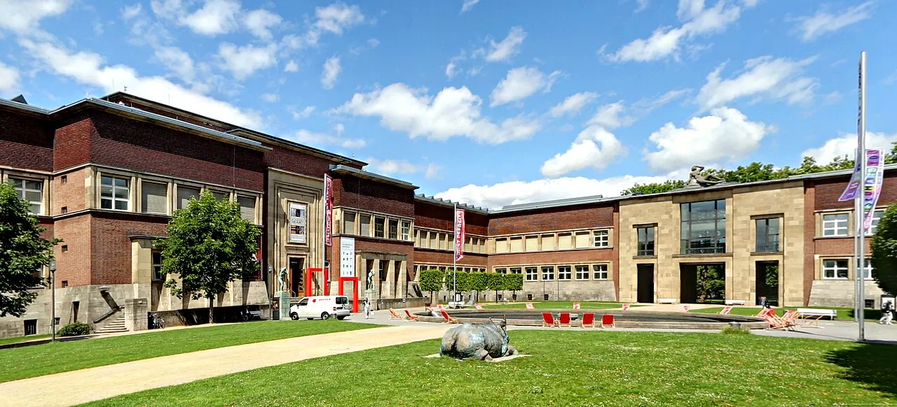
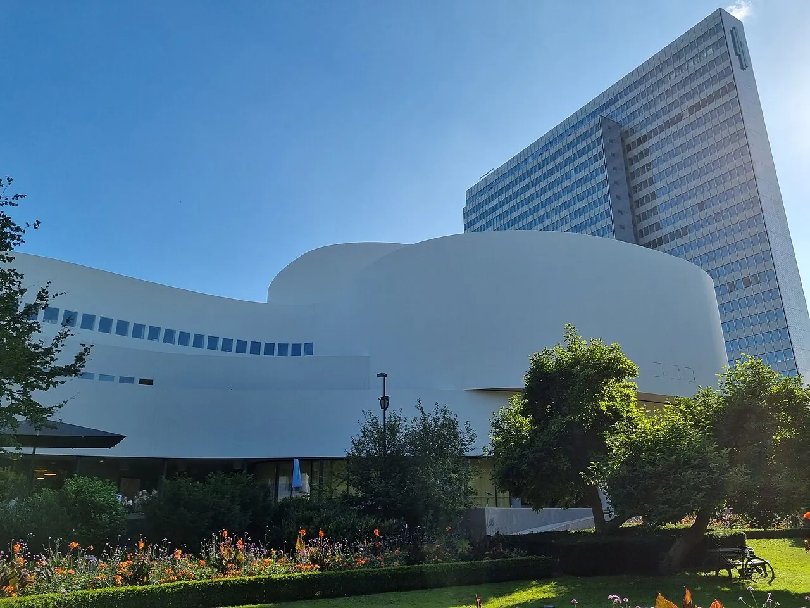
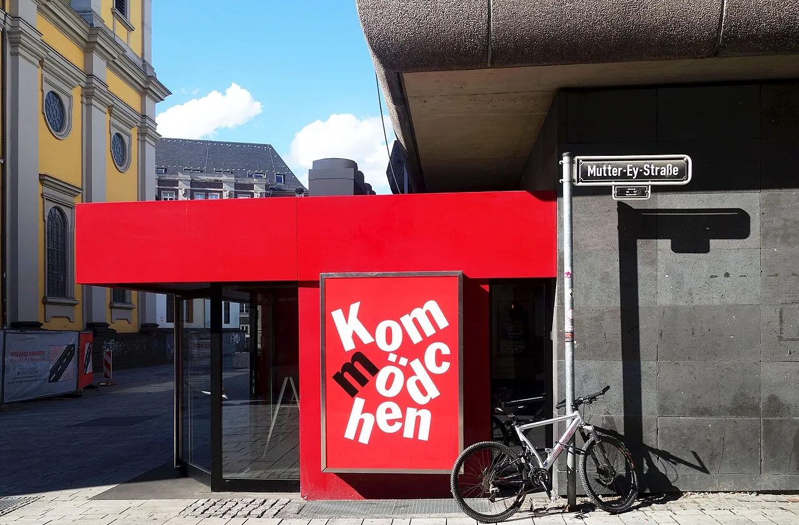
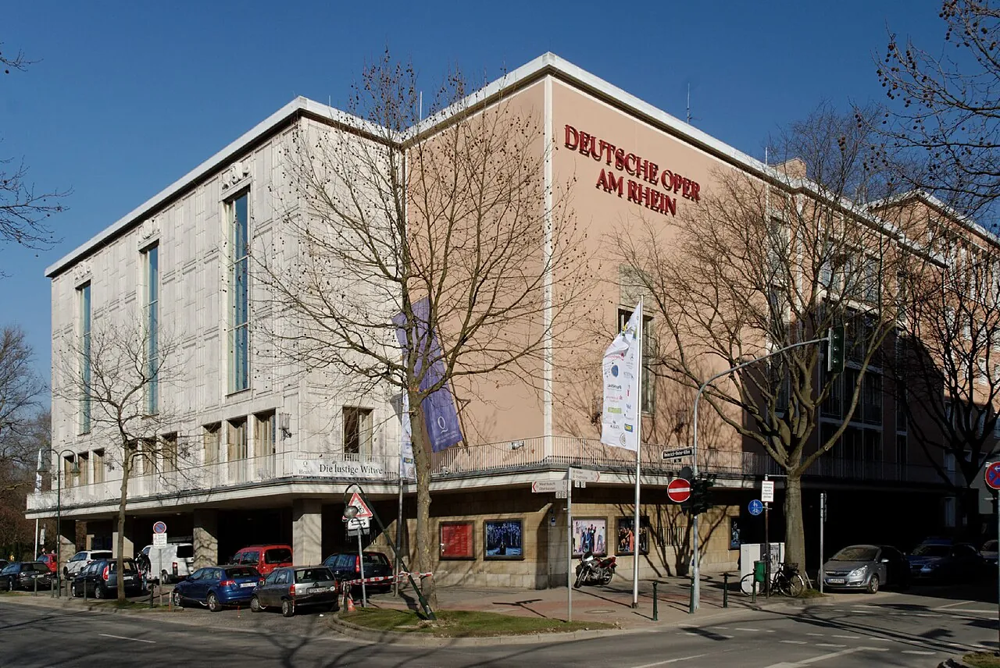
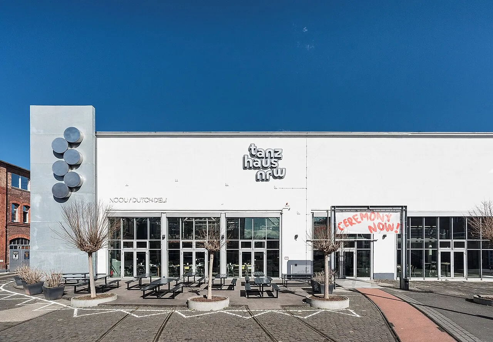
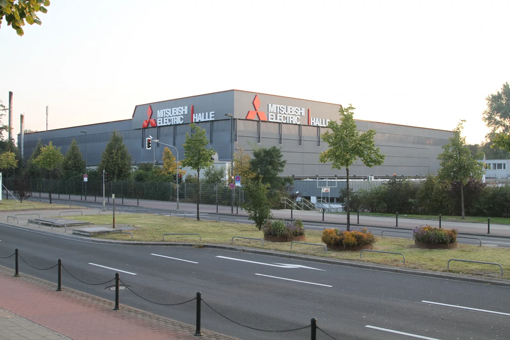
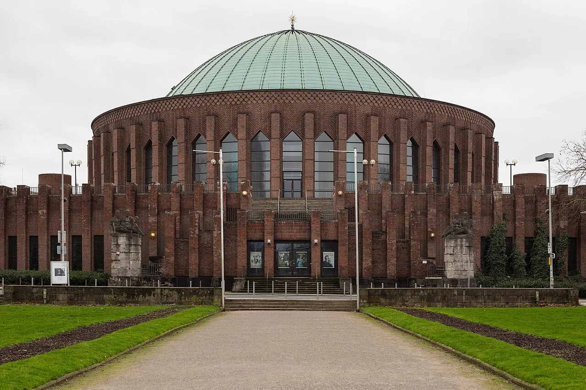
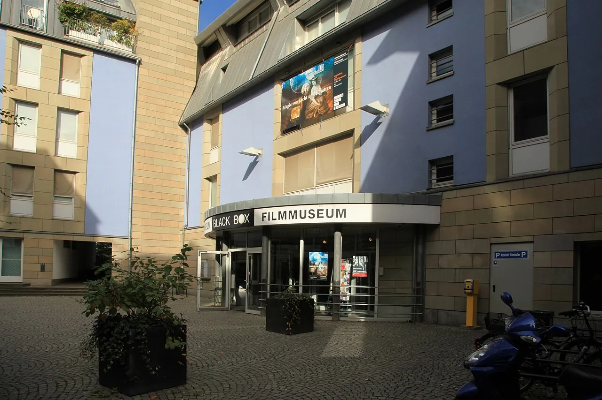
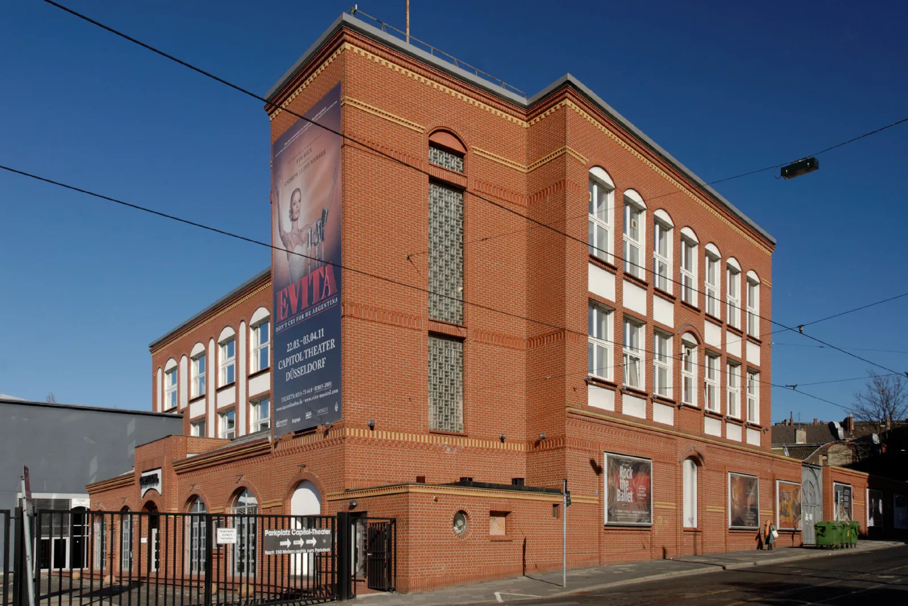

# Ortsseiten: Pilot Texte und Bilder (20.11.2026)

Zur Freigabe: 10 Orte. Je Ort das Bild (mit Nachweis), der Text, wie er auf der Ortsseite erscheint, und die Quelle zu jedem Satz.
Freigabe in `data/spielstaetten/texte.csv` (Spalte `freigabe` = ja) – oder einfach im Chat „Pilot freigeben“ bzw. Änderungswünsche je Ort.

## Kunstpalast Düsseldorf

`/orte/kunstpalast-duesseldorf` · 10 Sätze · Website: https://www.kunstpalast.de

*Foto: Raimond Spekking / Wikimedia Commons (CC BY-SA 4.0) – [Quelle](https://commons.wikimedia.org/wiki/File:Museum_Kunstpalast_-_Ehrenhof_und_n%C3%B6rdlicher_%C3%9Cbergang_(8241-49).jpg)*

Der **Kunstpalast** ist das städtische Kunstmuseum Düsseldorfs und liegt zwischen Rhein und **Hofgarten** nördlich der Altstadt. Seine Geschichte beginnt **1846** mit einem Verein zur Errichtung einer Gemäldegalerie, der vor allem Werke der Düsseldorfer Malerschule ankaufte. Ein eigenes Kunstmuseum der Stadt öffnete erst 1928.

Das Gebäude gehört zum **Ehrenhof**, den Wilhelm Kreis 1925/26 für die Großausstellung **GeSoLei** plante und der den älteren Ausstellungsbau Kunstpalast von 1902 einbezog. Das Ensemble umschließt mit Kunstpalast und NRW-Forum einen Innenhof und zieht sich über ein Gartenparterre bis zur Tonhalle. Von 1999 bis 2000 entstand hinter der denkmalgeschützten Fassade ein Neubau nach Entwurf von **Oswald Mathias Ungers**. Seit 2020 gehört das benachbarte NRW-Forum zum Kunstpalast.

Die Sammlung umfasst über 100.000 Objekte, darunter Gemälde und Skulpturen vom Mittelalter bis zur Gegenwart sowie Kunstgewerbe, Design, Grafik und Fotografie. Zum Haus gehört auch das **Glasmuseum Hentrich** mit einer bedeutenden Glassammlung. Die **Graphische Sammlung** bewahrt über 90.000 Zeichnungen, Aquarelle und Druckgrafiken aus acht Jahrhunderten.

Quellen je Satz

1. Der Kunstpalast ist das städtische Kunstmuseum Düsseldorfs und liegt zwischen Rhein und Ho… — https://de.wikipedia.org/wiki/Museum_Kunstpalast
2. Seine Geschichte beginnt 1846 mit einem Verein zur Errichtung einer Gemäldegalerie, der vo… — https://de.wikipedia.org/wiki/Museum_Kunstpalast
3. Ein eigenes Kunstmuseum der Stadt öffnete erst 1928. — https://de.wikipedia.org/wiki/Museum_Kunstpalast
4. Das Gebäude gehört zum Ehrenhof, den Wilhelm Kreis 1925/26 für die Großausstellung GeSoLei… — https://de.wikipedia.org/wiki/Museum_Kunstpalast
5. Das Ensemble umschließt mit Kunstpalast und NRW-Forum einen Innenhof und zieht sich über e… — https://de.wikipedia.org/wiki/Ehrenhof_(D%C3%BCsseldorf)
6. Von 1999 bis 2000 entstand hinter der denkmalgeschützten Fassade ein Neubau nach Entwurf v… — https://de.wikipedia.org/wiki/Museum_Kunstpalast
7. Seit 2020 gehört das benachbarte NRW-Forum zum Kunstpalast. — https://de.wikipedia.org/wiki/Museum_Kunstpalast
8. Die Sammlung umfasst über 100.000 Objekte, darunter Gemälde und Skulpturen vom Mittelalter… — https://de.wikipedia.org/wiki/Museum_Kunstpalast
9. Zum Haus gehört auch das Glasmuseum Hentrich mit einer bedeutenden Glassammlung. — https://de.wikipedia.org/wiki/Museum_Kunstpalast
10. Die Graphische Sammlung bewahrt über 90.000 Zeichnungen, Aquarelle und Druckgrafiken aus a… — https://de.wikipedia.org/wiki/Museum_Kunstpalast

> Hinweis der Recherche: kunstpalast.de sperrt per robots.txt ausdrücklich ClaudeBot/anthropic-ai, daher keine Inhalte von der Hausseite verwendet; alle Belege aus Wikipedia (keine offizielle Quelle). Keine Haltestelle aufgenommen (nur auf kunstpalast.de bzw. Drittseiten belegt: Tonhalle/Ehrenhof). Objektzahl uneinheitlich: Wikipedia 'über 100.000', visitduesseldorf.de nennt mehr als 130.000. Bildmotiv: Ehrenhof-Innenhof mit Brunnen (2011). Wikimedia liefert Vorschaubilder inzwischen über thumb.wikimedia.org; dieselbe Pfadangabe auf upload.wikimedia.org antwortete mit HTTP 429.

---

## Düsseldorfer Schauspielhaus

`/orte/duesseldorfer-schauspielhaus` · 10 Sätze · Website: https://www.dhaus.de

*Foto: Daniel.widawski / Wikimedia Commons (CC BY-SA 4.0) – [Quelle](https://commons.wikimedia.org/wiki/File:Schauspielhaus_D%C3%BCsseldorf.jpg)*

Das **Düsseldorfer Schauspielhaus**, kurz D’haus, ist ein Ensembletheater mit Hauptspielstätte am **Gustaf-Gründgens-Platz**. Louise Dumont und Gustav Lindemann eröffneten **1905** an der Karl-Theodor-Straße das Schauspielhaus Düsseldorf als Privattheater. Dem Haus war eine Theaterakademie angeschlossen, zu deren Schülern Gustaf Gründgens gehörte. Von 1951 bis 1970 spielte das Schauspielhaus an der Jahnstraße.

Das heutige Gebäude entwarf der Düsseldorfer Architekt **Bernhard Pfau**, es entstand von 1965 bis 1969 und wurde im Januar 1970 mit Büchners „Dantons Tod“ eröffnet. Die skulpturale Großform steht in deutlichem Kontrast zum benachbarten **Dreischeibenhaus**. In den Spielzeiten 2016/17 bis 2018/19 wurde das Haus umfassend saniert.

Im Gebäude liegen das Große Haus mit rund 730 Plätzen, das Kleine Haus mit bis zu 300 Plätzen und das **Unterhaus**, eine experimentelle Spielstätte im Keller. Junges Schauspiel und Stadt:Kollektiv spielen im **Central** an der Worringer Straße am Hauptbahnhof, das zugleich Proben- und Produktionszentrum ist. Nahe Haltestellen sind Schadowstraße, Heinrich-Heine-Allee und Jacobistraße.

Quellen je Satz

1. Das Düsseldorfer Schauspielhaus, kurz D’haus, ist ein Ensembletheater mit Hauptspielstätte… — https://de.wikipedia.org/wiki/D%C3%BCsseldorfer_Schauspielhaus
2. Louise Dumont und Gustav Lindemann eröffneten 1905 an der Karl-Theodor-Straße das Schauspi… — https://www.dhaus.de/das-dhaus/ueber-das-haus/
3. Dem Haus war eine Theaterakademie angeschlossen, zu deren Schülern Gustaf Gründgens gehört… — https://www.dhaus.de/das-dhaus/ueber-das-haus/
4. Von 1951 bis 1970 spielte das Schauspielhaus an der Jahnstraße. — https://www.dhaus.de/das-dhaus/ueber-das-haus/
5. Das heutige Gebäude entwarf der Düsseldorfer Architekt Bernhard Pfau, es entstand von 1965… — https://de.wikipedia.org/wiki/D%C3%BCsseldorfer_Schauspielhaus
6. Die skulpturale Großform steht in deutlichem Kontrast zum benachbarten Dreischeibenhaus.… — https://de.wikipedia.org/wiki/D%C3%BCsseldorfer_Schauspielhaus
7. In den Spielzeiten 2016/17 bis 2018/19 wurde das Haus umfassend saniert. — https://www.dhaus.de/das-dhaus/ueber-das-haus/
8. Im Gebäude liegen das Große Haus mit rund 730 Plätzen, das Kleine Haus mit bis zu 300 Plät… — https://www.dhaus.de/das-dhaus/ueber-das-haus/
9. Junges Schauspiel und Stadt:Kollektiv spielen im Central an der Worringer Straße am Hauptb… — https://www.dhaus.de/das-dhaus/ueber-das-haus/
10. Nahe Haltestellen sind Schadowstraße, Heinrich-Heine-Allee und Jacobistraße. — https://www.dhaus.de/besuch/anreise/

> Hinweis der Recherche: Gründung: Wikipedia nennt 16.06.1904 als Gründungsdatum und 28.10.1905 als Eröffnung, dhaus.de nur 1905 (Eröffnung) – im Text daher 'eröffneten 1905'. Platzzahl Großes Haus: dhaus.de 'heute ca. 730', Wikipedia 'bis zu 738'; Kleines Haus Wikipedia 219–309, dhaus.de 'bis zu 300'. Wikipedia verortet das Junge Schauspiel noch in der Münsterstraße, dhaus.de nennt das Central – Text folgt dhaus.de. Haltestellen laut dhaus.de/Anreise. Bild: Fassade nach Sanierung, 2021. Vorschaubild über thumb.wikimedia.org (upload.wikimedia.org-Thumbnail antwortete mit HTTP 429).

---

## Kom(m)ödchen Düsseldorf

`/orte/kom-m-oedchen-duesseldorf` · 8 Sätze · Website: https://www.kommoedchen.de

*Foto: Kürschner / Wikimedia Commons (CC0) – [Quelle](https://commons.wikimedia.org/wiki/File:Kom%C3%B6dchen,_Mutter-Ey-Stra%C3%9Fe,_D%C3%BCsseldorf,_August_2026.jpg)*

Das **Kom(m)ödchen** ist eine Kabarettbühne in der Düsseldorfer Altstadt, gegründet als politisch-literarisches Kabarett. Kay und Lore Lorentz riefen es **1947** im Hinterzimmer einer Kneipe ins Leben, das erste Programm „positiv dagegen“ hatte im März 1947 Premiere.

Weil es im alten Haus an der Hunsrückenstraße zu eng wurde, bot die Stadt Räume in der damals neu gebauten **Kunsthalle** an, in die das Kabarett im April **1967** umzog. Nach dem Tod von Kay Lorentz übernahm Lore Lorentz 1993 die künstlerische Leitung, sie starb im Februar 1994. Der Eingang liegt am **Kay-und-Lore-Lorentz-Platz**, der Saal hat 200 Plätze.

Neben dem **eigenen Ensemble** treten Gäste aus der deutschsprachigen Kabarettszene auf, auch Newcomer. Aus den Ensembles des Hauses gingen unter anderem Hugo Egon Balder, Volker Pispers und Harald Schmidt hervor. Von der Stadtbahn-Haltestelle **Heinrich-Heine-Allee** sind es rund zwei Minuten zu Fuß.

Quellen je Satz

1. Das Kom(m)ödchen ist eine Kabarettbühne in der Düsseldorfer Altstadt, gegründet als politi… — https://de.wikipedia.org/wiki/Kom(m)%C3%B6dchen
2. Kay und Lore Lorentz riefen es 1947 im Hinterzimmer einer Kneipe ins Leben, das erste Prog… — https://www.kommoedchen.de/theater/
3. Weil es im alten Haus an der Hunsrückenstraße zu eng wurde, bot die Stadt Räume in der dam… — https://www.kommoedchen.de/theater/
4. Nach dem Tod von Kay Lorentz übernahm Lore Lorentz 1993 die künstlerische Leitung, sie sta… — https://www.kommoedchen.de/theater/
5. Der Eingang liegt am Kay-und-Lore-Lorentz-Platz, der Saal hat 200 Plätze. — https://www.kommoedchen.de/theater/
6. Neben dem eigenen Ensemble treten Gäste aus der deutschsprachigen Kabarettszene auf, auch … — https://www.kommoedchen.de/theater/
7. Aus den Ensembles des Hauses gingen unter anderem Hugo Egon Balder, Volker Pispers und Har… — https://www.kommoedchen.de/theater/
8. Von der Stadtbahn-Haltestelle Heinrich-Heine-Allee sind es rund zwei Minuten zu Fuß. — https://www.kommoedchen.de/kontakt/

> Hinweis der Recherche: Aktuelle Leitung bewusst weggelassen: kommoedchen.de nennt Kay S. und Elke Lorentz (seit 2015) als Geschäftsführung, Wikipedia nennt Luzie Lorentz seit 2024. Ensemble-Namen ebenfalls weggelassen (Website und Wikipedia nennen unterschiedliche Besetzungen). Bild: Ansicht von der Mutter-Ey-Straße (August 2026, CC0) – zeigt die Seite des Kunsthallen-Gebäudes; Alternative mit eindeutigem Eingang: File:Komödchen_Düsseldorf_(Eingang).jpg (Johann H. Addicks, CC BY-SA 3.0, 2006, geringere Auflösung). Vorschaubild über thumb.wikimedia.org.

---

## Opernhaus Düsseldorf (Deutsche Oper am Rhein)

`/orte/opernhaus-duesseldorf` · 10 Sätze · Website: https://www.operamrhein.de

*Foto: Wiegels / Wikimedia Commons (CC BY 3.0) – [Quelle](https://commons.wikimedia.org/wiki/File:Opernhaus_in_Duesseldorf-Stadtmitte,_von_Suedwesten.jpg)*

Das **Opernhaus Düsseldorf** an der Heinrich-Heine-Allee ist Spielstätte und Verwaltungssitz der **Deutschen Oper am Rhein**. Es liegt am Rand der Altstadt zwischen **Hofgarten** und Königsallee. Die Deutsche Oper am Rhein ist eine Theatergemeinschaft der Städte Düsseldorf und Duisburg, wurde 1956 gegründet und umfasst neben der Oper auch die Compagnie Ballett am Rhein.

Das Gebäude wurde **1875** als Stadttheater nach Plänen von Ernst Giese im Stil der italienischen Renaissance eröffnet. Bei Luftangriffen 1943 wurde es stark beschädigt. Von 1954 bis 1956 bauten Paul Bonatz, Julius Schulte-Frohlinde und Ernst Huhn das Haus grundlegend um und gaben ihm sein heutiges Erscheinungsbild. Seit **1994** steht es unter Denkmalschutz.

Bei einer Sanierung 2006/2007 kam ein Orchester- und Ballettprobensaal mit zehn Meter breiter Glasfassade zum Hofgarten hinzu. Im Keller lagert der **Fundus** mit rund 50.000 Kostümen. Nächste Haltestelle ist **Heinrich-Heine-Allee**, vom Hauptbahnhof sind es drei U-Bahn-Stationen.

Quellen je Satz

1. Das Opernhaus Düsseldorf an der Heinrich-Heine-Allee ist Spielstätte und Verwaltungssitz d… — https://de.wikipedia.org/wiki/Opernhaus_D%C3%BCsseldorf_(1943)
2. Es liegt am Rand der Altstadt zwischen Hofgarten und Königsallee. — https://www.operamrhein.de/ihr-besuch/opernhaus-duesseldorf/
3. Die Deutsche Oper am Rhein ist eine Theatergemeinschaft der Städte Düsseldorf und Duisburg… — https://www.operamrhein.de/ueber-uns/
4. Das Gebäude wurde 1875 als Stadttheater nach Plänen von Ernst Giese im Stil der italienisc… — https://www.operamrhein.de/ihr-besuch/opernhaus-duesseldorf/
5. Bei Luftangriffen 1943 wurde es stark beschädigt. — https://www.operamrhein.de/ihr-besuch/opernhaus-duesseldorf/
6. Von 1954 bis 1956 bauten Paul Bonatz, Julius Schulte-Frohlinde und Ernst Huhn das Haus gru… — https://de.wikipedia.org/wiki/Opernhaus_D%C3%BCsseldorf_(1943)
7. Seit 1994 steht es unter Denkmalschutz. — https://de.wikipedia.org/wiki/Opernhaus_D%C3%BCsseldorf_(1943)
8. Bei einer Sanierung 2006/2007 kam ein Orchester- und Ballettprobensaal mit zehn Meter brei… — https://www.operamrhein.de/ihr-besuch/opernhaus-duesseldorf/
9. Im Keller lagert der Fundus mit rund 50.000 Kostümen. — https://www.operamrhein.de/ihr-besuch/opernhaus-duesseldorf/
10. Nächste Haltestelle ist Heinrich-Heine-Allee, vom Hauptbahnhof sind es drei U-Bahn-Station… — https://www.operamrhein.de/ihr-besuch/opernhaus-duesseldorf/

> Hinweis der Recherche: Platzzahl weggelassen: Wikipedia nennt heute 1342 Plätze, operamrhein.de nennt 1.260 Sitzplätze bei der Eröffnung 1875 und 'maximal 1.296 Besucher' (Bezug unklar). Gründungsjahr Deutsche Oper am Rhein: operamrhein.de 1956, Wikipedia nennt die Vereinbarung Düsseldorf–Duisburg 1955. Neubau-Pläne ('Opernhaus der Zukunft') bewusst nicht erwähnt: laut Wikipedia 2026 vom Oberbürgermeister zurückgezogen, operamrhein.de nennt noch Einzug ab 2034 – widersprüchlich und veränderlich. Offizielles Pressefoto vorhanden (oper_duesseldorf_11_presse_foto_jens_wegener.jpg, © Jens Wegener), aber Nutzungsrechte unklar, daher Commons-Bild (Aufnahme 2011).

---

## Tanzhaus NRW

`/orte/tanzhaus-nrw` · 10 Sätze · Website: https://tanzhaus-nrw.de

*Foto: Foto: Katja Illner / tanzhaus nrw, via Wikimedia Commons (CC BY-SA 4.0) – [Quelle](https://commons.wikimedia.org/wiki/File:Tanzhaus_nrw_2_klein_Foto_Katja_Illner.jpg)*

Das **Tanzhaus NRW** ist ein Zentrum für zeitgenössischen Tanz und zugleich Spielort, Produktionsort und Akademie. Seine Anfänge reichen bis **1973** zurück, als eine Gruppe Düsseldorfer Künstlerinnen und Künstler den Grundstein legte, und 1978 entstand die „Werkstatt“, aus der das Haus hervorging. Seit **1998** ist es in einem alten Straßenbahndepot an der Erkrather Straße 30 untergebracht.

Auf rund 4.000 Quadratmetern gibt es zwei Bühnen sowie acht Tanz- und Probenstudios. Der **Große Saal** hat 318 Sitzplätze, der Kleine Saal 89. Als Produktionshaus für freischaffende Choreografinnen und Choreografen nimmt das Haus jedes Jahr Künstlerinnen, Künstler und Ensembles für Residenzen, Labs und Workshops auf. Das **Junge Tanzhaus** widmet sich dem Tanz für und mit jungem Publikum.

Die Akademie richtet sich an alle Generationen, rund 80 Dozentinnen und Dozenten unterrichten Stile von Urban Dance über zeitgenössischen Tanz bis Tap. Jeden Morgen findet ein **Professional Training** für Tanzschaffende statt. Die Haltestelle **Worringer Platz** liegt etwa fünf Gehminuten entfernt, der Hauptbahnhof rund zehn.

Quellen je Satz

1. Das Tanzhaus NRW ist ein Zentrum für zeitgenössischen Tanz und zugleich Spielort, Produkti… — https://tanzhaus-nrw.de/de/haus/profil
2. Seine Anfänge reichen bis 1973 zurück, als eine Gruppe Düsseldorfer Künstlerinnen und Küns… — https://tanzhaus-nrw.de/de/haus/profil
3. Seit 1998 ist es in einem alten Straßenbahndepot an der Erkrather Straße 30 untergebracht.… — https://de.wikipedia.org/wiki/Tanzhaus_NRW
4. Auf rund 4.000 Quadratmetern gibt es zwei Bühnen sowie acht Tanz- und Probenstudios. — https://tanzhaus-nrw.de/de/haus/profil
5. Der Große Saal hat 318 Sitzplätze, der Kleine Saal 89. — https://tanzhaus-nrw.de/de/haus/profil
6. Als Produktionshaus für freischaffende Choreografinnen und Choreografen nimmt das Haus jed… — https://tanzhaus-nrw.de/de/haus/profil
7. Das Junge Tanzhaus widmet sich dem Tanz für und mit jungem Publikum. — https://tanzhaus-nrw.de/de/haus/profil
8. Die Akademie richtet sich an alle Generationen, rund 80 Dozentinnen und Dozenten unterrich… — https://tanzhaus-nrw.de/de/haus/profil
9. Jeden Morgen findet ein Professional Training für Tanzschaffende statt. — https://tanzhaus-nrw.de/de/haus/profil
10. Die Haltestelle Worringer Platz liegt etwa fünf Gehminuten entfernt, der Hauptbahnhof rund… — https://tanzhaus-nrw.de/de/dein-besuch

> Hinweis der Recherche: Gründungsjahr uneinheitlich: Wikipedia nennt 1998 als Gründung des Tanzhaus NRW (Umzug ins Depot, Umbenennung), die Hausseite nennt 1973 als Anfang und 1978 als Gründung der 'Werkstatt' – Text nennt alle drei Daten mit ihrem jeweiligen Bezug. Straßenbahndepot nur bei Wikipedia belegt (nicht auf der Profilseite). www.tanzhaus-nrw.de leitet auf https://tanzhaus-nrw.de um. Bild: Fassade April 2018, von tanzhaus nrw selbst auf Commons hochgeladen.

---

## Mitsubishi Electric Halle

`/orte/mitsubishi-electric-halle` · 8 Sätze · Website: https://www.mitsubishi-electric-halle.de/

*Foto: Plumpaquatsch / Wikimedia Commons (Gemeinfrei (Public Domain)) – [Quelle](https://commons.wikimedia.org/wiki/File:MitsubishiElectricHalle.JPG)*

Die **Mitsubishi Electric Halle** ist eine Mehrzweckhalle in **Oberbilk**, in der Konzerte, Shows und Sportveranstaltungen stattfinden. Eröffnet wurde sie **1971** unter dem Namen **Philipshalle**, seit 2011 trägt sie den Namen ihres heutigen Sponsors. Die Halle gehört der Stadt Düsseldorf und wird von der **D.LIVE** betrieben.

Der Innenraum umfasst rund **3.300 Quadratmeter** und fasst bis zu **7.500** Menschen. Ausfahrbare Tribünen und ein Vorhangsystem erlauben unterschiedliche Aufteilungen des Saals. Dazu kommen zwei **Foyers** mit jeweils rund 900 Quadratmetern und eine Außenterrasse.

Die Halle liegt an der Siegburger Straße direkt neben dem **Volksgarten**. Die nächste Haltestelle ist **Oberbilk S U**, die von Stadtbahn und S-Bahn angefahren wird und nur wenige Gehminuten entfernt liegt.

Quellen je Satz

1. Die Mitsubishi Electric Halle ist eine Mehrzweckhalle in Oberbilk, in der Konzerte, Shows … — https://de.wikipedia.org/wiki/Mitsubishi_Electric_Halle
2. Eröffnet wurde sie 1971 unter dem Namen Philipshalle, seit 2011 trägt sie den Namen ihres … — https://de.wikipedia.org/wiki/Mitsubishi_Electric_Halle
3. Die Halle gehört der Stadt Düsseldorf und wird von der D.LIVE betrieben. — https://de.wikipedia.org/wiki/Mitsubishi_Electric_Halle
4. Der Innenraum umfasst rund 3.300 Quadratmeter und fasst bis zu 7.500 Menschen. — https://www.mitsubishi-electric-halle.de/veranstalter/raumuebersicht
5. Ausfahrbare Tribünen und ein Vorhangsystem erlauben unterschiedliche Aufteilungen des Saal… — https://www.mitsubishi-electric-halle.de/veranstalter/raumuebersicht
6. Dazu kommen zwei Foyers mit jeweils rund 900 Quadratmetern und eine Außenterrasse. — https://www.mitsubishi-electric-halle.de/veranstalter/raumuebersicht
7. Die Halle liegt an der Siegburger Straße direkt neben dem Volksgarten. — https://de.wikipedia.org/wiki/Mitsubishi_Electric_Halle
8. Die nächste Haltestelle ist Oberbilk S U, die von Stadtbahn und S-Bahn angefahren wird und… — https://www.mitsubishi-electric-halle.de/besucherinfos/anfahrt

> Hinweis der Recherche: Original ist nur 1.600 × 1.067 px groß, daher direkt das Original verlinkt (Aufnahme Oktober 2011, Fassade kann sich seitdem verändert haben). Wikipedia nennt bis 7.500 Personen unbestuhlt bzw. 5.450 mit Reihenbestuhlung; die offizielle Seite nur 7.500. Foyerflächen laut offizieller Seite 930 und 900 m² (im Text „jeweils rund 900“). Kein Architekt belegt.

---

## Tonhalle Düsseldorf

`/orte/tonhalle-duesseldorf` · 9 Sätze · Website: https://www.tonhalle.de/

*Foto: Christian A. Schröder (ChristianSchd) / Wikimedia Commons (CC BY-SA 4.0) – [Quelle](https://commons.wikimedia.org/wiki/File:Tonhalle_Duesseldorf_Oederallee_Pempelfort_Duesseldorf_Germany_02.jpg)*

Die **Tonhalle** ist ein Konzerthaus am Rheinufer in Pempelfort und bildet den südlichen Abschluss des Kulturforums **Ehrenhof**. Der Rundbau entstand 1925/26 nach Plänen von **Wilhelm Kreis** als Mehrzweckhalle für die Ausstellung GeSoLei und hieß zunächst Rheinhalle. Das Gebäude war von Anfang an so angelegt, dass es auch als **Planetarium** dienen konnte.

Nach Kriegsschäden baute das Architekturbüro **HPP** um Helmut Hentrich von 1976 bis **1978** unter der rekonstruierten Kuppel einen fast halbkugelförmigen Konzertsaal ein. Im Jahr 2005 wurde das Haus erneut modernisiert. Der große Saal heißt seit 2014 **Mendelssohn-Saal** und hat 1.854 Plätze, dazu kommen ein Kammermusiksaal mit 300 Plätzen und die Rotunde im Foyer.

Die Tonhalle ist die Heimat der **Düsseldorfer Symphoniker**. Neben Klassik stehen auch Jazz und Kabarett auf dem Programm. In der Nähe liegt der U-Bahnhof **Tonhalle/Ehrenhof**.

Quellen je Satz

1. Die Tonhalle ist ein Konzerthaus am Rheinufer in Pempelfort und bildet den südlichen Absch… — https://de.wikipedia.org/wiki/Tonhalle_Düsseldorf
2. Der Rundbau entstand 1925/26 nach Plänen von Wilhelm Kreis als Mehrzweckhalle für die Auss… — https://de.wikipedia.org/wiki/Tonhalle_Düsseldorf
3. Das Gebäude war von Anfang an so angelegt, dass es auch als Planetarium dienen konnte. — https://de.wikipedia.org/wiki/Tonhalle_Düsseldorf
4. Nach Kriegsschäden baute das Architekturbüro HPP um Helmut Hentrich von 1976 bis 1978 unte… — https://de.wikipedia.org/wiki/Tonhalle_Düsseldorf
5. Im Jahr 2005 wurde das Haus erneut modernisiert. — https://www.visitduesseldorf.de/attraktionen/tonhalle-duesseldorf-concert-hall-9b4f1d13f7
6. Der große Saal heißt seit 2014 Mendelssohn-Saal und hat 1.854 Plätze, dazu kommen ein Kamm… — https://de.wikipedia.org/wiki/Tonhalle_Düsseldorf
7. Die Tonhalle ist die Heimat der Düsseldorfer Symphoniker. — https://de.wikipedia.org/wiki/Tonhalle_Düsseldorf
8. Neben Klassik stehen auch Jazz und Kabarett auf dem Programm. — https://www.visitduesseldorf.de/attraktionen/tonhalle-duesseldorf-concert-hall-9b4f1d13f7
9. In der Nähe liegt der U-Bahnhof Tonhalle/Ehrenhof. — https://de.wikipedia.org/wiki/Tonhalle_Düsseldorf

> Hinweis der Recherche: tonhalle.de wird per JavaScript gerendert und war nicht auslesbar (Unterseite /haus = 404), daher nur Wikipedia und visitduesseldorf.de als Belege. Umbauzeitraum: Wikipedia 1976–1978, andere Quellen 1975–1977/78. Platzzahl Mendelssohn-Saal: Wikipedia 1.854, andere Quellen ca. 1.850 bzw. 1.933. Der Kammermusiksaal heißt laut Drittquelle (miz.org, nicht geöffnet) Helmut-Hentrich-Saal – nicht belegt, daher neutral formuliert. visitduesseldorf nennt das Orchester „Düsseldorfer Symphonieorchester“, Wikipedia „Düsseldorfer Symphoniker“.

---

## Filmmuseum Düsseldorf

`/orte/filmmuseum-duesseldorf` · 8 Sätze · Website: https://www.duesseldorf.de/filmmuseum

*Foto: Frank Vincentz / Wikimedia Commons (CC BY-SA 3.0) – [Quelle](https://commons.wikimedia.org/wiki/File:Düsseldorf_-_Schulstraße_-_Filmmuseum_01_ies.jpg)*

Das **Filmmuseum Düsseldorf** ist ein städtisches Museum in der **Altstadt** am Alten Hafen. Bereits 1979 gründete die Stadt ein Filminstitut, das Museumsgebäude an der Schulstraße wurde am **21. August 1993** eröffnet. Die Dauerausstellung zeigt auf rund 2.200 Quadratmetern die Geschichte des Films von den Anfängen bis in die Gegenwart.

Zur Sammlung gehören unter anderem rund 500.000 Fotos, mehr als 25.000 Plakate und Nachlässe etwa von **Lotte Reiniger** und Helmut Käutner. Als einziges Museum dieser Art in Nordrhein-Westfalen beherbergt das Haus die **Filmsammlung des Landes**, das Archiv umfasst über 30.000 Filmkopien.

Im Haus liegt das Kino **Black Box** mit 135 Plätzen, das seit 2009 als kommunales Kino betrieben wird. Gezeigt werden Klassiker, Retrospektiven und Neuerscheinungen, viele Vorführungen laufen von analogen Kopien. Im Kino steht außerdem eine **Welte-Kinoorgel** aus dem Jahr 1928.

Quellen je Satz

1. Das Filmmuseum Düsseldorf ist ein städtisches Museum in der Altstadt am Alten Hafen.… — https://de.wikipedia.org/wiki/Filmmuseum_Düsseldorf
2. Bereits 1979 gründete die Stadt ein Filminstitut, das Museumsgebäude an der Schulstraße wu… — https://de.wikipedia.org/wiki/Filmmuseum_Düsseldorf
3. Die Dauerausstellung zeigt auf rund 2.200 Quadratmetern die Geschichte des Films von den A… — https://www.duesseldorf.de/filmmuseum
4. Zur Sammlung gehören unter anderem rund 500.000 Fotos, mehr als 25.000 Plakate und Nachläs… — https://de.wikipedia.org/wiki/Filmmuseum_Düsseldorf
5. Als einziges Museum dieser Art in Nordrhein-Westfalen beherbergt das Haus die Filmsammlung… — https://www.duesseldorf.de/filmmuseum
6. Im Haus liegt das Kino Black Box mit 135 Plätzen, das seit 2009 als kommunales Kino betrie… — https://de.wikipedia.org/wiki/Filmmuseum_Düsseldorf
7. Gezeigt werden Klassiker, Retrospektiven und Neuerscheinungen, viele Vorführungen laufen v… — https://de.wikipedia.org/wiki/Filmmuseum_Düsseldorf
8. Im Kino steht außerdem eine Welte-Kinoorgel aus dem Jahr 1928. — https://de.wikipedia.org/wiki/Filmmuseum_Düsseldorf

> Hinweis der Recherche: Das Wikipedia-Hauptbild (Eingang 2011) zeigt ein großes Ausstellungsbanner („40 Jahre Tatort“), daher stattdessen das Außenfoto von Frank Vincentz (Okt. 2012) gewählt; den Bildinhalt selbst (Banner o. Ä.) konnte ich nicht sichten – bitte kurz ansehen. Die Stadt nennt zusätzlich eine eigene Domain filmmuseum-duesseldorf.de (nicht geöffnet); als Webseite die Seite auf duesseldorf.de eingetragen. Wikipedia nennt 4 Etagen, Grundsteinlegung 15.09.1989 (nicht verwendet). Keine Haltestelle belegt.

---

## Capitol Theater Düsseldorf

`/orte/capitol-theater` · 9 Sätze · Website: https://www.capitol-theater.de/

*Foto: Joerg Wiegels / Wikimedia Commons (CC BY 3.0) – [Quelle](https://commons.wikimedia.org/wiki/File:Capitol_Theater_in_Duesseldorf-Flingern-Sued,_von_Suedwesten.jpg)*

Das **Capitol Theater** an der Erkrather Straße ist eine Bühne für Musicals, Shows, Comedy und Veranstaltungen. Es wurde Anfang der 1990er-Jahre in einem über 100 Jahre alten ehemaligen **Straßenbahndepot** der Rheinbahn eingerichtet. Nach Angaben des Hauses eröffnete es **1996** mit dem Musical „Grease“.

Bei einer Renovierung im Jahr 1999 blieben die **Backsteinarchitektur** und der Charakter des Depots erhalten. Der große **Theatersaal** hat 1.250 Plätze und eine 25 mal 13 Meter große Bühne. Als zweiter Saal fasst der **Club** bis zu 475 Gäste in Theaterbestuhlung. Hinzu kommt ein über 1.000 Quadratmeter großes Foyer mit Wintergarten.

Im Jahr 2011 zog der **Quatsch Comedy Club** dauerhaft ins Capitol ein. Betreiberin des Hauses ist die **ATG Entertainment GmbH**.

Quellen je Satz

1. Das Capitol Theater an der Erkrather Straße ist eine Bühne für Musicals, Shows, Comedy und… — https://www.capitol-theater.de/
2. Es wurde Anfang der 1990er-Jahre in einem über 100 Jahre alten ehemaligen Straßenbahndepot… — https://en.wikipedia.org/wiki/Capitol_Theater_(Düsseldorf)
3. Nach Angaben des Hauses eröffnete es 1996 mit dem Musical „Grease“. — https://www.capitol-theater.de/
4. Bei einer Renovierung im Jahr 1999 blieben die Backsteinarchitektur und der Charakter des … — https://de.wikipedia.org/wiki/Capitol_Theater_(Düsseldorf)
5. Der große Theatersaal hat 1.250 Plätze und eine 25 mal 13 Meter große Bühne. — https://www.capitol-theater.de/
6. Als zweiter Saal fasst der Club bis zu 475 Gäste in Theaterbestuhlung. — https://www.capitol-theater.de/
7. Hinzu kommt ein über 1.000 Quadratmeter großes Foyer mit Wintergarten. — https://www.capitol-theater.de/
8. Im Jahr 2011 zog der Quatsch Comedy Club dauerhaft ins Capitol ein. — https://www.capitol-theater.de/
9. Betreiberin des Hauses ist die ATG Entertainment GmbH. — https://www.capitol-theater.de/

> Hinweis der Recherche: Widersprüche: Offizielle Seite nennt Eröffnung 1996 mit „Grease“, de.wikipedia dagegen 1994 (Umbau durch Lothar Neuse, Eröffnung mit „Broadway Düsseldorf“) – daher im Text als Angabe des Hauses gekennzeichnet. Plätze: offiziell 1.250, de.wikipedia 1.131; Foyer offiziell über 1.000 m², Wikipedia ca. 1.500 m² – offizielle Werte verwendet. Stadtteil uneinheitlich (en.wikipedia/Commons: Flingern bzw. Flingern-Süd, de.wikipedia-Kategorie: Oberbilk) – daher weggelassen. visitduesseldorf.de bezeichnet das Depot als denkmalgeschützt (sonst nicht belegt, nicht verwendet). Betreiber laut de.wikipedia seit 2018 Mehr-BB Entertainment (ATG-Tochter), Impressum der Website nennt ATG Entertainment GmbH. Die Website zeigt eigene Außenbilder (assets/images/…/Capitol-Aussen-….jpg) ohne Fotografenangabe, daher Commons-Bild (Original 1.600 px, Aufnahme 2011) gewählt. Keine Haltestelle belegt.

---

## Stadtbücherei Bilk

`/orte/stadtbuecherei-bilk` · 6 Sätze · Website: https://www.duesseldorf.de/stadtbuechereien/standorte/bilk

*Kein Bild – die Seite zeigt die Ersatzkachel.*

Die **Stadtteilbücherei Bilk** ist eine Filiale der Stadtbüchereien Düsseldorf an der **Friedrichstraße 127**. Sie befindet sich in den **Düsseldorf Arkaden**. Auf rund 440 Quadratmetern verteilt sich das Angebot über zwei Etagen.

Neben Büchern, Hörbüchern, DVDs und Spielen gibt es eine **Kinder- und Jugendbibliothek**, ein Lesecafé und Arbeitsplätze. Eine Besonderheit ist die **Bibliothek der Dinge**, in der Gegenstände statt Medien ausgeliehen werden. Regelmäßig finden Lesungen, Workshops und **Kamishibai**-Erzählstunden für Kinder statt.

Quellen je Satz

1. Die Stadtteilbücherei Bilk ist eine Filiale der Stadtbüchereien Düsseldorf an der Friedric… — https://www.duesseldorf.de/stadtbuechereien/standorte/bilk
2. Sie befindet sich in den Düsseldorf Arkaden. — https://www.ddorf-aktuell.de/?p=99758
3. Auf rund 440 Quadratmetern verteilt sich das Angebot über zwei Etagen. — https://www.duesseldorf.de/stadtbuechereien/standorte/bilk
4. Neben Büchern, Hörbüchern, DVDs und Spielen gibt es eine Kinder- und Jugendbibliothek, ein… — https://www.duesseldorf.de/stadtbuechereien/standorte/bilk
5. Eine Besonderheit ist die Bibliothek der Dinge, in der Gegenstände statt Medien ausgeliehe… — https://www.duesseldorf.de/stadtbuechereien/standorte/bilk
6. Regelmäßig finden Lesungen, Workshops und Kamishibai-Erzählstunden für Kinder statt. — https://www.duesseldorf.de/stadtbuechereien/standorte/bilk

> Hinweis der Recherche: Die offizielle Seite spricht vom „Stadtteilzentrum Bilk“; die Lage in den Düsseldorf Arkaden ist nur durch ddorf-aktuell.de (Lokalnachrichten, 02.01.2024) belegt. Eröffnungsjahr 2008 nur aus einem Suchtreffer (Umfragebericht der Stadtbüchereien, PDF nicht lesbar) – nicht verwendet. Keine Geschichte und keine Haltestelle belegt (der ÖPNV-Link der Stadtseite nutzt abweichend „Friedrichstraße 144“ als Ziel). Kein sauberes Gebäudefoto gefunden – ein Foto der Düsseldorf Arkaden wäre möglich, zeigt aber nicht die Bücherei. Teilweiser Sonntagsbetrieb ohne Personal belegt, aber als Öffnungszeit-Detail weggelassen.

---
